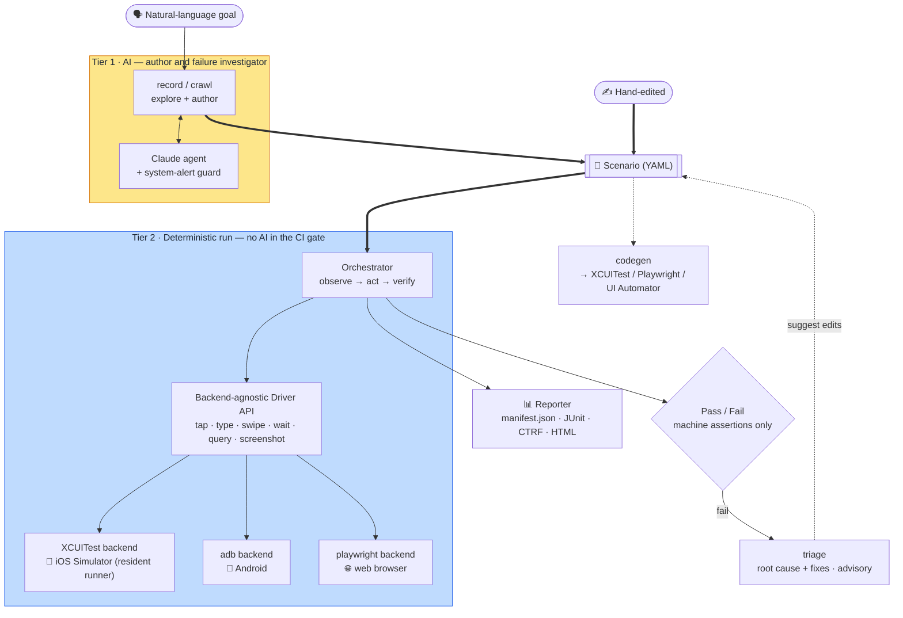
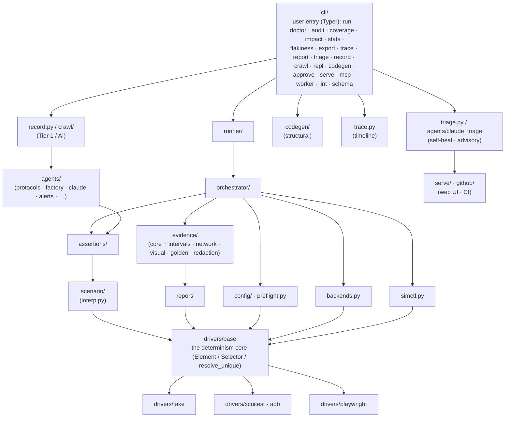

**English** · [日本語](ja/architecture.md)

# Architecture and module relationships

> Which module does what, where it depends, and **which features described in
> the design ([`DESIGN.md`](../DESIGN.md)) are not yet wired up** in the current code.

Related: [concepts](concepts.md) · [developer guide](developer-guide.md) (the class-level reading guide) · the per-feature pages (linked below)

---

## Overview (data flow)

A [scenario](glossary.md#scenario-authoring), authored by AI or by hand, is the shared artifact. `run` replays the scenario deterministically with no AI in the gate. `codegen` and `triage` also consume the scenario.

Two tiers divide the work:

- Tier 1 (AI, yellow in the diagram) authors scenarios and investigates failures.
- Tier 2 (deterministic, blue in the diagram) decides pass/fail from machine assertions alone.

The whole spine is platform-neutral. The one platform-specific seam is the **backend** that the orchestrator drives: XCUITest for iOS, adb for Android, playwright for web, and so on, all behind one `Driver` interface. A new platform is thus a new backend, not a fork of the core.

Mermaid source

<!-- mermaid-svg: assets/diagrams/architecture-data-flow.svg -->

The [dependency-layer view](#dependencies-layers) below shows the same system as module layers rather than as data flow.

---

## Module list and roles

The `bajutsu/` package (Python 3.13+, pydantic v2 / typer / anthropic / pyyaml / jinja2).

| Module | Role | Page |
|---|---|---|
| `common/drivers/base` | Driver Protocol + shared types (`Element`/`Selector`/`Point`) + **selector resolution** (the determinism core) | [selectors](selectors.md) / [drivers](drivers.md) |
| `common/drivers/actuation` | `Actuation`/`ActuationLog` — the concrete-gesture record every driver appends to a step's outcome (coordinate, channel, whether the platform accepted it), backing the `actionLog` evidence kind (BE-0345) | [evidence](evidence.md#actionlog--what-each-step-actually-did-to-the-screen) |
| `common/drivers/coordinate_tree.py` | `CoordinateTreeDriver` — the shared transient-empty retry / stable-key settle / `_resolve` / `wait_for` base class the coordinate backend (adb) inherits (BE-0254) | [drivers](drivers.md#adb-android) |
| `common/drivers/fake` | In-memory `FakeDriver` (for tests without a device) | [drivers](drivers.md#fakedriver) |
| `common/drivers/xcuitest` | XCUITest backend (iOS; the sole iOS backend since BE-0290 retired idb — semantic tap, native condition-wait, text selection, and multi-touch via a resident on-device runner; BE-0019) | [drivers](drivers.md#xcuitest-ios) |
| `common/drivers/adb` | adb backend (Android; `tap`/`long_press`/`double_tap` resolve and inject device-side via the resident server's `POST /act`, falling back to a `uiautomator dump` frame-center coordinate tap when that channel is unavailable, BE-0339) | [drivers](drivers.md#adb-android) |
| `common/drivers/playwright` | Playwright web backend (browser; first slice — deterministic run) | [drivers](drivers.md#playwright-web) |
| `common/drivers/xcuitest_live` | The live-route XCUITest driver: W3C WebDriver (Appium's XCUITest driver) against a reserved device-cloud iOS device, in place of the resident-runner channel, for the `appium` device provider (BE-0238) — session lifecycle, query/tap/screenshot/readiness, gestures, and text entry are wired; `selectAll`/`copy` fail loudly (no Appium XCUITest equivalent); verification against a real device-cloud grid is still open ([BE-0303](../roadmaps/BE-0303-xcuitest-live-real-grid-verification/BE-0303-xcuitest-live-real-grid-verification.md)) | — |
| `common/drivers/elements.py` | Platform-neutral predicates/geometry over a normalized element tree (`screen_size_from_elements`, `shows_app_ui`), shared by assertions, the crawl, the runner pipeline, and record | [drivers](drivers.md) |
| `common/drivers/dom.py` | DOM → `Element` normalization shared by the Playwright backend and the WebView bridge | [drivers](drivers.md#playwright-web) |
| `common/drivers/web_network.py` | Web network observation: the Playwright-side `Collector` (hooks `requestfinished` into the same `NetworkExchange` model the iOS path uses) + in-process mock stubbing via `page.route` | [drivers](drivers.md#playwright-web) |
| `common/drivers/webview` | WebView bridge client — the Python side of the BajutsuKit WebView channel (DOM query + tap dispatch over HTTP) | [drivers](drivers.md) |
| `common/drivers/zorder` | Z-order responder client — the Python side of the BajutsuKit `nativeZ` channel (BE-0355) | [drivers](drivers.md) |
| `common/scenario/` | Scenario schema (strict pydantic validation) + YAML load / dump (package: `models` / `load` / `load_expanded` / `expand` / `select` / `serialize` / `edit`) | [scenarios](scenarios.md) |
| `common/assertions/` | Machine assertion evaluation (total function — never raises) (package: `evaluate` / `network` / `visual` / `schema` / `_common`, BE-0250) | [selectors](selectors.md#assertion-evaluation) |
| `common/orchestrator/` | The deterministic Tier 2 run loop (act → wait → verify) (package: `loop` / `waits` / `substitution` / `evidence_rules` / `actions` / `control_channel`) | [run-loop](run-loop.md) |
| `common/cancellation.py` | Cooperative cancellation (BE-0370): the read-only `CancelSource` the orchestrator's wait loops and the runner poll, the `RunCancelled` unwind exception a poll loop raises to the nearest safe boundary, and the `SIGTERM`→event bridge `bajutsu run`'s entry point installs — imports nothing from Bajutsu, so the deterministic core, the CLI, and `serve` all reach it | [run-loop](run-loop.md) |
| `common/evidence/` | Evidence capture, split by role (BE-0257): `core` (instant / interval capture and Sinks), `intervals` (video / deviceLog as simctl child processes), `media` (a finished recording's duration, read from the file), `network` (collector + in-protocol deterministic mocks), `visual` (visual-regression image comparison), `golden` (element-tree comparison), `redaction` (labels / headers / fields + secret values) | [evidence](evidence.md) |
| `common/report/` | `manifest.json` + JUnit XML + CTRF JSON + interactive HTML, plus a finished run's `.zip` export and its offline reload for re-rendering (package: `format` / `manifest` / `ctrf` / `rows` / `panels` / `html` / `richtext` / `archive` / `load`), plus `from_grouping.py` — the row-grouping helper `rows.py` builds on | [reporting](reporting.md) |
| `common/scenario/interp.py` | `${ns.key}` interpolation primitive (`params.` / `row.` / `secrets.` / `vars.`) | [scenarios](scenarios.md) |
| `common/mailbox.py` | Pure, network-free matching/extraction logic for the `email` step (BE-0046): normalize a mailbox provider's messages, match on `to`/`subject`/`subjectMatches`, select only a message that arrived after the step started, and extract a value by regex into `${vars.*}` | [scenarios](scenarios.md) |
| `common/totp.py` | RFC 6238 time-based one-time password (TOTP) for the `totp` step (BE-0046): a pure, deterministic function of the shared secret and the time, so a code is derivable with no network and no device | [scenarios](scenarios.md) |
| `common/config/` | Team defaults × per-target resolution (`Effective`) (package: `schema` / `effective` / `resolve` / `accessors` / `preconditions` / `json_schema`). `schema` holds one model per target group (`services`, `hooks`, `evidence`, `paths`), the `_merge` step that folds `defaults` into each target before validation, the `_templates` step that expands a target's `extends` into the ordered layers `_merge` folds onto `defaults` ([BE-0471](../roadmaps/BE-0471-target-templates/BE-0471-target-templates.md)), and the `platform/` registry that supplies each platform's `subject` / `runsOn` / `driver` models, with `runsOn` holding one block per destination the platform allows ([BE-0469](../roadmaps/BE-0469-runson-destination-blocks/BE-0469-runson-destination-blocks.md)); `load_config(text, path=, root=)` / `load_config_file(path, root=)` take the config's own path and the suite root so a `use:` component under `hooks` resolves at load; `preconditions` merges a scenario's `preconditions` (`subject` and the `device` state) over each target it drives, and `json_schema` builds the config's JSON Schema from the models and the registry for `bajutsu config schema` ([BE-0452](../roadmaps/BE-0452-target-config-restructure/BE-0452-target-config-restructure.md)) | [configuration](configuration.md) |
| `common/config_source/` | Acquire a config (and its scenario tree) from a Git source at an immutable commit SHA into a content-addressed cache (BE-0063) — where a config comes from, distinct from `common/config/`'s schema and resolution | [configuration](configuration.md) |
| `common/backends.py` | Backend availability check · actuator selection (platform-aware registry: `ios` / `android` / `web` / `fake`) · driver construction | [drivers](drivers.md#backend-selection-and-the-actuator) |
| `common/devices/` | Device-identity helpers shared across backends (package): `os.py` (the parsed device OS — platform/major/minor — read from the `device_runtime` label, BE-0358), `id.py` (the device-id validator every backend's `--udid`/config path shares, guarding against argv option injection), `errors.py` (the platform-neutral `DeviceError` base `simctl`/`adb` subclass, BE-0260, plus the `DeviceTimeout` beneath it that every backend raises when a device operation exceeded its deadline rather than failing, BE-0374), `version.py` (`VersionSpec`, npm's range grammar for `runsOn` version ranges), `facts.py` (reads what `runsOn` conditions compare from each available device: the Simulator's device-type name, family, and runtime, a real iOS device's family over `devicectl`, and a pool that mixes the two (BE-0468), an Android device's API level and Android Virtual Device (AVD) name, a browser's version), `runs.py` (forms a scenario's runs from lists and ranges — one per listed `kind` too — resolves each run's `family` priority list, combines the runs across targets, and picks each run's eligible devices; BE-0452, BE-0468), and `browsers.py` (the browser kinds `runsOn.browser.kind` names, and the Playwright engine and channel each launches as; BE-0468) | [drivers](drivers.md) |
| `common/backend_cli/` | Backend command-line wrappers (package): `simctl.py` (`simctl` wrapper — erase/boot/launch/openurl/io), `adb.py` (the adb command-builder half of the Android backend — clean-state/launch/deeplink/input/screencap, the twin of `simctl`), `adb_resident/` (the resident UI Automator server channel's Python side — connection, wait budgets, and the read-timeout retry/restart recovery, BE-0245 / BE-0477) | [drivers](drivers.md#environment-management-simctl) |
| `common/platform_lifecycle/` | The `Environment` seam (BE-0009): one `RunEnvironment`/`CrawlEnvironment` Protocol per platform for per-run app bring-up, readiness, relaunch, device control, and teardown, so `common/runner/` and `crawl/cli.py` drive iOS/Android/web through one interface instead of branching on the actuator name (package: `protocols` / `factories` / `readiness` / `relaunchers` / `device_control` / `read_session`, plus `environments/` — `ios` / `xcuitest` / `xcuitest_live` / `android` / `web` / `fake`, and `device_runner/`, the per-user signed device build of the XCUITest runner, BE-0456) | — |
| `common/capability/preflight.py` · `common/capability/capability_preflight.py` · `common/capability/capabilities.py` · `common/capability/worker_capability.py` | Runnability gate, per backend (iOS: required CLIs + a booted Simulator; web: Playwright + its Chromium browser), plus a scenario step's declared-capability preflight and the capability set each backend actually supports; `worker_capability.py` loads and validates the worker capability file (`worker.yaml`, with the shipped default beside it), and `capability_preflight` judges each scenario against it and the host operating system before any device is acquired (BE-0450) | [configuration](configuration.md) · [drivers](drivers.md#worker-capability-check-be-0450) |
| `common/provisioning/requirements` | One declarative mapping: backend/capability → pip extra + external-tool probe + install method (BE-0164), shared by `preflight` and `provision` | — |
| `common/provisioning/provision` | Config-aware environment installer (BE-0164): resolve a config's backends + AI provider, install only their extras/tools idempotently (`make install`, `python -m bajutsu.common.provisioning.provision`) | — |
| `common/runner/` | config + scenarios → report; device pool + launch sequence; `device_provider` seam resolves where the run's devices come from — the built-in `local` pass-through, plus an `appium` provider driving a reserved iOS device end to end behind a live Appium/WebDriver endpoint (BE-0238), selected by an `appium` environment in `worker.yaml` rather than a target key (BE-0452); a further cloud-vendor kind (e.g. Firebase Device Streaming) stays a future addition; `recovery` holds the backend-crash retry-count/wall-clock-budget decision shared with the on-device driver conformance suite (BE-0334), plus the two predicates that classify a failure for it — `recovers_by_respawn` decides a retry, `is_host_fault` diagnoses a failure the host caused, and a wedged device answers the two differently (BE-0378) — the latter naming the platform-neutral `DeviceTimeout` so every backend that adopts it is covered (BE-0374); `recovery` also holds the run-level latch that stops later scenarios, carrying *why* recovery was abandoned (a spent budget or a wedged host), and the guarded-teardown policy that the pool's teardown sites, `launch_driver`, and the on-device suites' lease discard all share (BE-0342); `mailbox` resolves the `email` step's transport by a registry keyed on `kind` (the shipped `http` JSON adapter; BE-0186), mirroring `common/ai/registry.py`'s shape (package: `pipeline` / `pool` / `launch` / `device_provider` / `recovery` / `mailbox`) | [run-loop](run-loop.md#runner-the-run-pipeline) |
| `common/run_meta/` | Run-metadata helpers shared across features (package): `files.py` (the runs-root name + path-free reads of a run directory — listing, manifests), `id.py` (run id generation/parsing), `root.py` (the run directory's write provider, BE-0331 — see the import contract below), `artifact_perms.py` (owner-only `0700`/`0600` permissions for a run's artifacts, BE-0131), `object_store.py` (a backend-agnostic `ObjectStore` — local/S3/GCS — for evidence upload and server storage, BE-0110/BE-0204) | [configuration](configuration.md) |
| `run/notify` | Run-completion notifications (e.g. Slack), sent after `bajutsu run` finishes | — |
| `common/doctor/` | Convention score (id coverage, etc.) | [configuration](configuration.md#doctor-the-convention-score) |
| `common/agents/` | AI / authoring-agent periphery (BE-0257), moved under `common/` (reorg successor to BE-0257): `protocols` + `factory` (the `Observation`/`Proposal`/`Agent` abstraction + construction of the one SDK-backed agent), `claude` (the authoring agent), `claude_backed` (shared base, BE-0246), `claude_enrich`, `claude_triage`, `ai_config` (provider/model/effort/language resolution), `anthropic_client` (SDK client construction), `availability` (credential-gap messaging), `enrich` (the enrichment loop), `alerts` (system-alert guard) | [recording](recording.md) |
| `common/ai/` | Vendor-neutral AI backend seam (BE-0104), moved under `common/` (reorg successor to BE-0257): `AiBackend` protocol + normalized request/response types (`base`), provider registry (`registry`) covering the Anthropic API and Amazon Bedrock via the reference adapter over `common.agents.anthropic_client` (`anthropic`), the Anthropic CLI `ant` (also via the `anthropic` adapter, BE-0163), the Claude Code CLI (`claude_code`, BE-0176), and the `none` switch whose factory raises so no AI path can construct a backend (`disabled`, BE-0394) | [configuration](configuration.md#ai-provider-ai-be-0047) |
| `run/` | `bajutsu run`'s CLI command (`cli.py`): target/backend resolution, device leasing, plan construction, and the deterministic run/report dispatch. The public command is a thin wrapper that runs that body in a child process, `python -m bajutsu.run.internal` (`internal.py`), through the one-shot worker path that `bajutsu worker --once` also uses; the serve spec builders emit the same module (BE-0449). `device_matrix.py` plans an invocation's runs from the `runsOn` conditions of the targets each scenario runs against and groups the runs that take the same devices into cells, each run as one pass (BE-0452) | [cli](cli.md) |
| `record/` | The record loop (observe → propose → execute → emit) (package: `loop.py`, plus `capture.py` — proxy-actuation capture of tap/type/swipe into a scenario step — and `cli.py`, its CLI command) | [recording](recording.md#the-record-loop) |
| `crawl/` | Autonomous breadth-first crawl → screen map: `core` engine + `serialize`, with `guide` / `tabs` / `report` / `repro` / `flows`, plus its CLI command (`cli.py`) | [recording](recording.md) |
| `repl/` | The AI-free manual shell (BE-0423): `render.py` prints an element tree, `session.py` is the command set (`tree` / `find` / `tap` / `type` / `scroll` / `back` / `screenshot` / `step`, plus the `--sel` full-selector escape hatch), `tui.py` the ncurses-style shell an interactive terminal gets by default, `loop.py` the plain `bajutsu>` prompt-loop fallback otherwise (BE-0429), `cli.py` its CLI command, including `--attach` (BE-0455), which drives the app already running on a booted Simulator without relaunching it | [cli](cli.md#repl) |
| `codegen/` | Scenario → native test generation: XCUITest (Swift), Playwright (TypeScript), UI Automator (Kotlin), plus its CLI command (`cli.py`) | [codegen](codegen.md) |
| `triage/` | M4 self-heal: rule-based `HeuristicTriageAgent` + structured fixes (`renameId`/`addIndex`/`raiseTimeout`), `--apply`/`--write`/`--rerun` (package: `heuristic.py`, plus `cli.py` — its CLI command) | [cli](cli.md) |
| `common/github/` | GitHub helpers: `actions` (CI, continuous integration, annotations + job summary), `app` (App installation token for the private-repo config source), `errors` (the shared access error) | [ci](ci.md) |
| `common/analytics/` | Token/cost accounting, split by role (BE-0257): `usage` (process-global, in-memory, best-effort) / `ledger` (attributed, persistent AI usage/cost ledger, BE-0196) / `stats` (aggregates the ledger for the serve usage dashboard, BE-0195) | [web-ui](web-ui.md#usage--the-ai-token-usage-and-cost-dashboard) |
| `common/cloud/` | Cloud device backends reached as batch submitters, off the deterministic `run`/CI verdict path (`devicefarm.py`, the first concrete provider) | [devicefarm](devicefarm.md) |
| `serve/` | Local web UI (the `serve` command): author / run / reports / triage a failed run, each queued as a job for a `bajutsu worker`, since the server runs no job itself (BE-0449); its `serve`/`worker`/`approve` CLI commands live in `cli/` (one file each, feature-colocated); `capabilities.py` routes a queued job to a worker that advertises every token the job requires — its platform, and `host:<os>` when its driver runs on one host operating system alone, which the worker advertises for its own machine, and the device-family tokens of the target's `runsOn.ios.family`, one any-of group per family priority list, which the worker advertises from its Simulator inventory and, as `device:<family>`, from the real devices connected to it (BE-0166, BE-0450, BE-0468), and the `cap:` / `setting:` tokens of each environment route its steps and settings need (`common/capability/route_tokens.py`, BE-0467) | [cli](cli.md) · [self-hosting](self-hosting.md#capability-routed-queues-be-0166) |
| `mcp/` | MCP server: exposes `run`/`doctor` as tools + run evidence as resources, plus its CLI command (`cli.py`) | [cli](cli.md) |
| `common/lint.py` | Scenario linter + JSON Schema generation (`lint` / `schema` commands) | [cli](cli.md) |
| `common/target_lint.py` | `lint --config --target`: the run's step, settings, and precondition checks per target, without a device (BE-0467) | [cli](cli.md) |
| `analysis/` | Read-only advisory analysis (BE-0257), no device/AI, never gates CI: `audit` (determinism/flakiness audit, BE-0049), `coverage` (scenario id-namespace coverage, BE-0050), `impact` (test impact analysis — affected steps from a diff, BE-0321), `stats` (the aggregate run-stats dashboard, BE-0102), cross-run flakiness ranking (`flakiness`, BE-0220), and the `trace` timeline (`trace.py`, the `bajutsu trace` command's core) — each with its own Typer command in `cli/` (one file per command, feature-colocated) | [cli](cli.md) |
| `cli/` | Typer app assembly: mounts each feature's own CLI (`run`/`crawl`/`record`/`repl`/`triage`/`mcp`/`codegen`/`serve`/`analysis`) plus the feature-less `commands/` (`doctor`/`lint`/`schema`/`config`/`report`/`runner`) and the `.env` loader (`dotenv.py`) | [cli](cli.md) |
| `common/screenshots.py` | Screenshot capture + pixel-coordinate helpers shared across the AI paths (`screenshot_bytes`, `png_size`, `fraction`, BE-0246) | [recording](recording.md) |
| `common/handoff/` | The human-in-the-loop handoff contract (Tier 1, BE-0179): the transport-neutral request/response `record` (terminal stdin) and `serve` (SSE) implement the same way | [recording](recording.md) |
| `common/deprecations.py` | One-time deprecation notices (`warn_once`) and hard rejections for removed authoring/CLI spellings (`reject_renamed_key`) | — |
| `common/diagnostics.py` | Process-wide logging configuration: what a run says about itself while it happens, and how loud | — |
| `common/stall_diagnostics.py` | Bounded, best-effort state capture at the moment a backend stalls (BE-0361/BE-0367) | — |
| `common/_yaml.py` | YAML loader that keeps `on`/`off`/`yes`/`no` as strings | [scenarios](scenarios.md#yaml-caveat) |

## Dependencies (layers)

Lower layers are more stable, and upper layers depend on lower ones. The core is `common/drivers/base` (selector resolution), and every execution path depends on the core.

![Dependency-layer diagram: cli/ is the user entry point, from which runner/, record.py/crawl/, codegen/, trace.py, and triage.py descend directly (codegen/ and trace.py have no further dependencies drawn). runner/ depends on orchestrator/; record.py/crawl/ depends on the AI agent helpers; triage.py depends on the serve/CI helpers. orchestrator/ and the agent helpers depend on assertions/ and evidence/, and orchestrator/ additionally depends on config.py, backends.py, and simctl.py. assertions/ depends on scenario/ and evidence/ depends on report/; scenario/, report/, config.py, backends.py, and simctl.py all converge on drivers/base.py, the determinism core, from which drivers/fake, the iOS and Android drivers (xcuitest, adb), and the Playwright driver all derive.](assets/diagrams/architecture-dependency-layers.svg)

Mermaid source

<!-- mermaid-svg: assets/diagrams/architecture-dependency-layers.svg -->

- `common/orchestrator/` depends on `base.Driver` alone and **is not coupled to any concrete driver**. Tests can run the loop with `FakeDriver` and no device, while in production the same loop drives XCUITest (iOS) or playwright (web).
- `common/runner/` provides the factory that launches the app and returns a ready driver. The factory decouples the loop from a real device.
- `scenario/` (the pydantic authoring model) and `common/drivers/base` (the runtime TypedDict) are different things. `Selector.as_selector()` converts the former to the latter.

### Enforced layer boundaries (BE-0112)

The layering above is more than a convention: it is an **executable contract in the gate**. `make lint-imports` (part of `make check`, and a CI step) runs [import-linter](https://import-linter.readthedocs.io/) against the declared layers. A forbidden import fails the gate instead of surviving until someone notices. The configuration lives in `[tool.importlinter]` in `pyproject.toml`, and it declares three layers:

1. **Deterministic core**: the path that derives a verdict and evidence with no model and no
   periphery stack. It comprises `common/orchestrator/`, `common/runner/`, `common/drivers/base`, `assertions/`, `evidence/`,
   `report/`, `config/`, `scenario/`, `preflight.py` / `capability_preflight.py` /
   `capabilities.py` / `worker_capability.py`, `common/doctor/`, and `common/lint.py` / `common/target_lint.py`. The core carries the prime directives.
2. **Contract**: the stable surfaces a consumer depends on. These are the scenario schema (`scenario/`) and
   the `Driver` Protocol (`common/drivers/base`).
3. **Periphery**: the consumers of the contract, each removable behind an optional extra.
   - `serve/`, `mcp/`, and the codegen emitters.
   - The AI / agent paths: `agents/` (`protocols`, `ai_config`, `anthropic_client`, `enrich`, `alerts`, and more) plus `record/`, `triage/`, and `crawl/guide`.
   - The `github/actions.py` and `run/notify` helpers. The rest of `github/` (`app` and `errors`) is core-safe, so `config_source` reaches it without pulling the periphery in.

Three contracts are enforced:

- **The deterministic core must not import the periphery.** This contract enforces prime directives #1 and #3 statically. The verdict/evidence path stays free of the serve, AI, and codegen stacks and cannot silently grow a dependency on them.
  - A pure element-tree helper that a core module needs, such as `screen_size_from_elements` or `shows_app_ui`, lives in the core (`bajutsu/common/drivers/elements.py`) and not in a periphery module such as `record/`.
  - Likewise the resolved `ai` block (`AiConfig`) lives in `config/`, so the core reads it without importing the AI client.
- **The core must stay host-agnostic (BE-0129).** Multi-tenant hosting concerns belong to `bajutsu/serve/` alone. These concerns are organizations, roles, and tenancy, plus the `db` (SQLAlchemy/Alembic/psycopg/cryptography) and `oauth` (Authlib, joserfc) extras.
  - The org model (`OrgConfig`, `org_for_*`, `targets_for_org`, `load_serve_config`) lives in `bajutsu/serve/orgs.py`, not `config/`.
  - `Config` carries no `orgs` field. The core loader drops a top-level `orgs:` before validation.
  - A run in the hosted topology (which reads an org-bearing config) therefore keeps working.
  - The core never models orgs.
  - The same mechanism drops a top-level `ui:` key (BE-0191). The serve UI's presentation settings (`ui.default_theme`) are a serve concern, parsed in `bajutsu/serve/themes/` and not modeled in `Config`.
  - A forbidden import-linter contract keeps `config/`, `common/drivers/`, `common/runner/`, and `scenario/` off those extras. `include_external_packages` lets the contract see the external import. It sits on top of the periphery contract that already keeps those packages off `bajutsu.serve`.
- **The scenario schema and `Driver` Protocol stay a portable inner contract.**
  - They are independent of the runtime core (`common/orchestrator/`, `common/runner/`, `config/`, and more) as well as the periphery.
  - The independence keeps the contract a stable layer. A consumer can depend on it without pulling in the runtime.
  - It underpins cross-version schema reads (BE-0119) and any future split of the periphery from the core.

The check is static analysis on the import graph. It uses no model, and it puts nothing on the `run` / CI verdict path beyond a deterministic pass/fail. A new module's layer decides where the module belongs:

- A module on the verdict/evidence path is core and must not reach the periphery.
- A module that consumes the contract is periphery and belongs behind an extra.

## Test layout

`tests/` holds the **unit-test suite** (`uv run pytest -q`). No test requires a real Simulator. Tests verify command builders as pure functions. They exercise execution paths with `FakeDriver` and injected runners (`RunFn` · `Spawn` · `Clock`).

Real-device E2E against the showcase app runs with `make -C demos/showcase run-swiftui` or `make -C demos/showcase ui-test` ([showcase](showcase.md)).

### Driver conformance suite (BE-0114)

Prime directive #3 puts every backend behind one `Driver` interface, so the determinism-core invariants must hold identically on all of them. Per-backend tests alone cannot guarantee that. A backend could tap the first match on an ambiguous selector, or return success on a zero-match, and it would pass its own tests while failing no shared one.

The **driver conformance suite** closes that gap. It is one executable contract (a technology compatibility kit, TCK) that runs the *same* test body against every backend. The suite drives the real driver instance, including code that bypasses `common/drivers/base`, and not the shared base alone.

The contract (`tests/driver_conformance.py`) is the "done" definition that a new backend meets:

- An ambiguous selector (two or more matches) fails rather than acting on the first match.
- A zero-match selector fails rather than reporting success.
- Selector failures share one error type (`SelectorError`), uniform across backends.
- A unique match acts without error, and `query()` reports the on-screen elements.
- `capabilities()` matches observed behavior (else each affected call raises `UnsupportedAction`; BE-0280, BE-0464, BE-0466):
  - The `QUERY` / `ELEMENTS` baseline is declared.
  - Multi-touch gestures work exactly when `MULTI_TOUCH` is declared.
  - Select-all and clipboard copy work exactly when `TEXT_SELECTION` is declared. A harness that can read the device clipboard also checks that the copied text lands there, so a copy that silently does nothing fails (#2390).
  - Setting a native `<select>` by value works exactly when `SELECT_OPTION` is declared.
  - Loading a URL works exactly when `URL_NAVIGATION` is declared.
  - `read_attributes` resolves each selector like a tap exactly when `ELEMENT_ATTRIBUTE` is declared.
- Text editing round-trips on the focused field: typing, then deleting, reduces the reported length. `tap_point` is a raw coordinate tap and the alert-dismissal path. Aimed at the field's center, it focuses the field, the same observable effect as a semantic tap (BE-0280).
- `wait_for` is a single-shot check of the current screen. The shared `wait_until` loop turns it into a condition wait with no fixed sleep.
- One `scroll` step leaves consecutive viewports overlapping (BE-0329). The reads before and after the step share at least one element that the region's bounds do not clip.
  - This states the non-inertial contract that each backend already documents, in the one form a tree can show.
  - It belongs to the `Driver` contract because the `scroll` loop's correctness rests on it.
  - A gesture that flings shares nothing, so it fails the suite here. Otherwise it would carry a target past the viewport unqueried during a run.
- One `scroll` step travels the distance its endpoints asked for, within a stated tolerance. The suite checks three step sizes: the default, the smallest that the loop's own recovery takes, and a step below that floor, which an author's `amount` can request.
  - Overlap alone does not imply that distance. A step can leave the viewports overlapping and still travel far further than it asked for.
  - The iOS gesture did exactly that until BE-0400. It traversed every drag at one fixed speed, so the content flung on past the endpoints by up to six times the requested distance. No step travelled less than about a third of a screen, however little it asked for.
  - That floor is why the property belongs to the `Driver` contract and not to one backend's tests. Below the floor, the `scroll` action's author-chosen `amount` and BE-0329's halving recovery both name step sizes that no gesture could deliver.

To add a backend to the suite, implement a `ConformanceHarness` (given a screen, return a driver showing it) and subclass `DriverConformanceContract`. Pytest then runs the inherited contract against the backend. Each backend runs the same contract with no second spec:

- `FakeDriver` runs on the fast Linux gate (`make check`).
- Playwright runs in the web CI job.
- XCUITest runs under the iOS on-device E2E path (`ios-e2e.yml`).
- The **adb backend** runs on a booted Android emulator (`android-e2e.yml`'s `conformance (adb)` job, BE-0270).

Each harness realizes a screen its own way:

- `FakeDriver` takes the elements directly.
- Playwright renders the elements as HTML.
- The on-device harnesses launch the showcase app into conformance mode once (`SHOWCASE_CONFORMANCE`) and then reseed each screen. The real backend query and act code is thus exercised, not the shared base alone.
  - The iOS harness reseeds by writing a spec file that the app polls (`conformance-spec.txt` in its Documents directory). It writes a file instead of relaunching or using a deeplink per screen.
  - `simctl openurl` raises iOS's "Open in app?" dialog. Relaunching per screen crashes the resident XCUITest runner after a handful of `app.launch()` cycles.
  - The adb harness instead re-launches the app's `singleTask` activity with a new `SHOWCASE_CONFORMANCE` intent extra, delivered through `onNewIntent`. `adb push` cannot reach the app sandbox, and the intent reuses the convention that delivers `subject.launch.env` as intent extras (BE-0007).
  - The adb harness is scoped to the Compose toolkit, the one that can render a spec-driven arbitrary-id screen. `testTag` takes any runtime string, while a Views `resource-id` must be a compile-time `R` entry.

The suite carries an `ondevice` pytest marker, which the gate's default deselects, so the suite never runs in `make check`. It runs serially on a single device, because the shared device is reseeded through one channel and parallel workers would collide.

### Fault-injection lanes (BE-0305)

Two mechanisms in the drivers exist for a real device fault alone, and the suites above never meet one. The conformance suite waits for every screen to be ready before it reads, and no job breaks the runner on purpose.

- `CoordinateTreeDriver`'s transient-empty retry (BE-0254) rides over the degenerate accessibility tree that a device serves mid-transition.
- The XCUITest channel's transient retry (BE-0207) and crash recovery (BE-0287) ride out a runner that stops answering.

The fast-suite tests of these mechanisms feed a fabricated element count and raise a synthetic exception. They cover the control flow for real, but they give no evidence that the real condition reaches it. A real device does not raise a Python exception, and a detection heuristic keyed on an element count can be broken while a fabricated count still trips it.

The **fault-injection lanes** inject the real condition instead:

- `fault-injection (adb)` (`android-e2e.yml`) puts the emulator's display to sleep. The real read source (the resident UI Automator channel, and the `uiautomator dump` fallback behind it) then serves a genuinely empty tree. The lane checks that the retry rides over it rather than raising a false "element not found". A second case holds the display down so the retry budget runs out, and pins that outcome as a loud `ElementNotFound` and not a silent one.
- `fault-injection (xcuitest)` (`ios-e2e.yml`) signals the runner's own host process.
  - `SIGSTOP` leaves the socket accepting while nothing answers, which is what a wedged runner looks like from the host. A short freeze is absorbed by the transient retry, and a freeze past the retry budget is ridden out by crash recovery.
  - `SIGKILL` must end the run on a crash diagnosis that names a mid-run runner fault, never an unrelated timeout.

Neither lane guesses how long to hold a fault. Each lane lifts the fault on the driver's *own* log record that it reached the layer under test (`tests/fault_injection.py`). Observed behavior, not the length of a sleep, decides which mechanism a case exercises.

Both lanes now feed their lane's required aggregate check. They landed outside it, on the signal-then-required path that BE-0282 established. That caution was earned: these lanes break the device on purpose and so carry more inherent flakiness risk than lanes that drive a healthy one. Over its first ten days `fault-injection (xcuitest)` failed 78 times against 52 passes.

What retired the caution was not the failure rate falling but the cause being found.

- Every one of those 78 failures precedes the commit that fixed the runner's HTTP server against replying to a peer that had gone away. That reply killed the XCTest host with SIGPIPE.
- The lane holds the runner under `SIGSTOP`, which is how a connection comes to be abandoned in the first place. The lane therefore tripped that defect far more often than any suite driving a healthy runner. It found a real runner-channel bug, which is what the lane exists to do.
- Since that fix the lane has run 64 times without a failure, against 58 passes and 2 failures for `conformance (xcuitest)` over the same span.
- `fault-injection (adb)` ran 73 times for one failure, and that failure was the emulator never coming up, not anything the lane asserts. `conformance (adb)` had four failures in 67 runs.
- Both lanes now sit at or better than a suite that has been on the gate throughout.

A regression in `_is_transient_empty`'s threshold or in the crash classifier's matching is the precise failure these lanes exist to catch. A signal is something a merge can ignore, so the promotion is what makes the coverage mean anything. `tests/test_e2e_gate_needs.py` pins the promotion on the fast suite in three layers:

- Which jobs each gate depends on.
- That every one of those jobs has its result read.
- That each of those results actually reddens the check, shown by running the verdict script itself.

Without these tests, a gate can be narrowed, or left permanently green, without a single test noticing.

### The concurrent-device lane (BE-0298)

Every job described above boots exactly one device. None of them can observe what `common/runner/pool.py`'s `device_pool` claims for a parallel run. The claim is that under `--workers N` each worker leases its own device and writes evidence only under its own `run_dir/<sid>` subdirectory of the one shared run directory. No worker shares a mock port or index with any other worker's scenario (the no-shared-state invariant that [`DESIGN.md`](../DESIGN.md) §3.3 states).

The fast suite proves that claim of the pool's own bookkeeping alone. `tests/runner/test_pool.py` monkeypatches `make_driver` to hand `FakeDriver` instances fabricated udids like `"UDID-A"`. That shows worker A's resources really are separate from worker B's *in the data structures the pool manages*. It says nothing about contention at the OS and subprocess level outside those structures:

- Two real `simctl` or `adb` invocations racing on a boot lock.
- A host port allocated per device.
- An artifact path computed before a worker's subdirectory exists.

The **concurrent-device lane** boots two real devices instead. `pool (adb)` (`android-e2e.yml`) boots two emulators and runs four state-neutral showcase scenario files through one `bajutsu run --workers 2`. The pool has to share the work out and keep both workers busy at once.

`scripts/assert_pool_isolation.py` turns the outcome into a verdict. The script reads the finished run's `manifest.json` and the run directory's own subdirectory listing. It fails on any of these:

- An artifact recorded under another worker's slug.
- Two results sharing one slug.
- A subdirectory that no result claims.
- A recorded evidence directory that the run never wrote.
- One device having quietly taken every scenario.
- No two scenarios on different devices having overlapped in wall-clock time.

The check is a file read and a set comparison. It runs after `bajutsu run` has returned its own verdict, so it observes the run's artifacts and never feeds any scenario's pass/fail.

The job takes a change filter of its own, `touches_pool` in `scripts/e2e_changes.py`. The filter is narrower than the lane-wide signal that every other job reads, because the job boots twice what the Android lane's other jobs boot. The job stays a per-PR signal outside that lane's required aggregate check, on the signal-then-required path of BE-0282 that the fault-injection lanes above also take. Its reason is its own: two emulators against one runner is the most resource-sensitive work the lane carries.

An iOS twin, `pool (xcuitest)`, booted two Simulators on the macOS lane until BE-0298 withdrew it. That job returned one isolation verdict in five runs. The other four collapsed on the host rather than on any pool check:

- `SimRenderServer` crashed on its own dispatch queue.
- `simctl uninstall` timed out against a wedged CoreSimulator.
- The runner channel became unreachable mid-run.

Each red run spent about half an hour of a runner billed at 10x. BE-0361 measured that runner as 3 cores and 7 GiB. A *single* booted Simulator brought up 257 guest processes and left 189 MB of physical memory unused, so a second Simulator doubles the guest population against an already saturated ceiling. Dropping the video recording, the touch markers, and half the scenarios moved the collapse earlier without removing it. The isolation claim therefore rests on real concurrent devices on Android. On iOS it rests on the fast suite's bookkeeping proof alone.

---

## Implementation status

> The design ([`DESIGN.md`](../DESIGN.md)) also includes the future vision. Here we separate
> **what the current code actually runs** from **what is not yet wired up**.

### Implemented (tested; the path works end-to-end in code)

#### Drivers and backend selection

- Selector resolution and ambiguity detection (the determinism core).
- Platform-aware backend registry (`common/backends.py`): a target's required `platform` decides its actuator.
  - `ios` resolves to `xcuitest`, the sole iOS actuator since BE-0290 retired idb. `android`, `web`, and `fake` each resolve to their own actuator.
  - `--backend` is a check, not a fallback list. It accepts the target's platform, that platform's actuator, or `fake`, and exits 2 on anything else (BE-0452).
  - A platform with more than one actuator would resolve **per scenario** in cost order (BE-0240). Since iOS now has one actuator, no platform's cost order differs from its stability order.
- The **XCUITest backend** (`common/drivers/xcuitest`) is the sole iOS actuator (BE-0290). It drives a resident on-device runner (`BajutsuKit`) over a loopback HTTP channel.
  - The runner provides semantic (identifier) tap, a native condition-wait, text selection, and the `pinch`/`rotate` multi-touch gestures.
  - The runner reads the XCTest automation snapshot, which descends into group containers and so renders a fully-expanded element tree.
  - The generic runner (`XCUIApplication(bundleIdentifier:)`) drives an arbitrary app by bundle id with no app-side integration. It needs Xcode's `xcodebuild` (BE-0019).
  - A Simulator target needs no runner config at all. When neither `driver.runner.testRunner` nor `driver.runner.build` is named, the environment resolves to the Simulator runner bundled in the wheel as package data. The environment materializes the bundle into a content-hash-keyed writable cache on first use. An explicit `testRunner` or `build` still overrides the bundle (BE-0292).
  - A real device (`runsOn.ios.kind: device`) with no `testRunner` resolves to the per-user signed build that `bajutsu runner build --device` cached (`environments/device_runner/`, BE-0456). When no such build exists, the run fails with the build command. A run never builds a signed runner itself.
  - A real device does not share the host's loopback. usbmuxd therefore bridges the runner, `nativeZ`, and WebView ports (`environments/xcuitest/_usbmux.py`, reached through the environment's `reach_device_port`). A host `127.0.0.1` listener tunnels each connection to the port on the device, the iOS counterpart of the Android resident channel's `adb forward`.
  - The network collector runs the other way. On a real device it binds every interface, and the app is offered the host's addresses (`collector_host`, `environments/xcuitest/_host_address.py`). The app keeps the first address that answers a signed `GET /ping` with the collector's own signature.
  - Beyond the loopback the token never travels. The app signs every request with a Keyed-Hash Message Authentication Code (HMAC) over its method, path, nonce, and body. The collector refuses a reused nonce (409) and any bearer header (401), and it signs each answer against the request's nonce (`common/evidence/network/_hmac_auth.py`, BE-0459).
  - The pool announces the signed method with `BAJUTSU_COLLECTOR_AUTH=hmac`. A loopback collector still accepts a bearer header, for Android and for an app built against an older BajutsuKit.
  - In a checkout that ships `BajutsuKit/`'s own source, the bundle rebuilds itself whenever the source has moved past it. `bajutsu run`, pytest, and `make serve` all resolve the runner through the same rebuild-if-stale function (`docs/specs/xcuitest-bundled-runner-auto-refresh.md`).
- Reading the element tree of `SFSafariViewController` from the process that draws it, `com.apple.SafariViewService` (BE-0396). On iOS 26 the app's own XCTest snapshot stops at that process boundary.
  - The XCUITest backend merges in a second snapshot taken from the service's own handle whenever the service is foregrounded. It prunes the app-side mirror of the same subtree to avoid reporting the subtree twice.
  - `tap`, `doubleTap`, and `press(forDuration:)` actuate a browser element at its live frame center. They skip `XCUIElement`'s own call, which the browser's chrome silently drops.
  - On the iOS versions that leave the dismiss control unidentified, its identifier is normalized to `Close`.
  - A scenario thus drives the in-app browser through `/elements` like any other screen, with no protocol change.
- The **Playwright web backend** (`common/drivers/playwright`) runs a deterministic `run` against a browser on the Linux gate (`demos/web`). It is raised to the rich end of the capability model (BE-0054):
  - Native `network` observation and stubbing (`page.route()`).
  - `video` and `deviceLog`-equivalent console and page-error interval evidence, through the shared `driver_interval` seam.
  - Emulated `multiTouch` (pinch and rotate).
  - Parallel runs across N `BrowserContext` lanes.
  - A target-level `runsOn.browser.emulate`: the desktop default, or a Playwright device preset for mobile emulation (BE-0228).
  - The web has no `appTrace`: it has no app log to stream. iOS streams `os_log`, and Android streams a tag-filtered `logcat` (BE-0478).
  - The Playwright `query()` fills `value` from each element's own source:
    - `href` for `<a>`, `src` for ``, and `datetime` for `<time>`.
    - A form control, a `<meter>`, and a `<progress>` that carries a `value` attribute report their live `value`, even under a `role`.
    - Any other element with a `role` reports `aria-valuetext` or `aria-valuenow` when either is present. Otherwise it reports its own `value` property.
    - An indeterminate `<progress>` (one carrying no `value` attribute) reports `aria-valuetext` or `aria-valuenow` alone.
    - An element that holds its own text but matches no other rule is read too. It is labeled with the `staticText` trait that iOS uses for a label.
  - The same Playwright walk descends into every iframe, nested and cross-origin included, offset into main-page CSS pixels.
    - The exception is an iframe under a non-translation CSS transform. The walk leaves that iframe unread, so a tap cannot silently miss.
    - A cross-origin iframe's elements carry `crossOriginFrame: true` and stay selectable. `doctor`'s score and the crawl's screen model leave them out, because the app cannot instrument or explore an embedded third-party page.
- The **Android adb backend** (`common/drivers/adb` + `common/backend_cli/adb`) covers these areas:
  - **Tap actuation.** `tap`, `long_press`, and `double_tap` send the resolved element's identity to the resident server's `POST /act`. The server re-resolves the element and injects the gesture device-side, so the gesture lands on the bounds the device holds at inject time. Once retries exhaust, or when the channel has no `/act` endpoint, the driver falls back to a host-computed frame-center coordinate tap (BE-0339).
  - **Resident read recovery.** A resident read that times out retries once on a fresh connection. It then restarts the server before the lease falls back to `uiautomator dump`. `driver.residentRecovery` (`readRetries` / `restart`) bounds the recovery, and `manifest.json` records it per step and per scenario (BE-0477).
  - **Text entry.** `type` sends plain ASCII through `adb shell input text`. Everything else, such as Japanese and emoji, goes through the resident server's own `/type` endpoint (BE-0476).
  - **Launch, reporting, and evidence.** The `AndroidEnvironment` launch sequence, `doctor` reporting, and interval evidence through the driver-supplied `driver_interval` seam. That evidence is `video` via `screenrecord`, `deviceLog` via `logcat`, and `appTrace` via a tag-filtered `logcat` (BE-0478).
  - **Network capture.** `request` assertions run over an OkHttp interceptor (`BajutsuAndroid`) that reports to the host collector, bridged to the emulator with `adb reverse` (BE-0283). `mocks` stay a follow-up.
  - **Tests.** Fast-gate unit tests run over captured XML fixtures.
  - **On-device actuation fidelity.** System `back`, deeplink, a single-round-trip `doubleTap`, scroll-into-view resolution, and up-front runtime-permission grants (BE-0210).
  - **App locale.** Before every launch, `runsOn.android.locale` sets the app's own language with `cmd locale` (BE-0478). The run reads it back, and it needs API level 33. Unset, it clears what an earlier run left on a reused emulator.
  - **Seeded photos.** `runsOn.android.seedPhotos` empties a directory Bajutsu owns in shared storage, pushes the listed images with ascending modification times, and rescans it with the media scanner. A photo picker then shows a known set without a device-wide wipe.
  - **Device control.** `setLocation` and clipboard read/write/clear, gated by per-operation capability tokens (BE-0211 / BE-0212). The clipboard goes through an in-app receiver (`BajutsuAndroid`, BE-0233), because a shell process cannot reach the clipboard on Android 10+. `foreground` (BE-0447) starts the launcher activity without clearing the app's state. `background` presses Home and waits until the app leaves the resumed activity (BE-0478). The status-bar pair drives the System UI demo mode. `push` stays unsupported because it needs a receiver inside the app's process. `clearKeychain` does not apply, because Android has no keychain.
  - **Permissions.** The per-scenario `permissions` field (`pm grant`/`pm revoke`, BE-0276) backs the whole permission vocabulary, including `notifications` (`POST_NOTIFICATIONS`, API 33+). iOS's `simctl privacy` differs: it has no Transparency, Consent, and Control (TCC) service for notifications.
  - **Multi-touch.** `pinch` and `rotate` two-finger multi-touch is gated on a rooted device (protocol-B `sendevent`, no single-touch fallback; BE-0232).
  - **Codegen.** A UI Automator (Kotlin) codegen target (BE-0209).
  - **CI lane.** An Android e2e CI lane (emulator under KVM, `android-e2e.yml`; BE-0208). The lane now runs the shared scenario set outside the still-excluded mocked-network flows. The adb driver reaches every tab by driving the native tab bar with the same cross-backend selector iOS uses: a clickable `NavigationBarItem` derives the `button` trait and its child text as `label` (BE-0223). That was the one portability gap that used to hold tab-scoped scenarios out of the lane.
  - **Id matching.** Id matching stays verbatim in the driver. A native id syntax can fail to reproduce the SPEC id: Android Views `android:id` maps `stable.refresh` to `stable_refresh`. In that case the scenario's selector lists **both id forms**, and the shared resolver matches either as an OR. This is an explicit scenario-side convention, not a driver-side `.`↔`_` rewrite (BE-0221).
  - **Identifier tagging.** The plumbing behind both id forms (Compose's `testTagsAsResourceId` and the Views `android:id` lookup) ships as its own library, [`IdentifierTool`](../IdentifierTool/README.md) (BE-0405). The library has no dependency on `BajutsuAndroid`.
- **Flutter apps, driven by the existing XCUITest / adb backends unchanged** (BE-0008). Flutter adds no new backend.
  - `Semantics(identifier: …)` (Flutter 3.19+) surfaces into the same OS accessibility tree that XCUITest and adb already read. The platform-neutral `id` selector therefore resolves and actuates exactly as on a native app. A Flutter showcase twin confirmed this on-device.
  - [drivers.md#flutter-via-the-native-backends](drivers.md#flutter-via-the-native-backends) has the id convention, the lazy-semantics precondition, and the confirmed gaps. The gaps are that Flutter apps have no `network`/`mocks` observation, and that Android clipboard needs the in-app receiver, which the plugin-free Flutter app doesn't link.

#### Scenarios, assertions, and the run loop

- Scenario schema (strict validation) and YAML round-trip. `id` / `idMatches` accept a list of OR candidates for cross-platform id forms (BE-0221).
- Evaluation of the assertion kinds: `exists`, `value`, `label`, `count`, `enabled`, `disabled`, `selected`, `request`, `requestSequence`, `event`, `responseSchema`, `visual`, `clipboard`, `golden`, and `attribute`.
- The Tier 2 run loop (act → wait → verify), verified with `FakeDriver`.
- **Multi-target scenario execution** (BE-0428). A scenario's top-level `targets: list[str]` plus a per-step `target: str` interleave steps across more than one declared target, such as an iOS target and a web target. The steps run as one `bajutsu run` invocation with one pass/fail verdict.
  - All declared targets share `${vars.*}`. A value that one target's `extract` step captures is readable by an assertion against a different target in the same run.
  - Every declared target launches together before the first step and tears down together after the last one.
  - A step, an `if`/`forEach` condition, or an `expect` entry that omits `target` behaves as before for a scenario declaring zero or one targets. Once a scenario declares two or more targets, `target` is required.
  - The exception is a scenario that declares a `primaryTarget` (BE-0436, pinned to `targets[0]`). An omitted `target` then resolves to the primary target through the public `Step.resolved_target` property. A private attribute backs the property and never reaches `model_dump()` or a re-serialized step.
  - `--target` becomes optional once a scenario is self-declaring this way, and `--scenario` becomes mandatory in its place. An explicit `--target` is checked for membership in `scenario.targets` and is not silently overridden.
  - `RunResult.target_devices` and `StepOutcome.target` report which device and target produced each step. They leave the existing single-target fields empty, so an existing JUnit/CTRF reader parses a single-target run unchanged.
  - `bajutsu crawl`, `record`, and `serve`'s own dispatch UI each still resolve one target, as before. Carrying `targets`/`target` through them is a follow-up that this item does not cover.
- **Target groups** (BE-0437) are pure authoring sugar over BE-0428's per-step `target`. A step's new `steps: list[Step]` field names one target once for a whole nested run of steps, instead of repeating `target:` on each step.
  - A load-time pass (`_expand_target_groups`) replaces every group with its own stamped, flat children before the per-step `target` rule validates them.
  - Nothing that executes a step learns the new shape. `bajutsu run` never observes a target group, only the per-step `target` form that BE-0428 already runs.
  - The pass runs at the same three points as `_check_target_requirements`: `Scenario`'s own validator, `expand_components`, and the pipeline's folding of a target's `hooks.setup` / `hooks.cleanup`. Pydantic does not re-validate the last two.
  - `bajutsu run`'s CLI matches its step-line count against the raw YAML's one-entry-per-item count and not against a snapshot of its own. A group is expanded inside `Scenario`'s validator, before the CLI could take a snapshot.
- **Components in multi-target scenarios** (BE-0446). A `use:` or `group:` step may carry `target`.
  - `expand_components` stamps the `target` onto every step the expansion produces that omits one. The stamping descends through `if`/`forEach` bodies and nested `use` calls and stops at a `web:`/`app:` block.
  - A produced step that names a different target fails the load, with the component chain in the message.
  - A caller that omits `target` leaves each produced step to resolve as a hand-written one would.
  - The load-time `_check_target_requirements` pass checks a `use:`/`group:` step's `target` for membership alone. It walks a `group`'s own children with that `target` as their caller. A child that omits `target` needs none, and a child that names a different target fails the load.
  - `expand()` itself now recurses into every `if`/`else`, `forEach`, `web:`, and `app:` body, so no `use` step reaches the run loop unexpanded at any target count.
  - The runner, the report, and the CLI still see only the flat per-step `target:` form.
- **Report step grouping** (BE-0439). A step's own `group: { name, steps }` field names a stretch of consecutive steps as one section, purely for `report.html`.
  - `expand_components` replaces a `group` step with its flattened `steps`. It tags each step with the group's `name` and a run-wide `group_id` (`report_group`/`report_group_id` on the expanded step). `rows.py`'s `_fold_groups` uses these tags to insert one heading row per stretch.
  - `run` never observes `group` itself. `use` (BE-0030) already gets the same load-time-only treatment.
  - A `group` nested directly inside another `group`, an `if`, a `forEach`, a `web`, or an `app` body fails the load. So does a `group` reached by a `use` call made from inside a `group`, or carried into such a body by a component.
  - Expansion stamps a `group` step's own `target` onto the steps it produces, the same way it stamps a `use` step's (BE-0446).
  - A stretch that contains a failing step opens its section by default. A stretch with no failure renders collapsed until a reader opens it. The existing "expand all" and "collapse all" controls toggle every scenario's groups too.
- **Device groups and `installApp`/`setPrimaryTarget`** (BE-0447). A `targets` entry may be a nested array of two or more names, a device group, whose members share one device instead of each taking its own. A bare name stays a group of one, so an ungrouped scenario is unchanged.
  - A top-level `installs` list names which non-primary members install and launch at the start.
  - Any other member stays a later one. An `installApp: { from, keepData }` step installs it, and `foreground` brings it up. BE-0447 ports `foreground` to Android (previously iOS-only). On both platforms, it also launches a member that is not yet running, instead of merely bringing a running one to front.
  - A `setPrimaryTarget: { target }` step, top-level only, moves which member an omitted `target` resolves to from that point on. This includes `interrupts` entries and the top-level `expect` block. The scenario model tracks the current primary through the step list to check every omitted `target` and `installApp.from` statically.
  - A group's members must share one native backend platform, device route, and effective locale. `run` preflight refuses a violation before any device is leased. Preflight also refuses a web target in a group of two or more, and two starting members that share a bundle identifier.
  - Each member's driver checks that its own app is in front before acting, and raises a named `AppNotInFront` otherwise, because a device shows one app at a time.
  - XCUITest shares the lease's one resident runner across a group's members (`/app/target` swaps its base bundle). adb gives each member its own driver over the one resident channel.
  - A web target, a device-cloud lease that hands over a preinstalled binary, and code generation (XCUITest, UI Automator, and Playwright, each emitting a labeled `// TODO`) all reject the two new steps.
- **Backend-crash recovery in the run pipeline.** A mid-scenario backend crash (`base.BackendCrashError`, backend-agnostic) discards the dead lease and re-runs the whole scenario on a freshly respawned one.
  - Two bounds keep the recovery from hiding a failure. One is a retry count (`crash_retries`, default 1). The other is an optional wall-clock ceiling on total respawn time (`crash_recovery_budget`, unset by default). A scenario that keeps crashing, or a runner that never comes back, still fails loudly and is never retried into a silent pass or a hung job.
  - A retry forces `preconditions.subject.reinstall: erase`, the same device reset that a scenario gets by declaring that value. That means a Simulator restart (`simctl shutdown → erase → boot`) on the XCUITest backend, or an app-level clean state on adb. The alternative would be a bare in-place respawn onto the very device that just crashed it.
  - The forced erase is skipped in these cases:
    - The merged reinstall is `overwrite`, which keeps the app's data across the lease. A merged `clean`, the built-in default, does not skip the erase. `clean` keeps no data either, so a guard on that value would disable the forced retry on the very path it was written for.
    - The run has `--no-erase` ([BE-0473](../roadmaps/BE-0473-config-run-group-and-interrupts/BE-0473-config-run-group-and-interrupts.md)).
    - The route is one of the two XCUITest routes that reject any `erase` precondition outright: a real device (`runsOn.ios.kind: device`), or the live WebDriver endpoint. Forcing the erase there would abort the run instead of retrying the one scenario.
  - If the forced-erase lease itself fails with a device-level fault, the retry degrades to the same bare in-place respawn. The fault is a `simctl.DeviceError` or `adb.DeviceError`, a sibling type to `BackendCrashError` and not a subclass of it. Without the degrade, the fault would escape the retry loop and abort the whole run.
  - A *timeout* fault (`device_errors.DeviceTimeout`) is the exception. It fails the scenario and latches the run instead (BE-0374). A device that refused produced evidence about one operation. A device that never answered produced evidence only that the service behind every operation stopped serving, so retrying onto it assumes what the timeout disproved.
  - A second, run-scoped wall-clock budget (`run_crash_recovery_budget`, also unset by default) bounds crash-recovery time across the whole run and does not reset per scenario. A device that keeps degrading thus fails the run loudly. Otherwise each scenario would silently re-spend its own budget until an external CI timeout cancels the job.
  - Spending the run-level budget on a recovery that ultimately succeeds latches nothing, because that only shows the device still works. The latch trips once a scenario's own crash-retry loop has actually failed because that budget was the binding constraint. Every later scenario then fails immediately, before its own first lease is even attempted. The latch is checked at the top of each scenario, not only inside the crash-retry loop. A device that has already proven it cannot recover then no longer costs every remaining scenario one full cold-spawn attempt on the way to the same cancellation.
  - A device preparation that timed out sets the same latch with no such qualification (BE-0374). The latch carries whichever cause set it, so a skipped scenario reports the wedge and not a budget the run may never have had.
  - The on-device driver conformance suite shares the per-scenario decision (`common/runner/recovery`). A Simulator infrastructure fault there recovers the same way, instead of reddening the required check on an unrelated PR (BE-0334).
  - On the Simulator XCUITest route, the retry has one rung above the erase (BE-0354): a **replacement device**. The rung mints the device through the same path that a vanished device's replacement uses, and leaves the degraded device shut down and out of the pool.
    - An erase resets the device's data, not a wedged capture pipeline. A forced-erase retry that crashes again therefore escalates to the replacement.
    - An attempt whose video recording never confirmed it started writing escalates from its *first* crash, because that symptom identifies a degradation class that the erase does not clear.
    - The replacement attempt drops the forced erase, because a device about to be created has nothing to erase.
    - The rung is scoped to an unpinned run with a `subject.path` to install, so `--udid` keeps the erase-level retry on the device the operator named.
    - A replacement resets strictly more than an erase does. It therefore honors the two opt-outs that the erase rung honors: `reinstall: overwrite` and `bajutsu run --no-erase`.
- **Per-scenario iOS crash-report capture** (BE-0421). A scenario that fails on an exhausted XCUITest crash retry gains a `crash-diagnostics/` subdirectory in its *own* evidence directory, `runs/<run_id>/<sid>/`.
  - The subdirectory holds a bounded tail of the runner's own captured output. It also holds the `.ips` crash report of the crashed `xcodebuild` process, whenever macOS wrote one.
  - The capture happens at lease release, before a later scenario can re-lease and overwrite the same warm environment.
  - The scenario's own failure string names the subdirectory directly.
- **Per-scenario app-crash capture** (BE-0424) is the app-side counterpart to the entry above, and deliberately *not* a retry.
  - A crash of the backend leaves nothing of the scenario to salvage, so the pipeline discards the lease and re-runs the scenario. A crash of the app under test leaves the driver, the backend process, and the running video recording all intact. The pipeline therefore classifies it **in-band**: it fails the step that observed the crash, and the ordinary `RunResult` assembly finishes around it.
  - The detection is reactive. The pipeline asks a driver only once a step has already failed, so a green run pays nothing. The evidence lands in an `app-crash/` subdirectory next to the one above.
  - Retrying here would spend the crash-recovery budget on a scenario likely to fail the same way. It would also risk absorbing a real app regression as flakiness (BE-0049) instead of failing loudly.
  - The capture is scoped to the iOS Simulator and to Android API 30 and above, where each platform's own signal can confirm the event. Elsewhere it answers "cannot confirm" and does not guess ([`docs/evidence.md`](evidence.md#app-crash-evidence-be-0424)).

#### DSL authoring, control flow, and data

- DSL basics:
  - The `within` selector (geometric scoping).
  - The `relaunch` step (validated on-device).
  - A target's `hooks.setup`, which calls a former prelude as a `use:` component (BE-0452).
  - `locale` applied at launch.
  - Parallel runs (`--workers`) over a device pool.
- DSL authoring reuse:
  - Reusable parameterized components (`use` / `${params.*}`). A ref that holds a `/` or ends in `.yaml` / `.yml` resolves as a cross-file component file (BE-0030). A bare name resolves against a `components:` block declared inline in the same scenario file (BE-0422).
  - Data-driven scenarios (`data` / `dataFile` with `${row.*}`).
  - Secret variables (`${secrets.X}` with value masking).
  - Scenario tags, with `--tag` / `--exclude` selection.
  - The `setLocation` / `push` device steps.
  - The pre-launch `permissions` field (`simctl privacy` / `pm grant`|`pm revoke`, BE-0276).
  - The `doubleTap` action.
  - File-level and scenario-level `description`.
- DSL control flow and data capture:
  - Conditional `if` and `forEach` loops. Both are deterministic, and the condition is a machine assertion.
  - `extract`, which captures an element's value, label, or identifier into `${vars.*}`.
- DSL `totp` and `email` steps (BE-0046):
  - `totp` generates an RFC 6238 one-time password from a shared secret (commonly `${secrets.*}`) into `${vars.*}`. The step is local and deterministic, with no network and no model.
  - The optional `minRemaining` of `totp` (BE-0474) makes the run loop wait, before the handler runs, for the next 30-second window when the current one has fewer seconds left. The wait ends on the boundary and is bounded by one window plus one cancellation slice. It records a non-fatal `StepOutcome.warnings` note when the wall clock jumped.
  - `email` polls a mailbox (config `targets.<name>.services.mailbox`, a registry-based transport; `http` is the shipped adapter, BE-0186). It polls until a message that matches `to` / `subject` / `subjectMatches` arrives after the step started.
  - `email` then extracts a value through a `bodyMatches` regex into `${vars.*}`. The step is a condition wait bounded by `timeout`, never a fixed sleep.
- DSL `generate` step (BE-0377): computes a value into `${vars.*}` with no network and no model. The step is a generator draw or a clock read in the runner.
  - A random value is a string over a chosen character set, an integer, a float with an optional precision, or a version-4 UUID.
  - The current datetime takes an optional `strftime` `format`, additive signed offsets, and an optional IANA `timezone` (default UTC).
  - The loader rejects an unrenderable `format` or an unknown `timezone` when the scenario loads. An accepted step therefore always executes and always succeeds.
  - The produced value is recorded on the step's manifest entry and shown in the report. Every codegen target emits a labeled `// TODO`.
- DSL `eval` step (BE-0472): ops drawn from a fixed vocabulary of string/list operations run as an ordered pipeline over a `from` value. The result is stored into `${vars.*}`.
  - The vocabulary is `split`, `join`, `filter`, `pick`, `count`, `sort`, `unique`, `reverse`, `json`, `regex`, `replace`, `substring`, `trim`, and `case`.
  - `into: { var }` stores the result in one variable. `into: { vars: [...] }` spreads a list result over several variables in order.
  - The loader type-checks the pipeline (string in, string or list at each step) before the run starts. It rejects an operation applied to the wrong type.
  - A list result is stored as compact JSON array text, the same `json_text` rendering that `extractBody` uses.
  - When any input traces back to `${secrets.*}` or to a variable that an earlier step marked secret, the result is registered as a new secret value before the step is recorded. A derived value is thus masked in every later artifact. The result of `count` is exempt, since it carries no character of the input.
  - The masking is scenario-scoped. Under `--workers > 1`, a value derived in one scenario does not mask matching text in another scenario's evidence.
  - `eval` has no XCUITest/Playwright/UI Automator equivalent, so every codegen target emits a labeled `// TODO`.
  - Despite the name, `eval` runs no code. `ops` draws from the vocabulary above alone, and a scenario cannot extend it. The step stays local and deterministic, with no model and no network.
- DSL `sleep` step (BE-0451) is the one sanctioned exception to condition waits. It is a fixed pause for a wait that no condition on the screen, the tree, or the network log can observe, such as a server-side throttle or an animation that outlives `until: settled`.
  - `seconds` (strict, `0 < seconds ≤ 30`) and a non-blank `reason` are both required. The loader rejects a longer or unexplained pause and points at `wait` instead.
  - The run loop executes the step beside `wait`, through the injected `Clock`, in quarter-second slices. A cancelled run leaves promptly, and a fake-clock test advances time with no wall-clock wait. The step touches no driver and needs no capability token.
  - The exception stays countable:
    - The progress label and `report.html` show `sleep Ns — reason`.
    - The determinism audit (BE-0049) lists every sleep as a `fixed-sleep` finding. It walks `setup`/`cleanup`/`interrupts`/`web`/`app` too. It grades a scenario Moderate past ten seconds of total fixed pause.
    - `triage`'s laxer guard warns on a fix that adds a sleep.
    - Every codegen emitter translates the step with the reason as a comment.
    - `record` and `crawl` never offer the step to the authoring model.
- DSL `interrupts` (BE-0314): a config-level list (`hooks.interrupts`, the app-wide default) and a scenario-level list (appended) of `{ condition, steps }` entries.
  - The runner checks the entries opportunistically. The entries reuse the assertion-DSL `condition` shape that `if` already uses.
  - They target a screen that can surface at an unpredictable point, such as an onboarding step or a permission prompt the accessibility tree can see. They do not target one known spot in the step sequence.
  - The check is free where it rides a tree already read for the step: a `wait` poll, or the fresh `before` that a `screenChanged`-policy step reads with no carried-over tree to reuse. Every other non-`wait` step pays one extra `driver.query()`. A step that reuses a carried-over `prev_after` (BE-0234) pays it too.
  - On a match, the runner runs the entry's `steps` and then resumes the interrupted step. A `wait` keeps its original deadline, and an act step retries once. A re-entrancy cap falls back to the step's ordinary outcome.
  - In a scenario that declares two or more targets (BE-0428), an entry's own `target` field names which target it watches. Unlike an ordinary `Step`'s `target`, it stays optional even then, and defaults to the primary target.
  - A recovery step in the entry's own `steps` is optional the same way. An omitted one runs on the entry's target and not on the primary (BE-0438).
- DSL `setup` / `cleanup` (BE-0392, named `before` / `after` until BE-0452): a scenario's setup and teardown as their own phases, tracked apart from `steps` and not spliced into it.
  - `setup` is an ordered step list that runs first. It aborts the scenario when it fails.
  - `cleanup` is a list of `{ on, steps }` rules keyed to the run's own machine-checked verdict (`always` / `success` / `failure`). It is reached on every path out of `steps`. That includes the failing path that a trailing cleanup step could never reach. It also includes a cancelled run, where the phase runs under a slice of the cancellation grace window instead of the latched cancel source.
  - The target config carries the same two phases as `hooks.setup` and `hooks.cleanup` (BE-0452). `setup` merges config-then-scenario, and `cleanup` merges scenario-then-config.
  - A scenario's `preconditions.inheritSetup: false` skips its targets' `hooks.setup`.
  - Both phases report as their own blocks and reach every export.

#### DSL gestures, text entry, and device actions

- DSL `scroll` action (BE-0326) scrolls a region, either the whole screen or a `within` container. It scrolls until a target selector's frame center lands inside the viewport. Otherwise it fails deterministically, either at a `maxScrolls` bound (default 15) or once two consecutive reads *show* the region standing still (end-of-content).
  - Each step travels a default fraction of the viewport. An optional per-step `amount` (0 < amount ≤ 1, the same unit `swipe`/`drag` take) overrides the fraction for a screen that the default step size overshoots or creeps across.
  - BE-0400 made the realized travel match what was requested. Before it, the iOS gesture flung past every requested distance by up to 6×, and no step travelled less than about a third of a screen. The smaller end of `amount` was therefore undeliverable.
  - What counts as showing that stillness is BE-0329's subject. Any one of three cases suffices:
    - An element that the loop watched move is still there, unclipped, has stopped, and is not chrome sitting outside the scrolling region. A collapsing app bar shifts once and then pins, which would otherwise stand for a list still scrolling behind it.
    - The region's bounds cut nothing off, so no frame can be hiding motion. A tree that reports a window or root view spanning the screen never meets this case.
    - The tree can show neither of the above. A backend that clips an element taller than the screen to the screen reports the same frame while content scrolls behind it. In this case the captured screen's checksum did not change across the step either. The checksum is taken only on such a step and trusted only once two captures agree.
  - A step after which nothing that had been in view is on screen at all (partly counts) is read as a possible overshoot. The loop halves the step fraction (floor 0.125) and takes one look-back step to read the span that passed. At the floor, it fails naming the overshoot.
  - The re-read confirmation exists because a queried tree can lag a gesture that has already moved the content.
    - Android publishes the accessibility update after the scroll. A read taken meanwhile describes the pre-scroll screen, and one read cannot tell that screen from a bottomed-out region.
    - A backend that admits such a lag reports the budget in which a step's result has to arrive (`ReadLagProvider`). adb is the one backend that reports a lag today.
    - A backend that reports none still fails on the first unchanged read that carries the evidence above. The synchronous backends thus stay as fail-fast as before.
  - The same budget governs two further reads on such a backend (BE-0332). It closes the `gestures` long-press flake and the `extract.yaml` stale-value flake.
    - A coordinate resolve after a content-moving `tap` / `longPress` / `doubleTap` (not only after a pan) postdates that actuation before it trusts the tree.
    - A mid-scenario `extract` waits for the value it copies out to postdate the action that produced it.
  - A device-side read mark turns this ceiling into an early-releasing wait.
    - The resident Android reader stamps each read with the device-clock time of the newest accessibility event it has seen. The driver takes a device-clock mark before an actuation. A read is trusted the instant its mark postdates the action, and does not idle to the budget.
    - The budget then stands for a one-shot `uiautomator dump` alone, which carries no such mark (BE-0332 Units 3–4). See [drivers](drivers.md#adb-android).
  - A gesture that the resident server injects narrows the wait further (BE-0339 Unit 5).
    - The server watches its own accessibility event stream for the injection to publish, and reports that event back. A confirmed gesture arms no barrier at all. A gesture that the device could not confirm arms the barrier exactly as a coordinate injection does.
    - A confirmed gesture also carries the tree that the device dumped once that publish had landed. The read that the driver would otherwise open its next settle with is thus already answered ([BE-0407](../roadmaps/BE-0407-step-latency-driver-internal-tuning/BE-0407-step-latency-driver-internal-tuning.md) unit 19).
    - The driver adopts that tree only after re-checking that its own mark postdates the gesture. One mislabelled header therefore cannot seed a pre-gesture screen.
  - Each scroll step is non-inertial: a bounded advance with no fling. It is realized per backend behind `Driver.scroll` and a `ViewportProvider`. Web and fake report the true viewport directly, and a native backend's on-screen-only tree already is one. This closes the BE-0210 asymmetry where only adb recovered an off-screen `tap`.
  - Codegen maps `scroll` onto Playwright's `scrollIntoViewIfNeeded()` and UI Automator's `UiScrollable.scrollIntoView` natively. It emits a labeled `TODO` for XCUITest, which has no single robust scroll-to-element primitive.
- Tap-target tappability check with a bounded scroll safety net (BE-0349). Before `tap` / `double_tap` / `long_press` act, each backend asks, in its own idiomatic way, whether the resolved element is reachable at its own point. The focus-tap inside `type`/`clear`/`delete`/`select` does the same. The backends check as follows:
  - The local XCUITest route uses the native `isHittable`, asked once the element's center is on-screen. The runner refuses a center past the screen edge outright, so the scroll below reaches the element instead of XCUITest's own unsettled scroll-into-view.
  - Web uses the `document.elementFromPoint` ancestor-chain hit test.
  - Both adb and the live XCUITest route use a document-order `topmost_at_point` geometric proxy. The live route has no `isHittable` to read over Appium. The proxy is correct for Compose's `zIndex`. It has known blind spots on View `elevation` and a stale-bounds case under a lightweight Compose offset modifier.
- When the check fails, the orchestrator recovers as follows:
  - It tries a small, bounded scroll (`down` first, then a wider `up` fallback for a top-anchored obstruction) and re-checks before retrying the actuation once.
  - If the target is still unreachable, the step fails with a dedicated `ElementNotTappable` error instead of the misleading `ElementNotFound`.
  - On the XCUITest backend, the driver acts before that scroll, when a `tap` is refused on a target whose center is on screen. This is the shape a scroll cannot fix, as when iOS inflates a container's accessibility element over the control it wraps. The driver examines the target's named descendants. Where exactly one is reachable, it taps that one and records `substitution: soleHittableDescendant`. Where none or several are, it fails naming the candidates and does not choose between them (BE-0373).
- DSL text-editing steps (BE-0265): `clear` / `delete` / `select` / `copy` close the gap left by `type` on every backend (adb, Playwright, XCUITest, fake).
  - The web context raises `UnsupportedAction` for `select`/`copy` (codegen routes those to XCUITest instead). It raises for `clear`/`delete` too.
  - A cross-step `SelectionState` enforces the precondition that `copy` requires a prior `select`. The precondition is verified through the existing `clipboard` read-back alone, since no backend exposes selection as queryable state.
- DSL `navigate` step (BE-0464, web only) loads a URL mid-scenario. It serves a page that no control links to (an email link, a shared-item URL), a deep page that a UI walk would otherwise have to reach, or a redirect to exercise.
  - The value is a plain string resolved against the target's `baseUrl` the way a browser resolves a link (`urljoin`).
  - The step rejects any scheme other than `http`/`https`: at load time for a literal value, and at run time for a value that carries a `${...}` token.
  - The step returns once the page's `load` event fires, without reading the response status. Cookies and storage persist across it.
  - It rides on a new `Driver.goto(url)` method, gated on the `urlNavigation` capability. Only the Playwright backend declares the capability. Preflight therefore rejects the step on iOS or Android before any device work, including a `navigate` nested inside a `web:` block.
- DSL `attribute` assertion (BE-0466, web only) checks one HTML attribute of one element (`href`, `alt`, a `data-*` or `aria-*` state). It uses `equals` / `contains` / `matches` or `absent: true`.
  - The runner reads the attribute on demand through `Driver.read_attributes(reads)`, right after each query that the block is evaluated against. One call serves the whole block, so its assertions are judged against one instant.
  - A step's `assert` re-reads the attribute on every tick of the condition wait. Only an attribute that an assertion names reaches a report.
  - The assertion is gated on the `elementAttribute` capability. Only the Playwright backend declares it, so preflight rejects the assertion on iOS or Android (the iOS WebView context included) before any device work.
- DSL device and system actions (iOS):
  - `background`, `clearKeychain`, `clearClipboard`.
  - `overrideStatusBar` / `clearStatusBar` (deterministic status bar).
  - The `http` action for test-data setup and webhooks. `saveBody` stores the whole response body. `extractBody` (BE-0440) pulls one or more named fields out of a JSON body by a fixed key/index `path` grammar, straight into `${vars.*}`.
- DSL `setPickerValue` (BE-0356) moves a wheel-style picker to a named row. On iOS the picker is a `UIPickerView`, or a `UIDatePicker` in a wheel mode. The step calls XCUITest's own `adjust(toPickerWheelValue:)` on the resolved wheel.
  - On Android (BE-0480) the picker is an `android.widget.NumberPicker`, spinner-mode `DatePicker` and `TimePicker` included. The adb driver resolves the wheel as it resolves a tap target. It sends the wheel's identity to the resident server's `/setPickerValue` endpoint. The server steps the wheel one row at a time through `NumberPicker`'s accessibility scroll actions. It reads the row back after each step. A 400-row cap and a deadline bound the walk. The step has no coordinate fallback.
  - The step is handle-based like `tap`, not coordinate-based like `swipe`/`drag`/`scroll`. A wheel's rows are not separately addressable elements that a coordinate drag could reliably stop on.
  - A value that the wheel does not carry fails the step, naming that value. The step does not leave the wheel wherever it stopped.
  - A multi-component picker (a year wheel beside a month wheel) addresses each component through the selector's existing `within`/`traits`/`index` fields, one step per component.
  - The `PICKER_WHEEL` capability gates the step. The resident-runner XCUITest backend, the adb backend, and `FakeDriver` declare it. Preflight thus stops the step on the web backend before any work starts.
- DSL `selectPhotos` (BE-0433) picks one or more images from an open `PHPickerViewController` grid by ordinal `indices`, then taps the picker's confirm control. On adb it drives the Android 13+ photo picker the same way, finding its cells and add button by resource id within the picker's own package.
  - The step resolves the confirm control structurally, by elimination inside the picker's navigation bar, since the control carries no identifier of its own.
  - Every cell in the grid shares one identifier (`PXGGridLayout-Info`). The existing `index` selector field disambiguates the cells, the same way `handleSystemAlert` addresses an unlabeled SpringBoard button.
  - Actuation is a raw coordinate tap at the resolved cell's exact frame center. A handle-based tap on the same cell is measured to fail (`element vanished`/`ElementNotTappable`) against this recycled collection view.
  - A `seedPhotos` precondition (`Preconditions.seed_photos`) seeds the Simulator's photo library with fixture images via `simctl addmedia`, so the grid's content is reproducible.
  - `seedPhotos` requires an effective `subject.reinstall: erase`. The scenario's value wins, else the target's, then `--erase` / `--no-erase` moves it. The load checks this, since a reused library would otherwise seed nothing silently.
  - The step is gated on the `SELECT_PHOTOS` capability. The XCUITest and adb backends declare it, and adb refuses a device below API 33 when the step runs. Web rejects the step at preflight.

#### DSL system-alert and tip handling

- DSL `handleSystemAlert` (BE-0316) is a deterministic, iOS-only step. It taps a SpringBoard permission-prompt button by a native accessibility query, through the runner's second, on-demand SpringBoard handle.
  - Resolution stays Python-side in `resolve_unique`. Only the XCUITest backend declares the capability, so Android and web fail preflight.
  - The label is deterministic because the XCUITest lifecycle pins the *Simulator's own* system language to the run's `locale` on every cold spawn. SpringBoard is a separate process that no app launch argument reaches, so the pin is a global-domain write plus one reboot. Warm-runner reuse is gated on that locale still matching.
  - Some prompts cannot be pre-answered by `permissions`: notification authorization, ATT, and the cross-process paste consent (BE-0369). For these, the step also takes `prompt` + `choice` in place of `sel`. The run resolves the label that the pinned locale renders (BE-0320).
  - Under a language that the label table does not cover, the step keeps `prompt` + `choice` and answers by the button's position instead (BE-0445). SpringBoard lists deny first and grant second on all three prompts, measured across languages that include a right-to-left one. The position is resolved against each live read of the alert, never on an alert with another button count.
  - The step's *wait* for that prompt belongs to the orchestrator, not the driver (BE-0406).
    - The driver queries SpringBoard once and taps. `wait_for_system_alert` polls to the step's own deadline. Each poll reads the step's target first and then drives the reactive guard below.
    - Keeping the wait here lets the guard clear an interruption while the step waits. Inside the driver's own loop nothing else could act, so a declared prompt held the screen for the step's whole timeout.
    - Since BE-0461, the step's own tree reads resolve in-tree alone, so its SpringBoard alert stays the step's.
    - An alert that the step judges not its own goes to `POST /systemAlert/resolve`. The endpoint answers while that alert still offers the buttons the step read, and not otherwise. The two paths therefore never answer the same prompt.
- DSL `systemAlert` interrupts entries (BE-0315) are the reactive counterpart: an alert guard. Until BE-0473 they were a `systemAlertHandling` key.
  - The guard answers each prompt that a `systemAlert` entry names, in the scenario or its target. It makes no model call. Each entry is one rule.
  - Since BE-0461, the XCUITest backend answers the prompts inside the requests that read the screen, not from a watcher in Python.
  - Under a governing guard, a wait's polls and an action's target reads send `GET /elements?resolveAlerts=true`. The runner then works in three steps:
    1. It presses the SpringBoard alert that a native rule names. It checks SpringBoard at most once per `pollInterval` (default 1s, decoupled from the wait's own poll cadence).
    2. It takes the snapshot.
    3. It taps the in-app prompt that an in-tree rule names, once a fresh check finds no SpringBoard alert.
  - The reply carries the tree and a record of each answer. The records reach the report through the drain that consumes them, so the report counts each answer once.
  - Every path that presses shares one per-showing memo in the runner. The memo waits a re-tap delay before a re-press. After three presses it stops, and the runner records *gave up*.
  - Assertions (`assert`, `expect`, `extract`, `if`) and evidence keep the plain read. A check never changes the screen it is checking, and a screenshot shows the real screen.
  - Every other backend keeps a Python-side collapsed-tree proxy alone.
  - Since BE-0402, the guard is deterministic throughout. Where nothing can act, it does nothing. What it saw rides the step's own reason as a note, in one of three forms:
    - A SpringBoard alert that no rule identifies, by its buttons: `… — an unhandled system alert is blocking the screen (buttons: Allow, Don't Allow)`.
    - A press that did not clear its prompt, by the button the rule chose.
    - A collapsed tree that no record explains, in a hedged form.
  - The history of the guard's declaration:
    - Before BE-0402, the last case fell back to an AI-vision guard that read a screenshot. `visionInstruction` steered that fallback alone, so `run` now rejects it before any scenario starts and does not ignore it. This is the silent inversion that BE-0401 split the old single `instruction` key to expose.
    - BE-0406 then made `rules` the guard's whole declaration and removed `labels`. A button label named a button, never the alert it sat on, so it licensed a tap on a screen that no scenario had described.
  - How the declaration composes:
    - `rules` composes across two layers (scenario, then target) by concatenation, innermost-first.
    - Each of the two scalars, `pollInterval` and `frozenScreenTimeout`, takes the innermost layer that supplies one.
    - No flag carries a prompt paired with a choice legibly, so the command line supplies `pollInterval` alone.
  - On the XCUITest backend, `frozenScreenTimeout` (default 10s, `0` disables it) also bounds a second stop.
    - A `for` or `screenChanged` wait gives up early when a resolving read's own SpringBoard check finds no alert, yet no element below the application has carried a label or an identifier for that long.
    - A scenario opts in by declaring an in-tree prompt such as `savePassword` in `rules`.
    - A `gone`/`settled` wait never stops this way, since a frozen tree already satisfies it.
  - A prompt's entry records which of the three answer surfaces it reaches: the `handleSystemAlert` step, the runner's SpringBoard check, and its in-tree pass.
    - iOS raises `savePassword` inside the application's own process. It is thus declarable as a rule and answered by the in-tree pass alone.
    - The step rejects it at parse time and does not poll an empty button list to its deadline.
  - A step makes at most one alert retry.
    - Four kinds of step failure take the retry: a refused actuation, a target that the step's selector read could not find, a failed `assert`, and a failed `handleSystemAlert` step that answers by position (BE-0445), which waits without the gate. A failed `expect` takes it as well.
    - The retry sends one forced resolving read (`forceCheck=true`), which skips the SpringBoard rate limit.
    - Three outcomes license a second run: an answer, a press that the memo withheld, and an answer that the step's own reads made. On one of them, the screen settles and the step (or the `expect`) runs once more.
    - The settle is a condition wait on the tree holding still, bounded at one second and best-effort. A prompt that has been tapped is not yet a prompt that is gone.
    - A `wait` takes no such retry, since its polls already resolved throughout.
    - A `handleSystemAlert` step's own tree reads resolve in-tree alone, so its own SpringBoard alert stays the step's. An alert that the step reads and judges not its own goes to `POST /systemAlert/resolve` at the guard's cadence. The runner answers it while it still offers the same labels the step read, and not otherwise. The policy thus never answers the step's own prompt arriving in its place.
  - XCUITest itself intervenes on an alert that interrupts an in-flight interaction *before* any read resolves it. Left alone, it answers with the alert's own default button, silently overriding a scenario's policy with nothing in the report.
    - The runner therefore installs an interruption monitor. It presses the same rule-named button that the reactive guard would, and records what it pressed as an ordinary `AlertEvent`.
    - The orchestrator resolves each rule's labels and pushes them, once per scenario, over `POST /interruptionPolicy`. It pushes alongside whether the guard governs the scenario at all.
    - Each rule carries its surface. The monitor matches the native rules alone, since an in-process prompt never interrupts another process's interaction.
    - The in-tree rules travel with the guard's pacing, so the runner can answer such a prompt inside the request that reads the screen (BE-0461).
  - A `handleSystemAlert` step's own prompt/choice form is not necessarily among those rules. The step exists precisely for a prompt that an author chooses not to declare as a `systemAlert` entry.
    - While that one step waits, the orchestrator pushes one more rule for the step's own target alongside the scenario's.
    - It restores the scenario's own policy once the step returns, fails, or the wait raises.
    - Without the extra rule, an earlier action's own interruption could meet that same prompt first and find no matching rule. It would then fail a step for an alert that this one was about to answer.
  - A prompt on which the policy names no button is still left to XCUITest's own default handler, unchanged (BE-0399). Nothing here can stop that tap.
    - Since BE-0406, a governing policy records the buttons it declined before doing so.
    - The step or `expect` that met the interruption fails, naming those buttons. The run does not continue as if nothing had answered on the scenario's behalf.
  - A foreground notification banner reaches that same monitor but takes a branch of its own, ahead of the policy (BE-0416). A banner carries no button that a rule could identify, and its one tappable region opens the notification's app.
    - The monitor waits for the banner to settle on screen. It swipes the banner upward by its own measured frame.
    - It confirms the clearance before claiming the interruption. When the swipe misses, it waits out the banner's own auto-dismissal. On iOS 26.5, XCUITest's own handler ignores the banner and its lookup errors stop the runner.
    - It records the banner as an `AlertEvent` under a `notificationBanner` kind, since the text beside it is the notification's and not a button's.
    - The branch sits ahead of the `governs` check because neither alert outcome fits a banner. A governing policy recorded the banner as an undeclared interruption and failed an otherwise passing step. An ungoverned policy left XCUITest to wait the banner out, measured at ~9s per interrupted interaction against ~0.6s undisturbed.
    - The guard itself is on by default, and `--no-system-alert-handling` disables it for every scenario. The banner branch above runs either way.
  - A banner reaches that monitor on an *interaction* alone. A plain query never invokes it, so a banner sitting on screen with nothing tapping through it is never cleared there (BE-0416 Units 2/3/8). A second, proactive path covers that gap.
    - `Driver.notification_banner_frame()` is a non-blocking read of the same SpringBoard element by a different identifier query. The capability that gates it is `HANDLE_NOTIFICATION_BANNER`, and only XCUITest declares it. The query is `NotificationShortLookView` against SpringBoard's whole tree, not `alerts`.
    - The step loop calls it once per step, right before the `after.png` shutter starts. The path exists to reach the corrupted capture, and every visual-regression comparison built from it.
    - A found banner is swiped by `notification_banner_swipe_points`. This is the same upward gesture that the interruption monitor performs, and it reuses the ordinary `swipe` action rather than a second gesture primitive.
    - The swipe happens only when the resulting drag still travels at least the 20 points that the monitor's own swipe clears a banner's top edge by. A frame caught mid-animation leaves the (top-margin-clamped) endpoint too close to the start for that. At the extreme below it, the drag inverts downward. Such a frame is left alone.
    - Immediately before the gesture itself, a fresh presence check declines a banner that has since auto-dismissed. The confirmed frame and the acted-on one can otherwise differ by one round trip, landing the swipe on whatever the app now shows at that point.
    - A bounded poll re-confirms the swipe gone immediately after. This is the same discipline as the interruption monitor's own confirm-before-claiming.
    - The query is rate-limited to the guard's own resolved `pollInterval` (BE-0315's default when the guard is off). A passing scenario pays it once per interval and not once per step.
    - The `expect`-phase visual capture gets the same unconditional check immediately before it, gated on an actual `visual` assertion being present. So does a step-level `assert`'s own `visual` entry, right before that step's own single-shot capture. The rate-limited sweep above runs after the step body finishes, which is too late for a capture taken inside it.
    - There is no scenario or CLI toggle. A scenario cannot observe a banner, so none can be broken by clearing it. This is the same "no known use for a toggle" that the interruption path above already established.
- DSL `- tipKit: dismiss` interrupts entry (BE-0389) is an opt-in guard for a blocking Apple TipKit tip. It was a top-level `iosTipKitHandling` until BE-0452, then `tipKitHandling` until BE-0473.
  - TipKit's presentation marks the content it covers accessibility-hidden and does not merely occlude it. A blocked tap can thus fail as `ElementNotFound`, not only `ElementNotTappable`.
  - The XCUITest backend alone declares `Capability.HANDLE_TIPKIT_TIP` and implements `Driver.dismiss_blocking_tip()`. It resolves the `PopoverDismissRegion` scrim, required together with the tip's own `TipView` container. An app's own popover is thus left alone, since a `confirmationDialog` installs an identical scrim.
  - No Swift runner change is needed, since the tip already surfaces in the same accessibility tree that every wait poll and tap resolution already fetches.
  - The step loop retries a step once when the dismiss actually found and cleared a tip. The retry sits beside the alert guard's own end-of-step branch. The dismiss also composes onto BE-0314's `on_interrupt_poll` hook, so a tip does not hold a wait to its full timeout either.
  - The guard defaults off, unlike the alert guard, because a scenario sometimes asserts on the tip itself. Such a scenario writes `- tipKit: leave` to turn off its target's `dismiss`.
  - The resolution order is flag, scenario, target, then off (BE-0177). `--ios-tipkit-handling` / `--no-ios-tipkit-handling` set every scenario's entry to `dismiss` / `leave`.
  - The `systemAlert` entries compose per prompt instead (BE-0401, BE-0473).

#### DSL cross-app control

- DSL `app` is a deterministic step on iOS (XCUITest) and Android (adb). It activates an app that the test target never started, by bundle id and with no app-side cooperation. It then runs nested `steps` against that app's own accessibility tree.
  - `XcuitestElementProvider` holds a stack of `XCUIApplication` handles instead of one fixed one. Entering the block pushes a new handle and `.activate()`s it. Leaving pops back to the one beneath. Nesting an `app` block inside another thus returns to the immediate parent and not unconditionally to the test target.
  - The Python driver reuses the test target's own `XcuitestDriver` instance for the block. The `web` step uses a separate `WebContextDriver`, but `app` needs the full native actuation surface (tap, type, gestures, picker wheels), and reusing the same object gets that for free.
  - On Android the adb driver does the same with no runner. It resolves the package's launcher activity with `cmd package resolve-activity --brief`, starts it with `am start -W -n`, then polls `dumpsys activity activities` (bounded) until the package holds the resumed activity, raising `ElementNotFound` on timeout. A driver-side app stack serves `leave_app`, which brings the app beneath back to the front.
  - The step is gated on the `APP_CONTEXT` capability. The resident-runner XCUITest backend, the adb backend, and `FakeDriver` declare it, so only web is rejected at preflight before any device work. `web` differs: its WebView bridge availability is a per-run fact and not a fixed backend capability, so it fails at run time instead.
  - A feasibility spike measured `activate()` reliably foregrounding an uncooperative app (Safari, Maps, Contacts) on Simulator before this step was designed ([`docs/specs/ios-cross-app-ui-control-feasibility.md`](specs/ios-cross-app-ui-control-feasibility.md)).

#### Evidence, network observation, and reporting

- Evidence comes in several kinds:
  - Instant evidence: `screenshot`, `elements`, `actionLog`, and `rawTree`. `actionLog` carries each step's concrete actuations: the coordinate sent, the gesture's geometry, and the channel that carried it. `rawTree` carries the raw dump behind `elements`. It is opt-in, on adb and XCUITest.
  - Interval evidence: `video`, `deviceLog`, and `appTrace`.
  - The network collector (`network.json`).
  - **Visual regression**: `visual` against a baseline, where the `approve` command promotes baselines.
  - `capturePolicy` firing.
  - **Redaction applied** to logs, element trees, and network exchanges before they are written.
- `bajutsu run --touch-markers` (BE-0371, iOS only, needs an app that links `BajutsuKit`) draws a marker at each touch that the app's `UIEvent` queue actually delivers.
  - The marker is evidence that a gesture was received, not merely sent. It appears in the recorded video and in each step's screenshot.
  - The flag is off by default and on in the repo's own iOS CI lanes.
  - The marker is hidden for the one capture that a `visual` assertion compares, over the in-app control channel (BE-0365).
- Network observation with **deterministic mocks** (scenario `mocks` become in-protocol stubs, validated on-device) covers `request` assertions, `wait: { until: request }`, and offline stubbed responses.
  - The `query` and `body` fields of a `request`/`event` match take a key/value dictionary instead of a regex. The same holds for `requestSequence` and `responseSchema.request`.
  - Matching is order-independent for query parameters and JSON object keys. The `$matches` and `$exists` operators are available. For `body`, nested maps and lists work too: lists match element by element and must have the same length.
  - `mocks` refuse both fields and keep their existing `match` grammar: exact `method`/`url`/`path` plus the `urlMatches`/`pathMatches`/`bodyMatches` regexes (BE-0463).
  - On iOS, a `setMocks` step replaces the app's stub table mid-scenario over the in-app control channel (BE-0365).
- The **screen-transition signal** (BE-0310, iOS): an opt-in `BajutsuScreen` in `BajutsuKit` swizzles `UIViewController.viewDidAppear(_:)`. It reports each completed view-controller appearance to the collector's `/transitions` endpoint.
  - It covers UIKit and SwiftUI alike, since every `NavigationStack` push, sheet presentation, and tab switch is `UIHostingController`-backed. It is independent of the network-exchange store, which it shares a process with.
  - The post-launch readiness gate (`await_ready`) consults the signal as a new rung above the BE-0218 namespace/count heuristics. An explicit `subject.startWhen` still outranks it, so a base-screen transition never preempts the modal that `subject.startWhen` waits for.
  - The `settled` wait consults the signal as a quiescence-window debounce, in place of tree-diff polling.
  - A target that doesn't link the observer, or hasn't yet transitioned, gets the unchanged tree-diff behavior on both.
  - The fast gate tests the signal with a fake signal source. On-device confirmation across UIKit and SwiftUI is this item's own gate, tracked in [`demos/showcase/BE-0310-screen-transition-verification.md`](../demos/showcase/BE-0310-screen-transition-verification.md).
- `bajutsu run --trace-driver` (BE-0415), off by default, traces driver calls per scenario into `driver_trace.json` next to that scenario's other evidence.
  - The trace records every Python↔driver call (`driver`) and each host-device round trip inside it (`transport`, plus an Android `subprocess` fallback). It carries timing and step/attempt attribution.
  - The flag is diagnostic only, like `--score`/`--zip`.
  - The `transport` / `subprocess` round-trip detail is XCUITest- and adb-only (BE-0415's "Not doing"). The flag itself is not backend-gated: a web (Playwright) run still writes `driver_trace.json` with the `driver`-level records, since the pipeline wraps whatever driver the lease returns.
- `bajutsu run --step` / `--break` / `--break-on-fail` are off by default. A step gate holds the step loop at a boundary (`_StepRunner.exec_steps`, beside the cancellation check).
  - The operator reads the live app with the `repl` command set.
  - The gate lets the run continue, or raises `RunCancelled` on `quit`. It never chooses a verdict.
  - A command that acts on the app stamps `RunResult.interactive` and fails the scenario, so a hand-driven run cannot pass as a green one.
  - The gate covers one scenario, one engine, one worker, and an interactive terminal.
- Per-scenario `result.json`: the runner writes each scenario's verdict to `<sid>/result.json` the moment that scenario finishes.
  - The entry is the same one that `manifest.json` lists for the scenario. A run killed midway thus still keeps the verdicts of the scenarios it completed.
  - A failed write warns and the run continues. `manifest.json` stays the single source of truth.
- Reporting (`manifest.json` / `junit.xml` / `ctrf.json` / `report.html`).
- Config resolution (defaults × templates × targets, redact merge) and actuator selection.
- The `simctl` command layer, the XCUITest automation-snapshot parser, and the `doctor` score with the per-backend runnability gate (`preflight.py`): iOS needs the required CLIs and a booted Simulator, and web needs Playwright and its Chromium browser.
- The `trace` command (`trace.py`): a text timeline over a saved run (steps, network, and appTrace).
- M4 self-healing triage (`triage/heuristic` + `agents/claude_triage`) assembles a failed run's context and a `TriageAgent` diagnosis.
  - The diagnosis comes from the rule-based `HeuristicTriageAgent`, or from `--ai` Claude with the failure screenshot.
  - An agent can propose a structured fix (`renameId` / `addIndex` / `raiseTimeout`).
  - `--apply`/`--write` patches the scenario source (diff-previewed, opt-in), and `--rerun` re-runs it.

#### The CLI, `serve`, and codegen

- The CLI: `run` / `doctor` / `audit` / `coverage` / `impact` / `stats` / `flakiness` / `export` / `trace` / `report` / `triage` / `record` / `crawl` / `repl` / `codegen` / `approve` / `serve` / `mcp` / `worker` / `lint` / `schema` / `config` / `runner`.
  - `record` and `crawl` are the Tier 1 AI authoring paths and the alert guard.
  - `repl` is the AI-free manual shell beside them (BE-0423).
  - `repl --attach` (BE-0455, local iOS Simulator only) connects that shell to a target app that is already running, with no erase, install, or relaunch. An operator thus inspects the exact screen they were already looking at. An app that is not yet running is launched instead, and that launch still skips erase and install.
- The **parsed device OS** (`common/devices/os.py`, BE-0358) is the device's operating-system (OS) version as a small parsed fact: platform, major, minor. It is read from the `device_runtime` label that a run already records per scenario.
  - An absent or unrecognized label parses to "unknown" and not to a guessed version.
  - Both flakiness surfaces carry the parsed OS in their grouping key. A scenario's verdict history is thus per OS version, and a reproducible cross-version difference no longer scores as flakiness.
  - The XCUITest driver receives the OS as a `make_driver` keyword. It is not a `Driver` member, which every backend and every test double would then have to declare. A driver-level report can thus name the OS it ran on.
  - **Reading the OS is not a licence to branch on it.** This repository fixes a behavioural OS difference version-agnostically. A per-OS branch must earn its place in its own roadmap item against that alternative.
- Read-only advisory analysis commands use no device and no AI, and never gate CI. Only a missing or unreadable input exits non-zero. The commands are:
  - A determinism/flakiness **audit** with static, repeat-and-diff, and longitudinal modes (`audit`, BE-0049).
  - A scenario id-namespace **coverage** map (`coverage`, BE-0050).
  - **Test impact analysis**: the affected scenario steps that a `git` diff selects, by inverting the coverage index (`impact`, BE-0321).
  - The aggregate run-stats dashboard as CLI/HTML output (`stats`, BE-0102).
  - Cross-run **flakiness** ranking, from a runs directory or the `serve` database (`flakiness`, BE-0220).
  - A finished run's **export** as a portable `.zip` (`export`, BE-0060).
  - **Report** re-rendering (`report.html`/`junit.xml`/`ctrf.json`) from stored run data with no re-run (`report`, BE-0068).
- The **run-history label and the target stamp** (BE-0404): a run records the config it ran and the target it ran.
  - `runs.label` comes from the config's own name or an explicit `run --label`. `runs.target` is mirrored from the manifest.
  - Restarting `serve` against a second config thus yields two readable histories instead of one interleaved list. A per-target comparison is computable from stored data.
  - The org row holds the one config source it last bound. That is how a hosted replica recovers an uploaded bundle it never received. A replica that still holds the extracted bundle resolves that cache before any object store is required, so it rebinds without a fetch ([BE-0393](../roadmaps/BE-0393-per-org-config-memory/BE-0393-per-org-config-memory.md) unit 5). This is groundwork, since every deployment that keeps a config memory today also has a store.
  - The change replaced BE-0225's named **project** registry. Its table, endpoints, CLI commands, and web surfaces are gone.
- **A configuration binding per login session** ([BE-0393](../roadmaps/BE-0393-per-org-config-memory/BE-0393-per-org-config-memory.md) units 1-2 and 6-7). Six fields together were the bound configuration: its path, the directory its relative paths resolve against, its Git provenance, the bound bundle, the API-bound-Git trust flag, and the org that bound it. They are now one frozen value, keyed by login session and acting org.
  - A bind is visible to the session that made it and to no other. Two members of one org can work at once. One member switching configurations no longer repoints a colleague's run. Signing in as a second org no longer takes the configuration away from the first.
  - A session that binds nothing reads the deployment's own binding. That is the configuration `serve` started with, whose `orgs:` block partitions its targets as the operator wrote it. Sharing stays the default, and a single-tenant `serve` is unchanged.
  - Three readers keep that deployment-wide answer deliberately: sign-in's org model (a configuration bound in a session must not name who may sign in), the active key environment variable, and the usage ledger.
  - A session with no binding of its own inherits the configuration that its org last bound. The inheritance is restored into the slot on that session's first request. It is best-effort, so a moved file or an unreachable repository leaves the fallback in place and is not retried. It is lazy, because sign-in must not wait on a fetch and the org a session acts as can change without a sign-in.
  - Every bind records that memory, the file-browser pick and the Git spec included, and not only an uploaded bundle.
  - The header names which of three configurations the session is reading: the one the member bound, the one their org last bound and they inherited, or the deployment's own. The bind dialog says that what a member binds also becomes what their colleagues' next sessions start from. A restore is written to the audit log like the binds it stands in for.
  - A job freezes its working directory when it is accepted. A rebind between dispatch and spawn thus cannot repoint a run that was already accepted.
- **Database-backed org lifecycle and membership** (BE-0375): once a database is wired, an org's `members` / `githubOrgs` / `githubTeams` / `editorTeams` live in the `orgs` table and not in the config file's `orgs:` block. The table is seeded from that block once per org at startup and at every config rebind, and then owned by the database.
  - `serve` gains four admin-only `/api/orgs…` endpoints and an **Orgs** page. They create, re-member, and soft-delete a tenant without a redeploy.
  - Sign-in resolves against the table alone there. An unreadable config no longer denies every user, and an unreadable database answers with a 5xx naming the store.
  - A target's identity becomes `(org, target)`, so two orgs may each claim one name.
  - Target ownership itself stays in configuration (prime directive 3). A database-less deployment keeps reading `orgs:` unchanged.
- **Choosing the active org on sign-in** (BE-0395): a login whose GitHub memberships match more than one org is no longer pinned to whichever the ranking put first.
  - Sign-in records every org a login may act as, with the role held in each. The header offers them through a selector in place of the plain org badge.
  - An admin admitted by their admin Team is the exception. They are offered every live org, read fresh and not from a set stored at sign-in. An org they create afterwards thus needs no re-login.
  - The active org stays the single column that `ServeState.org_of` reads, so every org-scoped read and write goes through the same seam as before.
  - A `users.org_selected_at` marker distinguishes an org the user picked from one merely resolved for them. Sign-in keeps a pick that is still eligible, and goes on re-resolving the rest. A user removed from the org they picked lands on the head of their new eligible list.
  - A single-org deployment renders the badge as before.
- **A CI job's own identity** (BE-0414): a GitHub Actions workflow that declares `permissions: id-token: write` presents the GitHub-issued OpenID Connect (OIDC) token once, to `POST /api/oidc/exchange`.
  - `serve` verifies the issuer, the JSON Web Key Set (JWKS), and a deployment-configured `aud` (audience; unset disables the whole OIDC caller shape). It then mints a short-lived **machine session** that every later call presents instead.
  - The request names the org it wants to act as. Naming selects and never grants, since one repository may be listed by several orgs. That org's own `allowedRepositories` is what admits the request. It is matched by exact equality on the token's `repository` claim and not on a parsed `sub`, with an optional per-entry `environment` / `ref` / `workflowRef` narrowing.
  - The machine session is a third caller shape beside a human's OAuth session and the worker's shared token. It is not a role but an explicit endpoint allowlist in `gate.py`: the content-miss probe `GET /api/artifacts/exists`, the three artifact uploads, `POST /api/run`, and reading its own org's runs and the job it dispatched.
  - The session is revocable per repository. It is refused outright on a database-less deployment, or on a session store that cannot enforce a per-session expiry.
- **Per-job artifact overrides, independent of the active config binding** ([BE-0431](../roadmaps/BE-0431-job-scoped-artifact-override/BE-0431-job-scoped-artifact-override.md)): on a hosted deployment, `POST /api/run` accepts `binaryArtifact` and `scenariosArtifact`, each the sha256 of an already-stored artifact (BE-0268).
  - A named leg resolves against that artifact alone: the binary placed at the job's own target `subject.path`, or a `scenarios` zip replacing that target's scenarios directory.
  - An unnamed leg keeps resolving through the org's active config binding, untouched. Two concurrent CI dispatches against one deployment thus no longer contend for the deployment's fallback binding or write the org's remembered configuration.
  - The worker keys the job's workspace by override identity, so a later job on the same worker is never contaminated by it. It reuses the cached bundle tree and does not re-fetch it.
  - The override is refused with no job queue (`UnqueuedExecutor`, BE-0449). It is also refused on the cloud-batch `run-set` fan-out, whose Device Farm worker (BE-0448) maps no override onto its request.
  - Each overridden sha256 is recorded on the run's manifest provenance.
- The **cross-target comparison dashboard** (BE-0226, repointed to the target axis by BE-0404) is a `serve` **Comparison** tab. It ranks the bound config's targets side by side: pass-rate, flaky-rate, and p50/p95 run duration, plus a per-target trend sparkline.
  - It reuses BE-0102's per-config aggregation, computed once per target (`GET /api/metrics/targets`). It is read-only and advisory, like BE-0102.
  - A row opens that target's run history read-only, by pointer or by keyboard.
  - The view writes nothing. A target is not a binding, so there is nothing on it to activate.
- AI **crawl** (`crawl/`): autonomous breadth-first exploration of an app, producing a screen map (`screenmap.json`).
- **The server runs no job itself** (BE-0449). `serve` queues every job for a `bajutsu worker`: `run`, `run-set`, `triage`, `record`, and `crawl`.
  - One machine keeps the queue in SQLite under `.bajutsu/`.
  - A deployment with a bucket must set `BAJUTSU_DATABASE_URL`, or the server refuses to start.
  - The server ignores the deprecated `--backend` flag.
- The `serve` local web UI (Tier 1) covers these areas:
  - **Authoring and running.** Author (`record` / `crawl`), edit, and run scenarios.
  - **Opening a config bundle.** Open a `.zip` bundle of config, scenarios, and the built app binary as the active config that the tabs run from (BE-0073).
  - **Compose & load.** The server also accepts those same three pieces as independent content-addressed artifacts and composes them into that tree at bind time (`POST /api/artifacts/{config,scenarios,binary}`, BE-0268). The UI has a **Compose & load** panel with a drop zone per artifact. Each artifact is hashed in the browser and uploaded on a content miss alone. The panel composes a bound config on demand. Reopening it pre-fills each zone from the active composition, with a per-zone **Clear**, so only the legs that changed need re-uploading. `POST /api/compose` stays a pure function of its request body (`GET /api/compose/current`, BE-0325).
  - **Reports and evidence.** Browse reports and evidence.
  - **Execution-environment choice.** A Replay-tab **execution-environment choice** offers a device-cloud environment only while a live worker advertises it. With such an environment chosen, picking several scenarios and pressing Run dispatches a Device Farm fan-out (`POST /api/run-set`, BE-0336) from the UI instead of one run. A run-set panel follows every scenario's job in one list (BE-0465).
  - **Trash.** A per-row or bulk **delete** on the Replay or Crawl history list moves a run to a shared **Trash**. The run is restorable within a retention window before permanent removal (BE-0239).
  - **Resuming a crawl.** A past crawl's screen map can be **resumed live**. The resume continues the remaining frontier with the same budget and worker controls, or re-explores one pruned branch with the same budget (BE-0181).
  - **Run-stats dashboard.** A read-only aggregate dashboard across the run history (BE-0102). Every axis (date, backend, scenario, and step/assertion hotspot) is now a deep link into the matching runs in the history list (BE-0241).
  - **Flaky tab.** A ranked **Flaky** tab surfaces the cross-run flakiness ranking. It links each row to its representative passing and failing run evidence (BE-0220).
  - **Usage dashboard.** A read-only **Usage** dashboard over the attributed AI usage/cost ledger shows token and dollar totals by provider, model, command, and scenario (BE-0195, BE-0196).
  - **Coverage map.** A per-target **Coverage** map shows id-namespace coverage against declared `idNamespaces`, the gap list, and off-namespace ids (BE-0146). It folds in the endpoint/observed-id dimensions with a selected run set. It adds the screens-visited dimension when a crawl is selected alongside those runs.
  - **Linkable pages.** Each of Stats, Flaky, Usage, and Coverage also opens as its own linkable page: `GET /stats`, `/flakiness`, `/usage`, and `/coverage?target=<name>`. The map needs a target that the other three don't.
  - **Readiness panel.** A pre-run **readiness panel** (`doctor`: environment runnability and the current screen's convention score) sits in the Record and Replay forms (BE-0148).
  - **Scenario viewer.** A read-only **scenario viewer** in the Replay form shows the selected scenario's raw YAML and its runner-parsed structured steps before a run (BE-0273). It is the scenario-level mirror of the config viewer, non-gating and AI-free.
  - **Upload scenario.** An **upload scenario** control in the same form adds a local `.yaml` file (via the existing `POST /api/scenario`) or a `.zip` of more than one (`POST /api/scenarios/upload`) straight into the bound config's target scope, with no config rebind (BE-0340). It reports a same-named file as overwritten and does not replace it silently. It parses every zip entry before writing any of them, so one bad entry aborts the whole upload and leaves no partial batch behind.
  - **Scenario secrets.** A **scenario secrets** panel provisions the bound config's declared `${secrets.X}` names as write-once values from the browser. A spawned Record / Replay / Crawl run inherits them (BE-0274).
  - **Server tab.** A read-only **Server** settings tab reports the running server's resolved configuration (`GET /api/server`, BE-0318). The report covers deployment mode, bound config provenance, backends, and the run-storage, retention, and concurrency settings. It also says whether this build ships the bundled iOS XCUITest Simulator runner and what toolchain it was built against.
  - **Themes.** A **pluggable theme system** offers drop-in visual tokens and swappable transitions, a header picker, and an in-UI editor with live preview and local-draft/server-upload persistence (BE-0191).
  - **Version badge.** A header **version badge** reports which build of bajutsu is serving the page (BE-0272, BE-0277).
    - It always shows the version string.
    - It adds a short commit SHA, branch, and dirty flag when serve runs from a Git checkout. For a self-hosted Docker image that ships no `.git`, it shows a build-time-embedded commit instead (`BAJUTSU_BUILD_COMMIT`, surfaced with `source: "build-arg"`).
    - The checkout detail is admin-gated, since a branch name can encode an in-progress topic. `GET /api/version` is open and `GET /api/version/checkout` is admin-only. Both read fresh per request via `git` plumbing with an environment-variable fallback, and use no LLM.
  - **Baselines and streaming.** Approve visual baselines. Live job streaming works from a browser (not for CI).
- **MCP server** (`bajutsu mcp`): `bajutsu_run` and `bajutsu_doctor` as MCP tools plus run evidence as resources, for Claude Desktop / Code integration (optional dependency `fastmcp`).
- **Scenario linter** (`bajutsu lint` / `bajutsu schema`): validates scenarios without running them, and outputs JSON Schema for editor integration.
- Codegen: scenario → native test, with three targets behind a shared scenario walk (BE-0083). The targets are XCUITest (Swift, iOS), Playwright (TypeScript, web), and UI Automator (Kotlin, Android; BE-0209).

### Validated on a real Simulator (iPhone 17 Pro, recent iOS)

- The XCUITest backend's resident runner (`BajutsuKit`) is confirmed against Xcode's `xcodebuild`. The confirmed parts are reading the XCTest automation snapshot, element resolution by snapshot handle, semantic (identifier) tap, text and swipe, the simctl launch sequencing, and the `simctl io` screenshot.
  - The confirmation ran the showcase scenarios, evidence capture, and the triage self-heal loop on-device (`make -C demos/showcase run-swiftui`). The `ios-e2e.yml` CI workflow exercises the smoke path.
  - [BE-0290](../roadmaps/BE-0290-xcuitest-default-ios-backend/BE-0290-xcuitest-default-ios-backend.md) retired idb, so XCUITest is the only iOS backend under this path.
- `back` and device control (`setLocation` / clipboard / `push`) on the XCUITest backend run on-device per PR in `ios-e2e.yml` ([BE-0281](../roadmaps/BE-0281-ios-on-device-actuation-coverage/BE-0281-ios-on-device-actuation-coverage.md)).
- The `pinch`/`rotate` multi-touch gestures are confirmed on-device by the `ios-e2e.yml` `run (xcuitest)` job (`demos/showcase/scenarios/gestures_multitouch.yaml`, `--backend ios`).
- `setPickerValue` is confirmed on-device by the `ios-e2e.yml` `run (xcuitest)` job (`demos/showcase/scenarios/picker_wheel.yaml`, BE-0356). It covers a `UIPickerView` and a wheel-mode `UIDatePicker`, including the multi-component `within`/`traits`/`index` addressing. The `android-e2e.yml` smoke job runs the same scenario on the Compose and Views showcase apps (BE-0480). It covers a `NumberPicker` and a spinner-mode `DatePicker`.
- The scenario-authoring features run on-device per PR in `ios-e2e.yml`'s `actuation (xcuitest)` job, so none of them rests on adb and Playwright alone ([BE-0285](../roadmaps/BE-0285-scenario-feature-real-backend-coverage/BE-0285-scenario-feature-real-backend-coverage.md)). The features are `extract`, `forEach` over a list whose tree mutates between iterations, data-driven rows, and `relaunch`.
- The network path over the iOS transport runs per PR in `ios-e2e.yml`'s `network (xcuitest)` job (`make -C demos/showcase e2e-network`, [BE-0282](../roadmaps/BE-0282-real-backend-network-coverage/BE-0282-real-backend-network-coverage.md)). In this path, `BajutsuKit`'s in-app `URLProtocol` serves a mocked request from its own stub and reports each exchange to the collector on loopback.
  - The job runs `network_mock.yaml`, a stubbed `POST /post` answered 201 where a live server would answer 200.
  - It runs `network_live.yaml`, an unstubbed catalog `GET` that is asserted merely to have been observed.
  - It then asserts the persisted `network.json` (`demos/showcase/network/assert_network_evidence.py`). The mocked exchange is marked `mocked`, with its `Authorization` header and `password` body field masked and no raw secret anywhere in the file. The unstubbed exchange carries `mocked` false, so an over-broad mock matcher cannot claim traffic that nothing stubbed.
  - The same job then runs `network_echo.yaml` into its own `echo/` evidence subdirectory. The separate directory keeps the run from adding a second `/post` exchange to the redaction check above.
  - `network_echo.yaml` POSTs a secret-bearing body to a live echo server and asserts that the app renders the echoed value. This checks that `BajutsuURLProtocol` forwards an intercepted request's body intact and not empty.
  - On iOS, this job is the one place that observes whether a *really captured* credential is masked in shipped evidence. Every pure redaction test feeds the algorithm a hand-built exchange.
  - The job is non-gating. New on-device coverage lands as a signal first, the path that the web twin below took before joining `E2E (web)`.

### Validated in a browser (Linux, no Mac)

- The Playwright web backend runs the `demos/web` scenarios deterministically inside the same `make check` gate as CI (the `web-e2e` job in `ci.yml`). This confirms that the deterministic core is platform-neutral.
  - Rich-end web capture (network / video / multi-touch) has since shipped (BE-0054).
  - A parallel web crawl across N browser processes ([BE-0077](../roadmaps/BE-0077-parallel-web-crawl/BE-0077-parallel-web-crawl.md)) runs on this same gate.
- The `network (playwright)` job (`web-e2e.yml`; [BE-0282](../roadmaps/BE-0282-real-backend-network-coverage/BE-0282-real-backend-network-coverage.md)) drives the real network path against a real browser. The path covers `page.route` interception, `requestfinished` capture, the `mocked` provenance flag, and redaction of really-captured evidence.
  - The job runs `demos/web/scenarios/network.yaml` **with network on**, and then asserts that the persisted `network.json` masks a captured secret.
  - It landed as signal first. Having proven stable in CI, it now feeds the required `E2E (web)` gate.
  - The iOS half is the `network (xcuitest)` job described under "Validated on a real Simulator" above. All three backends now drive the network runtime they implement.
  - Android now has app-side network capture (BE-0283). `BajutsuAndroid`'s OkHttp interceptor reports each exchange to the host collector over an `adb reverse` tunnel. This is the same app-side-cooperation shape that `BajutsuKit` uses on iOS.
    - The adb driver itself still declares no native `NETWORK` capability, because there is no native network monitor to actuate.
    - The `network (adb)` job (`android-e2e.yml`) therefore validates the app-side path directly and not through a driver capability.

### Validated on an Android emulator (Linux, no Mac)

- A booted x86_64 API 34 AVD under KVM confirms the adb backend's subprocess execution (`android-e2e.yml`; BE-0208). The confirmed parts are:
  - `uiautomator dump` parsing.
  - The resident server's `POST /act` identity-addressed tap, with its frame-center coordinate fallback (BE-0339).
  - The `AndroidEnvironment` launch sequence.
  - On-device actuation fidelity.
  - The `pinch`/`rotate` multi-touch and device-control slices.
- The lane drives both the Compose and Views showcase builds over the same shared scenarios that iOS runs. It adds a golden element-tree check and a pixel visual-regression baseline for the Compose catalog.
- The lane also builds the resident UI Automator server ([BE-0245](../roadmaps/BE-0245-adb-resident-uiautomator-server/BE-0245-adb-resident-uiautomator-server.md)).
  - The lane's reads therefore run over the resident channel by default. The channel is `GET /source` over `adb forward`, and it replaces the ≈ 2.4 s per-read `uiautomator dump` startup.
  - A dump-fallback golden run guards the `uiautomator dump` path.

### Validated against a real Postgres (Linux, no Mac)

- The `serve db (postgres)` job (`serve-db.yml`; [BE-0309](../roadmaps/BE-0309-serve-postgres-ci-lane/BE-0309-serve-postgres-ci-lane.md)) runs the following against an ephemeral `postgres:16` service container:
  - The serve DB layer's Alembic migrations. This includes migration 0010's `dialect.name == "postgresql"` foreign-key branch, and the `JSONB` column variants that `models.py` and several migrations select on Postgres alone.
  - The wider DB-touching suite across `tests/serve/` (models, repository, and OAuth persistence). It covers every file that opts into the shared `serve_engine` fixture.
- Every one of those tests is parametrized over both dialects through the shared `serve_engine` fixture (`tests/conftest.py`). The fast `check` gate exercises SQLite. This lane exercises Postgres behind the `postgres` marker (`pytest tests/serve -m postgres -n0`).
  - The lane gives migration 0010's dialect-specific code, and the ORM/repository layer above it, their first coverage against the dialect that the hosted deployment actually targets.
  - The lane landed as signal first (BE-0282's precedent). It has since been promoted to a **required check**, which is a repository ruleset setting and not a code change. A Postgres regression now blocks the merge like `check` and the `E2E (…)` aggregators.

### Not yet wired (schema/flags exist but have no runtime effect)

| Feature | Status | Location |
|---|---|---|
| `services.mockServer` (external mock command) | config schema only; the `cmd`/`port` external server is **not implemented** — superseded by scenario `mocks` (declarative in-protocol stubs, implemented) | `common/config/schema/mock_server.py` `MockServer` |
| `appTrace` interval evidence on the **web** backend | `appTrace` streams the app's own log (`os_log` on iOS, a tag-filtered `logcat` on Android, BE-0478); the Playwright backend implements the `video` and `deviceLog`-equivalent (console / page-error) interval kinds instead (BE-0054), but has no `appTrace` analogue | `common/evidence/intervals` · `common/drivers/playwright` |
| `nativeZ` on a **SwiftUI** or **Jetpack Compose** screen | Both reporting paths are shipped (BE-0355), but each declarative toolkit generates its own accessibility elements and exposes no underlying one to measure: SwiftUI materializes its elements only for an assistive technology attached to the process, so the app's own view tree carries no identifiers, and Compose forwards no app-declared extra-data key through its node generation. UIKit and Android `View` screens in an opted-in app report a position; SwiftUI and Compose screens read `None`. Diagnostic only — no selector or occlusion check reads it | `BajutsuKit/Sources/BajutsuKit/BajutsuZOrder.swift` · `BajutsuAndroid/…/BajutsuZOrder.kt` |

Every feature above is also flagged inline on its relevant feature page.
