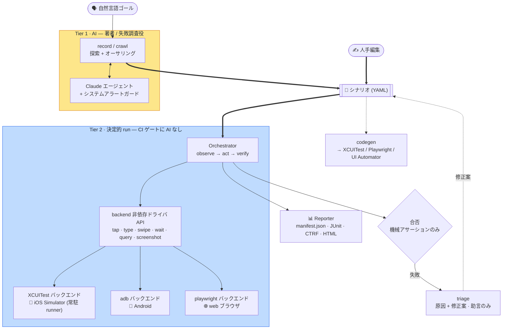
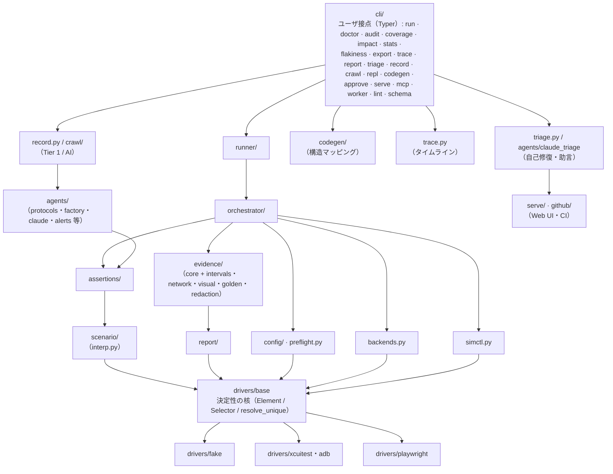

[English](../architecture.md) · **日本語**

# アーキテクチャとモジュール関係

> どのモジュールが何を担当し、どこに依存するか。また **設計（[`DESIGN.md`](../../DESIGN.md)）に
> あるが現状まだ配線されていない機能** を明示します。

関連: [concepts](concepts.md) · [開発者ガイド](developer-guide.md)（クラス単位の読解案内） · 各機能ページ（下のリンク）

---

## データフローの全体像

[シナリオ](glossary.md#シナリオのオーサリング)は、AI または人手で作成する共有の成果物です。`run` はシナリオを、ゲートに AI を置かずに決定的にリプレイします。`codegen` と `triage` もシナリオを入力として使います。

作業は 2 つの Tier に分かれます。

- Tier 1（AI、図では黄）は、シナリオのオーサリングと失敗の調査を担います。
- Tier 2（決定的、図では青）は、機械アサーションだけで合否を決めます。

決定的な中核全体はプラットフォーム非依存です。プラットフォーム固有の継ぎ目は、orchestrator が駆動する **backend** だけです。iOS は XCUITest、Android は adb、web は playwright といった実体が、いずれも 1 つの `Driver` インターフェースの背後にあります。したがって、新しいプラットフォームは新しい backend であって、コアの fork ではありません。

Mermaid ソース

<!-- mermaid-svg: assets/diagrams/architecture-data-flow-ja.svg -->

下の[依存レイヤ図](#依存関係とレイヤ)は、同じシステムをデータフローではなくモジュール層として示します。

---

## モジュール一覧と役割

`bajutsu/` パッケージ（Python 3.13+、pydantic v2 / typer / anthropic / pyyaml / jinja2）。

| モジュール | 役割 | ページ |
|---|---|---|
| `common/drivers/base` | Driver Protocol + 共通型（`Element`/`Selector`/`Point`）+ **セレクタ解決**（決定性の核） | [selectors](selectors.md) / [drivers](drivers.md) |
| `common/drivers/actuation` | `Actuation`/`ActuationLog`。各ドライバがステップの結果へ書き足す具体的なジェスチャーの記録（座標・経路・プラットフォームが受理したか）。`actionLog` 証跡種別を支えます（BE-0345） | [evidence](evidence.md#各ステップが画面に対して実際に行ったことactionlog) |
| `common/drivers/coordinate_tree.py` | `CoordinateTreeDriver`。座標系のバックエンド（adb）が継承する共有基底クラス。一時的空ツリーへのリトライ / 安定キーによる settle / `_resolve` / `wait_for` を提供（BE-0254） | [drivers](drivers.md#adbandroid) |
| `common/drivers/fake` | インメモリの `FakeDriver`（実機不要テスト用） | [drivers](drivers.md#fakedriver) |
| `common/drivers/xcuitest` | XCUITest バックエンド（iOS。BE-0290 で idb を撤去して以来、iOS の唯一の backend。実機上に常駐する runner が semantic tap、ネイティブ条件待ち、テキスト選択、multi-touch を提供。BE-0019） | [drivers](drivers.md#xcuitestios) |
| `common/drivers/adb` | adb バックエンド（Android。`tap`/`long_press`/`double_tap` は resident server の `POST /act` で端末側にて解決・inject し、channel が使えないときは `uiautomator dump` による frame 中心の座標 tap にフォールバックします。BE-0339） | [drivers](drivers.md#adbandroid) |
| `common/drivers/playwright` | Playwright web バックエンド（ブラウザ。第一段、決定的 run） | [drivers](drivers.md#playwrightweb) |
| `common/drivers/xcuitest_live` | live-route の XCUITest ドライバ。常駐 runner のチャネルの代わりに、予約済みのデバイスクラウド上の iOS デバイスへ W3C WebDriver（Appium の XCUITest ドライバ）で駆動する `appium` デバイスプロバイダ向け（BE-0238）。セッションのライフサイクル、query/tap/screenshot/readiness、ジェスチャ、テキスト入力までを実装済み。`selectAll`/`copy` は Appium 側に相当機能がなく明示的に失敗する。実デバイスクラウドのグリッドに対する検証は未了（[BE-0303](../../roadmaps/BE-0303-xcuitest-live-real-grid-verification/BE-0303-xcuitest-live-real-grid-verification-ja.md)） | — |
| `common/drivers/elements.py` | 正規化済み要素ツリーに対する、プラットフォーム非依存の述語・幾何ヘルパー（`screen_size_from_elements`、`shows_app_ui`）。assertions・crawl・runner パイプライン・record が共有 | [drivers](drivers.md) |
| `common/drivers/dom.py` | Playwright バックエンドと WebView ブリッジが共有する DOM → `Element` 正規化 | [drivers](drivers.md#playwrightweb) |
| `common/drivers/web_network.py` | web のネットワーク観測。Playwright 側の `Collector`（iOS 側と同じ `NetworkExchange` モデルへ `requestfinished` を橋渡し）+ `page.route` によるプロセス内 mock スタブ | [drivers](drivers.md#playwrightweb) |
| `common/drivers/webview` | WebView ブリッジクライアント。BajutsuKit の WebView チャネルの Python 側（DOM 取得 + tap 発行を HTTP 経由で実施） | [drivers](drivers.md) |
| `common/drivers/zorder` | z 順応答クライアント。BajutsuKit の `nativeZ` チャネルの Python 側（BE-0355） | [drivers](drivers.md) |
| `common/scenario/` | シナリオスキーマ（pydantic 厳格検証）+ YAML 読込 / 書出（パッケージ: `models` / `load` / `load_expanded` / `expand` / `select` / `serialize` / `edit`） | [scenarios](scenarios.md) |
| `common/assertions/` | 機械アサーション評価（総関数。例外を投げない）（パッケージ: `evaluate` / `network` / `visual` / `schema` / `_common`、BE-0250） | [selectors](selectors.md#アサーション評価) |
| `common/orchestrator/` | 決定的 Tier 2 run ループ（act → wait → verify）（パッケージ: `loop` / `waits` / `substitution` / `evidence_rules` / `actions` / `control_channel`） | [run-loop](run-loop.md) |
| `common/cancellation.py` | 協調的キャンセル（BE-0370）。orchestrator の wait ループと runner がポーリングする読み取り専用の `CancelSource`、poll ループが安全な境界まで巻き戻すために投げる `RunCancelled` 例外、`bajutsu run` のエントリポイントが組み込む `SIGTERM` → イベントのブリッジをまとめて持ちます。Bajutsu の他モジュールを一切 import しないため、決定的コア、CLI、`serve` のいずれからも参照できます | [run-loop](run-loop.md) |
| `common/evidence/` | 証跡の取得を役割ごとに分けたパッケージ（BE-0257）：`core`（瞬時 / 区間の取得と Sink）、`intervals`（video / deviceLog の simctl 子プロセス管理）、`media`（完了した録画の再生時間をファイルから読み取る）、`network`（collector + プロトコル内の決定的モック）、`visual`（ビジュアルリグレッションの画像比較）、`golden`（要素ツリー比較）、`redaction`（ラベル / ヘッダ / フィールド + シークレット値の redaction） | [evidence](evidence.md) |
| `common/report/` | `manifest.json` + JUnit XML + CTRF JSON + インタラクティブ HTML に加え、完了した run の `.zip` エクスポートと再描画用のオフライン再読込（パッケージ: `format` / `manifest` / `ctrf` / `rows` / `panels` / `html` / `richtext` / `archive` / `load`）、および `rows.py` が使う行グルーピングのヘルパー `from_grouping.py` | [reporting](reporting.md) |
| `common/scenario/interp.py` | `${ns.key}` 補間プリミティブ（`params.` / `row.` / `secrets.` / `vars.`） | [scenarios](scenarios.md) |
| `common/mailbox.py` | `email` ステップ（BE-0046）向けの純粋でネットワークを使わない照合・抽出ロジック。メールボックスプロバイダのメッセージを正規化し、`to`/`subject`/`subjectMatches` で照合し、ステップ開始後に届いたメッセージだけを選び、正規表現で値を `${vars.*}` に取り出す | [scenarios](scenarios.md) |
| `common/totp.py` | `totp` ステップ（BE-0046）向けの RFC 6238 時刻ベースワンタイムパスワード（TOTP）。共有シークレットと時刻の純粋で決定的な関数なので、ネットワークもデバイスも使わずにコードを導出できる | [scenarios](scenarios.md) |
| `config/` | チーム既定 × アプリ別の解決（`Effective`）（パッケージ: `schema` / `effective` / `resolve` / `accessors` / `preconditions` / `json_schema`）。`schema` は target のグループごとのモデル（`services`、`hooks`、`evidence`、`paths`）、検証の前に `defaults` を各 target へ畳み込む `_merge`、target の `extends` を `_merge` が `defaults` に重ねる層の並びへ展開する `_templates`（[BE-0471](../../roadmaps/BE-0471-target-templates/BE-0471-target-templates-ja.md)）、各プラットフォームの `subject` / `runsOn` / `driver` のモデルを供給する `platform/` レジストリを持ちます。`runsOn` は、そのプラットフォームが許す宛先ごとに 1 つのブロックを持ちます（[BE-0469](../../roadmaps/BE-0469-runson-destination-blocks/BE-0469-runson-destination-blocks-ja.md)）。`load_config(text, path=, root=)` と `load_config_file(path, root=)` は config 自身のパスとスイートのルートを受け取ります。`hooks` の中の `use:` コンポーネントは、config を読み込むときに解決します。`preconditions` は、シナリオの `preconditions` を、そのシナリオが動かす各 target に重ね合わせます。`json_schema` は、`bajutsu config schema` のために、モデルとレジストリから config の JSON Schema を組み立てます（[BE-0452](../../roadmaps/BE-0452-target-config-restructure/BE-0452-target-config-restructure-ja.md)） | [configuration](configuration.md) |
| `common/backends.py` | バックエンド可用性判定、actuator 選択（プラットフォーム対応レジストリ: `ios` / `android` / `web` / `fake`）、Driver 生成 | [drivers](drivers.md#バックエンド選択と-actuator) |
| `common/devices/` | バックエンド間で共有するデバイス識別のヘルパ（パッケージ）: `os.py`（`device_runtime` ラベルから読む、解析済みのデバイス OS。プラットフォーム/メジャー/マイナー、BE-0358）、`id.py`（各バックエンドの `--udid`/config が共有するデバイス id バリデータ。argv オプションインジェクションを防ぎます）、`errors.py`（`simctl`/`adb` が継承するプラットフォーム中立な `DeviceError` 基底、BE-0260。その下に、デバイス操作が失敗ではなく期限の超過で終わったときにどのバックエンドも送出する `DeviceTimeout`（BE-0374）を置きます）、`version.py`（`runsOn` のバージョン範囲を読む、npm の範囲文法の `VersionSpec`）、`facts.py`（`runsOn` の条件が比べる値を、利用できる各デバイスから読みます。Simulator のデバイスタイプ名、ファミリー、ランタイム、`devicectl` で読む iOS 実機のファミリー、両者が混在するプール（BE-0468）、Android デバイスの API レベルと Android Virtual Device（AVD）名、ブラウザのバージョンです）、`runs.py`（リストと範囲からシナリオの run を作ります。`kind` に並べた種類ごとにも run を作り、各 run の `family` の優先順位リストを解決します。そのうえで run をターゲットをまたいで組み合わせ、各 run が使える適格なデバイスを選びます。BE-0452、BE-0468）、`browsers.py`（`runsOn.browser.kind` が指すブラウザの種類と、それぞれを起動する Playwright のエンジンとチャネル。BE-0468） | [drivers](drivers.md) |
| `common/backend_cli/` | バックエンドのコマンドラインラッパ（パッケージ）: `simctl.py`（`simctl` ラッパ。erase/boot/launch/openurl/io）、`adb.py`（Android バックエンドのコマンド構築側。clean-state/launch/deeplink/input/screencap。`simctl` の双子）、`adb_resident/`（常駐 UI Automator サーバチャネルの Python 側 — 接続、待機バジェット、読み取りタイムアウトのリトライ/再起動リカバリ、BE-0245 / BE-0477） | [drivers](drivers.md#環境管理simctl) |
| `common/platform_lifecycle/` | `Environment` の seam（BE-0009）。1 つの `RunEnvironment`/`CrawlEnvironment` Protocol がプラットフォームごとのアプリ起動・readiness・relaunch・デバイス制御・teardown を担い、`common/runner/` と `crawl/cli.py` は actuator 名で分岐せず iOS/Android/web を同じインターフェースを通じて駆動（パッケージ: `protocols` / `factories` / `readiness` / `relaunchers` / `device_control` / `read_session`、加えて `environments/` ── `ios` / `xcuitest` / `xcuitest_live` / `android` / `web` / `fake`、および XCUITest runner をユーザーごとに署名して実機向けにビルドする BE-0456 の `device_runner/`） | — |
| `preflight.py` | バックエンド別の実行可能ゲート（iOS: 必須 CLI + 起動済みシミュレータ / web: Playwright とその Chromium ブラウザ） | [configuration](configuration.md) |
| `common/capability/worker_capability.py` | worker 能力ファイル（`worker.yaml`。同梱の既定が隣に置かれます）を読み込んで検証します。`capability_preflight` が、このファイルとホストの OS に照らして各シナリオを、デバイスを確保する前に判定します（BE-0450） | [drivers](drivers.md#worker-の能力検査be-0450) |
| `requirements.py` | 単一の宣言的マッピング。backend / capability から pip extra + 外部ツールのプローブ + インストール方法へ（BE-0164）。`preflight` と `provision` が共有する | — |
| `provision.py` | config 対応の環境インストーラ（BE-0164）。config の backend と AI プロバイダを解決し、必要な extra とツールだけを冪等に導入する（`make install`） | — |
| `common/runner/` | config + シナリオ → レポート。デバイスプール + launch 手順。`device_provider` の seam が、run のデバイスをどこから調達するかを解決する（組み込みの `local` pass-through に加え、予約済みの実機 iOS デバイスを Appium/WebDriver エンドポイント越しにエンドツーエンドで駆動する `appium` provider、BE-0238。この provider は target のキーではなく `worker.yaml` の `appium` environment で選びます（BE-0452）。他のクラウドベンダ種別は今後の追加課題）。`recovery` はバックエンドクラッシュのリトライ回数・wall-clock 予算の判定を持ち、オンデバイスのドライバ適合性スイートと共有します（BE-0334）。障害を分類する述語も 2 つ持ちます。`recovers_by_respawn` が再試行を判断し、`is_host_fault` がホスト側に原因のある失敗を診断します。固まったデバイスは、この 2 つに違う答えを返します（BE-0378）。`is_host_fault` が名指しするのはプラットフォーム中立な `DeviceTimeout` なので、この基底を採用したバックエンドはすべて対象に入ります（BE-0374）。後続シナリオを止める run 単位のラッチも `recovery` にあり、復旧を諦めた理由（予算を使い切ったのか、ホストが固まったのか）を保持します。さらに `recovery` は、pool の teardown 箇所・`launch_driver`・オンデバイススイートの lease 破棄が共有する、守られた teardown の方針も持ちます（BE-0342）。`mailbox` は `email` ステップの transport を、`kind` で鍵付けしたレジストリで解決します（出荷済みなのは `http` の JSON アダプタ、BE-0186）。形は `ai/registry.py` を踏襲します（パッケージ: `pipeline` / `pool` / `launch` / `device_provider` / `recovery` / `mailbox`） | [run-loop](run-loop.md#runner実行パイプライン) |
| `common/run_meta/` | 複数の機能が共有する run メタデータのヘルパ（パッケージ）: `files.py`（runs ルート名 + run ディレクトリのパスを介さない読み取り。一覧・manifest）、`id.py`（run id の生成・解析）、`root.py`（run ディレクトリの書き込みプロバイダ、BE-0331。後述の import 契約を参照）、`artifact_perms.py`（run の成果物への owner-only な `0700`/`0600` 権限、BE-0131）、`object_store.py`（証跡アップロードとサーバストレージ向けのバックエンド中立な `ObjectStore`。local/S3/GCS、BE-0110/BE-0204） | [configuration](configuration.md) |
| `run/notify` | `bajutsu run` 完了後に送る run 完了通知（Slack など） | — |
| `common/doctor/` | 規約充足度スコア（id カバレッジ等） | [configuration](configuration.md#doctor規約充足度スコア) |
| `agents/` | AI / オーサリングエージェントの periphery（BE-0257）：`protocols` + `factory`（`Observation`/`Proposal`/`Agent` 抽象 + 唯一の SDK エージェントの構築）、`claude`（オーサリングエージェント）、`claude_backed`（共有基底、BE-0246）、`claude_enrich`、`claude_triage`、`ai_config`（プロバイダ/モデル/effort/言語の解決）、`anthropic_client`（SDK クライアント構築）、`availability`（資格情報欠如のメッセージ化）、`enrich`（enrichment ループ）、`alerts`（システムアラートガード） | [recording](recording.md) |
| `ai/` | ベンダー中立な AI バックエンドのシーム（BE-0104）。`AiBackend` プロトコルと正規化した request/response 型（`base`）、プロバイダレジストリ（`registry`）が登録済みのプロバイダを賄います。`agents.anthropic_client` の上に立つ Anthropic 参照アダプタ（`anthropic`）による Anthropic API と Amazon Bedrock、Anthropic CLI `ant`（同じく `anthropic` アダプタ経由、BE-0163）、Claude Code CLI（`claude_code`、BE-0176）、そしてファクトリが例外を送出してどの AI 経路にもバックエンドを構築させない `none`（`disabled`、BE-0394） | [configuration](configuration.md#ai-プロバイダaibe-0047) |
| `run/` | `bajutsu run` の CLI コマンド（`cli.py`）: target/backend 解決、デバイスの lease 取得、plan 構築、決定的な run/report ディスパッチ。公開コマンドは薄いラッパーで、この本体を子プロセス `python -m bajutsu.run.internal`（`internal.py`）として、`bajutsu worker --once` と同じ 1 回実行の worker 経路で実行します。serve の仕様ビルダーも同じモジュールを出力します（BE-0449）。`device_matrix.py` は、各シナリオが動かすターゲットの `runsOn` の条件から呼び出し全体の run を計画し、同じデバイスを使う run をセルにまとめます。セルは 1 回のパスとして実行します（BE-0452） | [cli](cli.md) |
| `record/` | record ループ（observe → 提案 → 実行 → 書き出し）（パッケージ: `loop.py`、加えて `capture.py` ── tap/type/swipe のプロキシ actuation をシナリオステップに解決、および `cli.py` ── その CLI コマンド） | [recording](recording.md#record-ループ) |
| `crawl/` | 自律的な幅優先クロール → スクリーンマップ：`core` エンジン + `serialize`、`guide` / `tabs` / `report` / `repro` / `flows`、加えてその CLI コマンド（`cli.py`） | [recording](recording.md) |
| `repl/` | AI を使わない手動シェル（BE-0423）：`render.py` が要素ツリーを表示し、`session.py` がコマンド集合（`tree` / `find` / `tap` / `type` / `scroll` / `back` / `screenshot` / `step`、さらに完全なセレクタを書けるエスケープハッチ `--sel`）、`tui.py` が対話的な端末でデフォルトになる ncurses 風シェル、`loop.py` がそれ以外の場合に使われる素の `bajutsu>` プロンプトループ（BE-0429）、`cli.py` がその CLI コマンドです。`cli.py` の `--attach`（BE-0455）は、起動済みの Simulator で動いているアプリを再起動せずに操作します | [cli](cli.md#repl) |
| `codegen/` | シナリオ → ネイティブテスト生成: XCUITest（Swift）、Playwright（TypeScript）、UI Automator（Kotlin）、加えてその CLI コマンド（`cli.py`） | [codegen](codegen.md) |
| `triage/` | M4 自己修復: ルールベース `HeuristicTriageAgent` + 構造化 fix（`renameId`/`addIndex`/`raiseTimeout`）、`--apply`/`--write`/`--rerun`（パッケージ: `heuristic.py`、加えて `cli.py` ── その CLI コマンド） | [cli](cli.md) |
| `common/github/` | GitHub ヘルパ：`actions`（CI、アノテーション + ジョブサマリ）、`app`（プライベートリポジトリの config source 向けの App インストールトークン）、`errors`（共有するアクセスエラー） | [ci](ci.md) |
| `common/analytics/` | 役割で分けたトークン/コストの集計（BE-0257）：`usage`（プロセスグローバル、インメモリ、ベストエフォート）／`ledger`（帰属付きで永続化する AI 使用量/コスト台帳、BE-0196）／`stats`（serve の使用量ダッシュボード向けに台帳を集計、BE-0195） | [web-ui](web-ui.md#usage--ai-トークン利用量とコストのダッシュボード) |
| `common/cloud/` | 決定的な `run`/CI の判定パスの外側で、バッチ送信先として利用するクラウドデバイスバックエンド（`devicefarm.py` が最初の具体的プロバイダ） | [devicefarm](devicefarm.md) |
| `serve/` | ローカル Web UI（`serve` コマンド）: オーサリング / 実行 / レポート / 失敗した run の triage。サーバ自身は job を実行しないので、それぞれを job として `bajutsu worker` のキューに積みます（BE-0449）。`serve`/`worker`/`approve` の CLI コマンドは `cli/`（機能ごとに 1 ファイル）にあります。`capabilities.py` は、キューのジョブを、そのジョブが必要とするトークンをすべて広告するワーカーへ振り分けます。必要とするトークンは、プラットフォームと、ドライバが 1 つの OS でしか動かない場合の `host:<os>` です。ターゲットの `runsOn.ios.family` があれば、そのデバイスファミリーのトークンも必要とし、ファミリーの優先順位リストは any-of のグループ 1 つになります。ワーカーは自分のマシンの `host:<os>` を広告し、ファミリーのトークンは Simulator の在庫から、`device:<family>` は接続中の実機から広告します（BE-0166、BE-0450、BE-0468）。さらに、ステップと設定が必要とする環境ルートごとの `cap:` / `setting:` トークンも使います（`common/capability/route_tokens.py`、BE-0467） | [cli](cli.md) · [self-hosting](self-hosting.md#能力に基づくキューの振り分けbe-0166) |
| `mcp/` | MCP サーバ: `run`/`doctor` をツール + 実行証跡をリソースとして公開、加えてその CLI コマンド（`cli.py`） | [cli](cli.md) |
| `common/lint.py` | シナリオ linter + JSON Schema 生成（`lint` / `schema` コマンド） | [cli](cli.md) |
| `common/target_lint.py` | `lint --config --target`：run と同じステップ・設定・前提条件のチェックを、デバイスなしでターゲットごとに行います（BE-0467） | [cli](cli.md) |
| `analysis/` | 実機も AI も使わない読み取り専用の助言的分析パッケージ（BE-0257）、CI を止めない: `audit`（決定性・フレーキネス監査、BE-0049）、`coverage`（シナリオの id 名前空間カバレッジ、BE-0050）、`impact`（テスト影響分析。diff から影響ステップを選ぶ、BE-0321）、`stats`（集計 run 統計ダッシュボード、BE-0102）、クロスランのフレーキネスランキング（`flakiness`、BE-0220）、`trace` タイムライン（`trace.py`、`bajutsu trace` コマンドの本体）——それぞれの Typer コマンドは `cli/`（機能ごとに 1 ファイル）にあります | [cli](cli.md) |
| `cli/` | Typer アプリの組み立て：各機能自身の CLI（`run`/`crawl`/`record`/`repl`/`triage`/`mcp`/`codegen`/`serve`/`analysis`）と、機能を持たない `commands/`（`doctor`/`lint`/`schema`/`config`/`report`/`runner`）、`.env` ローダ（`dotenv.py`）をマウント | [cli](cli.md) |
| `common/screenshots.py` | AI 経路が共有するスクリーンショット取得 + ピクセル座標のヘルパ（`screenshot_bytes`、`png_size`、`fraction`、BE-0246） | [recording](recording.md) |
| `common/handoff/` | 人手介在ハンドオフの契約（Tier 1、BE-0179）。`record`（端末の stdin）と `serve`（SSE）が同じ transport 中立なリクエスト/レスポンスを実装 | [recording](recording.md) |
| `common/deprecations.py` | 改名済みのオーサリング/CLI 表記への一度きりの非推奨通知（`warn_once`）と、廃止済み表記への明示的な拒否（`reject_renamed_key`） | — |
| `common/diagnostics.py` | プロセス全体のロギング設定。run が自分自身について何をどれだけ語るか | — |
| `common/stall_diagnostics.py` | バックエンドが stall した瞬間の、範囲を限定したベストエフォートな状態取得（BE-0361/BE-0367） | — |
| `common/_yaml.py` | `on`/`off`/`yes`/`no` を文字列のまま読む YAML ローダ | [scenarios](scenarios.md#yaml-の注意点) |

## 依存関係とレイヤ

下層ほど安定していて、上層が下層に依存します。中核は `common/drivers/base`（セレクタ解決）で、すべての実行系が中核に依存します。

![依存レイヤ図。cli/ がユーザ接点であり、その下に runner/、record.py/crawl/、codegen/、trace.py、triage.py が直接ぶら下がります（codegen/ と trace.py には、これ以上の依存関係が描かれていません）。runner/ は orchestrator/ に、record.py/crawl/ は AI エージェント関連のヘルパーに、triage.py は serve・CI 関連のヘルパーに、それぞれ依存します。orchestrator/ とエージェント関連のヘルパーは assertions/ と evidence/ に依存し、orchestrator/ はさらに config.py、backends.py、simctl.py にも依存します。assertions/ は scenario/ に、evidence/ は report/ に依存し、scenario/、report/、config.py、backends.py、simctl.py はいずれも決定性の核である drivers/base.py に収束します。そこから drivers/fake、iOS・Android 系ドライバ（xcuitest、adb）、Playwright ドライバへ分岐します。](assets/diagrams/architecture-dependency-layers-ja.svg)

Mermaid ソース

<!-- mermaid-svg: assets/diagrams/architecture-dependency-layers-ja.svg -->

- `common/orchestrator/` は `base.Driver` にのみ依存し、**どの具象ドライバとも結合しません**。そのため `FakeDriver` で実機なしにテストでき、本番では同じループが XCUITest（iOS）や playwright（web）を駆動します。
- `common/runner/` はアプリを起動して準備済みドライバを返す factory を提供し、ループを実機から分離します。
- `scenario/`（オーサリング表現の pydantic モデル）と `common/drivers/base`（実行時の TypedDict）は別物です。`Selector.as_selector()` が前者を後者へ変換します。

### 強制されるレイヤ境界（BE-0112）

上のレイヤ分けは規約にとどまらず、ゲートで**実行可能な契約**として強制します。`make lint-imports`（`make check` の一部であり、CI のステップでもあります）は、宣言したレイヤに対して [import-linter](https://import-linter.readthedocs.io/) を実行します。禁止された import は、誰かが気付くまで残らず、その場でゲートを落とします。設定は `pyproject.toml` の `[tool.importlinter]` にあり、3 つのレイヤを宣言します。

1. **決定性コア**：モデルにも periphery のスタックにも触れずに、判定と証跡を導く経路です。`common/orchestrator/`、`common/runner/`、`common/drivers/base`、`assertions/`、`evidence/`、`report/`、`config/`、`scenario/`、`preflight.py` / `capability_preflight.py` / `capabilities.py` / `worker_capability.py`、`common/doctor/`、`common/lint.py` / `common/target_lint.py` が含まれます。コアは prime directive を担います。
2. **契約（contract）**：利用者が依存する安定した界面です。シナリオスキーマ（`scenario/`）と `Driver` Protocol（`common/drivers/base`）が当たります。
3. **periphery**：契約の利用側で、いずれもオプションの extra の背後に切り離せます。
   - `serve/`、`mcp/`、codegen のエミッタ。
   - AI / エージェント経路：`agents/` 以下の `protocols`、`ai_config`、`anthropic_client`、`enrich`、`alerts` など、加えて `record/`、`triage/`、`crawl/guide`。
   - `github/actions.py` と `run/notify` のヘルパ。`github/` の残り（`app` と `errors`）は決定的コアからも参照できるので、`config_source` は periphery を巻き込まずに利用します。

強制する契約は 3 つです。

- **決定性コアは periphery を import してはいけません。** この契約は、prime directive 1 と 3 を静的に強制します。判定と証跡の経路は serve / AI / codegen のスタックから切り離されたままで、それらへの依存が黙って増えることはありません。
  - コアのモジュールが必要とする純粋な要素ツリーのヘルパ（`screen_size_from_elements`、`shows_app_ui` など）は、`record/` のような periphery のモジュールではなく、コア（`bajutsu/common/drivers/elements.py`）に置きます。
  - 同様に、解決済みの `ai` ブロック（`AiConfig`）は `config/` に置きます。コアは AI クライアントを import せずに、このブロックを読みます。
- **コアはホスト非依存に保ちます（BE-0129）。** マルチテナントなホスティングの関心事は、`bajutsu/serve/` だけが持ちます。関心事とは、組織、ロール、テナンシーと、`db`（SQLAlchemy、Alembic、psycopg、cryptography）や `oauth`（Authlib、joserfc）の extra です。
  - 組織モデル（`OrgConfig`、`org_for_*`、`targets_for_org`、`load_serve_config`）は、`config/` ではなく `bajutsu/serve/orgs.py` にあります。
  - `Config` は `orgs` フィールドを持ちません。コアのローダーは検証の前にトップレベルの `orgs:` を取り除きます。そのため、組織情報を含む config を読むホスト型構成の run はそのまま動き、コアは組織を一切モデル化しません。
  - 同じ仕組みが、トップレベルの `ui:` キー（BE-0191）も除去します。serve UI のプレゼンテーション設定（`ui.default_theme`）は serve の関心事です。この設定は `bajutsu/serve/themes/` で読み取られ、`Config` ではモデル化しません。
  - import-linter の forbidden 契約が、`config/`、`common/drivers/`、`common/runner/`、`scenario/` をこれらの extra から遠ざけます。`include_external_packages` により、外部 import も検出します。この契約は、同じパッケージを `bajutsu.serve` から遠ざける periphery 契約の上に重ねたものです。
- **シナリオスキーマと `Driver` Protocol は、可搬なインナー契約に保ちます。** periphery だけでなく、runtime のコア（`common/orchestrator/`、`common/runner/`、`config/` など）からも独立させます。この独立により、契約は、利用者が runtime を引き込まずに依存できる安定したレイヤになります。バージョンをまたいだスキーマの読み取り（BE-0119）と、将来 periphery をコアから分離する余地も、この独立が下支えします。

このチェックは import グラフに対する静的解析です。モデルは介在せず、決定的な合否以上のものは `run` / CI の判定経路に載りません。新しいモジュールを追加するときは、そのレイヤが置き場所を決めます。

- 判定と証跡の経路上にあるモジュールはコアであり、periphery に到達してはいけません。
- 契約を利用するモジュールは periphery であり、extra の背後に置きます。

## テスト構成

`tests/` に **ユニットテスト一式**（`uv run pytest -q`）があります。どのテストも実機 Simulator を必要としません。コマンドビルダは純関数として検証し、実行系は `FakeDriver` と注入ランナー（`RunFn`、`Spawn`、`Clock`）で検証します。showcase アプリに対する実機 E2E は、`make -C demos/showcase run-swiftui` または `make -C demos/showcase ui-test` で実行します（[showcase](showcase.md)）。

### driver conformance suite（BE-0114）

prime directive 3 は、どの backend も 1 つの `Driver` 界面の背後に置くことを求めます。したがって、決定性の中核となる不変条件は、すべての backend で同一に成り立たなければなりません。backend ごとのテストだけでは、これを保証できません。曖昧なセレクタで最初の一致を tap する backend や、0 件の query に成功を返す backend があっても、自身のテストは通ります。落とす共通テストがないからです。

**driver conformance suite** は、この隙間を埋めます。1 つの実行可能な契約（technology compatibility kit（TCK）に相当します）が、同じテスト本体をすべての backend に対して走らせます。このスイートは、共通の base だけでなく、実際のドライバのインスタンス（`common/drivers/base` を迂回するコードを含みます）を駆動します。

契約（`tests/driver_conformance.py`）は、新しい backend が満たすべき「完了」の定義です。

- 曖昧なセレクタ（2 件以上の一致）は、最初の一致に作用せず失敗します。
- 0 件のセレクタは、成功を報告せず失敗します。
- セレクタの失敗は 1 つのエラー型（`SelectorError`）を共有し、backend をまたいで一様です。
- 一意の一致はエラーなく作用し、`query()` は画面上の要素を報告します。
- `capabilities()` は観測される挙動と一致します（そうでなければ、該当の呼び出しはそれぞれ `UnsupportedAction` を送出します。BE-0280、BE-0464、BE-0466）。
  - `QUERY` / `ELEMENTS` の baseline を申告します。
  - multi-touch のジェスチャは、`MULTI_TOUCH` を申告したときに限り動作します。
  - 全選択とクリップボードへのコピーは、`TEXT_SELECTION` を申告したときに限り動作します。
  - ネイティブな `<select>` を値で設定する操作は、`SELECT_OPTION` を申告したときに限り動作します。
  - URL の読み込みは、`URL_NAVIGATION` を申告したときに限り動作します。
  - `read_attributes` は、`ELEMENT_ATTRIBUTE` を申告したときに限り、タップと同じ規則で各セレクタを解決して属性を読みます。
- フォーカス中のフィールドで、テキスト編集が往復します。入力してから削除すると、報告される文字数が減ります。`tap_point` は生の座標タップで、アラート消去の経路です。フィールドの中心を狙うと、そのフィールドをフォーカスし、semantic tap と同じ観測可能な効果を持ちます（BE-0280）。
- `wait_for` は現在の画面を 1 回だけ判定します。共有の `wait_until` ループが、それを固定 sleep なしの条件待ちに変えます。
- `scroll` の 1 ステップは、連続するビューポートを重ねたまま残します。ステップの前後の読み取りが、領域の枠に切り取られていない要素を少なくとも 1 つ共有する、という形です（BE-0329）。
  - この契約は、各 backend が非慣性と文書化しているジェスチャを、ツリーが示せる唯一の言葉に言い直したものです。
  - `scroll` ループの正しさがこの重なりに乗っているため、契約は `Driver` 契約の一部です。
  - 勢いを残すジェスチャは何も共有しないので、スイートで落ちます。そうでなければ、実行時に対象が、ループの 2 回の query のあいだを読まれないまま通り過ぎます。
- `scroll` の 1 ステップは、その終点が求めた距離だけ進みます。許容差の内側に収まることを、3 つの歩幅で確かめます。既定の歩幅、ループのリカバリが取る最小の歩幅、そして書き手が `amount` で要求できる、その下限より小さい歩幅です。
  - 重なりが残ることは、この距離を意味しません。ビューポートが重なったまま、求めた距離よりはるかに先まで進むステップがありうるからです。
  - BE-0400 まで、iOS のジェスチャがそうでした。どのドラッグも同じ速さで走査していたため、指を離した後もコンテンツが終点の先へ運ばれ、求めた距離の最大 6 倍まで進みました。どれだけ小さく求めても、画面のおよそ 3 分の 1 より短くは動きませんでした。
  - この下限があるために、`scroll` アクションで書き手が選ぶ `amount` と、BE-0329 の半減の両方が、どのジェスチャでも実現できない歩幅を名指すことになります。この性質が 1 つのバックエンドのテストではなく `Driver` 契約に属するのは、そのためです。

backend をこのスイートに加えるには、`ConformanceHarness`（画面を渡すと、それを表示するドライバを返すもの）を実装し、`DriverConformanceContract` を継承します。すると pytest が、継承した契約をその backend に対して走らせます。契約は同じで、第 2 の仕様はありません。

- `FakeDriver` は、高速な Linux ゲート（`make check`）で走ります。
- Playwright は、web CI ジョブで走ります。
- XCUITest は、iOS のオンデバイス E2E 経路（`ios-e2e.yml`）で走ります。
- **adb backend** は、起動済みの Android エミュレータ（`android-e2e.yml` の `conformance (adb)` ジョブ、BE-0270）で走ります。

各 harness は、画面をそれぞれの方法で実体化します。

- `FakeDriver` は、要素をそのまま受け取ります。
- Playwright は、要素を HTML として描画します。
- オンデバイスの harness は、`SHOWCASE_CONFORMANCE` で showcase アプリを一度だけ conformance モードで起動し、以降は画面ごとに再シードします。これにより、共有の base だけでなく、実際の backend の query と操作のコードを駆動します。
  - iOS の harness は、アプリがポーリングする spec ファイル（Documents ディレクトリの `conformance-spec.txt`）を書き換えて再シードします。画面ごとの再起動や deeplink ではなくファイル書き込みにするのは、`simctl openurl` が iOS の「アプリで開きますか?」ダイアログを出し、画面ごとの再起動は数回の `app.launch()` で常駐 XCUITest ランナーをクラッシュさせるためです。
  - adb の harness は、その代わりに、新しい `SHOWCASE_CONFORMANCE` の intent extra を載せてアプリの `singleTask` Activity を起動し直し、`onNewIntent` で届けます。`adb push` はアプリのサンドボックスに届きません。インテントなら、`subject.launch.env` を intent extras として渡す規約（BE-0007）に乗れます。
  - adb の harness は、Compose ツールキットに限定します。spec 駆動で任意の id を描く画面を表現できるのは Compose だけです。`testTag` は実行時の任意の文字列を受け取りますが、Views の `resource-id` はコンパイル時の `R` エントリでなければなりません。

このスイートには `ondevice` の pytest マーカーが付いています。ゲートの既定ではこのマーカーを除外するので、スイートは `make check` では決して走りません。共有する 1 台のデバイスを 1 つのチャネルで再シードするため、並列ワーカーどうしが衝突しないよう、直列で実行します。

### 障害注入レーン（BE-0305）

ドライバには、実際のデバイス障害のためだけに存在する機構が 2 つあります。ここまでのスイートは、そのどちらの条件にも出会いません。conformance スイートは読み取りの前に必ず画面の準備完了を待ち、ランナーを意図的に壊すジョブもないからです。

- `CoordinateTreeDriver` の transient-empty リトライ（BE-0254）は、デバイスが遷移途中に返すほぼ空の要素ツリーを乗り越えるために存在します。
- XCUITest チャネルの一過性リトライ（BE-0207）と crash-recovery（BE-0287）は、応答しなくなったランナーを乗り越えるために存在します。

これらの機構に対する高速スイートのテストは、要素数を組み立て、合成した例外を送出します。制御フローに対する実質的なカバレッジにはなりますが、実際の条件がそこに到達するかどうかの証拠にはなりません。実際のデバイスは Python の例外を送出しませんし、要素数を見る検出ヒューリスティクスは、組み立てた要素数なら通るまま壊れうるからです。

**障害注入レーン**は、代わりに実際の条件を注入します。

- `fault-injection (adb)`（`android-e2e.yml`）は、エミュレータのディスプレイをスリープさせます。すると、実際の読み取り元（常駐 UI Automator チャネルと、その背後の `uiautomator dump` フォールバック）が本当に空のツリーを返します。レーンは、リトライがそこを、誤った「要素が見つからない」を出さずに乗り越えることを検証します。2 つ目のケースはディスプレイを落としたまま保ってリトライ予算を使い切らせ、その結末が静かな失敗ではなく明示的な `ElementNotFound` になることを固定します。
- `fault-injection (xcuitest)`（`ios-e2e.yml`）は、ランナー自身のホストプロセスにシグナルを送ります。
  - `SIGSTOP` は、ソケットを accept できる状態に保ったまま応答を止めます。ホストから見れば、まさに固まったランナーの姿です。短い凍結は一過性リトライが吸収し、リトライ予算を超える凍結は crash-recovery が乗り越えます。
  - `SIGKILL` では、無関係なタイムアウトではなく、実行中のランナー障害を名指しするクラッシュ診断で、実行が終わらなければなりません。

どちらのレーンも、障害をどれだけ保つかを推測しません。各ケースは、検証対象の層に到達したというドライバ自身のログ記録（`tests/fault_injection.py`）を合図に、障害を解除します。したがって、あるケースがどの機構を駆動したかは、sleep の長さではなく、観測された挙動が決めます。

両レーンは現在、それぞれのレーンの必須集約チェックに入っています。着地した時点では、必須チェックの外に置いてありました。BE-0282 が確立した「まずシグナル、のちに必須」の道筋に乗せたためです。意図的にデバイスを壊すレーンは、健全なデバイスを駆動するレーンより、本質的にフレーキーになるリスクが高いからです。その慎重さには根拠がありました。最初の 10 日間で `fault-injection (xcuitest)` は、52 回の成功に対して 78 回失敗しています。

慎重さを解いたのは、失敗の率が下がったことではなく、原因が判明したことです。

- 78 回の失敗はすべて、ある修正より前に起きています。その修正は、応答を待たずに去った相手へ返信すると SIGPIPE で XCTest のホストプロセスが落ちるという、runner の HTTP サーバの欠陥を直したものです。
- このレーンは runner を `SIGSTOP` で止めたまま保ちます。相手が去った接続は、まさにそこから生まれます。したがってレーンは、健全な runner を駆動するどのスイートよりも高い頻度で、その欠陥を踏んでいました。レーンが runner チャネルの実際の不具合を見つけていたわけで、それこそがレーンの存在理由です。
- この修正の後、レーンは 64 回実行して 1 回も失敗していません。同じ期間の `conformance (xcuitest)` は、58 回成功して 2 回失敗しています。
- `fault-injection (adb)` は、同じ期間に 73 回実行して失敗は 1 回です。その 1 回は、レーンが検証している内容ではなく、エミュレータが起動しなかったことによるものです。同じ期間の `conformance (adb)` は、67 回中 4 回失敗しています。
- 両レーンはいま、ずっとゲートに乗っているスイートと同等か、それよりよい水準にあります。

`_is_transient_empty` の閾値やクラッシュ分類器のマッチングに回帰が入れば、それは両レーンが捕まえるために存在する失敗そのものです。シグナルであれば、マージはそれを無視できてしまいます。したがって、必須化こそがこのカバレッジに意味を持たせます。`tests/test_e2e_gate_needs.py` が、高速スイートで必須化を 3 つの層に分けて固定します。

- 各ゲートがどのジョブに依存するか。
- そのすべてのジョブについて、結果が読まれているか。
- verdict のスクリプト自体を実行して、それぞれの結果が本当にチェックを赤にするか。

これらがなければ、ゲートを狭めることも、永久に green のまま放置することも、どのテストにも気付かれずにできてしまいます。

### 並行デバイスレーン（BE-0298）

ここまでのジョブはどれもデバイスを 1 台しか起動しません。そのため、`common/runner/pool.py` の `device_pool` が並列実行に対して主張する保証を、どのジョブも観測できません。その保証とは、`--workers N` のもとで各ワーカーが固有のデバイスを借り受けることです。さらに各ワーカーは、共有された 1 つの run ディレクトリの下にある固有の `run_dir/<sid>` サブディレクトリにだけ、証跡を書きます。モックのポートや索引も、ほかのワーカーのシナリオとは共有しません。[`DESIGN.md`](../../DESIGN.md) §3.3 が述べる「状態を共有しない」不変条件です。

高速スイートが証明できるのは、プール自身の記帳についてだけです。`tests/runner/test_pool.py` は `make_driver` を monkeypatch し、`FakeDriver` インスタンスに `"UDID-A"` のような架空の udid を渡します。これで示せるのは、**プールが管理するデータ構造のなかで**ワーカー A のリソースがワーカー B のものと分離されていることまでです。そのデータ構造の外側にある、OS とサブプロセスのレベルの競合については、何も語りません。そうした競合には、次のものがあります。

- 起動ロックで競合する、2 つの実際の `simctl` や `adb` の呼び出し。
- デバイスごとに確保されるホストポート。
- ワーカーのサブディレクトリが存在する前に計算される成果物パス。

**並行デバイスレーン**は、代わりに実際のデバイスを 2 台起動します。`pool (adb)`（`android-e2e.yml`）はエミュレータを 2 台起動し、状態に依存しない showcase のシナリオファイル 4 本を、1 回の `bajutsu run --workers 2` で走らせます。プールは作業を 2 台へ振り分け、両方のワーカーを同時にビジーに保たなければなりません。

結果を判定に変えるのは `scripts/assert_pool_isolation.py` です。このスクリプトは、終了した run の `manifest.json` と、run ディレクトリのサブディレクトリ一覧を読みます。次のいずれかを見つけたら、失敗します。

- ほかのワーカーの slug の下に記録された成果物。
- 1 つの slug を共有する 2 つの結果。
- どの結果にも属さないサブディレクトリ。
- 結果が記録したのに、run が書いていない証跡ディレクトリ。
- 片方のデバイスが、黙ってすべてのシナリオを引き受けたこと。
- 異なるデバイス上の 2 本のシナリオが、実時間で重ならなかったこと。

この検査はファイルの読み取りと集合の比較にすぎません。`bajutsu run` が自身の判定を返した後に走るので、run の成果物を観測するだけで、どのシナリオの合否にも入力されません。

このジョブは、専用の変更フィルタ（`scripts/e2e_changes.py` の `touches_pool`）で発火します。ほかのすべてのジョブが読む、レーン全体を対象としたシグナルより狭いフィルタです。Android レーンのほかのジョブの 2 倍のデバイスを起動するからです。このジョブは PR ごとのシグナルであり、Android レーンの必須集約チェックからは外してあります。BE-0282 の「まずシグナル、のちに必須」の道筋に乗せる点は、障害注入レーンと同じです。外してある理由は、このジョブ固有のものです。1 つの runner でエミュレータを 2 台動かす作業は、このレーンでもっともホストの資源に左右されるからです。

iOS 側の対になるジョブ `pool (xcuitest)` は、Simulator を 2 台起動して macOS レーンで走っていましたが、BE-0298 で取り下げました。このジョブが分離の判定を返せたのは 5 回のうち 1 回だけです。残る 4 回は、プールの検査ではなくホストで崩れました。

- `SimRenderServer` が、自身のディスパッチキューでクラッシュしました。
- `simctl uninstall` が、固まった CoreSimulator に対してタイムアウトしました。
- runner のチャネルが、run の途中で到達不能になりました。

しかも赤くなるたびに、10 倍課金の runner を 30 分ほど使いました。BE-0361 は、その runner を 3 コア・7 GiB と実測しています。Simulator を **1 台**起動しただけでゲストプロセスが 257 個立ち上がり、物理メモリの未使用分は 189 MB しか残りません。2 台目の Simulator は、すでに飽和した天井に対してゲストの数を倍にします。動画記録、タッチマーカー、シナリオの半分を削っても、崩れる位置が早まっただけで、崩れること自体は変わりませんでした。そのため、実際の並行デバイスに対する分離の検証は Android レーンだけが担い、iOS 側は高速スイートによる記帳の証明だけが残ります。

---

## 実装状況

> 設計（[`DESIGN.md`](../../DESIGN.md)）には将来像も含まれます。**現状のコードが実際に動かすもの**と
> **まだ配線されていないもの**を区別します。

### 実装済み（テストあり、経路が通っている）

#### ドライバとバックエンド選択

- セレクタ解決と曖昧検出（決定性の核）。
- プラットフォーム対応の backend レジストリ（`common/backends.py`）：target の必須キー `platform`（`ios` / `android` / `web` / `fake`）が actuator を決めます。
  - `ios` は `xcuitest` に解決します。BE-0290 で idb を撤去して以来、XCUITest が iOS の唯一の actuator です。
  - `--backend` はフォールバックのリストではなく検査です。受け付けるのは、target のプラットフォーム、その actuator、`fake` のいずれかです。それ以外の値では終了コード 2 で終了します（BE-0452）。
  - actuator を複数持つプラットフォームであれば、**シナリオごと**にコスト順で解決します（BE-0240）。iOS が単一 actuator になった今、どのプラットフォームもコスト順と安定度順が食い違いません。
- **XCUITest バックエンド**（`common/drivers/xcuitest`）は、iOS の唯一の actuator です（BE-0290）。実機上に常駐する runner（`BajutsuKit`）を loopback HTTP 経由で駆動します。
  - runner は、semantic（identifier）tap、ネイティブの条件待ち、テキスト選択、`pinch`/`rotate` の multi-touch ジェスチャを提供します。
  - runner は XCTest のオートメーションスナップショットを読み取ります。このスナップショットはグループコンテナの内側まで降りるので、座標系 backend と違って完全に展開された要素ツリーを描き出します。
  - 汎用の runner（`XCUIApplication(bundleIdentifier:)`）は、アプリ側の統合なしに任意のアプリを bundle id で駆動します。Xcode の `xcodebuild` を必要とします（BE-0019）。
  - Simulator を対象にした target は、runner の設定を必要としません。`driver.runner.testRunner` と `driver.runner.build` のどちらも指定しないときは、wheel にパッケージデータとして同梱された Simulator 用 runner に解決します。初回利用時に、コンテンツハッシュ鍵の書き込み可能なキャッシュへ展開します。明示的な `testRunner` や `build` は、この既定より優先します（BE-0292）。
  - 実機（`runsOn.ios.kind: device`）で `testRunner` がないときは、ユーザーごとの署名済みビルドに解決します（`environments/device_runner/`、BE-0456）。このビルドは `bajutsu runner build --device` がキャッシュしたものです。ビルドがなければ、ビルドコマンドを示して失敗します。実行中に署名済み runner をビルドすることはありません。
  - 実機はホストとループバックを共有しません。そのため runner、`nativeZ`、WebView のポートは usbmuxd で橋渡しします（`environments/xcuitest/_usbmux.py`）。環境の `reach_device_port` がこの橋渡しを開きます。ホストの `127.0.0.1` で待ち受け、各接続を実機上のポートへトンネルします。Android の常駐チャネルが使う `adb forward` に相当する仕組みです。
  - ネットワークの collector は逆向きの通信です。実機では collector がすべてのインタフェースで待ち受けます（`collector_host`）。アプリにはホストのアドレスの候補を渡します（`environments/xcuitest/_host_address.py`）。アプリは各候補へ署名付きの `GET /ping` を送り、collector の署名付きで最初に応答した候補を使います。
  - ループバックの外では、トークンを送りません。アプリは、各要求のメソッド、パス、nonce、本文に、HMAC（Keyed-Hash Message Authentication Code）で署名します。collector は、使用済みの nonce を 409 で拒否し、Bearer ヘッダーを 401 で拒否します。collector は各応答にも、要求の nonce に対する署名を付けます（`common/evidence/network/_hmac_auth.py`、BE-0459）。
  - プールは `BAJUTSU_COLLECTOR_AUTH=hmac` で署名方式を知らせます。ループバックの collector は、Android と古い BajutsuKit で作ったアプリのために、Bearer ヘッダーも受け付けます。
  - `BajutsuKit/` 自身のソースを持つチェックアウトでは、ソースがバンドルより新しくなった時点で、このバンドルは自動で再ビルドされます。`make serve` に限らず、bundled tier のあらゆる入口が同じ関数で再ビルドします。詳細は `docs/specs/xcuitest-bundled-runner-auto-refresh.md` を参照してください。
- `SFSafariViewController` の要素ツリーを、それを描画しているプロセス `com.apple.SafariViewService` から読み取ります（BE-0396）。iOS 26 では、アプリ自身の XCTest スナップショットがこのプロセス境界で止まってしまいます。
  - XCUITest バックエンドは、このサービスがフォアグラウンドにあるときに限り、サービス自身のハンドルから取得した第 2 のスナップショットを合成します。アプリ側が同じサブツリーを重複して映し出す部分は剪定し、二重報告を避けます。
  - `tap`、`doubleTap`、`press(forDuration:)` は、要素の live な frame 中心を対象に actuation します。ブラウザの chrome が黙って無視してしまう、`XCUIElement` 自身の呼び出しは使いません。
  - 閉じるボタンに identifier を与えない iOS のバージョンでは、iOS 26 が使う `Close` を補って報告します。
  - これにより、プロトコルを変更せずに、シナリオは `/elements` を通じて in-app ブラウザを他の画面と同じように操作できます。
- **Playwright web バックエンド**（`common/drivers/playwright`）は、ブラウザに対する決定的 `run` を Linux のゲート上で動かせます（`demos/web`）。リッチ寄りの能力モデルまで引き上げ済みです（BE-0054）。
  - `page.route()` によるネイティブな `network` の観測とスタブ。
  - 共有の `driver_interval` seam を通した、`video` と `deviceLog` 相当（console / page-error）の区間証跡。
  - `multiTouch`（ピンチ / 回転）のエミュレーション。
  - N 個の `BrowserContext` レーンにまたがる並列実行。
  - ターゲット単位の `runsOn.browser.emulate`。既定はデスクトップで、Playwright のデバイスプリセットを指定するとモバイルをエミュレーションします（BE-0228）。
  - `navigate` ステップ（`Driver.goto`）を支える `URL_NAVIGATION` 能力。driver が相対参照をターゲットの `baseUrl` を基準に解決します（BE-0464）。この `URL_NAVIGATION` を申告する実バックエンドは Playwright だけです。
  - web には `appTrace` がありません。流すアプリのログがないためです。iOS は `os_log` を、Android はタグで絞った `logcat` を流します（BE-0478）。
  - Playwright の `query()` は、`value` を各タグ自身の値の出所から埋めます。
    - `<a>` には `href`、`` には `src`、`<time>` には `datetime` を使います。
    - フォームコントロール、`<meter>`、`value` 属性を持つ `<progress>` は、`role` を帯びていても live な `value` を報告します。
    - それ以外の `role` 付き要素は、`aria-valuetext` か `aria-valuenow` のどちらかがあればそれを報告します。どちらも無ければ、自身の `value` プロパティを報告します。
    - `value` 属性を持たない不定状態の `<progress>` は、`aria-valuetext` か `aria-valuenow` だけを報告します。
    - 他のどの規則にも一致しないものの、自身のテキストを持つ要素も読み取ります。iOS がラベルに使う `staticText` トレイトを付けて報告します。
  - 同じ Playwright の走査は、iframe（入れ子と cross-origin を含む）の内部にも入り込み、メインページの CSS ピクセルへオフセットします。
    - 例外は、平行移動以外の CSS transform の下にある iframe です。この iframe は読み取りません。タップが、エラーも出さずに意図しない場所へ着地する事態を避けるためです。
    - cross-origin の iframe から読んだ要素は、`crossOriginFrame: true` を帯びて選択可能なままです。ただし `doctor` のスコアと crawl の画面モデルからは除外します。埋め込まれたサードパーティのページは、アプリ自身が計測したり探索したりできる対象ではないからです。
- **Android adb バックエンド**（`common/drivers/adb` ＋ `common/backend_cli/adb`）は、次の範囲を実装済みです。
  - **tap の actuation。** `tap`、`long_press`、`double_tap` は、解決した要素の identity を resident server の `POST /act` へ送ります。server が自身の live なツリーに対して再解決して inject するため、ジェスチャは inject する瞬間にデバイスが持つ bounds へ着地します。リトライを使い切るか、channel に `/act` エンドポイントがないときは、host 側で計算した frame 中心の座標 tap にフォールバックします（BE-0339）。
  - **resident の読み取りリカバリ。** resident server の読み取りがタイムアウトした場合は、新しい接続で 1 回だけ再試行します。それでも失敗すれば、server を再起動してから `uiautomator dump` にフォールバックします。再試行回数と再起動の許可は `driver.residentRecovery`（`readRetries` / `restart`）で制御し、ステップ単位・シナリオ単位で `manifest.json` に記録されます（BE-0477）。
  - **テキスト入力。** `type` は、ASCII のみ `adb shell input text` を使います。日本語や絵文字などそれ以外は、resident server 自身の `/type` エンドポイントを経由します（BE-0476）。
  - **起動、報告、証跡。** `AndroidEnvironment` の起動シーケンス、`doctor` の報告、interval 証跡です。interval 証跡はいずれも driver 供給の `driver_interval` seam を通します。`video` は `screenrecord`、`deviceLog` は `logcat`、`appTrace` はタグで絞った `logcat` を使います（BE-0478）。
  - **ネットワーク捕捉。** アプリ内の OkHttp インターセプタ（`BajutsuAndroid`）がホストのコレクタへ報告し、そのコレクタを `adb reverse` でエミュレータへ橋渡しする `request` アサーションです（BE-0283）。`mocks` は追随の課題です。
  - **テスト。** 取得済み XML フィクスチャに対する fast ゲートのユニットテストがあります。
  - **実機上での actuation fidelity。** システム `back`、deeplink、単一ラウンドトリップの `doubleTap`、スクロールによる要素解決、実行時パーミッションの事前付与を含みます（BE-0210）。
  - **アプリの言語。** 起動のたびに、`runsOn.android.locale` が `cmd locale` でアプリ自身の言語を設定し、読み戻します（BE-0478）。API レベル 33 が必要です。未指定なら、再利用するエミュレーターに以前の run が残した設定を消します。
  - **写真の投入。** `runsOn.android.seedPhotos` は、共有ストレージにある Bajutsu 専用のディレクトリを空にし、並べた画像を更新時刻の昇順で送り、メディアスキャナで再スキャンします。これで、デバイス全体を wipe しなくても、写真ピッカーが既知の画像を表示します。
  - **デバイス制御。** `setLocation` とクリップボードの読み書き / クリアの部分集合を、操作ごとの capability トークンで管理する形で実装済みです（BE-0211 / BE-0212）。クリップボードは Android 10 以降シェルプロセスから到達できないため、アプリ内のレシーバ（`BajutsuAndroid`、BE-0233）を経由します。`foreground` も実装済みで（BE-0447）、アプリの状態を消さずにランチャーアクティビティを開始します。`background` は Home キーを押し、アプリが resumed activity から外れるまで待ちます（BE-0478）。ステータスバーの上書きとクリアには、System UI のデモモードを使います。一方、`push` と `clearKeychain` は未対応のままです。どちらもアプリのプロセス内にレシーバが必要だからです。
  - **パーミッション。** シナリオ単位の `permissions` フィールド（`pm grant`/`pm revoke`、BE-0276）は、権限の語彙全体に対応しています。API 33 以降の `POST_NOTIFICATIONS` を含む `notifications` も同様です。対応する TCC（Transparency, Consent, and Control）サービスを持たない iOS の `simctl privacy` とは異なります。
  - **マルチタッチ。** `pinch`/`rotate` の 2 本指マルチタッチは、rooted device 限定で実装済みです（protocol-B の `sendevent`、単一タッチへのフォールバックなし。BE-0232）。
  - **codegen。** UI Automator（Kotlin）ターゲットを実装済みです（BE-0209）。
  - **CI レーン。** Android の e2e CI レーン（KVM 上のエミュレータ、`android-e2e.yml`。BE-0208）は実装済みで、モックネットワーク系を除く共有シナリオ一式を実行します。adb ドライバは、iOS と同じ横断バックエンドのセレクタでネイティブのタブバーを操作し、あらゆるタブに到達できます。クリック可能な `NavigationBarItem` が `button` トレイトを持ち、子要素のテキストを `label` として派生させます（BE-0223）。タブバー操作の欠落こそが、タブに紐づくシナリオをレーンから除外していた唯一の移植性の課題でした。
  - **id の照合。** id の照合は、ドライバ内で厳密一致のままです。native な id 構文が SPEC の id を再現できない場合があります（Android Views の `android:id` は `stable.refresh` を `stable_refresh` に写します）。その場合は、シナリオのセレクタが id を**両方の形**で列挙し、共有リゾルバが OR としてどちらにも一致します。ドライバ側の `.`↔`_` 書き換えではなく、シナリオ側の明示的な規約です（BE-0221）。
  - **識別子の仕込み。** 両方の形の id を支えるアプリ側の仕込みは、独立したライブラリ [`IdentifierTool`](../../IdentifierTool/README.ja.md)（BE-0405）として出荷しています。Compose の `testTagsAsResourceId` と Views の `android:id` 解決を担い、`BajutsuAndroid` への依存は持ちません。
- **既存の XCUITest / adb backend をそのまま使う Flutter アプリ**（BE-0008）。Flutter は新しい backend を追加しません。
  - `Semantics(identifier: …)`（Flutter 3.19 以降）が、XCUITest と adb がすでに読んでいるのと同じ OS のアクセシビリティツリーへ写ります。そのため、プラットフォーム中立な `id` セレクタは、ネイティブアプリと同じように解決・actuation できます。Flutter 版 showcase の双子アプリで実機確認済みです。
  - [drivers.md#flutterネイティブバックエンド経由](drivers.md#flutterネイティブバックエンド経由) に、id 規約、semantics が遅延構築されるという前提、確認済みの制約があります。制約とは、`network`/`mocks` を観測できないことと、プラグインなしを保つ Flutter アプリがリンクしない in-app receiver を、Android のクリップボードが必要とすることです。

#### シナリオ、アサーション、run ループ

- シナリオスキーマ（厳格検証）と YAML ラウンドトリップ。`id` / `idMatches` は、プラットフォーム別の id 形に対応する OR 候補のリストを受け付けます（BE-0221）。
- アサーション評価：`exists`、`value`、`label`、`count`、`enabled`、`disabled`、`selected`、`request`、`requestSequence`、`event`、`responseSchema`、`visual`、`clipboard`、`golden`、`attribute`。
- Tier 2 run ループ（act → wait → verify）。`FakeDriver` で検証しています。
- **複数ターゲットにまたがるシナリオ実行**（BE-0428）。シナリオのトップレベル `targets: list[str]` とステップ単位の `target: str` により、複数の宣言済みターゲット（たとえば iOS ターゲットと web ターゲット）へ、ステップを自由に織り交ぜて振り分けられます。1 回の `bajutsu run` 呼び出しとして 1 つの合否判定にまとまります。
  - `${vars.*}` はすべてのターゲットで共有されます。あるターゲットの `extract` ステップが取り込んだ値を、同じ run 内の別ターゲットに対するアサーションから読み取れます。
  - 宣言済みのターゲットは、すべて最初のステップの前にまとめて起動し、最後のステップの後にまとめて終了します。
  - ステップや `if`/`forEach` の条件、`expect` のエントリが `target` を省略した場合、シナリオが宣言するターゲットが 0 個または 1 個であれば、今までどおり動作します。2 個以上になると、`target` の指定が必須になります。
  - ただし、シナリオが `primaryTarget`（BE-0436、`targets[0]` に固定）を宣言していれば、省略した `target` は公開プロパティ `Step.resolved_target` を通じて主ターゲットに解決されます。このプロパティの裏にある非公開の属性は、`model_dump()` にもステップの再シリアライズ結果にも現れません。
  - シナリオがこの形で自己宣言していれば、`--target` は省略可能になります（代わりに `--scenario` が必須になります）。`--target` を明示した場合は、`scenario.targets` に含まれているかを検査し、黙って上書きされることはありません。
  - `RunResult.target_devices` と `StepOutcome.target` が、各ステップを実行したデバイスとターゲットを報告します。単一ターゲット向けの既存フィールドは空のままなので、既存の JUnit/CTRF リーダーは単一ターゲットの run をこれまでどおり解釈できます。
  - `bajutsu crawl` / `record` と `serve` 自身のディスパッチ UI は、いずれも従来どおり単一のターゲットしか解決しません。`targets`/`target` をそこまで通すのはこの項目の対象外で、今後の課題です。
- **ターゲットグループ**（BE-0437）は、BE-0428 のステップ単位 `target` の上に乗る、純粋な記法上の糖衣構文です。ステップの新しいフィールド `steps: list[Step]` を使うと、入れ子になった一連のステップに対してターゲットを一度だけ名指しでき、各ステップに `target:` を繰り返す必要がなくなります。
  - ロード時の変換パス（`_expand_target_groups`）が、ステップ単位の `target` 規則による検証の前に、すべてのグループをスタンプ済みのフラットな子ステップへ置き換えます。
  - ステップを実行する側は、この新しい形を一切知りません。`bajutsu run` がターゲットグループそのものを目にすることはなく、BE-0428 がすでに実行しているステップ単位の `target` の形だけを見ます。
  - このパスは、`_check_target_requirements` と同じ 3 か所で走ります。`Scenario` 自身のバリデーターと、Pydantic がバリデーターを再実行しない 2 つの後段の差し込み（`expand_components`、パイプラインでの target の `hooks.setup` / `hooks.cleanup` の折り込み）です。
  - グループの展開は `Scenario` のバリデーターの中、つまり CLI が自前のスナップショットを取れるより前に起きます。そのため `bajutsu run` の CLI は、ステップ行番号の突き合わせを、自前のスナップショットではなく、生の YAML の 1 項目 1 エントリの個数に対して行います。
- **複数ターゲットシナリオでのコンポーネント**（BE-0446）。`use:` / `group:` ステップは `target` を持てます。
  - `expand_components` は、展開で生じたステップのうち `target` を省略したものすべてへ、その値を刻印します。刻印は `if`/`forEach` の本体と入れ子の `use` 呼び出しへ降り、`web:`/`app:` ブロックで止まります。
  - 異なるターゲットを名指しするステップはロードを失敗させ、メッセージにはコンポーネントの連鎖が入ります。
  - 呼び出し側が `target` を省略した場合、生じた各ステップは手書きのステップと同じように解決します。
  - ロード時の `_check_target_requirements` は、`use:`/`group:` ステップの `target` について、所属だけを検査します。`group` ステップの子ステップについては、その `group` ステップの `target` を呼び出し側のターゲットとして検査します。`target` を省略した子ステップはそのまま通り、異なるターゲットを名指しする子ステップはロードを失敗させます。
  - `expand()` 自体も、`if`/`else`、`forEach`、`web:`、`app:` のすべての本体へ再帰するようになりました。ターゲット数にかかわらず、未展開の `use` ステップが実行ループへ届くことはありません。
  - runner、レポート、CLI が見るのは、従来どおりステップ単位の平坦な `target:` 形式だけです。
- **レポート上のステップグルーピング**（BE-0439）。ステップ自身が持つ `group: { name, steps }` フィールドは、連続するステップの並びを 1 つのセクションとしてまとめます。これは `report.html` 専用の機構です。
  - `expand_components` が `group` ステップをその `steps` へ展開し、各ステップにグループの `name` と、run 全体を通じて一意な `group_id` を付けます。展開後のステップ上では `report_group`/`report_group_id` です。`rows.py` の `_fold_groups` がこれを使って、同じ `group_id` を持つステップの並びごとに 1 つの見出し行を挿入します。
  - `run` は `group` そのものを一切見ません。これは `use`（BE-0030）がすでに受けているのと同じ、ロード時限定の扱いです。
  - グループを別のグループ、`if`、`forEach`、`web`、`app` のいずれかの内側に直接入れ子にした場合は、ロード時に拒否されます。グループの内側から呼び出した `use` を通じて到達した場合や、コンポーネントがそうした本体へ持ち込んだ場合も同様です。
  - `group` ステップ自身の `target` は、`use` ステップと同じく展開後のステップへ刻印されます（BE-0446）。
  - 失敗したステップを含む並びは、セクションが既定で開いた状態になります。失敗のない並びは、読者が開くまで折りたたまれたまま表示されます。既存の「すべて展開」/「すべて折りたたむ」コントロールも、各シナリオのグループをまとめて切り替えます。
- **デバイスグループと `installApp`/`setPrimaryTarget`**（BE-0447）。`targets` の 1 エントリは、2 つ以上の名前を入れ子の配列にした**デバイスグループ**にもできます。グループのメンバーは 1 台のデバイスを共有します。それぞれが自分専用のデバイスを持つ従来の形とは異なります。裸の名前はメンバー 1 人のグループのままなので、グループを書かないシナリオは従来どおりです。
  - トップレベルの `installs` リストは、プライマリ以外のどのメンバーが最初にインストールして起動するかを名指しします。
  - それ以外のメンバーは「後続メンバー」のままです。`installApp: { from, keepData }` ステップがインストールし、`foreground` が立ち上げます。この項目は `foreground` を Android へも移植します（従来は iOS 限定でした）。両プラットフォームとも、実行中のアプリを前面に出すだけでなく、まだ起動していないメンバーを新たに起動できるよう拡張します。
  - トップレベル限定の `setPrimaryTarget: { target }` ステップは、`target` を省略したときの解決先を、その時点以降、切り替えます。`interrupts` エントリやトップレベルの `expect` ブロックも含みます。シナリオモデルはステップ列を順に歩いて現在のプライマリを追跡し、省略された `target` と `installApp.from` のすべてを静的に検査します。
  - グループのメンバーは、ネイティブバックエンドのプラットフォーム、デバイスの経路、実効 `locale` を、それぞれ一致させる必要があります。`run` の preflight が、デバイスを取得する前に拒否します。2 人以上のグループに属する web ターゲットや、開始メンバー同士でのバンドル識別子の重複も、同じ preflight が拒否します。
  - 各メンバーのドライバは、操作の前に自分のアプリが前面にあるかを確認し、そうでなければ `AppNotInFront` という名前のエラーを送出します。1 台のデバイスは、一度に 1 つのアプリしか映さないためです。
  - XCUITest は、リースが持つ 1 つの常駐 runner をグループのメンバー間で共有します（`/app/target` がアプリスタックの土台となるバンドルを差し替えます）。adb は、1 つの常駐チャンネル上で、メンバーごとに別々のドライバを割り当てます。
  - web ターゲット、アプリをプリインストール済みで渡すデバイスクラウドのリース、コード生成は、いずれもこの 2 つの新しいステップを拒否します。コード生成は XCUITest、UI Automator、Playwright で、いずれもラベル付きの `// TODO` を出力します。
- run パイプラインでの**バックエンドクラッシュ復旧**。シナリオ途中でバックエンドがクラッシュした場合（`base.BackendCrashError`、バックエンドに依存しない）、死んだリースを破棄し、新規に再生成したリースでシナリオ全体をやり直します。
  - 上限は 2 つあります。リトライ回数（`crash_retries`、既定 1）と、再生成に費やす合計時間の任意の wall-clock 上限（`crash_recovery_budget`、既定は無制限）です。クラッシュし続けるシナリオや復旧しないランナーを、黙って合格扱いにしたりジョブをハングさせたりせず、はっきりと失敗させます。
  - 再試行は `preconditions.subject.reinstall: erase` を強制します。シナリオがこの値を宣言したときにすでに得られるのと同じ、デバイスのリセットです。XCUITest バックエンドでは Simulator 自体の再起動（`simctl shutdown → erase → boot`）、adb バックエンドではアプリレベルのクリーンな状態化です。直前にクラッシュしたそのデバイスへの、その場での respawn ではありません。
  - 次の場合は、この強制をスキップします。
    - マージ後の reinstall が `overwrite` で、リースをまたいでアプリのデータを残す場合。組み込みのデフォルトであるマージ後の `clean` では、スキップしません。`clean` もデータを残さないので、その値を見るガードでは、この仕組みがまさに対象としている経路そのもので、強制再試行が無効になってしまいます。
    - run に `--no-erase` が付いている場合（[BE-0473](../../roadmaps/BE-0473-config-run-group-and-interrupts/BE-0473-config-run-group-and-interrupts-ja.md)）。
    - `erase` の precondition をそもそも受け付けない 2 つの XCUITest 経路の場合。実機（`runsOn.ios.kind: device`）と、live WebDriver エンドポイントです。そこで強制すれば、1 シナリオの失敗では済まず、run 自体が中断してしまいます。
  - 強制 erase 用のリース自体が、デバイスレベルの不具合で失敗したときは、同じその場での respawn に切り替えます。不具合とは `simctl.DeviceError`/`adb.DeviceError` で、`BackendCrashError` とは別系統の型です（その派生ではありません）。切り替えなければ、この不具合がループの外まで伝播し、run 全体を中断させます。
  - ただし、不具合がタイムアウト（`device_errors.DeviceTimeout`）であるときは切り替えず、シナリオを失敗させて run をラッチします（BE-0374）。拒否したデバイスは 1 つの操作についての証拠を出しています。まったく応答しなかったデバイスが示すのは、あらゆる操作の背後にあるサービスが応答をやめたことだけです。そこへ再試行するのは、タイムアウトが否定したことをそのまま前提に置く行為です。
  - もう 1 つの run 単位の wall-clock 予算（`run_crash_recovery_budget`、こちらも既定は無制限）は、クラッシュ復旧に使う時間を、シナリオ単位でリセットせず run 全体を通して制限します。劣化し続けるデバイスは、run 自体をはっきりと失敗させます。各シナリオが自分の予算を静かに使い切り、外部の CI タイムアウトがジョブを打ち切るのを待つことにはなりません。
  - 最終的に成功する復旧に、この run 単位の予算を使い切っただけでは、何もラッチされません。それはデバイスがまだ機能していることを示しているにすぎないからです。あるシナリオ自身のクラッシュ再試行ループが、この予算を主因として実際に失敗した後に、初めてラッチが立ちます。以降のどのシナリオも、自身の最初のリースを試す前の時点で、即座に失敗します。この確認は、クラッシュ再試行ループの中だけでなく、各シナリオの先頭でも行われます。すでに復旧できないと分かっているデバイスに対して、残る全シナリオが同じ打ち切りに至るまでにコールド起動の試行を 1 回ずつ余計に払わずに済みます。
  - デバイスの準備がタイムアウトした場合も、同じ限定を要さずに同じラッチを立てます（BE-0374）。ラッチはどちらの原因で立ったかを保持します。そのため、飛ばされたシナリオは、予算ではなく固まったホストを報告します。
  - オンデバイスのドライバ適合性スイートは、シナリオ単位の判定を共有しています（`common/runner/recovery`）。Simulator のインフラ障害が起きても、無関係な PR で必須チェックを赤くすることなく、同じように復旧します（BE-0334）。
  - Simulator の XCUITest 経路では、再試行は erase より強い段として**デバイスの置き換え**を持ちます（BE-0354）。消えたデバイスを置き換えるときと同じ手順で新しいデバイスを作り、劣化したデバイスはシャットダウンしてプールから外します。
    - erase が消すのはデバイスのデータであって、固まった画面キャプチャの機構ではありません。そのため、強制 erase 付きの再試行がまたクラッシュした場合は、この段へ進みます。
    - 映像の録画が書き込みを始めたことを確認できないまま終わった試行は、最初のクラッシュから、この段へ直接進みます。その兆候は、erase の効かない劣化を言い当てているからです。
    - 置き換えの試行では、強制 erase を外します。これから作成するデバイスには、消すものがないからです。
    - この段が働くのは、udid を固定しておらず `subject.path` を持つ run に限ります。`--udid` で名指しした run は、そのデバイス上の erase による再試行を保ちます。
    - 置き換えが消すものは erase より多いため、erase の段が尊重する 2 つの除外、`reinstall: overwrite` と `bajutsu run --no-erase` も、同じように尊重します。
- **iOS クラッシュレポートのシナリオ単位での取得**（BE-0421）。XCUITest のクラッシュ再試行を使い切って失敗したシナリオは、そのシナリオ自身の証跡ディレクトリ `runs/<run_id>/<sid>/` の下に、`crash-diagnostics/` サブディレクトリを持ちます。
  - サブディレクトリには、ランナー自身が出力したログの末尾（上限あり）が入ります。クラッシュした `xcodebuild` プロセスに対して macOS が `.ips` クラッシュレポートを書いていれば、それも入ります。
  - 取得はリースの解放時点で行い、同じ warm な environment を後続シナリオが再利用して上書きする前に済ませます。
  - シナリオ自身の失敗文字列も、このサブディレクトリを直接名指しします。
- **アプリクラッシュのシナリオ単位での取得**（BE-0424）は、直前の項目のアプリ側の対応物であり、意図して*再試行しません*。
  - バックエンドがクラッシュするとシナリオには救い出せるものが残らないので、パイプラインはリースを捨てて再実行します。一方、テスト対象アプリのクラッシュでは、ドライバ、バックエンドプロセス、実行中の動画記録がそのまま残ります。そのため**ステップループの内側**で分類します。事象を観測したステップを失敗させ、通常の `RunResult` の組み立てが、その周りで最後まで進みます。
  - 検知は事後的です。ステップがすでに失敗した後にだけドライバへ問い合わせるため、緑の run は何も払いません。証跡は、直前の項目の隣の `app-crash/` サブディレクトリに入ります。
  - ここで再試行すると、同じ形で失敗する見込みの高いシナリオが、クラッシュリカバリの予算を使い切ります。アプリの本物のリグレッションを、明示的な失敗として扱う代わりに flakiness として吸収してしまう危険もあります（BE-0049）。
  - 対象は iOS シミュレータと Android API 30 以上、つまり各プラットフォーム自身のシグナルが事象を実際に確認できる範囲に限ります。それ以外では推測せず、「確認できない」と答えます（[`docs/ja/evidence.md`](evidence.md#アプリのクラッシュ証跡be-0424)）。

#### DSL のオーサリング、制御フロー、データ取得

- DSL（ドメイン固有言語）の基本：
  - `within` セレクタ（幾何スコープ）。
  - `relaunch` ステップ（実機検証済み）。
  - target の `hooks.setup`。以前の前段は `use:` のコンポーネントとして呼びます（BE-0452）。
  - 起動時の `locale` 適用。
  - デバイスプール上の並列実行（`--workers`）。
- DSL のオーサリング再利用：
  - 再利用可能なパラメータ化コンポーネント（`use` / `${params.*}`）。`/` を含む参照や `.yaml` / `.yml` で終わる参照は、ファイル横断のコンポーネントファイル（BE-0030）として解決します。どちらでもない名前だけの参照は、同じシナリオファイルにインライン宣言した `components:` ブロック（BE-0422）を参照します。
  - データ駆動シナリオ（`data` / `dataFile` と `${row.*}`）。
  - シークレット変数（`${secrets.X}`、値マスク）。
  - シナリオタグと `--tag` / `--exclude` 選択。
  - `setLocation` / `push` デバイスステップ。
  - 起動前の `permissions` フィールド（`simctl privacy` / `pm grant`|`pm revoke`、BE-0276）。
  - `doubleTap` アクション。
  - ファイル単位とシナリオ単位の `description`。
- DSL の制御フローとデータ取得：
  - 条件分岐 `if` とループ `forEach`。どちらも決定的で、条件は機械アサーションです。
  - `extract`。要素の value / label / identifier を `${vars.*}` に取り込みます。
- DSL の `totp` と `email` ステップ（BE-0046）：
  - `totp` は、共有シークレット（多くは `${secrets.*}`）から RFC 6238 のワンタイムパスワードを生成して `${vars.*}` に書き込みます。ネットワークもモデルも使わず、ローカルで決定的です。
  - `totp` の省略可能な `minRemaining`（BE-0474）を指定すると、現在の 30 秒ウィンドウの残りが足りないとき、run ループが handler の前に次のウィンドウまで待ちます。待機は境界で終わり、上限は 1 ウィンドウとキャンセル確認の 1 刻み（0.25 秒）です。待機中に壁時計が飛んだときは、判定に影響しない警告を `StepOutcome.warnings` に残します。
  - `email` は、メールボックス（config の `targets.<name>.services.mailbox`。レジストリ方式の transport で、出荷済みなのは `http` アダプタ、BE-0186）をポーリングします。`to` / `subject` / `subjectMatches` に一致するメッセージが、ステップ開始後に届くまで待ちます。
  - 届いたら、`bodyMatches` の正規表現で値を `${vars.*}` に抽出します。`timeout` で上限を定めた条件待ちであり、固定 sleep ではありません。
- DSL の `generate` ステップ（BE-0377）は、値を計算して `${vars.*}` に書き込みます。ランナー側で生成器から値を引くか、クロックを読むだけで、ネットワークとモデルのいずれにも触れません。
  - 乱数は、選んだ文字集合による文字列、整数、任意の精度を持つ小数、バージョン 4 の UUID のいずれかです。
  - 現在日時は、任意の `strftime` の `format`、加算される符号付きオフセット、任意の IANA `timezone`（既定は UTC）を取ります。
  - 描画できない `format` と未知の `timezone` は、シナリオのロード時に拒否されます。そのため、受理されたステップは常に実行され、常に成功します。
  - 生成した値はステップの manifest エントリに記録されてレポートに表示されます。どの codegen ターゲットも、ラベル付きの `// TODO` を出力します。
- DSL の `eval` ステップ（BE-0472）は、固定の操作群から選んだ ops を、`from` の値に順番に適用するパイプラインとして実行し、結果を `${vars.*}` に書き込みます。
  - 操作群は、`split` / `join` / `filter` / `pick` / `count` / `sort` / `unique` / `reverse` / `json` / `regex` / `replace` / `substring` / `trim` / `case` です。
  - 結果を 1 つの変数に入れるときは `into: { var }` を使い、リストの結果を複数の変数へ順番に分けるときは `into: { vars: [...] }` を使います。
  - ローダーは、実行前にパイプラインの型をステップごとに追跡し、型に合わない操作を拒否します。
  - リストの結果は、`extractBody` と同じ `json_text` のレンダリングで、コンパクトな JSON 配列テキストとして保存されます。
  - 入力のいずれかが `${secrets.*}` であるか、それ以前のステップがシークレットだと印を付けた変数に遡れるとき、ステップはその結果を記録前に新しいシークレット値として登録します。以後のすべての証跡で、その値をマスクします。`count` の結果は入力の文字を持ち越さないため、この登録から除かれます。
  - このマスクはシナリオ単位で閉じています。`--workers > 1` で動かしても、一方のシナリオが導いた値で、他方の証跡の同じ文字列をマスクしてしまうことはありません。
  - `eval` は XCUITest / Playwright / UI Automator のいずれにも対応がなく、どの codegen ターゲットもラベル付きの `// TODO` を出力します。
- DSL の `sleep` ステップ（BE-0451）は、条件待ちのみという原則に対する唯一の正式な例外です。画面にも、ツリーにも、ネットワークログにも、どの条件も観測できない待ちのための固定の一時停止です。サーバー側のスロットルや、`until: settled` より長く続くアニメーションが当たります。
  - `seconds`（strict、`0 < seconds ≤ 30`）と、空でない `reason` の両方が必須です。これより長い、あるいは理由のない一時停止はローダーが拒否し、代わりに `wait` を使うよう示します。
  - run ループは、`wait` と並べてこのステップを実行します。注入された `Clock` を 0.25 秒刻みで呼ぶため、キャンセルされた run は 1 刻み以内で抜けます。fake clock を使うテストは、実際の待ち時間なしに時刻を進められます。ドライバには一切触れず、capability トークンも要りません。
  - 例外であることは、数えられる形を保ちます。
    - 進捗ラベルと `report.html` は、`sleep Ns — reason` を表示します。
    - 決定性監査（BE-0049）は、`setup`/`cleanup`/`interrupts`/`web`/`app` も歩いたうえで、書かれたすべての `sleep` を `fixed-sleep` の finding として列挙します。固定の一時停止の合計が 10 秒を超えたシナリオは、Moderate と採点します。
    - `triage` の緩さガードは、`sleep` を追加する修正に警告します。
    - どの codegen エミッタも、理由をコメントとして翻訳します。
    - `record`/`crawl` は、このステップをモデルに一切提示しません。
- DSL の `interrupts`（BE-0314）は、config レベル（`hooks.interrupts`、アプリ全体の既定）とシナリオレベル（追記）の、`{ condition, steps }` エントリのリストです。
  - `if` が使うのと同じアサーション DSL の `condition` を再利用して、機会をとらえてチェックします。
  - 対象は、予測できないタイミングで現れる画面です。オンボーディング画面や、アクセシビリティツリーから見えるパーミッションプロンプトが当たります。ステップ列の決まった一箇所は対象ではありません。
  - この判定が追加コストなしで済むのは、そのステップのために読んだばかりのツリーに乗れる場合だけです。`wait` のポーリングと、持ち越したツリーがないときに `screenChanged` ポリシー付きステップが読む `before` が、これにあたります。残りの `wait` 以外のステップは、`driver.query()` を 1 回余分に呼びます。前のステップから持ち越した `prev_after`（BE-0234）を使うステップも、古い可能性があるものとして読み直すため、ここに含まれます。
  - 条件が一致すると、そのエントリの `steps` を実行してから、中断していたステップを再開します。`wait` は元の deadline を維持し、act ステップは 1 回だけ再試行します。再入をキャップし、上限に達するとそのステップ本来の結果にフォールバックします。
  - 2 つ以上のターゲットを宣言したシナリオ（BE-0428）では、エントリ自身の `target` フィールドが、どのターゲットを監視するかを指定します。通常のステップの `target` と異なり、この指定はターゲットが 2 つ以上でも任意のままで、省略したエントリはプライマリターゲットを監視します。
  - エントリの `steps` にあるリカバリ用ステップの `target` も、同じく任意です。省略した場合は、プライマリではなくそのエントリのターゲットで実行します（BE-0438）。
- DSL の `setup` / `cleanup`（BE-0392）は、シナリオのセットアップとティアダウンを、`steps` へ連結するのではなく独立したフェーズとして扱います。2 つのフェーズの BE-0452 までの名前は、`before` / `after` です。
  - `setup` は最初に走る順序付きのステップ列で、失敗するとシナリオを打ち切ります。
  - `cleanup` は `{ on, steps }` ルールのリストです。run 自身のマシンチェックされた判定（`always` / `success` / `failure`）に紐づき、`steps` を抜けるすべての経路で到達します。末尾の後片付けのステップでは到達できない失敗経路も、キャンセルされた経路も含みます。キャンセルされた経路では、ラッチされたキャンセル用のソースではなく、キャンセルの猶予時間の一部を期限としてフェーズを縛ります。
  - target config 側は、同じ 2 つのフェーズを `hooks.setup` と `hooks.cleanup` として持ちます（BE-0452）。`setup` は config が先でシナリオが後、`cleanup` はシナリオが先で config が後という順に重なります。
  - シナリオの `preconditions.inheritSetup: false` は、そのシナリオの target の `hooks.setup` を飛ばします。
  - 2 つのフェーズはレポートで独立したブロックになり、すべてのエクスポートに載ります。

#### DSL のジェスチャ、テキスト入力、デバイス操作

- DSL の `scroll` アクション（BE-0326）は、画面全体、または `within` で指定したコンテナを、対象セレクタのフレーム中心がビューポート内に収まるまでスクロールします。`maxScrolls`（既定 15）の上限に達するか、連続する 2 回の読み取りが領域の静止を示した時点（end-of-content）で、決定的に失敗します。
  - 各ステップは、既定でビューポートの一定割合だけ進みます。既定のステップ幅が行き過ぎたり届かなかったりする画面向けに、ステップごとの任意指定 `amount`（0 < amount ≤ 1、`swipe`/`drag` と同じ単位）で上書きできます。
  - BE-0400 は、実際に進む距離を要求どおりに一致させました。それ以前は、iOS のジェスチャがどの要求距離に対しても最大 6 倍まで行き過ぎ、どのステップも画面の約 3 分の 1 未満には進めませんでした。そのため、`amount` の小さい側の値は実現できませんでした。
  - 何をもって静止を示したとするかは、BE-0329 の主題です。次の 3 つのいずれかを満たせば足ります。
    - ループが動くのを見た要素が、切り取られずにそこへ残って止まっており、しかもスクロールする領域の外のクロームでないこと。折りたたむアプリバーは一度動いてから固定されるので、背後でリストがスクロールし続けていても止まったままになります。
    - 領域の枠が何も切っていないので、動きを隠せる frame がないこと。画面全体を覆うウィンドウや root view を報告するツリーは、これを満たしません。
    - ツリーがそのどちらも示せない場合。画面より高い要素を画面に切り取って報告するバックエンドでは、背後で内容がスクロールしていても同じ frame を報告します。この場合は、画面のチェックサムも、ステップの前後で変化していないこと。チェックサムは、そうしたステップに限って撮影し、連続する 2 枚が一致してから信頼します。
  - ステップの前に視野にあったものが、その後どれも画面に残らなかったステップは、行き過ぎの可能性として読みます（一部だけ残っている場合は残ったと数えます）。ループはステップの割合を半分にし（下限 0.125）、通り抜けた範囲を読むために 1 ステップ戻ります。下限では、行き過ぎを名指して失敗します。
  - 再読み取りによる確認があるのは、問い合わせたツリーが、すでに内容を動かしたジェスチャより遅れうるからです。
    - Android は、スクロールで内容を動かした後にアクセシビリティ更新を公開します。公開までに読み取ったツリーはスクロール前の画面を表すため、1 回の読み取りでは末尾に達した領域と区別できません。
    - 読み取りが遅れうると申告するバックエンドには、ステップの結果が届くまでの猶予を持たせます（`ReadLagProvider`）。現時点で申告するのは adb だけです。
    - 猶予を申告しないバックエンドは、上記の証拠を伴う最初の変化なしの読み取りで失敗します。同期的なバックエンドは、従来どおりの速さで失敗します。
  - この同じ予算は、そうしたバックエンドでさらに 2 つの読み取りを支配します（BE-0332）。これにより、`gestures` の長押しフレークと `extract.yaml` の古い値フレークを解消します。
    - 内容を動かす `tap` / `longPress` / `doubleTap` の後の座標解決は（pan の後だけでなく）そのアクチュエーションより後になるまで、ツリーを信用しません。
    - シナリオ途中の `extract` は、写し取る値がそれを生んだアクションより後になるまで待ちます。
  - デバイス側の読み取りマークが、この上限を早期に解放される待ちへ変えます。
    - 常駐する Android リーダーは、読み取りごとに、そのダンプ時点で観測した最新のアクセシビリティイベントのデバイス時刻を刻印します。ドライバは、アクチュエーションに先立ってデバイス時刻のマークを取ります。
    - 読み取りのマークがアクションより後になった瞬間に、その読み取りを信用します。予算いっぱいまで待つ代わりに、即座に解放されます。
    - 予算が残るのは、マークを持たない一発の `uiautomator dump` のフォールバックだけです（BE-0332 作業単位 3〜4。[drivers](drivers.md#adbandroid) を参照）。
  - resident server が inject するジェスチャでは、待ちをさらに絞ります（BE-0339 作業単位 5）。
    - server は、自身のアクセシビリティイベントの流れを見て、その inject が publish されるのを確かめ、確かめたイベントを host へ返します。確認が取れたジェスチャにはバリアをまったく張りません。デバイスが確認できなかったジェスチャには、座標での inject とまったく同じようにバリアを張ります。
    - 確認が取れたジェスチャは、publish が届いた時点でデバイスが取ったツリーも併せて返します。次の settle が冒頭で行うはずだった読み取りは、これで済んでいることになります（[BE-0407](../../roadmaps/BE-0407-step-latency-driver-internal-tuning/BE-0407-step-latency-driver-internal-tuning-ja.md) の作業単位 19）。
    - ドライバがそのツリーを採用するのは、ツリー自身のマークがジェスチャを後追いしていることを確かめたあとです。ヘッダを 1 つ取り違えたサーバーが、ジェスチャ前の画面を種として渡すことはできません。
  - 各ステップは非慣性（勢いを残さない有界な移動）で、`Driver.scroll` と `ViewportProvider` の背後で、バックエンドごとに実現しています。web と fake は実際のビューポートを直接報告し、ネイティブバックエンドは画面内要素のみを返すツリーがそのままビューポートに相当します。adb だけがオフスクリーンの `tap` を復旧していた、BE-0210 の非対称性を解消するものです。
  - codegen は、Playwright の `scrollIntoViewIfNeeded()` と UI Automator の `UiScrollable.scrollIntoView` にネイティブなまま対応付けます。単一の堅牢な scroll-to-element プリミティブを持たない XCUITest には、`TODO` ラベルを出力します。
- タップ対象の到達可能性チェックと、有界なスクロール安全網（BE-0349）。`tap` / `double_tap` / `long_press`（および `type` / `clear` / `delete` / `select` 内部のフォーカスタップ）が操作する前に、各バックエンドが自分にもっとも自然な手段で、解決済みの要素が実際にその点で到達可能かを確認します。
  - ローカルの XCUITest ルートは、ネイティブの `isHittable` を使います。ただし要素の中心が画面の端より外にあれば、`isHittable` を問わずに拒否します。そうした対象には、XCUITest 自身のスクロールではなく、後述のスクロールで届かせます。
  - web は、`document.elementFromPoint` による祖先要素チェーンのヒットテストを使います。
  - adb と、Appium 経由では `isHittable` を読めない live-route の XCUITest ドライバは、ドキュメント順による幾何学的な近似 `topmost_at_point` を使います。この近似は Compose の `zIndex` には正しく対応しますが、View の `elevation` や、Compose の軽量な offset モディファイアによる frame の陳腐化には既知の死角があります。
- この確認に失敗したときの復旧は、次のとおりです。
  - オーケストレータは、小さく回数を区切ったスクロール（まず `down`、それでも届かなければ上端に固定された遮蔽物向けに範囲を広げた `up` フォールバック）を試したうえで再確認し、操作をもう一度だけ再試行します。
  - それでも対象へ到達できない場合は、誤解を招く `ElementNotFound` の代わりに、専用の `ElementNotTappable` エラーでステップが失敗します。
  - XCUITest バックエンドでは、中心が画面内にある対象への tap が拒否された場合に限り、スクロールの前にドライバが動きます。たとえば iOS が、コンテナの accessibility 要素を、そのコンテナが包む control の上に膨らませて報告する場合です。ドライバは対象の名前付き子要素を探索します。到達可能な要素がちょうど 1 つであれば、それをタップして `substitution: soleHittableDescendant` を記録します。0 個または複数であれば、どちらを選ぶかは決めずに候補を名指ししたうえで失敗します（BE-0373）。
- DSL のテキスト編集ステップ（BE-0265）：`clear` / `delete` / `select` / `copy` が、`type` だけでは埋まらない部分を補います。adb・Playwright・XCUITest・fake の各バックエンドに実装済みです。
  - web コンテキストは、`select`/`copy` で `UnsupportedAction` を送出します（codegen 側は代わりに XCUITest へ誘導します）。`clear`/`delete` でも同様に非対応です。
  - ステップをまたぐ `SelectionState` が、「`copy` の前に `select` が必要」という前提条件を担保します。どのバックエンドも選択状態を照会可能な形で公開しないため、検証は既存の `clipboard` 読み戻しだけで行います。
- DSL の `navigate` ステップ（BE-0464、web 限定）は、シナリオの途中で URL を読み込みます。どの control からもリンクされていないページ（メールのリンク、共有アイテムの URL）、UI を歩かないと届かない深いページ、リダイレクトの検証などに使います。
  - 値は単純な文字列で、ブラウザがリンクを解決する方法（`urljoin`）と同じ形で、ターゲットの `baseUrl` に対して解決します。
  - `http`/`https` 以外のスキームは拒否されます。リテラル値ならロード時に、`${...}` トークンを含む値なら実行時に失敗します。
  - ステップは、ページの `load` イベントが発火した時点で戻ります。レスポンスのステータスは読まないため、cookie とストレージはそのまま引き継がれます。
  - 新設の `Driver.goto(url)` メソッドに乗り、`urlNavigation` capability でゲートされています。これを宣言するのは Playwright バックエンドだけなので、`web:` ブロックの中に入れ子にした `navigate` を含め、デバイス側の作業に入る前に preflight で iOS や Android を拒否します。
- DSL の `attribute` アサーション（BE-0466、web 限定）は、1 つの要素の HTML 属性（`href`、`alt`、状態を表す `data-*` や `aria-*`）を、`equals` / `contains` / `matches` か `absent: true` で検証します。
  - runner は、ブロックを評価するクエリの直後に、`Driver.read_attributes(reads)` で属性をそのつど読み取ります。ブロック全体を 1 回の呼び出しで読むので、ブロック内のアサーションは同じ時点の値で判定されます。
  - ステップの `assert` では、条件待機の各ティックで読み直します。レポートに載る属性は、アサーションが名前を挙げたものだけです。
  - `elementAttribute` capability でゲートされています。この capability を宣言するのは Playwright バックエンドだけなので、デバイス側の作業に入る前に、preflight で iOS や Android（iOS の WebView コンテキストを含みます）を拒否します。
- DSL のデバイス / システムアクション（iOS）：
  - `background`、`clearKeychain`、`clearClipboard`。
  - `overrideStatusBar` / `clearStatusBar`（決定的なステータスバー）。
  - テストデータ準備 / Webhook 用の `http` アクション。`saveBody` はレスポンスボディ全体を保存します。`extractBody`（BE-0440）は、固定のキー/インデックス `path` 文法で JSON ボディから 1 つ以上の指定フィールドを取り出し、`${vars.*}` へ直接格納します。
- DSL の `setPickerValue`（BE-0356）は、ホイール式のピッカーを指定した行へ動かします。ピッカーは `UIPickerView`、またはホイールのみのモードに切り替えた `UIDatePicker` です。解決済みのホイールに対して、XCUITest 自身の `adjust(toPickerWheelValue:)` を呼び出します。
  - `tap` と同じくハンドルベースの操作であり、`swipe`/`drag`/`scroll` のような座標ベースではありません。ホイールの行は、座標ドラッグで確実に止められる個別の要素ではないからです。
  - ホイールが持たない値を指定した場合は、ホイールを止まった場所に残したまま、その値を名指ししてステップを失敗させます。
  - 複数コンポーネントのピッカー（年のホイールと月のホイールが並ぶような場合）は、セレクタの既存の `within`/`traits`/`index` フィールドで、コンポーネントごとに 1 ステップずつアドレス指定します。
  - `PICKER_WHEEL` capability でゲートされています。これを宣言するのは、常駐 runner を持つ XCUITest バックエンドと `FakeDriver` だけなので、Android と web は、デバイス側の作業に入る前に preflight で拒否されます。
- DSL の `selectPhotos`（BE-0433）は、開いている `PHPickerViewController` のグリッドから、序数の `indices` で 1 枚以上の画像を選び、ピッカーの確定コントロールをタップします。
  - 確定コントロールは自身の identifier を持たないため、ピッカーのナビゲーションバー内で、消去法により構造的に解決します。
  - グリッドの各セルは 1 つの identifier（`PXGGridLayout-Info`）を共有しています。`handleSystemAlert` がラベルのない SpringBoard のボタンを扱うのと同じ方法で、既存の `index` セレクタフィールドによって個々のセルを区別します。
  - actuation は、解決したセルの正確なフレーム中心への生の座標タップです。この再利用型のコレクションビューに対しては、同じセルへのハンドルベースのタップが失敗する（`element vanished`/`ElementNotTappable`）ことが確認されているためです。
  - `seedPhotos` precondition（`Preconditions.seed_photos`）は、`simctl addmedia` を介して Simulator の写真ライブラリにフィクスチャ画像をシードし、グリッドの内容を再現可能にします。
  - `seedPhotos` は、実効の `subject.reinstall: erase` を要求し、ロード時に検査します。実効値は、シナリオの値、なければターゲットの値に、`--erase` / `--no-erase` を反映したものです。再利用中のライブラリでは、何もシードされないまま黙って通ってしまうためです。
  - `SELECT_PHOTOS` capability でゲートされています。これを宣言するのは XCUITest バックエンドだけなので、Android と web は preflight で拒否されます。

#### DSL のシステムアラートと tip の処理

- DSL の `handleSystemAlert`（BE-0316）は、SpringBoard の権限プロンプトのボタンを、ネイティブなアクセシビリティ照会（ランナーの 2 つ目のオンデマンドな SpringBoard ハンドル）で tap する、決定的で iOS 専用のステップです。
  - 解決は Python 側の `resolve_unique` に残ります。この能力を宣言するのは XCUITest バックエンドだけなので、Android と web は preflight で失敗します。
  - label が決定的になるのは、XCUITest のライフサイクルが cold spawn のたびに **Simulator 自身の**システム言語を run の `locale` に固定するからです。SpringBoard はアプリの launch 引数が届かない別プロセスなので、固定はグローバル設定ドメインへの書き込みと再起動 1 回で行います。warm な runner の再利用は、その locale が一致していることを条件にします。
  - `permissions` で先回りできないプロンプトがあります。通知の許可、ATT、そしてプロセスをまたぐペーストの同意（BE-0369）です。これらについては、`sel` の代わりに `prompt` と `choice` も指定できます。固定した locale が描画する label を、run が解決します（BE-0320）。
  - label の対応表にない言語では、ステップは `prompt` と `choice` を持ったまま、ボタンの位置で答えます（BE-0445）。3 つのプロンプトのどれでも SpringBoard は拒否側を 1 番目、許可側を 2 番目に並べることを、右から左に書く言語を含む複数の言語で測って確かめています。位置はアラートを読むたびにその場で解決し、ボタンの数が違うアラートには決して当てはめません。
  - プロンプトを待つ*待機*を持っているのは、ドライバではなくオーケストレータです（BE-0406）。
    - ドライバは SpringBoard を 1 回照会して tap するだけです。`wait_for_system_alert` が、ステップ自身の期限までポーリングします。毎ポーリングで、まずステップの対象を読み、そのあとに次項のリアクティブなガードを回します。
    - 待機をここに置いたからこそ、ステップが待っているあいだに、ガードが割り込みを片付けられます。ドライバ自身のループの中では他の何も動けず、宣言済みのプロンプトがステップの `timeout` のあいだ画面を覆ったままでした。
    - BE-0461 以降、ステップ自身のツリー読み取りはツリー内の処理だけを行うので、SpringBoard のアラートはステップに残ります。
    - ステップが自分のものではないと判断したアラートは、`POST /systemAlert/resolve` へ送ります。このエンドポイントは、そのアラートがステップの読んだボタンをそのまま示している間だけ答えます。そのため、両者が同じプロンプトに答えることはありません。
- そのリアクティブな対極である DSL の `systemAlert` の interrupts エントリ（BE-0315）は、アラートガードです。BE-0473 までは `systemAlertHandling` キーでした。
  - シナリオの `interrupts` とターゲットの `hooks.interrupts` にある `systemAlert` エントリが名指しするプロンプトに、モデルを呼ばずに答えます。エントリ 1 件が規則 1 つにあたります。
  - BE-0461 以降、XCUITest バックエンドは、Python 側の監視ではなく、画面を読むリクエストの中でプロンプトに答えます。
  - 対象のガードのもとでは、wait の各ポーリングと、アクションが対象を解決するための読み取りが、`GET /elements?resolveAlerts=true` を送ります。runner はそのリクエストの中で、次の 3 段階を実行します。
    1. ネイティブの規則が名指しする SpringBoard アラートのボタンを押します。SpringBoard の確認は `pollInterval`（既定 1 秒。wait 自身のポーリング周期とは別です）につき 1 回までです。
    2. スナップショットを取ります。
    3. 新たな確認で SpringBoard アラートがないとわかった場合に限り、ツリー内の規則が名指しするアプリ内プロンプトをタップします。
  - 応答はツリーと、答えた記録を運びます。記録はそれを消費する drain を通ってレポートに届くため、1 つの応答は 1 回だけ報告されます。
  - runner は表示 1 回ごとのメモを持ち、押すすべての経路がこのメモを共有します。メモは再押下の間隔を空け、3 回押しても消えない表示には *gave up* を記録します。
  - アサーション（`assert`、`expect`、`extract`、`if`）と証跡は、通常の読み取りのままです。チェックが自分の見ている画面を変えることはなく、スクリーンショットは実際の画面を写します。
  - ほかのバックエンドは、Python 側の collapsed-tree proxy だけを使います。
  - BE-0402 以降、このガードは全経路が決定的です。何も対処できないときは何もせず、見たものを注記として失敗に添えます。注記は次の 3 つの形のいずれかです。
    - どの規則も同定しない SpringBoard アラートは、ボタン名で示します（`… — an unhandled system alert is blocking the screen (buttons: Allow, Don't Allow)`）。
    - 押しても消えなかったプロンプトは、規則が選んだボタンで示します。
    - 記録で説明のつかない崩れたツリーには、ボタン名を挙げない曖昧な形の注記が付きます。
  - ガードの宣言の経緯は、次のとおりです。
    - BE-0402 より前は、最後のケースでスクリーンショットをモデルに読ませる AI 視覚ガードへフォールバックしていました。`visionInstruction` が操作していたのはそのフォールバックだけなので、`run` はどのシナリオも実行する前にこれを拒否します。
    - 続く BE-0406 は、`rules` をガードの宣言のすべてとし、`labels` を削除しました。ボタンのラベルが名指ししていたのはボタンであってアラートではなく、シナリオが記述していない画面へのタップまで許してしまっていたからです。
  - 宣言の重ね方は、次のとおりです。
    - `rules` は 2 つの層（シナリオ、次にターゲット）を、内側から連結します。
    - 2 つのスカラーである `pollInterval` と `frozenScreenTimeout` は、それぞれ値を持つもっとも内側の層を取ります。
    - プロンプトと選択の組をフラグの値 1 つで読みやすく運べないため、コマンドラインが与えられるのは `pollInterval` だけです。
  - XCUITest バックエンドでは、`frozenScreenTimeout`（既定 10 秒、`0` で無効化）が、もう 1 つの停止も制御します。
    - 読み取り自身の SpringBoard 確認ではアラートなしと出たまま、アプリケーション配下のどの要素もラベルや識別子を持たない状態が続くことがあります。その状態がこの秒数続くと、`for` や `screenChanged` の wait は期限を待たずに諦めます。
    - シナリオ側は、`rules` に `savePassword` のようなアプリ内プロンプトを宣言することで、この停止にオプトインします。
    - `gone`/`settled` の wait は、画面が固まった状態そのものがすでに条件を満たすため、この形では停止しません。
  - ラベル表は、プロンプトごとに、3 つの応答面（`handleSystemAlert` ステップ、runner の SpringBoard 確認、ツリー内の処理）のどれに届くかを記録します。
    - iOS がアプリ自身のプロセスに出す `savePassword` は、規則としては宣言でき、答えられるのはツリー内の処理だけです。
    - ステップのほうは、空のボタン一覧を期限までポーリングする代わりに、解析時にこれを拒否します。
  - 1 つのステップが行うアラート再試行は、1 回までです。
    - 再試行を受けるステップの失敗は 4 種類です。拒否された操作、セレクタの読み取りで見つからなかった対象、失敗した `assert`、失敗した位置で答える `handleSystemAlert` ステップ（BE-0445）です。最後のステップはゲートなしで待機します。失敗した `expect` も同じです。
    - 再試行では、強制の読み取り（`forceCheck=true`）を 1 回送り、SpringBoard 確認の間隔制限を越えます。
    - 2 回目の実行を許すのは、応答があった場合、メモが押下を保留した場合、ステップ自身の読み取りが答えていた場合です。そのときは画面が落ち着くのを待ってから、ステップ（または `expect`）をもう一度だけ実行します。
    - この待ちは、ツリーが動かなくなるまでの条件待ちで、上限は 1 秒のベストエフォートです。tap されたプロンプトは、まだ消えたプロンプトではありません。
    - `wait` は、ポーリングのたびに処理済みなので、この再試行を受けません。
    - `handleSystemAlert` ステップ自身のツリー読み取りはツリー内の処理だけを行い、ステップ自身の SpringBoard アラートはステップに任せます。ステップが読んで自分のものではないと判断したアラートは、ガードの周期で `POST /systemAlert/resolve` へ送ります。runner は、そのアラートがステップの読んだラベルをそのまま示している間だけ答えます。そのため、入れ替わりに現れたステップ自身のプロンプトに、ポリシーが答えることはありません。
  - 進行中の操作に割り込むアラートは、どの読み取りが答えるよりも前に、XCUITest 自身が処理します。何もしなければ、XCUITest はアラート自身の既定ボタンで応答してしまい、シナリオのポリシーをレポートに何も残さないまま黙って上書きします。
    - そこでランナーは割り込みモニタを組み込みます。リアクティブなガードと同じく、規則が名指すボタンを押したうえで、押したボタンを通常の `AlertEvent` として記録します。
    - ボタンのラベルはオーケストレータが解決し、シナリオごとに 1 回 `POST /interruptionPolicy` で送り込みます。ガードがシナリオを対象にしているかどうかも、このとき同じ 1 回で送ります。
    - 規則はそれぞれ表示面を持ち、モニタが照合するのは native の規則だけです。プロセス内のプロンプトは、別プロセスの操作に割り込みません。
    - in-tree の規則は、ランナーが画面を読む要求の中でそのプロンプトに答えられるように、ガードのペース制御の値と一緒に送ります（BE-0461）。
  - `handleSystemAlert` ステップ自身が使う prompt/choice の形は、この rules に含まれるとは限りません。ステップという形があるのは、`systemAlert` エントリとして宣言しない選択を認めるためです。
    - オーケストレータは、そのステップが待っている間だけ、シナリオ自身の規則に加えて、ステップ自身の対象を 1 つ追加で送ります。
    - ステップが答え終わる、失敗する、あるいは待機自体が例外で終わるいずれの場合も、シナリオ本来の方針に戻します。
    - 追加の規則がないと、先行する操作の割り込みが同じプロンプトと先に出会い、一致する規則がなく、このステップがまさに正しく答えようとしていたアラートのせいで失敗することがあります。
  - ポリシーがボタンを名指ししないプロンプトは、従来どおり XCUITest 自身の既定ハンドラに委ねられます（BE-0399）。この tap 自体は変えられません。
    - 変わるのは沈黙のほうです。BE-0406 以降、対象になっているガードは、辞退する前に、規則が同定しなかったボタンの一覧を記録しておきます。
    - その割り込みに遭遇したステップや `expect` は、シナリオに代わって何かが答えたかのように続けるのではなく、ボタン名を添えて失敗します。
  - フォアグラウンドの通知バナーも同じモニタに届きますが、ポリシーを見るより前に別の分岐へ入ります（BE-0416）。バナーは規則が同定できるボタンを持たず、唯一タップできる領域を押すと通知元のアプリが開いてしまうからです。
    - モニタは、バナーが画面内で静止するのを待ってから、バナー自身の実測フレームを起点に上方向へスワイプします。
    - 消えたことを確認してから割り込みを引き受けます。スワイプで消えなかった場合は、バナーが自動的に消えるのを待ちます。iOS 26.5 では XCUITest 自身のハンドラはバナーを無視し、その照会の失敗が runner を止めてしまうからです。
    - 引き受けたバナーは、`notificationBanner` 種別の `AlertEvent` として記録に残ります。並ぶ文字列はボタンではなく通知本文だからです。
    - この分岐が `governs` の判定より前にあるのは、アラート側のどちらの結末もバナーには合わないためです。対象になっているポリシーは、バナーを未宣言の割り込みとして記録し、本来通るはずのステップを落としていました。対象外のポリシーは、バナーを XCUITest が待ち切るまで放置し、割り込まれた操作 1 回あたり約 9 秒かかっていました（割り込みがなければ約 0.6 秒です）。
    - ガード自体は既定で有効で、`--no-system-alert-handling` ですべてのシナリオについて無効化できます。バナーの分岐は、ガードの有効・無効にかかわらず動きます。
  - このモニタにバナーが届くのは、何かに割り込んでいるときだけです。ただの問い合わせでは監視は起動しないため、何もタップしていない画面に居座るバナーは、ここでは消えません（BE-0416 の作業単位 2・3・8）。この隙間を塞ぐのが、もう 1 つの能動的な経路です。
    - `Driver.notification_banner_frame()` は、同じ SpringBoard の要素を待ち合わせずに一度だけ読みます。これを許可する能力トークンは `HANDLE_NOTIFICATION_BANNER` で、宣言するのは XCUITest バックエンドだけです。照会先は `alerts` ではなく、SpringBoard の全ツリーに対する識別子 `NotificationShortLookView` です。
    - ステップループは、ステップごとに 1 回、`after.png` の撮影直前でこれを呼びます。この経路が塞ぐのは、その撮影と、そこから作るビジュアルリグレッションの比較画像です。
    - バナーが見つかると、割り込みモニタと同じ上方向へのスワイプ先を `notification_banner_swipe_points` が計算します。専用のジェスチャを足さずに、通常の `swipe` アクションで消します。
    - ただし消すのは、その結果が、割り込みモニタ自身のスワイプがバナーの上端を越える 20 ポイント以上を進む場合だけです。まだ描画途中のバナーを基準に計算すると、上限に張り付いた終点が始点に近すぎて、極端な場合は始点より下になり、下方向へ反転して、実際の dismiss には足りない長さになることがあります。そのような枠には手を出しません。
    - ジェスチャそのものを送る直前にも、あらためて存在を確認します。確認した瞬間と実際にスワイプする瞬間のあいだにバナーが自動的に消えていれば、その場に残っているものへスワイプを送ってしまうからです。
    - スワイプの直後には、消えたことを上限付きで再確認します。割り込みモニタ自身が、消えたことを確認してから割り込みを引き受けるのと同じ流儀です。
    - この照会は、ガード自身が解決した `pollInterval`（ガード無効時は BE-0315 が定めた値）でレート制限します。通るシナリオが払うコストは、ステップごとではなく間隔ごとに 1 回です。
    - `expect` フェーズのビジュアル撮影の直前も同様に確認しますが、対象は `visual` アサーションがある場合だけです。ステップ自身の `assert` が持つ `visual` エントリの撮影の直前も、同じく確認します。上記のレート制限付きスイープはステップ本体のあとで動くため、本体の中で撮るこの撮影には間に合わないからです。
    - シナリオや CLI 側のトグルは持ちません。バナーはシナリオから観測できないため、消してもシナリオが壊れる心配はありません。この「トグルに使い道がない」という判断は、上記の割り込み経路がすでに下したものと同じです。
- iOS の TipKit tip に対する opt-in ガードが、DSL の `- tipKit: dismiss` の interrupts エントリです（BE-0389）。BE-0452 まではトップレベルの `iosTipKitHandling`、BE-0473 までは `tipKitHandling` でした。
  - TipKit の提示は、覆う内容をアクセシビリティから隠すのであって、単に重ねて表示するのではありません。そのため、ブロックされた tap は `ElementNotTappable` だけでなく `ElementNotFound` としても失敗しえます。
  - XCUITest バックエンドだけが `Capability.HANDLE_TIPKIT_TIP` を宣言し、`PopoverDismissRegion` scrim を解決して `Driver.dismiss_blocking_tip()` を実装します。ガードはこの scrim を、tip 自身のコンテナ `TipView` と組み合わせて要求します。アプリ自身の popover（`confirmationDialog` が同一の scrim を設置します）には、手を触れないためです。
  - tip はすでに、どの wait のポーリングも tap の解決もフェッチする同じアクセシビリティツリーに現れるため、Swift ランナー側の変更は不要です。
  - ステップループは、dismiss が実際に tip を見つけて片付けたときだけ、ステップを 1 回リトライします。このリトライは、アラートガード自身のステップ末尾の分岐の隣に置かれます。dismiss は BE-0314 の `on_interrupt_poll` フックにも合成されるため、tip 1 つのために wait がタイムアウトいっぱいまで保持されることもありません。
  - アラートガードと異なり、既定は無効です。シナリオが tip 自体をアサーションの対象にすることがあるためで、そのシナリオは `- tipKit: leave` と書いて、ターゲットの `dismiss` を打ち消します。
  - 解決の順序は flag > scenario > target で、どれも指定しなければ無効です（BE-0177）。`--ios-tipkit-handling` / `--no-ios-tipkit-handling` は、すべてのシナリオのエントリを `dismiss` / `leave` に設定します。
  - `systemAlert` エントリのほうは、プロンプトごとに重ねます（BE-0401、BE-0473）。

#### DSL のクロスアプリ操作

- 決定的で iOS 限定の DSL `app` は、テスト対象アプリが一度も起動していないアプリを、バンドル ID でアプリ側の協力なしに activate します。そして入れ子の `steps` を、そのアプリ自身のアクセシビリティツリーに対して実行します。
  - `XcuitestElementProvider` は、固定の単一ハンドルの代わりに、`XCUIApplication` ハンドルのスタックを持ちます。ブロックへ入ると新しいハンドルを push して `.activate()` し、抜けると 1 つ下へ pop します。`app` ブロックを別の `app` ブロックの中に入れ子にした場合、戻る先は直近の親です。
  - Python のドライバは、テスト対象アプリ自身の `XcuitestDriver` インスタンスをそのまま再利用します。`web` ステップは専用の `WebContextDriver` を使いますが、`app` はネイティブの操作面（tap、type、ジェスチャ、picker wheel）をそのまま必要とするため、同じインスタンスを再利用するほうが得るものが大きいからです。
  - `APP_CONTEXT` capability でゲートし、これは常駐 runner の XCUITest backend と `FakeDriver` だけが宣言するので、Android と web はデバイス側の作業に入る前に preflight で弾かれます。`web` の WebView bridge の可否は、固定の backend capability ではなく実行ごとの事実であり、実行時に失敗するのとは対照的です。
  - この設計に先立って、実現可能性のスパイクが、`activate()` が協力しないアプリ（Safari・Maps・Contacts）を Simulator 上で確実に前面化することを確かめました（[`docs/specs/ios-cross-app-ui-control-feasibility.md`](../specs/ios-cross-app-ui-control-feasibility.md)）。

#### 証跡、ネットワーク観測、レポート

- 証跡には、次の種類があります。
  - 瞬時の証跡：`screenshot`、`elements`、`actionLog`、`rawTree`。`actionLog` は、ステップごとの具体的な actuation、つまり送った座標、ジェスチャの形状、それを運んだ経路を持ちます。`rawTree` は `elements` の元になった生ダンプで、opt-in、adb と XCUITest が対応します。
  - 区間の証跡：`video`、`deviceLog`、`appTrace`。
  - ネットワーク collector（`network.json`）。
  - **ビジュアルリグレッション**：baseline に対する `visual`。`approve` コマンドで baseline を昇格します。
  - `capturePolicy` 発火。
  - 書き出し前の、ログ、要素ツリー、ネットワーク exchange への **redaction 適用**。
- `bajutsu run --touch-markers`（BE-0371、iOS 限定、`BajutsuKit` をリンクするアプリが必要）は、アプリの `UIEvent` キューが実際に配送した各タッチを、マーカーとして描画します。
  - マーカーは、ジェスチャが実際に届いた証跡です。録画と各ステップのスクリーンショットへ描画します。
  - 既定では無効で、リポジトリ自身の iOS CI レーンでは有効です。
  - `visual` アサーションが比較する 1 回の撮影のあいだだけ、アプリ内制御チャネル（BE-0365）でマーカーを非表示にします。
- ネットワーク観測と**決定的モック**（シナリオ `mocks` がプロトコル内スタブになる。実機検証済み）は、`request` アサーション、`wait: { until: request }`、オフラインのスタブ応答を含みます。
  - `request`/`event` の `query` と `body` フィールドは、正規表現の代わりにキーと値の辞書を受け取ります。この辞書は `requestSequence` と `responseSchema.request` でも共通して使えます。
  - 順序に依存しないのは、クエリパラメータと JSON のキーです。`$matches`/`$exists` 演算子も使えます。`body` では入れ子の map とリストも扱え、リストは同じ長さの配列を要素ごとに比べます。
  - `mocks` はこの 2 つのフィールドを受け付けず、従来の `match` の文法のままです。完全一致の `method`/`url`/`path` と、`urlMatches`/`pathMatches`/`bodyMatches` の正規表現です（BE-0463）。
  - iOS では、`setMocks` ステップが、アプリ内制御チャネル（BE-0365）を通して、シナリオの途中でアプリのスタブテーブルを置き換えます。
- **画面遷移シグナル**（BE-0310、iOS）：`BajutsuKit` のオプトインの `BajutsuScreen` が `UIViewController.viewDidAppear(_:)` を swizzle し、完了したビューコントローラの出現をそれぞれコレクタの `/transitions` エンドポイントへ報告します。
  - `NavigationStack` の push、シートの提示、タブの切り替えはいずれも `UIHostingController` に支えられているため、UIKit と SwiftUI のどちらも同じように覆います。同じプロセスにあるネットワーク通信のストアとは独立しています。
  - 起動直後の readiness ゲート（`await_ready`）は、BE-0218 の namespace／要素数のヒューリスティックの上に新設した段として、このシグナルを参照します。ただし明示的な `subject.startWhen` はそれより上位で、base 画面の遷移が `subject.startWhen` の待つモーダルを先取りすることはありません。
  - `settled` 待ちは、ツリー差分のポーリングに代えて、このシグナルを静止の窓によるデバウンスとして参照します。
  - observer を組み込まない（あるいはまだ遷移していない）ターゲットでは、どちらもツリー差分の挙動のまま変わりません。
  - フェイクのシグナル源で高速ゲートのテストは済んでいます。UIKit と SwiftUI の双方でのオンデバイス確認は、この項目自身のゲートであり、[`demos/showcase/BE-0310-screen-transition-verification.ja.md`](../../demos/showcase/BE-0310-screen-transition-verification.ja.md) で追っています。
- `bajutsu run --trace-driver`（BE-0415、既定では無効）は、シナリオごとの driver 呼び出しトレースを、そのシナリオの他の証跡と並べて `driver_trace.json` に書き出します。
  - Python↔driver の呼び出し（`driver`）と、その内側の各ホスト・デバイス間往復（`transport`。Android のサブプロセスへのフォールバックを含む）を、タイミングとステップ／試行（`attempt`）の帰属つきで記録します。
  - `--score`/`--zip` と同じく、診断専用です。
  - `transport`／`subprocess` の往復の記録は XCUITest と adb だけが対象ですが、フラグ自体はバックエンドで切り替わらないため、web（Playwright）のランでも `driver` 階層のレコードは書き出されます。
- `bajutsu run --step` / `--break` / `--break-on-fail`（デフォルトでは無効）は、ステップループを止める step gate です。gate は、キャンセル判定の隣にあるステップの境界（`_StepRunner.exec_steps`）で呼ばれます。
  - 止めているあいだ、オペレーターは `repl` と同じコマンド群で、動作中のアプリを読み取れます。
  - gate が行うのは、実行を続けさせることと、`quit` で `RunCancelled` を送出することです。判定は決めません。
  - アプリを操作するコマンドを実行すると、`RunResult.interactive` に記録してシナリオを失敗にします。手動操作を含む実行は、成功として通りません。
  - 対象は、シナリオ 1 つ、エンジン 1 つ、ワーカー 1 つ、対話端末の実行です。
- シナリオごとの `result.json`：ランナーは各シナリオが終わった時点で、その判定を `<sid>/result.json` に書き出します。
  - 中身は `manifest.json` がそのシナリオについて持つものと同じエントリです。途中で強制終了された実行でも、完了したシナリオの判定は残ります。
  - 書き出しに失敗したときは、警告して実行を続けます。`manifest.json` が引き続き唯一の情報源です。
- レポート（`manifest.json` / `junit.xml` / `ctrf.json` / `report.html`）。
- config 解決（defaults × templates × targets、redact マージ）と actuator 選択。
- `simctl` コマンド層、XCUITest のオートメーションスナップショットのパーサ、`doctor` スコアとバックエンド別の実行可能ゲート（`preflight.py`）。iOS は必須 CLI と起動済みシミュレータを要し、web は Playwright とその Chromium ブラウザを要します。
- `trace` コマンド（`trace.py`）：保存済み run のテキストタイムライン（steps、network、appTrace）。
- M4 自己修復トリアージ（`triage/heuristic` + `agents/claude_triage`）は、失敗 run のコンテキストを組み立て、`TriageAgent` の診断を得ます。
  - 診断は、ルールベースの `HeuristicTriageAgent`、または失敗スクリーンショット込みの `--ai` の Claude が行います。
  - エージェントは構造化 fix（`renameId` / `addIndex` / `raiseTimeout`）を提案できます。
  - `--apply`/`--write` でシナリオ source に適用し（diff プレビュー、opt-in）、`--rerun` で再実行して検証します。

#### CLI、`serve`、codegen

- CLI：`run` / `doctor` / `audit` / `coverage` / `impact` / `stats` / `flakiness` / `export` / `trace` / `report` / `triage` / `record` / `crawl` / `repl` / `codegen` / `approve` / `serve` / `mcp` / `worker` / `lint` / `schema` / `config` / `runner`。
  - `record` と `crawl` が Tier 1 の AI オーサリング経路で、alert guard を伴います。
  - `repl` は、その隣に並ぶ、AI を使わない手動シェルです（BE-0423）。
  - `repl --attach`（BE-0455、ローカルの iOS Simulator 限定）は、この手動シェルを、すでに動いている target アプリへ erase もインストールも再起動もせずに接続します。オペレータは、すでに見ていたその画面をそのまま調べられます。動いていないアプリは起動しますが、そのときも erase やインストールはしません。
- **解析済みのデバイス OS**（`common/devices/os.py`、BE-0358）は、デバイスの OS バージョンを、プラットフォーム、メジャー、マイナーからなる小さな解析済みの事実として持ちます。値は、run がシナリオごとにすでに記録している `device_runtime` のラベルから読みます。
  - ラベルがないか解釈できないときは、推測したバージョンではなく「不明」として解析します。
  - 2 つのフレーキネス面は、この値をグループ化のキーに持ちます。シナリオの判定履歴は OS バージョンごとに分かれ、バージョン間で再現する差異が、フレーキネスとして採点されることはなくなります。
  - XCUITest ドライバは、`make_driver` のキーワード引数として受け取ります。`Driver` のメンバーにすると、すべてのバックエンドとテストダブルが宣言し直すことになるためです。これにより、ドライバ層の失敗は、どの OS で起きたかを名乗れます。
  - **OS を読めることは、OS で分岐してよいという許可ではありません。** 挙動の OS 差はバージョンに依存しない形で直す、というのがこのリポジトリの立場です。OS ごとの分岐は、その代案に対して、それ自身のロードマップ項目で論証する必要があります。
- 実機も AI も使わない読み取り専用の助言的な分析コマンドは、CI を止めません。入力が欠けている、読めないときだけ非ゼロで終了します。コマンドは、次のとおりです。
  - 静的、repeat-and-diff、longitudinal の 3 モードを持つ決定性・フレーキネス監査（`audit`、BE-0049）。
  - シナリオの id 名前空間カバレッジマップ（`coverage`、BE-0050）。
  - カバレッジ索引を反転して、`git` の diff から影響するシナリオステップを選ぶ**テスト影響分析**（`impact`、BE-0321）。
  - CLI / HTML 出力の集計 run 統計ダッシュボード（`stats`、BE-0102）。
  - runs ディレクトリまたは `serve` のデータベースから見る、クロスランのフレーキネスランキング（`flakiness`、BE-0220）。
  - 完了した run を持ち運び可能な `.zip` にまとめる export（`export`、BE-0060）。
  - 保存済みの run データから、再実行なしに `report.html`/`junit.xml`/`ctrf.json` を再生成する report（`report`、BE-0068）。
- **run 履歴のラベルと target の刻印**（BE-0404）：run は、実行した config と、実行した target を記録します。
  - `runs.label` は、config 自身の名前か、明示した `run --label` の値です。`runs.target` は、manifest から写します。
  - 別の config で `serve` を起動し直しても、1 つに混ざった履歴ではなく 2 つの読み分けられる履歴になります。target 単位の比較が、保存済みのデータから計算できます。
  - org の行は、その org が最後に bind した config ソースを 1 つ保持します。アップロードされたバンドルを受け取っていない別のレプリカが、そこから復元します。展開済みのバンドルを手元に持つレプリカは、オブジェクトストアを要求する前にそのキャッシュを解決するので、取得せずに bind し直せます（[BE-0393](../../roadmaps/BE-0393-per-org-config-memory/BE-0393-per-org-config-memory-ja.md) の作業単位 5）。今日 config の記憶を持つデプロイはいずれもストアを持つので、これは作業単位 6 と 7 が開くデプロイ形態への地ならしです。
  - この変更は、BE-0225 の名前付き**プロジェクト**レジストリを置き換えたもので、テーブル、エンドポイント、CLI コマンド、Web の画面はいずれも無くなりました。
- **ログインセッションごとの config バインディング**（[BE-0393](../../roadmaps/BE-0393-per-org-config-memory/BE-0393-per-org-config-memory-ja.md) の作業単位 1、2、6、7）。バインドされた config を構成していた 6 つのフィールドは、config のパス、相対パスの解決基準となるディレクトリ、Git の来歴、バインド中のバンドル、API 経由で bind した Git かどうかの信頼フラグ、bind した org です。これらを 1 つの不変値にまとめ、ログインセッションと acting org の組で引きます。
  - bind は、それを行ったセッションにだけ見えます。1 つの org の 2 人が同時に作業でき、片方の切り替えが同僚の run を差し替えることはありません。2 つ目の org でサインインしても、1 つ目の org から config を奪いません。
  - 何も bind していないセッションは、デプロイ自身のバインディングを読みます。これは `serve` が起動した config で、その `orgs:` ブロックがオペレータの書いたとおりに target を分割します。共有が既定のままで、単一テナントの `serve` は挙動が変わりません。
  - 3 つの読み出しは、意図的にデプロイ全体の答えを保ちます。サインインの org モデル（セッションで bind した config が、サインインできる人を決めてはなりません）、AI の鍵を保持する環境変数、そして usage ledger です。
  - 自分のバインディングを持たないセッションは、その org が最後に bind した config を、そのセッションの最初のリクエストで復元して引き継ぎます。best-effort なので、ファイルが移動していたりリポジトリに到達できなかったりすれば fallback のままとし、再試行はしません。遅延させるのは、サインインを fetch で待たせないためと、セッションの acting org はサインインなしに変わりうるためです。
  - この記憶は、すべての bind が書きます。アップロードされたバンドルだけでなく、ファイルブラウザで選んだものも Git spec も含みます。
  - ヘッダーは、そのセッションが 3 つのうちどれを読んでいるかを示します。メンバー自身が bind したものか、org が最後に bind したものを引き継いだものか、デプロイ自身のものか、という区別です。bind のダイアログは、ここで bind したものが同僚の次のセッションの出発点にもなることを、bind するその場で伝えます。復元は、それが代行している bind と同じように監査ログへ記録します。
  - job は受理された時点で作業ディレクトリを固定します。dispatch から spawn までの間に rebind されても、受理済みの run が別の場所を向くことはありません。
- **データベースを出どころとする org のライフサイクルとメンバーシップ**（BE-0375）：データベースを繋ぐと、org の `members` / `githubOrgs` / `githubTeams` / `editorTeams` は、config ファイルの `orgs:` ブロックではなく `orgs` テーブルに置かれます。起動時と config の再 bind のたびに、そのブロックから org ごとに一度だけ書き写し、以後はデータベースが持ちます。
  - `serve` は、admin 専用の `/api/orgs…` エンドポイントを 4 つと **Orgs** ページを持ちます。再デプロイなしで、テナントの作成、メンバーシップの置き換え、soft delete ができます。
  - サインインの解決はテーブルだけを見ます。config が読めなくても全ユーザを拒否することはなくなり、データベースが読めないときは、ストアを名指しする 5xx で答えます。
  - target の識別子は `(org, target)` になり、同じ名前を 2 つの org がそれぞれ要求できます。
  - target の所有そのものは config に残ります（prime directive 3）。データベースを繋がないデプロイは、従来どおり `orgs:` を読みます。
- **サインイン時のアクティブ org 選択**（BE-0395）：GitHub のメンバーシップが複数の org に一致するログインは、従来はランキングが先に置いた org へ固定され、ヘッダーのバッジには他の org が存在することを示す手掛かりがありませんでした。
  - サインインは、そのログインが振る舞えるすべての org を、それぞれで持つロールとともに記録します。ヘッダーは、それらを単純なバッジの代わりにセレクタとして提示します。
  - ただし admin Team によって受け入れられた admin は例外です。サインイン時に保存した集合ではなく、生存しているすべての org を、その都度読み直して提示します。サインイン後に Orgs ページで作った org も、再サインインなしにそのまま現れます。
  - アクティブな org は依然として単一のカラムであり、`ServeState.org_of` が読む先も変わらないため、org スコープの読み書きは以前と同じ経路を通ります。
  - `users.org_selected_at` の印が、ユーザ自身が選んだ org と、単に解決されただけの org を区別します。サインインは、選択がなお適格であるかぎりそれを維持し、適格でなくなった場合は解決し直します。選んでいた org から外されたユーザは、新しい適格リストの先頭に着地します。
  - 単一 org のデプロイでは、バッジの見え方は変わりません。
- **CI ジョブ自身の識別情報**（BE-0414）：`permissions: id-token: write` を宣言した GitHub Actions のワークフローは、GitHub が発行する OpenID Connect（OIDC）トークンを `POST /api/oidc/exchange` へ一度だけ提示します。
  - serve は、発行者、JWKS（JSON Web Key Set）、デプロイが設定した `aud`（未設定なら OIDC 経路そのものを無効化）を検証します。そして、以後の呼び出しが使う短命な**マシンセッション**を発行します。
  - どの org として振る舞うかは、リクエスト自身が指定します。org の指定は選択であって、権限の付与ではありません。1 つのリポジトリを複数の org が列挙できるため、指定された org の `allowedRepositories` が受け入れたときにだけ、セッションを発行します。判定は、トークンの `repository` クレームへの完全一致で行います（`sub` はパースしません）。エントリごとに、`environment` / `ref` / `workflowRef` で絞り込めます。
  - マシンセッションは、人間の OAuth セッション、worker の共有トークンに次ぐ 3 つ目の呼び出し元です。ロールではなく、`gate.py` の明示的なエンドポイント許可リストで権限が決まります。許可リストは、`GET /api/artifacts/exists` によるアーティファクトの有無の確認、3 種類のアーティファクトのアップロード、`POST /api/run`、自 org の run と発行したジョブの読み取りです。
  - リポジトリ単位で失効できます。データベースなしのデプロイや、セッションの有効期限を守れないストアでは拒否されます。
- **有効な config の binding とは独立した、job 単位のアーティファクト差し替え**（[BE-0431](../../roadmaps/BE-0431-job-scoped-artifact-override/BE-0431-job-scoped-artifact-override-ja.md)）。ホスト型デプロイでは、`POST /api/run` が `binaryArtifact` と `scenariosArtifact` を受け付けます。どちらも、保存済みのアーティファクトの sha256 です（BE-0268）。
  - 指定した方の脚は、そのアーティファクトだけを解決先とします。binary はその job 自身の target の `subject.path` に配置し、`scenarios` の zip はその target の scenarios ディレクトリを置き換えます。
  - 指定しなかった脚は、従来どおり org の有効な config の binding を解決先とするため、そちらは変更されません。この結果、1 つのデプロイに対する 2 つの同時 CI ディスパッチが、デプロイのフォールバック binding を奪い合ったり、org の記憶済み設定を書き換えたりすることがなくなります。
  - worker は、ジョブのワークスペースを override の識別子でキー付けするため、同じ worker 上の後続ジョブが汚染されることはありません。bundle のキャッシュ木も、再取得せずに再利用します。
  - job のキューがない状態（`UnqueuedExecutor`。BE-0449）では、拒否されます。クラウドバッチの `run-set` ファンアウトでも拒否されます。その Device Farm worker（BE-0448）は、差し替えをリクエストへ対応づけないためです。
  - 差し替えた sha256 は、それぞれ run の manifest の provenance に記録されます。
- **target を横断する比較ダッシュボード**（BE-0226。BE-0404 で軸を target に付け替え）は、`serve` の **Comparison** タブです。bind している config の target を、pass 率、flaky 率、p50/p95 の run 所要時間、そして target ごとのトレンドスパークラインで、横並びに順位付けします。
  - BE-0102 の config 単位の集計を、target ごとに 1 回ずつ実行して再利用します（`GET /api/metrics/targets`）。BE-0102 と同じく、読み取り専用でアドバイザリです。
  - 行を選ぶと、その target の run 履歴が読み取り専用で開きます。ポインタでもキーボードでも到達できます。
  - この画面は何も書き換えません。target は binding ではないので、有効にするものが存在しないからです。
- AI **crawl**（`crawl/`）：アプリを自律的に幅優先で探索し、スクリーンマップ（`screenmap.json`）を作ります。
- **サーバ自身は job を実行しません**（BE-0449）。`serve` は、すべての job を `bajutsu worker` のキューに積みます。対象は `run`、`run-set`、`triage`、`record`、`crawl` です。
  - 1 台のマシンでは、キューを `.bajutsu/` の下の SQLite に置きます。
  - バケットを指定したデプロイは `BAJUTSU_DATABASE_URL` を設定する必要があり、設定しなければサーバは起動を拒否します。
  - 非推奨の `--backend` フラグは無視します。
- `serve` ローカル Web UI（Tier 1）は、次の範囲を備えます。
  - **オーサリングと実行。** ブラウザからシナリオをオーサリング（`record` / `crawl`）、編集、実行します。
  - **バンドルを開く。** config、シナリオ、ビルド済みアプリバイナリの **`.zip` バンドルをアクティブな config として開いて**、各タブをそこから動かします（BE-0073）。
  - **Compose & load。** サーバは、この 3 つをそれぞれ独立した content-addressed な成果物としても受け付け、バインド時にそのツリーへ合成します（`POST /api/artifacts/{config,scenarios,binary}`、BE-0268）。UI にも **Compose & load** パネルを備え、成果物ごとのドロップゾーンでブラウザ側でハッシュ化します。サーバがまだ持たないバイト列だけをアップロードしたうえで、要求に応じてバインド済みの config へ合成します。パネルを開き直すと、現在バインド中の合成内容から各ゾーンを事前入力します（ゾーンごとの **Clear** 操作つき）。変更のあった成果物だけを再アップロードすれば済み、`POST /api/compose` はリクエストボディだけで決まる純粋な処理のままです（`GET /api/compose/current`、BE-0325）。
  - **レポートと証跡。** レポートと証跡を閲覧できます。
  - **実行環境の選択。** Replay フォームには**実行環境の選択**も備えます。device-cloud の環境は、動いている worker がそれを広告している間だけ選べます。device-cloud の環境を選んだうえで複数のシナリオを選び Run を押すと、1 回の run ではなく Device Farm のファンアウト（`POST /api/run-set`、BE-0336）を UI から直接発行します。run-set パネルが、各シナリオの job を一覧で追います（BE-0465）。
  - **ゴミ箱。** Replay の履歴タブでも crawl でも、行ごとまたは一括で削除すると、実行は共有の**ゴミ箱**へ移動するだけで、保持期間内であれば復元できます（BE-0239）。
  - **crawl の再開。** 過去の crawl のスクリーンマップは、**再開**できます。残りのフロンティアを同じ予算とワーカー設定のまま続けて探索するか、剪定済みの 1 つの分岐だけを同じ予算で再探索します（BE-0181）。
  - **run 統計ダッシュボード。** 集計 **run 統計ダッシュボード**の各軸（日付、backend、シナリオ、step/assertion のホットスポット）から、履歴一覧の該当する run へ直接ジャンプできます（BE-0241）。
  - **Flaky タブ。** クロスラン単位のフレーキネスランキングを表示する **Flaky** タブも備え、各行から代表的な成功・失敗それぞれの run の証跡へリンクします（BE-0220）。
  - **Usage ダッシュボード。** AI の利用状況・コストを帰属付きで記録する ledger を集計する、読み取り専用の **Usage** ダッシュボードも備えます。プロバイダ、モデル、コマンド、シナリオ別のトークン数と金額の合計を示します（BE-0195、BE-0196）。
  - **Coverage マップ。** ターゲットごとの **Coverage** マップも備えます。宣言済み `idNamespaces` に対する名前空間別カバレッジ、ギャップ一覧、名前空間外の id を示します。run を選択するとエンドポイント/観測 id の各次元を、その run と併せて crawl も選ぶと画面到達状況の次元を追加します（BE-0146）。
  - **単独ページ。** Stats・Flaky・Usage・Coverage の 4 つは、それぞれ単独でリンク可能なページとしても開けます（`GET /stats`、`/flakiness`、`/usage`、そして対象を指定する必要がある `/coverage?target=<name>`）。
  - **準備状況パネル。** Record と Replay のフォームでは、実行前の**準備状況パネル**（`doctor`: 環境の runnability と現在画面の規約スコア）を確認できます（BE-0148）。
  - **シナリオビューア。** Replay のフォームでは、実行前に選択中のシナリオの生の YAML とランナー解析による構造化ステップを、読み取り専用で表示します（BE-0273）。config ビューアのシナリオ版で、実行の判定には関与せず、AI も使いません。
  - **シナリオのアップロード。** 同じフォームには、**シナリオのアップロード**操作も備えます（BE-0340）。ローカルの `.yaml` 1 本は、既存の `POST /api/scenario` 経由で追加できます。複数本を束ねた `.zip` は、新設の `POST /api/scenarios/upload` 経由で追加できます。どちらも config の再バインドなしに、バインド済みの config のターゲットスコープへ直接反映されます。同名のファイルは、サイレントに置き換わるのではなく、上書きされたことがレスポンスで報告されます。zip の各エントリは書き込みの前にすべて解析され、1 件でも解析に失敗すると何も書き込まずアップロード全体を中止するため、不完全なバッチが部分的に残ることはありません。
  - **シークレットのパネル。** バインド済みの config が宣言する `${secrets.X}` の名前を一覧する **Scenario secrets** パネルも備えます。値をブラウザから書き込み専用で設定でき、そこから起動する Record / Replay / Crawl の run に引き継がれます（BE-0274）。
  - **Server タブ。** 実行中のサーバの解決済み設定を示す、読み取り専用の **Server** 設定タブも備えます（`GET /api/server`、BE-0318）。デプロイモード、バインド済み config の来歴、backend、run の保存先・保持期間・並行数の設定を示します。加えて、このビルドが同梱の iOS XCUITest Simulator runner を出荷しているか、出荷しているならどのツールチェーンでビルドしたかも示します。
  - **テーマ。** **プラグイン可能なテーマシステム**を備えます。ドロップイン方式のビジュアルトークンと差し替え可能なトランジション、ヘッダーのピッカー、ライブプレビュー付きの UI 内エディタとローカル下書き / サーバアップロードの永続化です（BE-0191）。
  - **バージョンバッジ。** このページを配信している bajutsu 自身のビルドをヘッダーに示す**バージョンバッジ**を持ちます（BE-0272、BE-0277）。
    - バージョン文字列は常に表示します。Git チェックアウトから起動しているときは、短縮コミット SHA、ブランチ名、dirty 判定も添えます。
    - `.git` を持たないセルフホストの Docker イメージでは、ビルド時に埋め込んだコミットにフォールバックします（`BAJUTSU_BUILD_COMMIT`。`source: "build-arg"` として示します）。
    - ブランチ名は作業中のトピックを含みうるため、チェックアウトの詳細は admin に制限します。`GET /api/version` は公開、`GET /api/version/checkout` は admin です。どちらもリクエストのたびに `git` の plumbing コマンドで最新を読み取り（環境変数へのフォールバックつき）、LLM は介しません。
  - **baseline とストリーミング。** ビジュアル baseline を承認し、ジョブをライブ配信します（CI 用ではありません）。
- **MCP サーバ**（`bajutsu mcp`）：`bajutsu_run` と `bajutsu_doctor` を MCP ツールとして、実行証跡をリソースとして公開します。Claude Desktop / Code との連携用です（オプション依存 `fastmcp`）。
- **シナリオ linter**（`bajutsu lint` / `bajutsu schema`）：実行せずにシナリオを検証します。エディタ連携用に JSON Schema も出力します。
- codegen：シナリオからネイティブテストを生成します。共有のシナリオ走査（BE-0083）の上に、XCUITest（Swift、iOS）、Playwright（TypeScript、web）、UI Automator（Kotlin、Android。BE-0209）の 3 ターゲットがあります。

### iPhone 17 Pro と近年の iOS の Simulator で検証済みの範囲

- XCUITest バックエンドの常駐 runner（`BajutsuKit`）を実機で検証しています。Xcode の `xcodebuild` に対して確認したのは、次の項目です。XCTest のオートメーションスナップショットの読み取り、スナップショットハンドルによる要素解決、semantic（identifier）tap、text / swipe、`simctl` launch 手順、`simctl io` スクリーンショットです。
  - showcase シナリオの実行、証跡の取得、triage 自己修復ループを、実機で走らせています（`make -C demos/showcase run-swiftui`）。`ios-e2e.yml` CI も smoke 経路を実行します。
  - [BE-0290](../../roadmaps/BE-0290-xcuitest-default-ios-backend/BE-0290-xcuitest-default-ios-backend-ja.md) で idb を撤去して以来、この経路の iOS backend は XCUITest だけです。
- XCUITest バックエンドの `back` とデバイス制御（`setLocation` / クリップボード / `push`）を、実機上で実行しています。`ios-e2e.yml` が PR ごとに検証します（[BE-0281](../../roadmaps/BE-0281-ios-on-device-actuation-coverage/BE-0281-ios-on-device-actuation-coverage-ja.md)）。
- `pinch`/`rotate` の multi-touch ジェスチャを、`ios-e2e.yml` の `run (xcuitest)` ジョブ（`demos/showcase/scenarios/gestures_multitouch.yaml`、`--backend ios`）で確認済みです。
- `setPickerValue` を、`ios-e2e.yml` の `run (xcuitest)` ジョブ（`demos/showcase/scenarios/picker_wheel.yaml`、BE-0356）で、実機で確認しています。対象は `UIPickerView` とホイール表示の `UIDatePicker` の両方で、複数コンポーネントの `within` / `traits` / `index` によるアドレス指定も含みます。
- シナリオ作成機能を実機上で実行しています。`ios-e2e.yml` の `actuation (xcuitest)` ジョブが PR ごとに検証するので、どの機能も adb と Playwright だけに依存しなくなりました（[BE-0285](../../roadmaps/BE-0285-scenario-feature-real-backend-coverage/BE-0285-scenario-feature-real-backend-coverage-ja.md)）。機能は、`extract`、反復のあいだにツリーが変化するリストに対する `forEach`、data-driven の行、`relaunch` です。
- ネットワークの実経路を実機上で動かしています。`ios-e2e.yml` の `network (xcuitest)` ジョブ（`make -C demos/showcase e2e-network`。[BE-0282](../../roadmaps/BE-0282-real-backend-network-coverage/BE-0282-real-backend-network-coverage-ja.md)）が PR ごとに検証します。この経路では、`BajutsuKit` のアプリ内 `URLProtocol` がモックされたリクエストに自前のスタブで応答し、各 exchange をループバック上の collector へ報告します。
  - ジョブは `network_mock.yaml` を実行します。スタブが 201 で応答する `POST /post` で、実サーバなら 200 を返します。
  - ジョブは `network_live.yaml` を実行します。スタブを介さないカタログの `GET` で、観測されたという事実だけをアサートします。
  - 続いて、永続化された `network.json` を `demos/showcase/network/assert_network_evidence.py` でアサートします。モックされた exchange に `mocked` が立ち、その `Authorization` ヘッダと `password` のフィールドがマスクされていて、生の秘密情報がファイルのどこにも残っていないことを確かめます。スタブを介さない exchange が `mocked` を false として記録されていることも確かめます。マッチ範囲の広すぎるモックが、何もスタブしていない通信を自分のものだと主張できない、ということです。
  - ジョブは続けて `network_echo.yaml` を実行します。専用の `echo/` サブディレクトリに記録するのは、上記の redaction チェックに 2 つ目の `/post` exchange を加えないためです。
  - `network_echo.yaml` は、secret を含むボディを外部の echo サーバへ POST し、アプリがその echo 値を表示することをアサートします。`BajutsuURLProtocol` が傍受したリクエストのボディを、空にせずそのまま転送しているかどうかを検査します。
  - *実際にキャプチャした*資格情報が、出荷される証跡でマスクされるかを、iOS 上で観測できるのはこのジョブだけです。純粋な redaction のテストは、すべて手で組み立てた exchange をアルゴリズムに渡すからです。
  - このジョブはゲート対象外です。実機の新しいカバレッジは、まずシグナルとして着地させます。下記の web 版が `E2E (web)` に加わる前にたどったのと同じ道筋です。

### Linux のブラウザで検証済みの範囲（Mac 不要）

- Playwright web バックエンドは、`demos/web` のシナリオを、CI と同じ `make check` ゲートの中（`ci.yml` の `web-e2e` ジョブ）で決定的に実行します。決定的コアがプラットフォーム非依存であることの裏付けです。
  - リッチ寄りの web 取得（ネットワーク / 動画 / マルチタッチ）は、BE-0054 で実装済みです。
  - N 個のブラウザプロセスにまたがる並列 web クロール（[BE-0077](../../roadmaps/BE-0077-parallel-web-crawl/BE-0077-parallel-web-crawl-ja.md)）は、この同じゲートの上で動きます。
- `network (playwright)` ジョブ（`web-e2e.yml`。[BE-0282](../../roadmaps/BE-0282-real-backend-network-coverage/BE-0282-real-backend-network-coverage-ja.md)）が、実ネットワーク経路を実ブラウザに対して動かします。経路とは、`page.route` の介入、`requestfinished` のキャプチャ、`mocked` の来歴フラグ、実際にキャプチャした証拠の redaction です。
  - ジョブは `demos/web/scenarios/network.yaml` を **network を有効にして** 実行し、続いて、永続化された `network.json` がキャプチャした秘密情報をマスクしていることをアサートします。
  - このジョブはまずシグナルとして着地させましたが、CI で安定を確認できたので、現在は必須の `E2E (web)` ゲートに組み込んでいます。
  - iOS 側は、上記「iPhone 17 Pro と近年の iOS の Simulator で検証済みの範囲」で述べた `network (xcuitest)` ジョブです。これで 3 つの backend すべてが、自分が実装しているネットワークの実行経路を動かすようになりました。
  - Android は現在、アプリ側のネットワークキャプチャ（BE-0283）に対応しています。**BajutsuAndroid** の OkHttp インターセプタが、各リクエストを `adb reverse` トンネル経由でホストの collector へ報告します。iOS で `BajutsuKit` が使うのと同じ、アプリ側連携の形です。
    - adb ドライバ自体は、アクチュエーションの対象になるネイティブのネットワークモニタがないため、引き続きネイティブな `NETWORK` capability を宣言しません。
    - そのため `network (adb)` ジョブ（`android-e2e.yml`）は、ドライバの capability を介さず、このアプリ側の経路を直接検証します。

### Linux の Android エミュレータで検証済みの範囲（Mac 不要）

- adb バックエンドの subprocess 実行を、KVM 上で起動した x86_64 API 34 AVD に対して確認しています（`android-e2e.yml`、BE-0208）。確認した項目は、次のとおりです。
  - `uiautomator dump` パース。
  - resident server の `POST /act` による identity 指定の tap と、その frame 中心座標へのフォールバック（BE-0339）。
  - `AndroidEnvironment` の起動シーケンス。
  - on-device の actuation fidelity。
  - `pinch`/`rotate` のマルチタッチとデバイス制御のスライス。
- このレーンは、iOS が走らせるのと同じ共有シナリオを、Compose と Views 両方の showcase ビルドで駆動します。Compose カタログの golden 要素ツリー検査とピクセル単位のビジュアルリグレッション baseline も併せて確認しています。
- このレーンは、常駐 UI Automator サーバ（[BE-0245](../../roadmaps/BE-0245-adb-resident-uiautomator-server/BE-0245-adb-resident-uiautomator-server-ja.md)）もビルドします。
  - そのため、これらの読み取りは既定で常駐チャネルを通ります。常駐チャネルは `adb forward` 越しの `GET /source` で、1 回約 2.4 秒の `uiautomator dump` 起動を置き換えます。
  - `uiautomator dump` 経路は、ダンプへフォールバックさせた golden の実行で守ります。

### Linux の実 Postgres で検証済みの範囲（Mac 不要）

- `serve db (postgres)` ジョブ（`serve-db.yml`、[BE-0309](../../roadmaps/BE-0309-serve-postgres-ci-lane/BE-0309-serve-postgres-ci-lane-ja.md)）は、次の項目を一時的な `postgres:16` サービスコンテナに対して実行します。
  - serve の DB 層の Alembic migration。migration 0010 の `dialect.name == "postgresql"` による foreign-key 分岐や、`models.py` といくつかの migration が Postgres でのみ選ぶ `JSONB` カラムのバリアントを含みます。
  - `tests/serve/` 全体の、DB に触れる広いテストスイート（models・repository・OAuth の永続化など）。共有の `serve_engine` フィクスチャにオプトインするファイルが対象です。
- これらのテストはすべて、共有の `serve_engine` フィクスチャ（`tests/conftest.py`）を通じて、両方の方言でパラメータ化されています。高速な `check` ゲートは SQLite を、このレーンは `postgres` マーカーの裏で Postgres を検証します（`pytest tests/serve -m postgres -n0`）。
  - このレーンは、migration 0010 の方言固有のコードと、その上位の ORM/repository 層に、ホスト型の運用環境が実際に対象とする方言での初めてのカバレッジを与えます。
  - BE-0282 の前例に従い、まずシグナルとして着地させ、その後**必須チェック**に昇格しました。コードの変更ではなく、リポジトリのルールセット設定によるものです。Postgres での回帰は、`check` や `E2E (…)` の集約ジョブと同じようにマージをブロックするようになりました。

### 未配線（スキーマ/フラグはあるが実行時に効かない）

| 機能 | 現状 | 場所 |
|---|---|---|
| `services.mockServer`（外部モックコマンド） | config スキーマのみ。`cmd`/`port` の外部サーバは**未実装**で、シナリオ `mocks`（宣言的なプロトコル内スタブ、実装済み）で代替する | `common/config/schema/mock_server.py` `MockServer` |
| **web** バックエンドでの `appTrace` 区間証跡 | `appTrace` はアプリ自身のログを流す（iOS は `os_log`、Android はタグで絞った `logcat`、BE-0478）。Playwright バックエンドは代わりに `video` と `deviceLog` 相当（console / page-error）の区間証跡を実装する（BE-0054）が、`appTrace` に相当するものは持たない | `evidence/intervals` · `common/drivers/playwright` |
| **SwiftUI** と **Jetpack Compose** の画面での `nativeZ` | 報告経路は両方とも実装済みだが（BE-0355）、宣言的な UI ツールキットはどちらも自身でアクセシビリティ要素を生成し、位置の測定元となる実体を外に出さない。SwiftUI は支援技術がプロセスに接続したときに初めて要素を実体化するため、アプリ自身のビューツリーに識別子が現れない。Compose はアプリが宣言した追加データキーを自身のノード生成に通さない。opt-in したアプリの UIKit と Android の `View` による画面は値を報告し、SwiftUI と Compose の画面は `null` になる。診断専用のフィールドで、セレクタも重なり判定もこれを読まない | `BajutsuKit/Sources/BajutsuKit/BajutsuZOrder.swift`・`BajutsuAndroid/…/BajutsuZOrder.kt` |

これらはいずれも各機能ページで該当箇所に注記しています。
