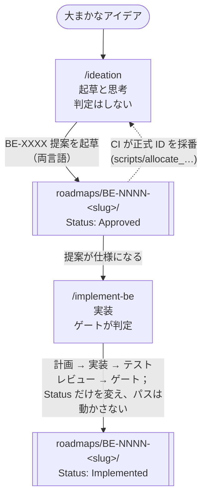

[English](../roadmap-workflow.md) · **日本語**

# ロードマップのワークフロー：着想から実装まで

> このページは、大まかなアイデアが出荷されゲートを通過したコードになるまでの道のりをたどります。
> **`ideation`** スキルがロードマップ項目（BE 項目）を *起草* し、**`implement-be`** スキルがそれを
> *出荷* します。この 2 つは意図的に対をなしています。片方が[ロードマップ](../../roadmaps/README-ja.md)を
> 満たし、もう片方がそれを消化します。両者が合わさって、Bajutsu へのあらゆる自明でない変更が通る循環を
> 形づくります。この循環が前提とする BE ID の仕組みは、
> [ai-development](ai-development.md#ロードマップ項目-be-id厳守) が規定します。

> **貢献が初めての方は、[コントリビューターワークフローチュートリアル](contributor-workflow-tutorial.md)から
> 始めてください。** 一つのアイデアをこの循環全体に通す、手を動かしながらの段階的な walkthrough です。
> `propose-and-build` で 1 つの PR にまとめるときも示します。このページは、チュートリアルの背後にある
> 考え方の概観です。

Bajutsu のロードマップは、ざっと眺めて通り過ぎるバックログではありません。テストにとってシナリオ YAML が
共有ハブであるのと同じように、ロードマップは計画の **共有ハブ** です。機能はまず BE（*Bajutsu Evolution*）
項目として [`roadmaps/`](../../roadmaps/README-ja.md) の下に書き留められます。その項目を提案として議論し
洗練してから、機能を作ります。この道のりの両半分にはそれぞれ専用のスキルがあるので、歩くのが人間でも
エージェントでも道筋は同じです。

## 循環の全体像

Mermaid ソース

<!-- mermaid-svg: assets/diagrams/roadmap-workflow-cycle-ja.svg -->

2 つのスキルは、同じ 3 つの **絶対指針**（[`CLAUDE.md`](../../CLAUDE.md)）を共有します。AI は起草と調査を
担い判定はしないこと、決定性を最優先すること、アプリ非依存であること、の 3 つです。両者が指針を共有する
のは、無関係な 2 つの道具ではなく 1 本のパイプラインの両端だからです。

指針の枠内で作れないアイデアは、よい提案ではありません。`ideation` はそのアイデアを捨てず、枠に収まる形に
作り直します。`implement-be` は、作りかけの項目が指針に反すると判明したときに、黙って迂回することを
拒みます。

## 起草：`ideation` スキル

`/ideation` で起動します。Bajutsu が次に何をできるかを考えたいとき、または大まかなアイデアを BE 項目に
仕立てたいときに使います。このスキルは白紙ではなく **相談相手** です。どの提案も、すでに計画済み、進行中、
あるいは意図的に採用しないと決めたものに結びつけます。

1. **既存のロードマップに足場を置く**：
   [`roadmaps/README-ja.md`](../../roadmaps/README-ja.md)（すでにスコープ外のものと、BE 番号を待つ
   未整理のアイデア）を読みます。出荷済みのものを「提案」しないために、
   [`architecture.md#実装状況`](architecture.md#実装状況)も読みます。トピックに近い BE 項目も読みます。
2. **一緒に着想する**：具体的で範囲の定まったアイデアを示します。範囲を絞る問いも投げかけます。誰のための
   ものか、どの [Tier](glossary.md#2-つの層) に触れるか、*機械チェック可能* な成果は何か、の 3 つです。
   隣接する項目を参照点として引き込みます。
3. **残ったアイデアを分類する**：3 つの行き先のどれかに振り分け、どれを選んだかを伝えます。
   - **既存の項目と重なる**：重複を作らず、その項目を補強します。
   - **新規で範囲が定まっている**：新しい項目を起草します。
   - **まだ形になっていない**：両言語の README の *未整理のアイデア* に箇条書きで残し、後で昇格します。
4. **プレースホルダー ID で新項目を起草する**：`make new-roadmap-item SLUG=… TITLE="…"` が
   `roadmaps/BE-XXXX-<slug>/` を、両言語のファイルとともに正規の Swift Evolution 形式で生成します。
   スキルは `TBD` の節を埋め、日本語側を自然な日本語に書き直します。`BE-XXXX` というプレースホルダーは
   意図的です。**ID を人手で当て推量することはありません。**
5. **CI のレビュー契約に照らしてセルフレビューする**：新規サブエージェントが、「Claude review」
   ワークフローが使うのと同じ契約（[`.github/claude-review-prompt.md`](../../.github/claude-review-prompt.md)、
   BE-0203）を、ステージ済みの差分に適用します。このサブエージェントは起草の会話を見ていません。CI の
   レビュアーが起草の経緯を知らない状態からレビューするのと同じ条件にするためです。スキルは見つかった指摘を
   基本的にすべて直しますが、例外が 2 つあります。
   - 誤検知や説明済みのトレードオフは、理由を書き添えて見送ります。
   - 設計そのものに関わる指摘は、直そうとせずユーザーにエスカレーションします。

   レビューは最大 3 回繰り返します。それでも指摘が収束しない場合は、ユーザーに判断を仰ぎます。
6. **検証し、依頼されたときだけ PR を開く**：ドキュメントだけの変更でも `make check` でゲートを緑に保ちます。
   PR 本文には、正式 ID を CI が採番することを書き添えます。

プレースホルダーを使うのは、ID が永続で単調増加であり、同時に多数のブランチが進行しているからです。
番号を人手で選ぶと競合します。2 つの PR が同じ番号をつかんでしまうからです。
[`roadmap-id`](../../.github/workflows/roadmap-id.yml) ワークフローが、PR 時に
[`scripts/allocate_roadmap_ids.py`](../../scripts/allocate_roadmap_ids.py) を走らせます。このスクリプトは
次に空いている ID をアトミックに確保し、`BE-XXXX` を `BE-NNNN` にすべて書き換えて、結果をブランチに
押し戻します。こうして起草は競合と無縁でいられます。詳しい仕組みは
[ai-development](ai-development.md#ロードマップ項目-be-id厳守) にあります。

## 出荷：`implement-be` スキル

`/implement-be BE-0066`（完全な ID、数字だけ、あるいは slug の一部）で起動します。既存の提案を出荷済みの
コードに変えたいときに使います。提案の **Detailed design**（詳細設計）が仕様です。判定するのは決定的な
ゲート（`make check`）であって、LLM ではありません。

1. **項目を特定する**：**両方** の言語ファイルを読みます。`Approved` の項目は、審査のゲートを通過した
   マージ（2人承認、または `single-approver proposal` の免除下では1人承認）の時点ですでに受理されています。
   そのため、実装は項目に *着手する* ことを意味し、この PR が状態を `Implemented` に切り替えます。
   スキルはそれを最初に伝えます。すでに `Implemented` の項目、`Deferred`（保留）の項目、`Rejected`
   （却下）の項目では、いったん止まって本当に何を望むかを確認します。`Rejected` の場合は、人間がその却下を
   明示的に覆したかどうかを確認します。
2. **トラッキング issue を確保する**：未着手の項目には、いずれも `roadmap-tracking` ラベル付きの GitHub
   issue があります。すでに他の担当者が割り当てられていれば、作業が重複しないようそこで止まります。
   そうでなければ、ブランチを切る前に自分をその issue の担当者にします。
3. **仕様とコードに足場を置く**：Detailed design と *Alternatives considered*（検討した代替案）を読みます。
   後者は却下済みの道筋（多くは指針上の理由による）を記録しているので、蒸し返しません。提案がリンクする
   ファイルをすべて開き、[実装状況](architecture.md#実装状況)を確認します。前提となる BE 項目が、それ自体
   まだ提案のままでないかも検証します。
4. **集中したブランチを用意する**：最新の `origin/main` から `claude/be-NNNN-<slug>` を切ります。ブランチが
   触れるのは、この項目に必要なファイルだけです。
5. **計画し、コードを書く前に合意を得る**：ロードマップ項目を丸ごと実装するのは大きく、後戻りが難しい作業
   です。そこで、まず具体的な計画への同意を得ます。計画に挙げるのは次の項目です。
   - 手を入れるファイル
   - 動くことを証明する *機械チェック可能* な成果と、AI に任せてよい箇所とよくない箇所
   - テスト
   - 両言語で動かすべきドキュメント
   - 絶対指針との緊張
6. **実装する**：設計どおりに、コードベースの流儀（既存のスタイル）に合わせて作ります。守る点は次のとおりです。
   - 厳格な `mypy` と設定済みの `ruff`
   - `sleep` ではなく条件待ち
   - 新しいつまみは `targets.<name>` 設定へ
   - 回帰の網としてのテスト
   - 文書化された挙動には両言語のドキュメント
7. **差分をレビューして洗練する**：リポジトリ自身のレビュー契約
   [`.github/claude-review-prompt.md`](../../.github/claude-review-prompt.md) に照らします。契約が定めるのは、
   CI の自動レビュアーが PR に当てるのと同じレンズ（BE-0203）です。レビュー用のコマンドは使わず、契約を
   読み込ませた新しいレビューコンテキストに任せるので、レビューはスキルの導入状況に左右されません。
   契約とあわせて、組み込みの [`simplify`](../../.claude/skills) スキルを使います。自明でない変更では
   **pr-review-toolkit** のエージェントも回します。これらは *起草の補助* です。著者に助言するだけで判定は
   しないので、指針 1 が保たれ、`run`/CI の経路に LLM が触れることはありません。更新した差分に契約を再度
   当てる作業を、指摘がなくなるまで繰り返します。実際の指摘がすべて直ってから、手順 10 で PR を開きます。
   手順 5 と同じく 3 回を上限とし、それでも実際の指摘が残る場合は、PR を開かずユーザーに判断を仰ぎます。
8. **項目を Implemented に切り替える**：両言語のファイルで `Status: Implemented` にし、`Implementing PR` の
   行を加えます。ダッシュボードが項目のメタデータから `Status` を直接読み取るため、ほかに再生成するものは
   ありません。ディレクトリは移動しません（BE-0159）。変わるのは `Status` とそのダッシュボードのバケット
   だけです。
9. **ゲートで検証する**：`make check` は緑でなければなりません。赤のまま push しません。正しさが本当に
   Simulator やブラウザでの実行に依存する場合は、[`verify`](../../.claude/skills) スキルがその実行を
   担います。未検証のまま動くと主張することはありません。
10. **Draft PR を自動で開く**：ゲートが緑になったら、依頼を待たずスキル自身が PR を開きます。出力は常に
    自己完結したゲート緑の変更だからです。タイトルには `[BE-NNNN]` 接頭辞を付けます。続く push で
    `Implementing PR` の行に実際の番号を埋めます。

## なぜ 1 つではなく 2 つのスキルなのか

起草と出荷を分けることは、Bajutsu 自身の中核的な境界を映しています。`ideation` は **著者** の役割にいて、
考え、提案し、作り直します。その出力である提案は、けっして判定ではありません。`implement-be` は **作り手**
の役割にいて、仕様を、決定的なゲートが合否を下すコードに変えます。

Bajutsu は、テスト実行の合否判定から AI を締め出します。このワークフローも同じように、計画の *開かれた*
部分（何を作るべきか、このアイデアは健全か）を、出荷の *閉じた* 部分（このコードは仕様を満たしゲートを
通るか）からはっきり切り離します。議論を重ねて形になった提案は、一行のチケットよりはるかによい仕様です。
その仕様に枠づけられた実装は、行き当たりばったりの変更よりはるかにレビューしやすくなります。

## 関連項目

- [ai-development](ai-development.md)：並行作業の規則、ゲート、そして両スキルが依存する **BE ID の厳格な
  ライフサイクル**（`Status` がダッシュボードのバケットを決める、1 ディレクトリのフラット構成、永続 ID）。
- [roadmaps/README](../../roadmaps/README-ja.md)：ロードマップ項目の追加方法、すでにスコープ外のもの、
  BE 番号を待つ未整理のアイデア。
- [concepts](concepts.md)：絶対指針が体現する、決定性と AI の境界の原則。
- [`CLAUDE.md`](../../CLAUDE.md)：絶対指針の出どころである working agreement。
