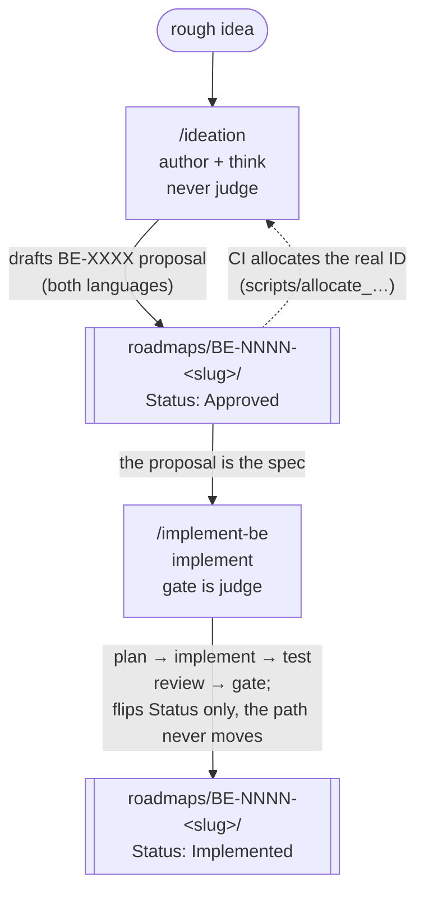

**English** · [日本語](ja/roadmap-workflow.md)

# The roadmap workflow: ideation → implementation

> This page follows a feature from a rough idea to shipped, green code. The **`ideation`** skill
> *authors* a roadmap (BE) item, and the **`implement-be`** skill *ships* it. The two are deliberate
> counterparts: one fills the [roadmap](../roadmaps/README.md) and the other empties it. Together
> they form the loop that every non-trivial change to Bajutsu runs through. The BE-ID mechanics the
> loop relies on are specified in [ai-development](ai-development.md#roadmap-items-be-ids-strict).

> **New to contributing? Start with the [contributor workflow tutorial](contributor-workflow-tutorial.md).**
> It is a hands-on, step-by-step walkthrough that runs one idea through this whole loop. It also
> shows when to fold the loop into a single PR with `propose-and-build`. This page is the conceptual
> overview behind the tutorial.

Bajutsu's roadmap is not a backlog you skim past. It is the **shared hub** for planning, the same
way a scenario YAML is the shared hub for a test. A feature starts as a BE (*Bajutsu Evolution*)
item under [`roadmaps/`](../roadmaps/README.md). The team discusses and refines that item as a
proposal, and builds the feature afterward. Each half of that journey has a dedicated skill, so the
path stays the same whether a human or an agent walks it.

## The cycle

Mermaid source

<!-- mermaid-svg: assets/diagrams/roadmap-workflow-cycle.svg -->

The two skills share the same three **prime directives** ([`CLAUDE.md`](../CLAUDE.md)): AI authors
and investigates but never judges, determinism comes first, and the tool stays app-agnostic. They
share the directives because they are two ends of one pipeline, not two unrelated tools.

An idea that cannot be built within the directives is not a good proposal. `ideation` reshapes
such an idea to fit and does not drop it. `implement-be` refuses to work around a directive
silently when a half-built item turns out to violate one.

## Authoring: the `ideation` skill

Invoke the skill with `/ideation` to brainstorm what Bajutsu could do next, or to turn a rough
idea into a BE item. The skill is a **sounding board**, not a blank page. It anchors every
suggestion to what is already planned, in progress, or deliberately not adopted.

1. **Ground in the existing roadmap.** The skill reads [`roadmaps/README.md`](../roadmaps/README.md)
   (what is already out of scope, and unsorted ideas awaiting a BE number). It reads
   [`architecture.md#implementation-status`](architecture.md#implementation-status), so it does not
   "propose" something already shipped. It also reads the BE items near your topic.
2. **Ideate with you.** The skill offers concrete, bounded ideas. It asks the questions that
   sharpen scope: who the idea is for, which [tier](glossary.md#the-two-tiers) it touches, and what
   the *machine-checkable* outcome is. It pulls in adjacent items as reference points.
3. **Classify each surviving idea** into one of three landings, naming which one it chose:
   - **overlaps an existing item**: augment that item rather than duplicate it.
   - **novel and scoped**: draft a new item.
   - **still unformed**: add a bullet under *Unsorted ideas* in both language READMEs, to promote
     later.
4. **Draft the new item with a placeholder ID.** `make new-roadmap-item SLUG=… TITLE="…"` scaffolds
   `roadmaps/BE-XXXX-<slug>/` with both language files in the canonical Swift-Evolution
   format. The skill fills the `TBD` sections and rewrites the Japanese side into natural Japanese.
   The literal `BE-XXXX` placeholder is intentional: **nobody guesses an ID by hand.**
5. **Self-review against the CI review contract.** A fresh subagent applies the contract that the
   "Claude review" GitHub Actions workflow uses
   ([`.github/claude-review-prompt.md`](../.github/claude-review-prompt.md), BE-0203) to the
   staged diff. The subagent never saw the authoring conversation, which mirrors the cold start of
   the CI reviewer. The skill fixes every finding, with two kinds of exception:
   - A false positive or an already-explained trade-off: the skill notes it and leaves it as-is.
   - A finding that calls for a genuine design change: the skill escalates it to you and does not
     attempt it.

   The review runs for at most 3 rounds. If the findings have not converged by then, the skill
   escalates to you.
6. **Verify and (when you ask) open the PR.** `make check` keeps the gate green even for a
   docs-only change. The PR body notes that CI will allocate the real ID.

The placeholder exists because IDs are permanent and monotonic, and many branches are in flight at
once. Picking a number by hand races: two PRs grab the same one. The
[`roadmap-id`](../.github/workflows/roadmap-id.yml) workflow runs
[`scripts/allocate_roadmap_ids.py`](../scripts/allocate_roadmap_ids.py) at PR time. The script
claims the next free IDs atomically, renames `BE-XXXX` → `BE-NNNN` everywhere, and pushes the result
back to the branch. Authoring stays conflict-free. The full mechanics are in
[ai-development](ai-development.md#roadmap-items-be-ids-strict).

## Shipping: the `implement-be` skill

Invoke the skill with `/implement-be BE-0066` (a full ID, a bare number, or a slug fragment) to
turn an existing proposal into shipped code. The proposal's **Detailed design** is the spec. The
deterministic gate (`make check`) is the judge, never an LLM.

1. **Resolve the item** and read **both** language files. An `Approved` item was already accepted
   at its review-gated merge (two approvals, or one under the `single-approver proposal` waiver).
   Implementing it *starts* it, and this PR flips it to `Implemented`. The skill says so up front.
   For an already-`Implemented`, `Deferred`, or `Rejected` item, the skill stops and confirms what
   you want. For a `Rejected` item, it confirms that a human has explicitly overturned the decision.
2. **Claim the tracking issue.** Every open item has a GitHub issue labeled `roadmap-tracking`.
   If someone else is already assigned, the skill stops rather than duplicating work. Otherwise it
   self-assigns the issue before branching.
3. **Ground in the spec and the code.** The skill reads the Detailed design and *Alternatives
   considered*. The latter records paths already rejected, often for directive reasons, so the skill
   does not re-propose them. The skill opens every file the proposal links and checks the
   [implementation status](architecture.md#implementation-status). It also verifies that no
   prerequisite BE item is itself still a proposal.
4. **Set up a focused branch** off the latest `origin/main` (`claude/be-NNNN-<slug>`). The branch
   stays in its lane and touches the files this item needs and no others.
5. **Plan, then confirm before writing code.** A whole roadmap item is large and hard to reverse,
   so the skill asks for your go-ahead on a concrete plan first. The plan lists:
   - the files it will touch
   - the *machine-checkable* outcome that proves it works, and where AI is and is not allowed to sit
   - the tests
   - the docs that must move in both languages
   - any tension with the prime directives
6. **Implement** to the design, matching the codebase grain:
   - strict `mypy` and configured `ruff`
   - condition waits, not `sleep`
   - new knobs in `targets.<name>` config
   - tests as the regression net
   - bilingual docs for any documented behavior
7. **Review and refine the diff** against the repository's own review contract,
   [`.github/claude-review-prompt.md`](../.github/claude-review-prompt.md). These are the same
   lenses that CI's automated reviewer applies (BE-0203). The skill reads them from the contract and
   applies them to the diff in a fresh review context, not through a review command, so the pass
   depends on no installed skill. Alongside the contract, the skill runs the built-in
   [`simplify`](../.claude/skills) skill. For a non-trivial change, it also runs the
   **pr-review-toolkit** agents. These are *authoring aids*: they advise the author and never judge,
   so directive #1 holds and no LLM touches the `run`/CI path. The skill re-runs the review
   contract against the updated diff until the pass comes back empty. It opens the PR (step 10)
   after every real finding is fixed. The cap is 3 rounds, like step 5 above. If a real finding
   still stands, the skill escalates to you with the PR left unopened.
8. **Flip the item to Implemented.** In both language files, set `Status: Implemented` and add the
   `Implementing PR` line. Nothing else needs regenerating, because the dashboard reads `Status`
   straight off the item's metadata. The directory never moves (BE-0159). The `Status` and its
   dashboard bucket change, and nothing else.
9. **Verify with the gate.** `make check` must be green; never push red. If correctness genuinely
   depends on a Simulator or browser run, the [`verify`](../.claude/skills) skill drives that run.
   The skill does not claim the change works untested.
10. **Auto-open the Draft PR.** Once the gate is green, the skill opens the PR itself and does not
    wait for a request, because its output is always a self-contained, gate-green change. The title
    carries the `[BE-NNNN]` prefix. A follow-up push fills the `Implementing PR` line with the
    real number.

## Why two skills, not one

Keeping authoring and shipping separate mirrors Bajutsu's own core boundary. `ideation` lives in
the **author** role: it thinks, proposes, and reshapes, and its output (a proposal) is never a
verdict. `implement-be` lives in the **builder** role: it turns a spec into code that a
deterministic gate either passes or fails.

Bajutsu keeps AI out of the pass/fail judgment of a test run. In the same way, the workflow keeps
the *open-ended* part of planning (what should we build, is this idea sound) cleanly apart from
the *closed* part of shipping (does this code meet the spec and pass the gate). A proposal argued
into shape is a far better spec than a one-line ticket. An implementation bounded by that spec is
far easier to review than a freehand change. The loop is the point.

## See also

- [ai-development](ai-development.md): the parallel-work rules, the gate, and the **strict BE-ID
  lifecycle** (`Status` ⇒ dashboard bucket, flat one-directory layout, permanent IDs) that both
  skills depend on.
- [roadmaps/README](../roadmaps/README.md): how to add a roadmap item, what is already out of
  scope, and unsorted ideas awaiting a BE number.
- [concepts](concepts.md): the determinism and AI-boundary principles that the prime directives
  encode.
- [`CLAUDE.md`](../CLAUDE.md): the working agreement the prime directives come from.
