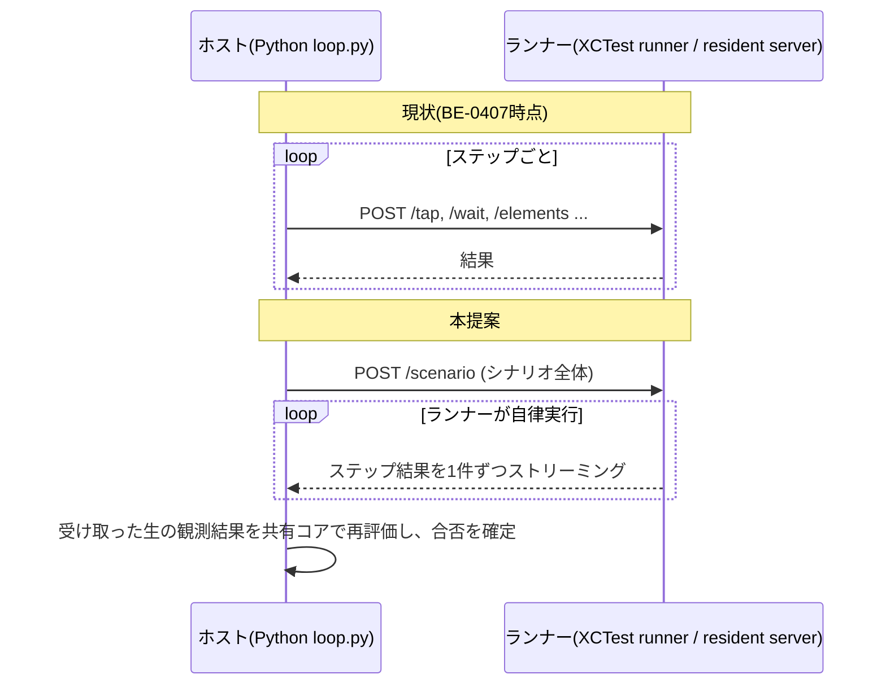

# 共有Rustコアによるオンデバイスでのシナリオ実行

> ステータス: ドラフト
> 対象: `bajutsu/common/orchestrator/`、`bajutsu/common/drivers/base/`、`bajutsu/common/drivers/xcuitest.py`、
> `bajutsu/common/drivers/adb.py`、`BajutsuKit`、`BajutsuAndroidUIAutomatorServer`
> 関連: [BE-0407](../../roadmaps/BE-0407-step-latency-driver-internal-tuning/BE-0407-step-latency-driver-internal-tuning.md)、
> [BE-0408](../../roadmaps/BE-0408-step-latency-device-executor-protocol/BE-0408-step-latency-device-executor-protocol.md)、
> [BE-0409](../../roadmaps/BE-0409-step-latency-ios-device-executor/BE-0409-step-latency-ios-device-executor.md)、
> [BE-0410](../../roadmaps/BE-0410-step-latency-android-device-executor/BE-0410-step-latency-android-device-executor.md)、
> [BE-0365](../../roadmaps/BE-0365-in-app-control-channel/BE-0365-in-app-control-channel.md)、
> [BE-0114](../../roadmaps/BE-0114-driver-conformance-suite/BE-0114-driver-conformance-suite.md)

シナリオの決定論的な解釈を、1つのRustクレートとして書きます。解釈の対象は、セレクタ解決、待機とアサーションの評価、制御フローです。
ホスト側のPythonはPyO3経由で、デバイス上のランナー(iOSとAndroid)はWebAssembly(WASM)経由で、同じバイナリの判定ロジックを呼びます。
この構成によって、ステップ実行におけるホストとデバイスの間の往復をなくします。
BE-0408〜0410が提案する段階的ロールアウトの代替案であり、どちらを採るかを比べるための材料として並記します。

## 1. なにをつくるのか

新しいRustクレート(`rust/bajutsu_core/`)を1つ作ります。
クレートは、次の判定を今日のPythonと同じ規則で実装します。

1つ目は、シナリオの展開です。
対象は、`bajutsu/common/scenario/expand.py`が持つ`if`、`for_each`、コンポーネント展開、変数補完です。

2つ目は、セレクタ解決です。
対象は、`bajutsu/common/drivers/base/_functions.py`の`find_all`と`resolve_unique`です。

3つ目は、1ステップのact、wait、verifyの判定です。
対象は、`bajutsu/common/orchestrator/loop/_functions.py`の`_run_step_body`と`run_scenario`です。

4つ目は、システムアラートによるブロック時の1回リトライ判定です。
対象は、`_step_runner.py`の`alert_guard`呼び出しです。

5つ目は、証跡ルールの発火判定です。
対象は、`bajutsu/common/orchestrator/evidence_rules.py`の`_rule_fires`と`_collect_captures`です。

クレートは2つの形でビルドします。

- **PyO3バインディング**：Pythonの拡張モジュール(`bajutsu_core`)としてビルドし、ホスト側の`bajutsu/common/orchestrator/`から呼べるようにします。ホストはこれを、新しい対象を自ら操作するために使いません。デバイスが返した生の観測結果から、合否を再計算する用途に限って使います。
- **WASMバイナリ**：`wasm32-unknown-unknown`向けにビルドします。iOSでは`XCUITest`ランナープロセス(`BajutsuKit`)に埋め込みます。Androidではresident UI Automatorサーバー(`BajutsuAndroidUIAutomatorServer`)に埋め込みます。タップ、型入力、スワイプ、ツリー読み取り、スクリーンショットといった実際のデバイス操作は、各プラットフォームがWASMのホスト関数としてクレートへ提供します。クレート自身は、どちらのOS APIも呼びません。

対応するアクチュエータの準備が整った時点で、ホストはシナリオ全体を1回のリクエストでランナーへ渡します。
シナリオ全体とは、`before`、`steps`、`expect`、`after`のすべてです。
ランナーはクレートを使って、シナリオを自律的に最後まで実行します。
各ステップが完了するたびに、ランナーは結果を1件ずつホストへストリーミングで返します。
ホストは、その結果をコマンドラインインタフェース(CLI)のライブ出力と`serve`のログバス経由でWeb UIへ、今日と同じ見え方で流し込みます。

合否の最終判定は、ホストが下します。
ホストは、デバイスが返した生の観測結果(選択された要素、アサーション対象の値)を、同じクレートで再評価します。
デバイス自身が計算した`ok`は、そのまま信用しません。

### やらないこと

- **PlaywrightとFakeDriverの置き換えはしません。** 既存ループ(`bajutsu/common/orchestrator/loop/_functions.py`)はそのまま残します。新しいオンデバイス経路を使えるのは、`Capability`(`bajutsu/common/drivers/base/capability.py:6`)で明示的にオプトインしたバックエンドだけです。対象をiOSとAndroidの2バックエンドに絞る理由は、「4. 検討した代替案と、採らなかった理由」に書きます。
- **区間証跡(videoとdeviceLog)の開始と終了の判断は変えません。** 区間証跡は、`simctl io recordVideo`のようなホスト側のOSプロセス制御を要します。デバイス内では完結できません。今回もホストが従来どおり、区間の開始と終了を判断します。ホストは、ステップ実行の合間に軽量な同期コマンドとして、その判断をランナーへ送ります。頻度は低く、ポーリングでもありません。したがって、本提案が削減したい往復には数えません。
- **`http`、`email`、`generate`、`visual`、`golden`、`request`アサーションはデバイスに移しません。** いずれも、デバイスの画面を読まない検証です。BE-0408の境界分けをそのまま踏襲します。
- **セレクタ解決ロジックの意味論そのものは変えません。** `find_all`と`resolve_unique`の現在の規則を、そのままRustへ移します。規則に含まれるのは、`within`、`idMatches`、`labelMatches`、トレイト導出、Androidの派生ラベルのフォールバックです。判定基準は、新設せず変更もしません。

## 2. なぜつくるのか

[BE-0407](../../roadmaps/BE-0407-step-latency-driver-internal-tuning/BE-0407-step-latency-driver-internal-tuning.md)は、実機計測の結果を示しました。
1回の`tap`ステップは、iOSで0.95〜1.07秒、Androidで3.25〜3.32秒かかります。
目標は250〜500ミリ秒であり、ホストとデバイスの間の往復そのものが支配的なコストでした。
原因は、ホストが50ミリ秒間隔でポーリングしながら条件を評価し、そのたびにHypertext Transfer Protocol(HTTP)のラウンドトリップを払っていることにあります。
[BE-0408](../../roadmaps/BE-0408-step-latency-device-executor-protocol/BE-0408-step-latency-device-executor-protocol.md)は、この往復を減らす設計を示しました。
その設計では、セレクタ解決と、待機およびアサーションの判定ロジックを、SwiftとKotlinへそれぞれ独立に移植します。

BE-0408自身が明言しているとおり、独立移植には意味論的ドリフトのリスクが伴います。
ホスト側のPython実装、iOS向けのSwift実装、Android向けのKotlin実装は、3つの独立したコードです。
3つのコードは、同じセレクタに対して常に同じ判定を返し続けなければなりません。
BE-0408は、[BE-0114](../../roadmaps/BE-0114-driver-conformance-suite/BE-0114-driver-conformance-suite.md)のドライバ適合スイートを拡張して、このズレを検知する計画です。
しかし適合スイートの拡張は、「ズレを検知するテストを書き足す」対策であって、「ズレがそもそも起こらない」構造ではありません。
`find_all`と`resolve_unique`の判定基準は、`bajutsu/common/drivers/base/_functions.py:152,274`にあります。
判定基準を将来変更するとき、変更した人は3つの言語で同じ変更をします。
しかも、それぞれが正しいことを確認しなければなりません。
3言語で一致を確認する責任は、BE-0408が対象を2バックエンドに絞ってもなお消えない継続コストです。

もう1つの動機は、往復の削減幅そのものにあります。
BE-0408の段階的ロールアウトは、「待機の条件評価」と「アサーション評価」を、個別にデバイスへ移します。
ステップ列をまとめて1回のリクエストで送る設計に至るのは、最終段階(ステージ4)になってからです。
裏を返せば、ステージ1〜3の期間は、往復の一部しか削減されません。
ステージ4に至っても、ステップをまたいだ判定はホストの役目のまま残ります。
例えば、システムアラートを検出したときの1回リトライ判定(`_step_runner.py`の`alert_guard`呼び出し)です。

本提案は、シナリオ全体を最初からランナーへ渡します。
シナリオに含まれる制御フローと、ステップ間の再試行判定まで、デバイス側でまとめて解釈実行させます。
こうすれば、ホストとデバイスの間の往復は、フェーズの境界と区間証跡の開始および終了だけになります。
この設計は、BE-0408のステージ4がまだ持ち越している往復の残りを、追加の段階を経ることなく一度に削ります。

## 3. どう実現するか



### 新設するRustクレート

`rust/bajutsu_core/`に、次の責務を持つモジュールを置きます。

**シナリオ展開**は、`bajutsu/common/scenario/expand.py`の`expand_components`、`expand_data`、`apply_setups`が行う展開を移植します。
対象は、`if`と`for_each`の展開、コンポーネント展開、`vars.*`補完です。

**セレクタ解決**は、`bajutsu/common/drivers/base/_functions.py`の`find_all`と`resolve_unique`を移植します。

**ステップループ**は、`bajutsu/common/orchestrator/loop/_functions.py`の`run_scenario`と`_run_step_body`が行う、act、wait、verifyの流れを移植します。
システムアラートの1回リトライ判定(`_step_runner.py`)も移植します。

**証跡ルール判定**は、`bajutsu/common/orchestrator/evidence_rules.py`の`_rule_fires`と`_collect_captures`を移植します。
これにより、どのステップでスクリーンショットと要素ツリーを取るべきかを、デバイス側で自己完結して判断できます。

**`Driver`トレイト**は、`bajutsu/common/drivers/base/driver.py`の`Driver`プロトコルに対応するRustのトレイトとして定義します。
具体的な実装は持ちません。
`tap`、`query`、`type_text`、`swipe`、`screenshot`を、WASMのホスト関数呼び出しとして宣言するだけにとどめます。

#### 同一ソースでも結果が分かれる条件

セレクタ解決とステップループの判定基準は、ホストのPyO3バインディングとデバイスのWASMバイナリの両方を、同じソースからビルドします。
ただし、同じソースからビルドしたことは、両者が常に同じ結果を返す保証にはなりません。
PyO3バインディングはネイティブターゲット向けで、WASMバイナリは`wasm32-unknown-unknown`向けだからです。
ターゲットに依存する差が、判定を分けることがあります。
差の例は、`usize`の幅(64ビットと32ビット)、浮動小数点の丸めと文字列化、`HashMap`の反復順です。
順序が判定に効く箇所では、この差が非決定性になりえます。
例えば、`resolve_unique`の重複畳み込み([`bajutsu/common/drivers/base/_functions.py:274`](../../bajutsu/common/drivers/base/_functions.py))です。
この箇所では、ホストとデバイスが別の要素を選ぶ形になります。

そこでクレートは、順序が判定に効く箇所の型を、`BTreeMap`のような決定的な型に限ります。
加えて、両ターゲットが[BE-0114](../../roadmaps/BE-0114-driver-conformance-suite/BE-0114-driver-conformance-suite.md)のドライバ適合スイートの同じフィクスチャに対して同一の結果を返すことを、CIで継続的に突き合わせます。
この差分検査を前提とすることで、BE-0408が抱える3実装間の意味論的ドリフトのリスクを、実装を1つに絞る形で大きく減らします。
適合スイートの役割は2つです。
1つは、`FakeDriver`など既存の`Driver`実装と同じフィクスチャに対して、このクレートを検証することです。
もう1つは、2ターゲット間の差分検査を担うことです。

### ホスト側の変更

`bajutsu/common/orchestrator/loop/_functions.py`の`run_scenario`の先頭に、分岐を1つ加えます。
対象の`Driver`が、オンデバイス実行の`Capability`を宣言しているかどうかを見る分岐です。

宣言していなければ、既存のステップループには、コードと挙動のどちらにも手を加えません。
宣言していれば、新設のPyO3バインディング経由で、シナリオ全体を対象のランナーへ渡します。
ホストは、返ってくるステップ結果のストリームを、1件ずつ受け取ります。
受け取った結果は、今日`StepOutcome`を`push`している箇所と同じ経路に流し込みます。
同じ経路とは、レポート書き込み、CLIのライブ出力、`serve`のログバスへの中継です。

デバイスが返す各ステップの結果には、判定済みの真偽値だけでなく、判定の根拠になった生の観測結果を含めます。
生の観測結果とは、解決された要素の属性と、アサーション対象として読んだ値です。
ホストは、受け取った生の観測結果を同じRustクレート(PyO3バインディング)へ渡し、合否をホスト側で再計算します。
デバイスが計算した`ok`は、そのまま採用しません。

シナリオの展開もデバイス側へ移すため、ホストは確認をもう1つ加えます。
ホストは、同じPyO3バインディングでシナリオをローカルにも展開します。
そして、デバイスから返ってきたステップ列が、その展開結果と一致することを確認します。
一致しなければ、デバイス側の制御フロー(`if`の分岐や`for_each`の反復回数など)がホストの想定と食い違っている証拠です。
その時点で、失敗として扱います。

この確認をしない場合、デバイス側の制御フローに誤りがあってステップが黙って飛ばされても、報告された各ステップの`ok`だけを見て合格と判定してしまいかねません。
合否を最終的に下すのは常にホストであるという原則(prime directive 1)は、この二重の確認によって成り立ちます。

### iOS側の変更

`BajutsuKit/Sources/BajutsuRunner/APIHandler.swift`に`POST /scenario`エンドポイントを追加します。
BE-0409が同名で提案している設計と、意図的に同じ名前にします。
どちらを採るとしても、このエンドポイント名の周辺で積んだ実装の一部を転用できるようにするためです。

ランナープロセス内でWASMランタイムを1つ動かし、`bajutsu_core`のWASMバイナリをロードします。
ホスト関数として提供するのは、`XcuitestElementProvider.swift`が持つ次の操作です。
`tap`、`snapshot`、`type`、`swipe`、スクリーンショット取得を提供します。
`APIHandler`は、`BajutsuKit`の全操作をランナーのメインスレッドへ直列化しています(BE-0323の非再入性)。
そのため、WASM側からのホスト関数呼び出しも、同じスレッド上で同期的に実行します。

この直列化を担うのは、次の2つです。

- `operations`という直列キュー
- `serialized(_:)`内の`DispatchQueue.main.sync`

実装は[`APIHandler.swift:51,354-366`](../../BajutsuKit/Sources/BajutsuRunner/APIHandler.swift)にあります。
シナリオ全体を実行する`POST /scenario`は、実行中このキューを占有し続けます。
そのため、`POST /scenario/cancel`や区間証跡の開始および終了を伝えるコマンドを、同じキュー経由で届けると、シナリオが終わるまで処理されません。
今日`health`と`setInterruptionPolicy`がこのキューを迂回しているのと同じ扱いを、新しい2つのエンドポイントにも与える必要があります。

WASMランタイムの候補は、次の2つのいずれかです。

- Bytecode Allianceのwasmtimeに対するSwiftバインディング
- 純Swift実装のWasmKit

どちらが埋め込みやすいかは、実装に着手する前の検証で確かめます。
`xcodebuild`のテストターゲットへ追加する依存として、どこまで軽く収まるかも同じです。
この実現可能性の検証は、「5. 作業手順」の最初のiOS向けステップで行います。

### Android側の変更

`BajutsuAndroidUIAutomatorServer`のresident instrumentationサーバーに、同じく`POST /scenario`エンドポイントを追加します。
Java仮想マシン(JVM)上で動くWASMランタイムを、1つ組み込みます。
候補は、純JVM実装で追加のネイティブライブラリ署名を要しないChicoryなどです。
ホスト関数としては、既存の`UiAutomation`セッションと`AccessibilityNodeInfo`アクセスを、そのまま提供します。

`ResidentServerTest.kt`が持つ`POSTDATE_BUDGET_MS`のような固定待機は、Rustクレート側のイベント駆動の待機判定に置き換わります。
この置き換えは、BE-0410の設計をそのまま引き継ぎます。

### 進捗のCLIとWeb UIへの配信

`POST /scenario`のレスポンスは、BE-0409が提案するのと同じチャンク転送を使います。
ステップが完了するたびに、1行1件の改行区切りのJavaScript Object Notation(JSON)であるNDJSONとして、1件ずつ書き出します。

```json
{"index": 3, "action": "tap", "ok": true, "durationMs": 42, "artifacts": [...]}
```

ホストは接続を開いたまま、この行が届くたびに読み取ります。
読み取った行は、既存の`StepOutcome`と同じ形へ変換します。
変換後は、今日CLIのライブ出力と`serve`のログバスが読んでいるのと同じ経路に渡します。

CLIのライブ出力とWeb UIのReplayタブの見え方は変えません。
変わるのは、進捗の生成元だけです。
今日は、ホストのforループ内で同期的に計算されます。
本提案では、ストリーミングで届きます。

### 既存機構との整合

- **キャンセル([BE-0370](../../roadmaps/BE-0370-graceful-run-cancel/BE-0370-graceful-run-cancel.md))**：`POST /scenario`と対になる`POST /scenario/cancel`を追加します。同じ認証トークンで保護します。ランナー内のRustループは、ステップの境界ごとにフラグをポーリングし、このエンドポイントがそのフラグを立てます。iOS側は、前述のとおり、このエンドポイントを直列キューの外で処理します。ホストが`SIGTERM`やWeb UIの停止ボタンを受けたら、この認証済みリクエストを送ってから、ストリームの終端を待ちます。シナリオ全体を1回で渡す設計でも、キャンセルの反応点はステップ境界のまま変わりません。
- **バックエンドのクラッシュ復旧([BE-0291](../../roadmaps/BE-0291-xcuitest-runner-reuse-across-scenarios/BE-0291-xcuitest-runner-reuse-across-scenarios.md)、BE-0407の`recovery.py`)**：ランナープロセスがシナリオの途中で落ちる場合を考えます。ホストは、接続断として、今日と同じ`BackendCrashError`を検出します。既存の再リースとリトライの判断を、そのまま使います。この経路は変更しません。
- **区間証跡**：「やらないこと」に書いたとおり、開始と終了の判断はホストに残します。この開始と終了のコマンドも、iOS側では前述の直列キューの外で処理する必要があります。

## 4. 検討した代替案と、採らなかった理由

| 案 | 概要 | 採らなかった理由 |
|---|---|---|
| BE-0408〜0410のとおり、SwiftとKotlinへ個別に移植する | セレクタ解決と判定ロジックを各言語へ手作業で移植し、BE-0114の適合スイートで検証します | 実装の初期コストは小さいです。しかし、3つの独立実装(ホストのPython、iOSのSwift、AndroidのKotlin)が同じ判定を返し続ける保証を、将来のあらゆる変更のたびにテストで確認し続けるコストを払います。本提案はRust/WASMという別種のツールチェイン導入コストを1回払う代わりに、このコストを構造的に減らします |
| PythonそのものをWASM化する(Pyodideなど) | CPythonをWASMにコンパイルしたランタイムを、ランナーとサーバーへ埋め込みます | 却下します。CPythonのWASMランタイムは数十MB級であり、XCTestランナーやAndroidインストゥルメンテーションのプロセスに埋め込むには重すぎます。CPythonのグローバルインタプリタロックとスレッドモデルも、`APIHandler`がすべての操作をメインスレッドへ直列化する設計(BE-0323)と相性が悪いです |
| 宣言的な仕様(中間表現やドメイン固有言語(DSL))からSwiftとKotlinのコードを生成する | 判定ロジックを1つの記述から書き、ビルド時にネイティブコードへ変換します | 却下します。ランタイム依存を増やさない利点はあります。しかし生成後のコードは、結局2つの独立したネイティブコードとして存在します。実行時の一致は「生成器が正しく変換したことを信頼する」形にとどまり、本提案が狙う、両ターゲットをCIで継続的に突き合わせる検証にはなりません。しかも生成器自体の保守コストが、WASMランタイムの組み込みコストと同程度かかります |
| Rustコアで`loop.py`全体を置き換え、PlaywrightとFakeDriverも含めて統一する | ホスト側の実行経路も、Rustコア経由に一本化します | 今回のスコープでは却下します。対象範囲が、検証したい問い(iOSとAndroidの往復削減)を越えて広がります。既存の全バックエンドのテスト資産も巻き込みます。まずiOSとAndroidのオンデバイス経路だけで実証します。置き換え範囲の拡大は、実証結果を見てから別途判断します |

## 5. 作業手順

| # | やること | 触るファイル | 完了条件 | 前提 |
|---|---|---|---|---|
| 1 | `rust/bajutsu_core/`にクレートを新設し、シナリオ展開(`expand_components`、`expand_data`、`apply_setups`相当)を移植します | `rust/bajutsu_core/` | 既存の`bajutsu/common/scenario/expand.py`のテスト用フィクスチャと同じ入力を与え、Rust側の出力をJSONへシリアライズしたものが一致することをゴールデンファイル比較で確認します | なし |
| 2 | セレクタ解決(`find_all`と`resolve_unique`)を移植します | `rust/bajutsu_core/` | BE-0114のドライバ適合スイートのフィクスチャをRust側でも読み、既存の期待結果と一致することを確認します | 1 |
| 3 | ステップループ(act→wait→verify)とシステムアラートの1回リトライ判定、証跡ルール判定を移植し、Rustクレート内のフェイクドライバに対して動かします | `rust/bajutsu_core/` | クレート単体のテストが、`bajutsu/common/drivers/fake.py`が持つ既存シナリオのいくつかについて、Python版`run_scenario`と同じ`RunResult`(合否と失敗理由)を返します | 2 |
| 4 | PyO3バインディングをビルドし、`Capability`とホスト側の再評価ロジック(デバイスが返す生の観測結果から合否を再計算し、ローカルに展開したステップ列と突き合わせる処理)を`loop.py`に追加します。この`Capability`を宣言しない既存ドライバの挙動は変更しません | `bajutsu/common/drivers/base/capability.py`、`bajutsu/common/orchestrator/loop/_functions.py` | 既存のドライバ適合スイートと回帰テストが無変更で通ります(新しい`Capability`は誰も宣言していないため経路に入りません) | 3 |
| 5 | iOS向けにWASMランタイムの実現可能性を検証します(候補: wasmtimeのSwiftバインディング、WasmKit)。1つの単純なシナリオ(`smoke.yaml`相当)をWASM経由で最後まで実行できることを確認します | `BajutsuKit/Runner/` | 実機シミュレータ上で、選んだランタイムがXCTestのテストターゲットにビルドでき、クレートの1関数呼び出しが成功します | なし(他のどの手順よりも先に着手します) |
| 6 | iOSの`APIHandler`に`POST /scenario`を追加し、ホスト関数(タップ、スナップショット、型入力、スワイプ、スクリーンショット)を配線して、1つの単純なシナリオをエンドツーエンドで通します | `BajutsuKit/Sources/BajutsuRunner/APIHandler.swift`、`BajutsuKit/Runner/Sources/XcuitestElementProvider.swift` | `make -C demos/showcase run-swiftui`の`smoke`シナリオが、新しい経路で合格として終わります | 4、5 |
| 7 | 進捗のNDJSONストリーミングをホスト側で受け取り、CLIのライブ出力と`serve`のログバスへ中継する配線を実装します | `bajutsu/common/orchestrator/`、`bajutsu/serve/logbus/` | `bajutsu run`実行中、ステップが完了するたびにCLIの出力行が増える見え方が、既存の(非オンデバイス)経路と同じになります | 6 |
| 8 | `POST /scenario/cancel`を、`operations`の直列キューを迂回する形で追加し、`SIGTERM`とWeb UIの停止ボタンからのキャンセルが、オンデバイス実行中のシナリオに対しても`RunResult(ok=False, failure="cancelled")`を返すことを確認します | `BajutsuKit/Sources/BajutsuRunner/APIHandler.swift`、`bajutsu/common/orchestrator/control_channel.py` | BE-0370の既存キャンセルテストと同等のテストを、オンデバイス経路に対しても追加し、通します | 6 |
| 9 | Android向けにWASMランタイムの実現可能性を検証します(候補: Chicoryなど純JVM実装)。1つの単純なシナリオをWASM経由で最後まで実行できることを確認します | `BajutsuAndroidUIAutomatorServer/` | Android実機かエミュレータ上で、選んだランタイムがinstrumentationテストターゲットにビルドでき、クレートの1関数呼び出しが成功します | なし(他のどの手順よりも先に着手します) |
| 10 | Androidのresident UI Automatorサーバーに、手順6〜8と同じ範囲の作業(`POST /scenario`の追加、進捗ストリーミング、`POST /scenario/cancel`)を行います | `BajutsuAndroidUIAutomatorServer/` | Android実機かエミュレータ上で、iOSと同じ`smoke`シナリオがオンデバイス経路で合格します | 4、9 |
| 11 | `controls.yaml`(BE-0407、BE-0409、BE-0410が使う実機計測の物差し)を新しい経路で計測し、BE-0409とBE-0410が見積もる1タップあたりの目標値(iOS 200〜350ミリ秒、Android 150〜300ミリ秒)と比較できる数値を記録します | `roadmaps/`配下の本項目のディレクトリ | 実機トレースの結果を本仕様書またはBE番号を割り当てた後の項目のProgressに記録します | 6、10 |
| 12 | この比較結果を踏まえ、BE-0408〜0410とどちらを採るかの判断材料として、英語と日本語の両方のドキュメント(`docs/drivers.md`と`docs/run-loop.md`とその日本語版)へ反映します | `docs/drivers.md`、`docs/run-loop.md`、`docs/ja/`配下 | 両言語の該当ページが、本提案とBE-0408〜0410のどちらが採用されたかを反映します | 11 |
| 13 | CIと`make check`のゲートにRust/WASMのビルドを組み込む方法(`maturin`をuvのビルドフローにどう統合するか、`wasm32-unknown-unknown`ターゲットのビルドをどのジョブで行うか)を決めます | `Makefile`、`.github/workflows/` | 新しいクレートに対する`cargo test`と型検査が、既存の`make check`と同じくフルクローンから再現できる形でCIに載ります | 1 |

詰め切れていない箇所は2つあります。
1つは、手順5と9のWASMランタイム選定です。実現可能性を確認する前の仮の候補にとどまります。
もう1つは、手順13のCI統合方法です。
どちらも、実装に着手する前の調査が要ります。
