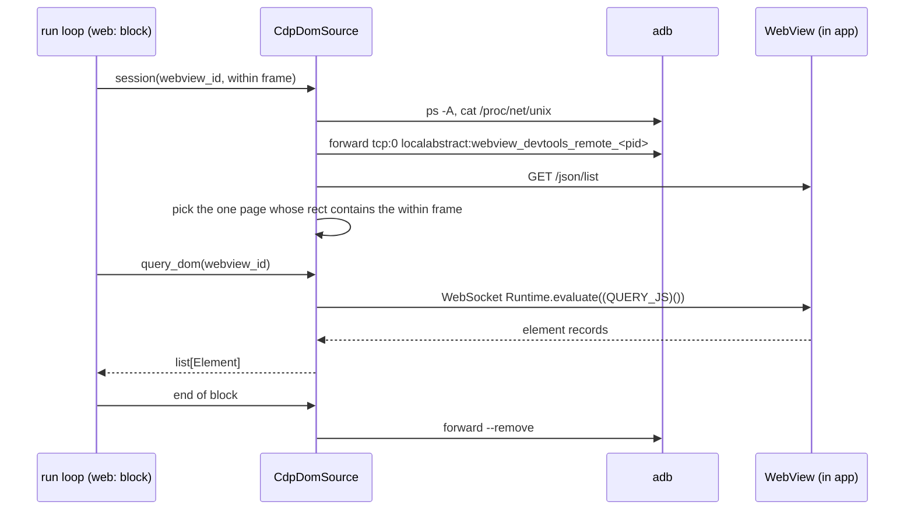

[English](BE-0482-android-webview-cdp.md) · **日本語**

# BE-0482 — 埋め込み Android WebView の DOM を CDP 経由で検索してタップする

<!-- BE-METADATA -->
| 項目 | 値 |
|---|---|
| 提案 | [BE-0482](BE-0482-android-webview-cdp-ja.md) |
| 提案者 | [@0x0c](https://github.com/0x0c) |
| 状態 | **承認済み** |
| トラッキング Issue | [検索](https://github.com/bajutsu-e2e/bajutsu/issues?q=is%3Aissue+label%3Aroadmap-tracking+in%3Atitle+"BE-0482") |
| トピック | プラットフォーム対応 |
<!-- /BE-METADATA -->

## はじめに

**WebView** は、ネイティブアプリが画面の一部に埋め込むブラウザのビューです。シナリオの `web:` ブロックは、
内側のステップを WebView 上のページの Document Object Model（DOM）に対して実行します。iOS では `web:`
ブロックがすでに動きます。一方 Android では実行時に失敗します。Android には、ページの DOM を bajutsu に
渡す仕組みがないためです。

この項目では、`DomSource` インタフェースの Android 向け実装を追加します。新しい実装は Chrome DevTools
Protocol（CDP）を通じて WebView にアクセスします。既存の `WebContextDriver` は手を加えずに Android で動きます。
同じ `web:` シナリオが両プラットフォームで通るようになり、パリティ表の `webView` 行から Android の差分が
消えます。

## 動機

ハイブリッドアプリは UI の一部を WebView で描画します。iOS の bajutsu は、その部分を BajutsuKit の
WebView ブリッジ経由で読みます。ブリッジを追加したのは
[BE-0037](../BE-0037-webview-hybrid-support/BE-0037-webview-hybrid-support-ja.md) です。ブリッジは
アプリ内で動く Hypertext Transfer Protocol（HTTP）サーバーです。アクセシビリティ識別子で `WKWebView`
を探し、ページ内で DOM を走査するスクリプトを評価して、要素ごとに 1 件のレコードを返します。`web:`
ブロックはそのレコードを `WebContextDriver` に渡し、`WebContextDriver` がセレクタを解決します。

Android には同等のブリッジがありません。実行ループは Android にもブリッジ用のポートを確保し、
`BAJUTSU_WEBVIEW_PORT` として渡しています。しかし Android の `reach_device_port` は何も転送せず、
アプリ側にもそのポートで待ち受けるサーバーがありません。そのため Android の `web:` ブロックは
「WebView bridge unreachable」で失敗します。シナリオの作者はアクセシビリティツリーに頼るしかありません。
ところがアクセシビリティツリーは WebView の中身を粗くしか出さないことが多く、セレクタで選べません。
`data-testid` が出ない、テキストノードがまとめられる、ノードそのものが出ない、といった形で現れます。

一方で Android は、WebView に入る経路をすでに備えています。デバッグを有効にした Android の WebView は、
`webview_devtools_remote_<pid>` という名前の抽象ローカルソケットで待ち受けます。`adb forward` を使えば、
このソケットをホスト側のポートへ転送できます。ソケットで話されるのは、Chrome DevTools の背後にある CDP
です。CDP は `DomSource` が必要とする 2 つの操作を備えています。ページ内でスクリプトを評価する操作と、
指定した位置へ入力を送る操作です。

この項目を実装し終えると、showcase の 1 本の `web:` シナリオが、プラットフォームごとの分岐なしに iOS 版と
Android 版の両方で通ります。`docs/platform-parity.md` の `webView` 行では、Android の欄が現在の「gap」
から「per-run」に変わります。読者はこの 2 点を直接確かめられます。

## 詳細設計

この設計で追加するものは 4 つです。Python 側の `DomSource` 実装、`DomSource` インタフェースへのブロック
単位のメソッド、ホスト側のソケット処理、アプリ側のヘルパーです。`WebContextDriver` とシナリオのスキーマには
手を加えません。

### `DomSource` に加えるブロック単位のセッション

現在の `DomSource` のメソッドは、WebView の id だけを受け取ります。ステップランナーの `_handle_web` は、
`within` セレクタをネイティブのツリーに対して解決します。そのあと解決した要素を捨てて、id だけを残します。
この関数は `bajutsu/common/orchestrator/loop/_step_runner.py` にあります。Android 向けの実装には、
このインタフェースにない情報が 2 つ要ります。WebView の frame と、ブロックの開始と終了です。

そこで `DomSource` に `session(webview_id, frame)` というメソッドを 1 つ加え、コンテキストマネージャを
返すようにします。`_handle_web` は、`within` セレクタ全体で解決した要素を保持し、ブロック内のステップを
`session(host_id, element["frame"])` の内側で実行します。コンテキストマネージャは、ブロックの成否にかかわらず
ブロックの終わりで閉じます。

- iOS 向けクライアントの `WebViewBridge` は、何もしないコンテキストマネージャを返します。
- `CdpDomSource` は、入るときにソケットを開いてターゲットを選び、出るときに転送を取り除きます。
- テスト用のフェイクにも、同じく何もしないメソッドを加えます。

### 実行から WebView へのアクセス経路

### CDP を使う DOM ソース

新しい `CdpDomSource` クラスが `DomSource` の検索と入力の 4 つのメソッドを実装します。置き場所は iOS 向けクライアント
と同じ `bajutsu/common/drivers/webview/` です。

| `DomSource` のメソッド | CDP の呼び出し |
|---|---|
| `query_dom` | 既存の `QUERY_JS` を `(QUERY_JS)()` の形にして `returnByValue` 付きの `Runtime.evaluate` で評価し、`parse_dom` で解析する |
| `tap_element` | `Input.dispatchTouchEvent` で、指定位置に `touchStart` と `touchEnd` を送る |
| `type_text` | `Runtime.evaluate` でフォーカス中の欄の末尾にキャレットを置き、`Input.insertText` で入力し、`Runtime.evaluate` で `change` を発火する |
| `scroll_to` | 要素の `scrollIntoView` を呼ぶスクリプトを `Runtime.evaluate` で評価する |

`QUERY_JS` は `bajutsu/common/drivers/dom.py` にすでにあり、Playwright バックエンドと共有されています。
Android 向けの実装も同じスクリプトを使うので、得られるレコードは web バックエンドや iOS と同じ形になります。

タップでは、画面座標への変換が要りません。`WebContextDriver` はタップ位置を WebView 自身の座標空間で
計算し、単位は Cascading Style Sheets（CSS）ピクセルです。`Input.dispatchTouchEvent` も同じ座標空間の
位置を受け取ります。ページには、ブラウザ自身の入力処理を通った信頼済みのタッチイベントが届きます。iOS の
ブリッジはスクリプトでクリックするため、イベントの経路は両プラットフォームで異なります。ただし記録される
操作は同じで、`cssPixel` 単位の 1 点へのタップです。

`Input.dispatchTouchEvent` は、指定位置に何があっても成功を返します。そこで `tap_element` は、先に
当たり判定をします。同じ位置で `document.elementFromPoint` を `Runtime.evaluate` で評価し、何も
返らなければタッチを送る前にステップを失敗させます。iOS のブリッジも、スクリプトのクリックに
`elementFromPoint` の結果が要るため、同じ場合に失敗します。この確認がなければ、`scroll_to` によって
ビューポートの外へ押し出された位置へのタップが、何も操作しないまま成功として扱われます。

入力も iOS のブリッジにそろえます。iOS のブリッジは欄の値の末尾に文字を追加し、`input` と `change` の
両方を発火します。一方 `Input.insertText` はキャレットの位置に挿入し、`input` しか発火しません。そこで
Android 向けの実装は、先にキャレットを末尾に置き、入力の後で `change` を発火します。これにより、共通の
シナリオが両プラットフォームで同じ文字列を残し、同じイベントを発火します。

### ブロックが指す WebView の特定

`web:` ブロックは `within` セレクタで WebView を指定します。`within` セレクタは adb のツリー上の
ネイティブ要素 1 つに解決され、その要素はデバイスピクセル単位の frame を持ちます。`_handle_web` はこの
frame を `session` に渡します。CDP の `/json/list` は、
ページごとに 1 つのターゲットを返します。Android の WebView では、各ターゲットの `description` が
JavaScript Object Notation（JSON）のオブジェクトです。このオブジェクトには、少なくとも次の 6 つのフィールドがあります。

- `attached` と `visible`：2 つのフラグです。
- `screenX` と `screenY`：ページの原点を、デバイスピクセルで表します。
- `width` と `height`：ページの大きさを、デバイスピクセルで表します。

`CdpDomSource` は、2 つのフラグがどちらも真のターゲットだけを残します。そのなかから、矩形がネイティブ要素
の frame を含むターゲットを選びます。該当が 0 件、または 2 件以上なら、ステップはセレクタエラーで
失敗します。

照合を一致ではなく包含で行うのは、2 つの矩形が測っているものが違うためです。adb のツリーは、画面と
すべての祖先ビューで切り取った後の範囲をビューの矩形として報告します。CDP は WebView の切り取られていない
矩形を報告します。一致で照合すると、画面上の WebView が 1 つだけでも、その一部が隠れていれば該当が 0 件になってしまいます。
WebView の一部が隠れるのは、画面からはみ出したとき、スクロールする親の中にあるとき、ツールバーの下に
あるときです。2 件以上の該当で失敗させる点は、曖昧なセレクタを即座に失敗させるというプライムディレクティブに従っています。CDP の
ターゲットはネイティブの識別子を持たないため、照合には id ではなく frame を使います。frame は `within`
セレクタ全体で解決した値なので、照合はネイティブのツリーで解決したものと同じ要素を見ます。

この規則では、大きな WebView の上に小さな WebView が重なるような、重なり合う 2 つの WebView を区別
できません。両方の矩形が frame を含むので、ステップは曖昧として失敗し、実行の決定性は保たれます。一部が
切り取られた WebView と、重なり合う 2 つの WebView は、ユニットテストで確かめます。

### ブロックごとのソケット

ソケットの名前には、アプリのプロセス ID（pid）が入ります。pid は、アプリの終了後や `relaunch` ステップの
後など、アプリが再起動するたびに変わります。そのため `CdpDomSource` は、ソケットを実行ごとに 1 回ではなく、
`session` を開くたび、つまり `web:` ブロックごとに解決します。

1. `adb shell ps -A -o PID,NAME` でパッケージのプロセスを一覧し、`<package>` とすべての
   `<package>:<name>` の子プロセスを残します。ハイブリッドアプリは WebView を別の `android:process` に
   置くことがあり、`pidof <package>` ではそのプロセスを見落とします。
2. `adb shell cat /proc/net/unix` から `webview_devtools_remote_<pid>` のソケットを一覧し、pid が
   パッケージのプロセスに属するものを残します。`chrome://inspect` も同じファイルを読みます。
3. 残した各ソケットへ、`adb forward` で空いているホスト側のポートを転送し、それぞれの `/json/list` を
   読みます。
4. すべてのソケットのターゲットをまとめて、前述の包含の規則で照合します。
5. 選んだターゲットの `webSocketDebuggerUrl` に WebSocket で接続します。

この手順はアプリごとのプロセス名を必要としないので、ツールはアプリに依存しないままです。

`CdpDomSource` は `session` を閉じるときに転送を取り除くので、転送がブロックより長く残ることはありません。
ソケットが見つからないときは、原因を示す理由とともにブロックを失敗させます。この理由が扱うのは、
パッケージのどのプロセスにもソケットがない場合です。理由には、アプリが WebView の
デバッグを有効にしていないことを書きます。対処は、後述のヘルパーを呼ぶことです。

### 実行への組み込み

現在の `_alloc_webview_bridge` は、web 以外のすべてのプラットフォームに HTTP の `WebViewBridge` を
作ります。この関数は `bajutsu/common/runner/pool.py` にあります。新しいコードでは、代わりに実行環境へ
`DomSource` を問い合わせます。iOS はこれまでどおり HTTP ブリッジと起動時の環境変数を返します。Android は
`CdpDomSource` を返し、`BAJUTSU_WEBVIEW_PORT` は設定しません。`session` の呼び出しを除けば、ステップランナーの
`_handle_web` の振る舞いは変わりません。DOM ソースがないときは、これまでどおり明確な理由でブロックを失敗させます。ただし現在の理由は
`BAJUTSU_WEBVIEW_PORT` を名指ししており、Android ではこの変数を設計上設定しません。新しい理由は、
WebView の DOM ソースがないことを示し、変数名を含めません。通信の失敗も、そのブロックの失敗理由に変えます。

通信の失敗が起きる場面は 2 つあります。1 つは `session` を開くときで、ソケットや `websockets`
パッケージがない場合です。もう 1 つはブロック内の `DomSource` の呼び出しで、CDP がエラーを返した場合や、
ページの遷移やアプリの再起動で WebSocket が閉じた場合です。`CdpDomSource` はこれらをすべて
`WebViewTransportError` という 1 つの例外型で送出し、`_handle_web` がそれを捕まえます。

現在は、このような例外を捕まえる層がありません。`_handle_web` が捕まえるのは `SelectorError` だけで、
内側のステップの処理が捕まえるのは `SelectorError`、`ElementNotTappable`、`AppNotInFront` です。
`bajutsu/common/runner/pipeline.py` のシナリオのループが捕まえるのも `BackendCrashError` だけです。
それ以外の例外は実行ループの外へ抜け、すでに成功したものも含めて、すべてのシナリオの結果を失わせます。

`webView` capability は、iOS と同じく実行ごとに付与されます。静的に宣言するバックエンドはありません。

### WebSocket クライアント

CDP は WebSocket の上で動きますが、Python の標準ライブラリには WebSocket クライアントがありません。
この設計では [`websockets`](https://websockets.readthedocs.io/) を新しいオプションの extra として
追加します。Playwright を入れる `web` extra と同じ扱いです。このパッケージを読み込むのは、Android の実行が
最初の `web:` ブロックに入ったときです。パッケージがなければ、インストールコマンドを
理由に示してそのブロックを失敗させます。import ガードが、ほかのすべての経路からこのパッケージを
遠ざけます。プロビジョニングの要件表の `adb` の項目にこの extra を加えます。要件表は
`bajutsu/common/provisioning/requirements/_shared.py` にあります。これにより、設定されたバックエンドが
Android を含むとき、`scripts/install.sh` がこの extra をインストールします。`scripts/serve.sh` は
`scripts/install.sh` に処理を任せるので、serve でも同じ extra が入ります。ゲートでクライアントを
テストできるよう、dev グループの `bajutsu[...]` にもこの extra を加えます。

### アプリ側のヘルパー

BajutsuAndroid に `Bajutsu.enableWebViewDebugging()` を追加します。このヘルパーは
`WebView.setWebContentsDebuggingEnabled(true)` を呼びます。クリップボードのレシーバーと同じく、アプリは
`Application.onCreate` からヘルパーを呼びます。呼ぶのはデバッグビルドかテストビルドだけです。debuggable な
アプリの WebView が自らデバッグを有効にするかどうかは、WebView のバージョンによって異なってきました。
明示的に呼べば WebView のバージョンに左右されません。debuggable でないテストビルドも扱えます。ヘルパーの KDoc には、
有効にするとデバイス上のどのプロセスもソケット経由でページを読めると書きます。この警告によって、
リリースビルドに呼び出しが残らないようにします。

### 作業分解

次の作業は互いに重ならず、すべてを終えると上の設計を満たします。

| # | 作業 | 範囲 | 確認方法 |
|---|---|---|---|
| 1 | CDP クライアントと `CdpDomSource` | WebSocket の要求と応答、矩形によるターゲット選択、`DomSource` の 4 メソッド（タップ前の当たり判定、キャレットと `change` の扱いを含む）、`WebViewTransportError` | 記録した CDP のやり取りを再生するユニットテストで、デバイスなしに確かめます。要素のない位置へのタップと、ブロックの途中で閉じたソケットも確かめます |
| 2 | ソケットの発見と転送 | `ps`、`/proc/net/unix`、`adb forward` の手順、ブロック単位の寿命、ソケットがないときの理由 | ユニットテストで、コマンドライン、`<package>:<name>` のプロセスにある WebView、エラーの理由を確かめます |
| 3 | 実行への組み込み | `DomSource` の `session` メソッド、`WebViewBridge` とフェイクでの何もしない実装、解決した frame で `session` を開く `_handle_web`、`BAJUTSU_WEBVIEW_PORT` を含まない形に書き換えた DOM ソースなしの理由。あわせて、`DomSource` を返す実行環境のフック。iOS は変えず、Android は `CdpDomSource` を返します | ステップランナーのテストで、`session` が解決した frame を受け取り、失敗したブロックでも閉じること、ソケットがないときはそのブロックだけが失敗することを確かめます。`tests/runner/test_pool.py` のケースで、Android が `BAJUTSU_WEBVIEW_PORT` を設定せず `CdpDomSource` を受け取ることを確かめます |
| 4 | オプションの extra とプロビジョニング | `pyproject.toml` の `websockets` extra、ロックの更新、import ガード、プロビジョニングの要件表の `adb` の項目への extra の追加、dev グループの `bajutsu[...]` への追加 | `lock-check` と import ガードのテストを含む `make check` が通ります |
| 5 | BajutsuAndroid のヘルパー | `Bajutsu.enableWebViewDebugging()` とその KDoc | showcase のアプリがヘルパーを呼び、ビルドが通ります |
| 6 | showcase | iOS の showcase と Android の 2 つの版（Compose と Views）に WebView 画面を追加し、WebView 内でタップと入力をする共通の `web:` シナリオを 1 本書きます | そのシナリオが両プラットフォームの実機で通ります。この実行が項目の受け入れ確認です |
| 7 | ドキュメント | `docs/platform-parity.md` と `docs/drivers.md` の capability 表の `webView` の印、`docs/scenarios.md` の `web:` の説明、ヘルパーの Android 向け導入手順。いずれも `docs/ja/` の対訳も更新します | `tests/test_platform_parity.py` が新しい印に対して通ります |

## 検討した代替案

| 案 | 概要 | 採らなかった理由 |
|---|---|---|
| BajutsuAndroid に注入するブリッジ | BajutsuKit の HTTP サーバーを Kotlin に移植し、ビューの id で WebView を探して `evaluateJavascript` で同じスクリプトを流します。Python 側は `WebViewBridge` をそのまま使えます | アプリ用ライブラリに手書きの HTTP サーバーが加わり、アプリ側でその起動も必要になります。CDP がすでにページを公開しているので、Android が備える経路を二重に作ることになります |
| アクセシビリティツリーだけを使う | 新しいコードなしに、ネイティブのツリーから WebView の中身を選びます | WebView の中身に対するセレクタは、曖昧になるか存在しないことが多くあります。その不足こそがこの項目の解決する問題です |
| ページ内のマーカーで照合する | アプリがページに埋めた値（meta タグなど）を各 CDP ターゲットに問い合わせ、`within` の id と比べます | 重なった WebView も確実に区別できますが、すべてのページにマーカーが必要です。重なった WebView がよくあるとわかれば、この規則に切り替えます |
| スクリプトのクリックでタップする | iOS と同じく、`elementFromPoint(...).click()` を `Runtime.evaluate` で実行します | イベントが信頼済みにならず、`touchstart` も発生しません。タッチイベントを待つページは反応しません |
| `adb shell input tap` でタップする | DOM の矩形をデバイスピクセルに変換し、実際のタッチを送ります | 変換が devicePixelRatio、ページのズーム、スクロールに左右され、それぞれがずれの原因になります。CDP の入力なら変換は要りません |
| `websockets` を base の依存にする、または自前のクライアントを書く | すべてのインストールにクライアントを含めるか、標準ライブラリだけで最小のクライアントを書きます | base の依存にすると、Android を使わない利用者にも入ります。自前のクライアントでは、プロトコル実装の保守をこのプロジェクトが抱えます |

## 進捗

> 開発の進行に合わせて常に最新の状態に保ってください。チェックリストは *詳細設計* の MECE な
> 作業分解（作業の単位ごとに 1 つ）に対応し、ログには変更内容と時期（古い順）を PR へのリンクと
> ともに記録します。

- [ ] CDP クライアントと `CdpDomSource`
- [ ] ソケットの発見と転送
- [ ] 実行への組み込み
- [ ] オプションの extra とプロビジョニング
- [ ] BajutsuAndroid のヘルパー
- [ ] showcase の画面と共通の `web:` シナリオ
- [ ] ドキュメント（`platform-parity`、`drivers`、`scenarios` の英日両方）

## 参考

- [BE-0037](../BE-0037-webview-hybrid-support/BE-0037-webview-hybrid-support-ja.md)：iOS の WebView
  ブリッジと `WebContextDriver` を追加した項目です。
- [Issue #2398](https://github.com/bajutsu-e2e/bajutsu/issues/2398)：この項目が埋める Android の
  `webView` の差分を記録した Issue です。
- [`docs/ja/platform-parity.md`](../../docs/ja/platform-parity.md)：この項目が `webView` 行を変える
  パリティ表です。
- [Chrome DevTools Protocol](https://chromedevtools.github.io/devtools-protocol/)：`Runtime` と `Input`
  のドメインです。
- [Remote debugging WebViews](https://developer.chrome.com/docs/devtools/remote-debugging/webviews)：
  `setWebContentsDebuggingEnabled` とデバッグ用ソケットの説明です。
