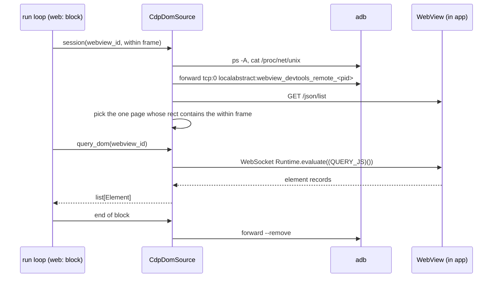

**English** · [日本語](BE-0482-android-webview-cdp-ja.md)

# BE-0482 — Query and tap inside an embedded Android WebView over CDP

<!-- BE-METADATA -->
| Field | Value |
|---|---|
| Proposal | [BE-0482](BE-0482-android-webview-cdp.md) |
| Author | [@0x0c](https://github.com/0x0c) |
| Status | **Approved** |
| Tracking issue | [Search](https://github.com/bajutsu-e2e/bajutsu/issues?q=is%3Aissue+label%3Aroadmap-tracking+in%3Atitle+"BE-0482") |
| Topic | Platform support |
<!-- /BE-METADATA -->

## Introduction

A WebView is a browser view that a native app embeds. A scenario's `web:` block runs its inner
steps against the Document Object Model (DOM) of such a view. On iOS that block works today. On
Android it fails at run time, because nothing on Android serves the page's DOM to bajutsu.

We propose a second implementation of the `DomSource` interface for Android. It reaches the WebView
over the Chrome DevTools Protocol (CDP). The existing `WebContextDriver` then runs unchanged on
Android. The same `web:` scenario passes on both platforms. The `webView` row of the parity table
loses its Android gap.

## Motivation

A hybrid app renders part of its UI in a WebView. On iOS, bajutsu reads that part through the
BajutsuKit WebView bridge. [BE-0037](../BE-0037-webview-hybrid-support/BE-0037-webview-hybrid-support.md)
added that bridge. The bridge is a Hypertext Transfer Protocol (HTTP) server inside the app. It finds the `WKWebView` by its accessibility
identifier, evaluates a DOM-walking script in the page, and returns one record per element. A
`web:` block hands those records to `WebContextDriver`, which resolves selectors against them.

Android has no such bridge. The run loop still allocates a bridge port for Android and passes it as
`BAJUTSU_WEBVIEW_PORT`. Android's `reach_device_port` forwards nothing, though, and no app-side
server listens on the port. A `web:` block on Android thus fails with "WebView bridge
unreachable". A scenario author falls back to the accessibility tree. That tree often exposes a
WebView's content too coarsely to select by: a missing `data-testid`, a merged text node, or no
node at all.

Android already ships a channel into its WebViews. Every Android WebView with debugging enabled
listens on an abstract local socket named `webview_devtools_remote_<pid>`. `adb forward` can bring
that socket to a host port. The socket speaks CDP, the protocol behind Chrome DevTools. CDP offers
what `DomSource` needs: evaluate a script in the page, and dispatch input at a point.

After this item ships, one `web:` scenario in the showcase passes on the iOS twin and the Android
twins without a per-platform branch. The `webView` row of `docs/platform-parity.md` reads
"per-run" for Android, where it reads "gap" today. A reader can check both facts directly.

## Detailed design

The design adds one Python `DomSource`, one block-scoped method on the `DomSource` interface, one
host-side socket step, and one app-side helper. It changes neither `WebContextDriver` nor the
scenario schema.

### A block-scoped session on `DomSource`

Today the `DomSource` methods take a WebView id alone. The step runner's `_handle_web` resolves the
`within` selector against the native tree. It then discards the resolved element and keeps the id
alone. The function lives in `bajutsu/common/orchestrator/loop/_step_runner.py`. The Android
source needs two pieces of information the interface lacks:

- the WebView's frame;
- the start and the end of the block.

`DomSource` gains one method, `session(webview_id, frame)`, which returns a context manager.
`_handle_web` keeps the element that the full `within` selector resolved. It runs the block's inner
steps inside `session(host_id, element["frame"])`. The context manager closes when the block ends,
whether the block passes or fails.

- `WebViewBridge`, the iOS client, returns a context manager that does nothing.
- `CdpDomSource` opens the socket and picks the target on entry, and removes the forward on exit.
- The test fakes gain the same no-op method.

### How the run reaches the WebView

### The CDP DOM source

A new `CdpDomSource` class implements the four query and input methods of `DomSource`. It lives beside the iOS
client, in `bajutsu/common/drivers/webview/`.

| `DomSource` method | CDP call |
|---|---|
| `query_dom` | `Runtime.evaluate` of the existing `QUERY_JS`, invoked as `(QUERY_JS)()` with `returnByValue`, parsed with `parse_dom` |
| `tap_element` | `Input.dispatchTouchEvent`, a `touchStart` then a `touchEnd` at the point |
| `type_text` | A `Runtime.evaluate` that moves the caret to the end of the focused field, then `Input.insertText`, then a `Runtime.evaluate` that dispatches `change` |
| `scroll_to` | `Runtime.evaluate` of a `scrollIntoView` script for the element |

`QUERY_JS` already lives in `bajutsu/common/drivers/dom.py`, shared with the Playwright backend. The
Android source reuses that script, so the records match what the web backend and iOS produce.

A tap needs no conversion to screen coordinates. `WebContextDriver` computes the point in the
WebView's own space. The unit is the Cascading Style Sheets (CSS) pixel. `Input.dispatchTouchEvent` takes a point in
that same space. The page receives trusted touch events through the browser's own input pipeline.
On iOS, the bridge clicks through a script instead, so the event path differs between platforms.
The recorded actuation stays the same: a tap in `cssPixel` at one point.

`Input.dispatchTouchEvent` reports success whatever sits at the point. For that reason,
`tap_element` hit-tests first. It evaluates `document.elementFromPoint` at the same point. When that
call returns nothing, the step fails before `tap_element` sends any touch. The iOS bridge already fails this way,
since its script click needs `elementFromPoint` to resolve. Without the check, `scroll_to` can push the
point out of the viewport. The step would then pass as a tap that actuated nothing.

Typing follows the iOS bridge too. That bridge appends to the field's value and dispatches both
`input` and `change`. `Input.insertText` inserts at the caret and dispatches `input` alone. The Android
source places the caret at the end first and dispatches `change` afterwards. One portable scenario
then leaves the same text and fires the same events on both platforms.

### Which WebView a block means

A `web:` block names its WebView with a `within` selector. The selector resolves to one native
element in the adb tree, which carries a frame in device pixels. `_handle_web` hands that frame to
`session`. CDP's `/json/list` lists one target
per page. For an Android WebView, each target's `description` holds a JavaScript Object Notation
(JSON) object whose fields include these six:

- `attached` and `visible`, two flags;
- `screenX` and `screenY`, the page's origin in device pixels;
- `width` and `height`, the page's size in device pixels.

`CdpDomSource` keeps the targets with both flags true. Among those, it picks the target whose
rectangle contains the native element's frame. Zero matches or two or more fail the step
with a selector error.

The rule tests containment, not equality, because the two rectangles measure different areas.
The adb tree reports a view's bounds clipped to the screen and to every ancestor. CDP reports the
WebView's full, unclipped rectangle. Under an equality rule, a partly hidden WebView would match nothing, though no other
WebView is on screen. A WebView becomes partly hidden when it runs off screen, stays in a scrolling
parent, or sits below a toolbar. Failing on two or more matches follows the prime directive on ambiguous selectors. The match
uses the frame and never the id, since a CDP target carries no native id. The frame comes from the
full `within` selector, so the match sees the same element the native tree resolved.

This rule cannot tell apart two WebViews that overlap, such as a small WebView placed over a larger
one. Both rectangles then contain the frame, and the step fails as ambiguous. Failing here keeps the
run deterministic. A unit test covers a clipped WebView and an overlapping pair.

### The socket, per block

The socket name carries the app's process id (pid). The pid changes whenever the app relaunches, as
it does after an app exit or a `relaunch` step. `CdpDomSource` resolves the socket when `session`
opens, once per `web:` block rather than once per run:

1. List the package's processes with `adb shell ps -A -o PID,NAME`. Keep `<package>` and each
   `<package>:<name>` child. A hybrid app may host its WebView in a separate `android:process`, and
   `pidof <package>` misses that process.
2. List the `webview_devtools_remote_<pid>` sockets in `adb shell cat /proc/net/unix`. Keep each
   socket whose pid belongs to the package. `chrome://inspect` reads the same file.
3. Forward a free host port to each kept socket with `adb forward`. Read each `/json/list`.
4. Apply the containment rule above across the targets of every socket together.
5. Open the WebSocket to the chosen target's `webSocketDebuggerUrl`.

This discovery needs no per-app process name, so the tool stays app-agnostic.

`CdpDomSource` removes the forward when `session` closes, so no forward outlives its block. A missing socket
fails the block with a reason that names the cause. A package process with no socket at all is
the case this reason covers. That reason says the app has not enabled
WebView debugging; the helper below is the fix.

### Wiring into the run

Today `_alloc_webview_bridge` builds an HTTP `WebViewBridge` for every non-web platform. The
function lives in `bajutsu/common/runner/pool.py`. The new code asks the run environment for its `DomSource` instead. iOS
keeps returning the HTTP bridge and its launch variable. Android returns a `CdpDomSource` and sets
no `BAJUTSU_WEBVIEW_PORT`. Apart from the `session` call, `_handle_web` keeps its behavior. It
still fails a block with a clear reason when no source exists. That reason today names
`BAJUTSU_WEBVIEW_PORT`, which Android now leaves unset by design. The new reason names the missing
WebView source and drops the variable. It also turns a transport failure into that block's failure reason.

A transport failure can come at two moments. Opening `session` fails when the socket or the
`websockets` package is missing. A `DomSource` call inside the block can fail too. A CDP error response
fails it, and so does a WebSocket that a navigation or an app restart closes. `CdpDomSource` raises one
exception type for each of these, `WebViewTransportError`. `_handle_web` catches that type.

Today no layer catches such an exception. `_handle_web` catches `SelectorError` alone. The inner
step handlers catch `SelectorError`, `ElementNotTappable`, and `AppNotInFront`. The scenario loop in
`bajutsu/common/runner/pipeline.py` catches `BackendCrashError` alone. Any other exception escapes the
run loop and discards every scenario's result, including the ones that already passed.

The `webView` capability stays granted per run, as on iOS. No backend declares it statically.

### The WebSocket client

CDP runs over WebSocket, and the Python standard library has no WebSocket client. The design adds
[`websockets`](https://websockets.readthedocs.io/) as a new optional extra, alongside the `web` extra
that carries Playwright. `CdpDomSource` imports the package on the first `web:` block of an
Android run, and never earlier. A missing package fails that block with the install command in the reason. The import
guard keeps the package off every other path. The `adb` entry of the provisioning requirements map gains the extra. That map lives in
`bajutsu/common/provisioning/requirements/_shared.py`. `scripts/install.sh` then installs the extra
whenever the configured backends include Android. `scripts/serve.sh` delegates to it, so a served
UI gets the extra too. The dev group's `bajutsu[...]` list also gains the extra, so the gate tests
the client.

### The app-side helper

BajutsuAndroid gains `Bajutsu.enableWebViewDebugging()`. It calls
`WebView.setWebContentsDebuggingEnabled(true)`. Like the clipboard receiver, the app calls the
helper from `Application.onCreate`, in a debug or test build alone. Whether a WebView enables
debugging by itself in a debuggable app has varied across WebView versions. An explicit call
removes that dependence, and also covers a non-debuggable test build. The helper's KDoc warns
that any process on the device can then read the page through the socket. That warning keeps the
call out of a release build.

### Work breakdown

The units below are mutually exclusive and, together, cover the design above.

| # | Unit | Scope | Check |
|---|---|---|---|
| 1 | CDP client and `CdpDomSource` | The WebSocket request and response loop, target selection by rectangle, the four `DomSource` methods with the tap hit-test and the caret and `change` handling, and `WebViewTransportError` | Unit tests replay a recorded CDP exchange, with no device, including a tap at a point with no element and a socket closed mid-block |
| 2 | Socket discovery and forwarding | The `ps`, `/proc/net/unix`, and `adb forward` steps, the per-block lifetime, and the missing-socket reason | Unit tests cover the command lines, a WebView in a `<package>:<name>` process, and the error reason |
| 3 | Run wiring | The `session` method on `DomSource`, its no-op in `WebViewBridge` and the fakes, `_handle_web` opening it with the resolved frame, and the no-source reason rewritten without `BAJUTSU_WEBVIEW_PORT`; the environment hook that supplies a `DomSource`, with iOS unchanged and Android returning `CdpDomSource` | A step-runner test asserts that `session` receives the resolved frame, closes on a failing block, and that a missing socket fails its block alone; a `tests/runner/test_pool.py` case asserts that Android sets no `BAJUTSU_WEBVIEW_PORT` and receives a `CdpDomSource` |
| 4 | Optional extra and provisioning | The `websockets` extra in `pyproject.toml`, the lock refresh, the import guard, the extra on the `adb` entry of the provisioning requirements map, and the extra in the dev group's `bajutsu[...]` list | `make check`, including `lock-check` and the import guard test |
| 5 | BajutsuAndroid helper | `Bajutsu.enableWebViewDebugging()` and its KDoc | The showcase apps call the helper and build |
| 6 | Showcase | A WebView screen in the iOS showcase and in both Android twins (Compose and Views), plus one portable `web:` scenario that taps and types inside the WebView | The scenario passes on-device on both platforms; this run is the item's acceptance check |
| 7 | Docs | The `webView` mark in `docs/platform-parity.md` and in the capability table of `docs/drivers.md`; the `web:` reference in `docs/scenarios.md`; the Android setup notes for the helper; each with its `docs/ja/` mirror | `tests/test_platform_parity.py` passes against the new marks |

## Alternatives considered

| Option | Summary | Why we did not adopt it |
|---|---|---|
| An injected bridge in BajutsuAndroid | Port the BajutsuKit HTTP server to Kotlin. Find the WebView by a view id, then run the same scripts through `evaluateJavascript`. The Python side reuses `WebViewBridge` unchanged. | Adds a hand-written HTTP server to the app library. The app must also start it. CDP already exposes the page, so a second server duplicates a channel Android provides. |
| Accessibility tree alone | Select WebView content from the native tree, with no new code. | Selectors are often ambiguous or missing for WebView content. That gap is the problem this item solves. |
| Match a page by an in-page marker | Ask each CDP target for a value the app stores in the page, such as a meta tag. Compare it with the `within` id. | Exact even for overlapping WebViews, but every page must carry the marker. We would switch to this rule if overlapping WebViews prove common. |
| Tap through a script click | Run `elementFromPoint(...).click()` through `Runtime.evaluate`, as iOS does. | The event is untrusted, and it skips `touchstart`. Pages that listen for touch events would not react. |
| Tap with `adb shell input tap` | Convert the DOM rectangle to device pixels, then send a real touch. | The conversion depends on the device pixel ratio, page zoom, and scroll. Each one is a source of drift. CDP input needs no conversion. |
| `websockets` as a base dependency, or a hand-written client | Ship the client with every install, or write a minimal client on the standard library. | A base dependency reaches users who never drive Android. A hand-written client leaves this project to maintain a protocol implementation. |

## Progress

> Keep this current as work proceeds. The checklist mirrors the MECE work breakdown in
> *Detailed design* (one box per unit of work); the log records what changed and when
> (oldest first), linking the PRs.

- [ ] CDP client and `CdpDomSource`
- [ ] Socket discovery and forwarding
- [ ] Run wiring
- [ ] Optional extra and provisioning
- [ ] BajutsuAndroid helper
- [ ] Showcase screens and a portable `web:` scenario
- [ ] Docs (`platform-parity`, `drivers`, `scenarios`, en and ja)

## References

- [BE-0037](../BE-0037-webview-hybrid-support/BE-0037-webview-hybrid-support.md) — the iOS WebView
  bridge and `WebContextDriver`.
- [Issue #2398](https://github.com/bajutsu-e2e/bajutsu/issues/2398) — the Android `webView` gap this
  item closes.
- [`docs/platform-parity.md`](../../docs/platform-parity.md) — the parity table whose `webView` row
  this item changes.
- [Chrome DevTools Protocol](https://chromedevtools.github.io/devtools-protocol/) — the `Runtime`
  and `Input` domains.
- [Remote debugging WebViews](https://developer.chrome.com/docs/devtools/remote-debugging/webviews)
  — `setWebContentsDebuggingEnabled` and the debugging socket.
