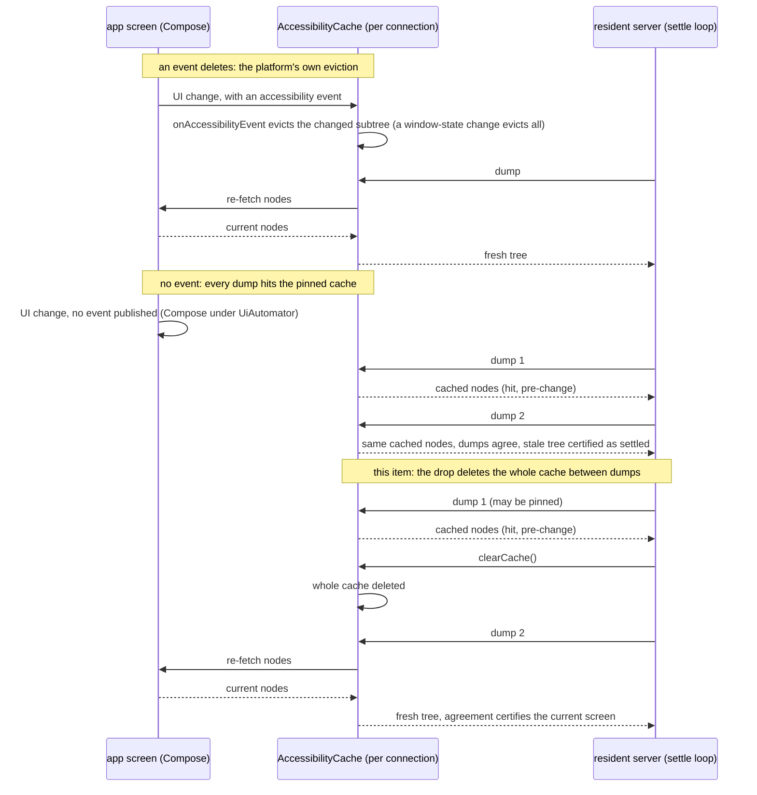

[English](BE-0490-adb-accessibility-cache-drop.md) · **日本語**

# BE-0490 — 常駐サーバの settle 読み取りの合間にプラットフォームのアクセシビリティキャッシュを破棄する

<!-- BE-METADATA -->
| 項目 | 値 |
|---|---|
| 提案 | [BE-0490](BE-0490-adb-accessibility-cache-drop-ja.md) |
| 提案者 | [@0x0c](https://github.com/0x0c) |
| 状態 | **実装済み** |
| トラッキング Issue | [検索](https://github.com/bajutsu-e2e/bajutsu/issues?q=is%3Aissue+label%3Aroadmap-tracking+in%3Atitle+"BE-0490") |
| 実装 PR | [#2451](https://github.com/bajutsu-e2e/bajutsu/pull/2451)（ユニット 1〜5） |
| トピック | プラットフォーム対応 |
<!-- /BE-METADATA -->

## はじめに

常駐 UI Automator サーバ（[BE-0245](../BE-0245-adb-resident-uiautomator-server/BE-0245-adb-resident-uiautomator-server-ja.md)）は、ホストからの読み取りに応答します。
応答では、連続する2回のダンプが一致するまでウィンドウ階層をダンプし続けます。
本項目では、2回のダンプの一致を **settle** と呼びます。
ホストは、settle したツリーを現在の画面として扱います。
しかし、ダンプの背後にあるプラットフォームのキャッシュが、この推論を弱めます。
Android は、接続ごとにアクセシビリティノードのキャッシュを保持します。
本項目では、このキャッシュを **AccessibilityCache** と呼びます。
AccessibilityCache の項目を無効化する引き金は、アクセシビリティイベントだけです。
イベントを生まない変更は、キャッシュ済みノードをそのまま残します。
そのため、連続する2回のダンプが一致しても、両方のダンプが固定された同じキャッシュを書き出しているだけかもしれません。
一致が証明するのは、観測したツリーが変化を止めたことです。
一致は、観測したツリーが現在の画面であることまでは証明しません。

codegen ターゲットは、生成したテストの読み取りを固定されたキャッシュからすでに守っています。
生成した UI Automator テストは、各 wait を 500 ミリ秒の区間に区切ります。
生成したテストは、区間の合間に `UiAutomation.clearCache()` で AccessibilityCache を破棄します。
このプラットフォーム呼び出しは API 34 で追加されました。
そのため、生成したテストは API 34 以上でのみ破棄を適用します。
一方、ランタイムの adb 経路には同等の防御がありません。
常駐サーバもホストドライバも、AccessibilityCache を破棄しません。

本項目は、codegen 側の防御を常駐サーバへ持ち込みます。
常駐サーバは、settle ループの読み取りの合間に AccessibilityCache を破棄します。
破棄は API 34 以上で適用します。
settle の意味は、破棄によって再取得を強いられた2回のダンプの一致へ変わります。
API 33 以下は対象外とします。
対象外とする理由は、代替案の節に記録します。

## 動機

AccessibilityCache は、アクセシビリティイベントに応答して項目を無効化します。
無効化の引き金はイベント以外にありません。
プラットフォームの実装（`AccessibilityCache.onAccessibilityEvent`）は、イベント種別ごとに消去範囲を決めます。
ウィンドウ内容の変更は、変更されたサブツリーを消去します。
スクロールは、スクロールしたサブツリーを消去します。
ウィンドウ状態の変更は、キャッシュ全体を消去します。
イベントを伴わない画面変更は、3つの消去のどれも発動させません。

イベントの欠落は、IPC メッセージの取りこぼしのような稀な事故だと考える読者もいるかもしれません。
しかし Jetpack Compose では、イベントの欠落が通常の状態です。
Compose のアクセシビリティデリゲートは、アクセシビリティサービスが有効な場合にイベントを送信します。
このデリゲートは、UI Automator を有効なサービスの判定から意図的に除外しています。
除外こそが仕組みであり、デリゲートは UI Automator だけが接続した状態ではセマンティクスの変更通知を省略します。
このリポジトリ自身のレーンでは、Compose アプリがタップされた要素自身のイベントを公開した観測があります（[BE-0332](../BE-0332-read-lag-barrier/BE-0332-read-lag-barrier-ja.md)）。
クリックイベントは、テキストが変わったノードを消去しません。
そのため、この観測があっても隙間は残ります。
キャッシュが失うのは、変更そのものに対する消去イベントです。
Google の Issue Tracker は、イベント待ちの呼び出しへの影響を記録しています（Issue 342316793）。
Macrobenchmark の `scrollUntil` は、Compose アプリからスクロールイベントを受け取れずにタイムアウトしました。
イベントの沈黙は、AccessibilityCache から唯一の無効化の引き金も奪います。

常駐サーバは、現在はこのような画面を settle 済みと認定してしまいます。
`ResidentServerTest.kt` の settle ループは、ダンプした XML 全体をバイト単位で比較します。
キャッシュが固定されていれば、ダンプはバイト単位で一致します。
ループは、変更前のツリーを settle 済みとして返します。
ホストは、settle したツリーを2か所で利用します。
ホストの settle は、ツリーのキーを静止を証明済みのキーとして記録します（[BE-0351](../BE-0351-adb-settle-proven-key/BE-0351-adb-settle-proven-key-ja.md)）。
固定されたツリーは、証明済みのキーに許される高速経路を得てしまう場合があります。
`/act` 経路は、タッチを注入する前に同じループで対象の境界を settle します。
固定されたダンプは、すでに要素が離れた位置へジェスチャを向けてしまう場合があります。

防御のコストは、構造によって上限が決まります。
settle は、現在は最大で4回のダンプを実行します（`SETTLE_DUMPS`）。
ダンプの合間の破棄は、1回の読み取りに最大で3回の破棄を加えます。
破棄の回数は、複数回のダンプをすでに支払う読み取りの内側に収まります。
新しい往復も、新しい待機も、長いタイムアウトも、どの読み取りにも増えません。

本項目が約束する観測可能な差分は、狭く、検証できます。
アクセシビリティイベントを伴わない画面変更は、API 34 以上で次の settle 読み取りに現れます。
本項目より前は、同じ読み取りが無関係なイベントの到着まで変更前のツリーを返す場合がありました。
静止した画面は、対象そのものについては引き続き2回のダンプで settle します。
健全な読み取りに、防御が余分なダンプを加えることはありません。
ただし階層全体の比較は無関係なウィンドウも含むため、ダンプの合間のステータスバーの時計の進みが3回目のダンプを加える場合があります。
そのためユニット4は、2回のダンプを対象自身の境界で表明します。

## 詳細設計

設計は5つのユニットからなります。
ユニット1とユニット3が常駐サーバを変更し、ユニット2が対象範囲を固定します。
ユニット4がエミュレータレーンで変更を証明し、ユニット5が文書化します。

| ユニット | 変更内容 | 場所 |
|---|---|---|
| 1 | settle ダンプの合間にプラットフォームのキャッシュを破棄する | `ResidentServerTest.kt` の共有 `settled()` ループ |
| 2 | なし。対象範囲の宣言であり、他のすべての経路を変更しません | — |
| 3 | 読み取りマークの隣にイベント種別を記録する。消去イベントのマークと種別ログ | `ResidentServerTest.kt` のイベントリスナーと `ReadMark` |
| 4 | 鮮度を証明する障害注入ケースと、静止画面の回帰の表明 | Android エミュレータレーン（[BE-0208](../BE-0208-android-emulator-e2e-ci/BE-0208-android-emulator-e2e-ci-ja.md)） |
| 5 | 破棄と API の下限と再確認したイベント種別を文書化する | `docs/drivers.md`、`docs/ja/drivers.md`、`docs/architecture.md` |

### 1. 共有 settle ループの内側でキャッシュを破棄する

一言で言うと、settle ループがダンプし直す前にプラットフォームのキャッシュを捨て、次のダンプにアプリからの再取得を強制します。

常駐サーバに、ヘルパーを1つ追加します。
ヘルパーは、名前と契約の両方で codegen ターゲットのヘルパーを写します。

- ヘルパーは、端末が API 34 以上で動作する場合に `uiAutomation.clearCache()` を呼びます。
- ヘルパーは、API 33 以下では即座に戻ります。
- ヘルパーは `RuntimeException` を捕捉し、警告を記録し、決して例外を投げません。
- 破棄の失敗が失わせるのは1回の読み取りの防御だけであり、読み取り自体は失われません。

ヘルパーの呼び出し箇所は、`ResidentServerTest.kt` の共有 `settled()` ループだけです。
ループは、settle を閉じなかった読み取りの後に、次の読み取りの前にキャッシュを破棄します。
settle の利用側は2つとも、共有の呼び出し箇所から破棄を受け継ぎます。
`settledDump` は、`/source` 向けに階層ダンプ全体を settle します。
`settledActBounds` は、`/act` 向けに対象の境界を settle します。
呼び出し箇所は1つだけであり、2つの利用側が食い違うことはありません。

破棄の配置により、settle の予算には1回のダンプの余裕が生まれます。
最悪の場合は、1回目のダンプが固定されたキャッシュを消費します。
1回目の破棄は、2回目のダンプに再取得を強います。
再取得したダンプは、固定されたダンプと異なります。
2回目の破棄の後の3回目のダンプは、2回目のダンプと一致して settle を閉じます。
4回のダンプ（`SETTLE_DUMPS`）が、この最悪の場合をまかないます。
変化し続ける画面は、引き続き予算を使い切り、最後のダンプを返します。

ダンプの数え方は変えません。
キャッシュの破棄はダンプではないため、`WaitBudget` のダンプ回数を消費しません。
ただし破棄は、同じ締切に対して実時間を消費します。
`capDumpWaits` は残りを次のダンプのアイドル待機に配分するため、ループは予算の確認を破棄の前に置き、再読み取りの分を払えない破棄は省きます。
アイドル待機は、引き続き各再読み取りの前に置きます。
破棄は、アイドル待機と再読み取りの間に置きます。
そのため読み取りは、アイドル待機が静止を宣言したツリーを再取得します。

図は3つの流れを示します。ダンプがキャッシュにヒットする流れ、イベントがキャッシュを削除する流れ、破棄が settle 読み取りの合間にキャッシュ全体を削除する流れです。

### 2. 対象範囲は常駐サーバだけとする

一言で言うと、変更するのは常駐サーバだけで、他のすべての読み取り経路は現在の挙動を保ちます。

本項目が変えるのは、常駐サーバの settle 読み取りとイベント記録だけです。
読み取りマークのゲート（[BE-0332](../BE-0332-read-lag-barrier/BE-0332-read-lag-barrier-ja.md)）は、settle の前で引き続き動作し、変更しません。
マークのゲートは順序を証明します。
順序の証明とは、読み取りが読み取りの引き金となったジェスチャより後であることです。
キャッシュの破棄は完全性を強めます。
完全性とは、一致したダンプが再取得したノードを記述することです。
2つの証明は互いの代わりにならないため、本項目は現在の順序を保ちます。

ホストドライバは変更しません。
ホストの settle の証明済みのキー（[BE-0351](../BE-0351-adb-settle-proven-key/BE-0351-adb-settle-proven-key-ja.md)）は、BE-0351 が与えた意味を保ちます。
キーは、キャッシュの破棄が先行したダンプの上に載るようになります。
本項目が閉じるのは、この隙間です。
一発の `uiautomator dump` へのフォールバックも変更しません。
フォールバックは呼び出しごとに新しい接続を開始するため、キャッシュが1回の読み取りを超えて生きることはありません。

本項目は、設定項目もエンドポイントも追加しません。
設定項目は、鮮度をテスト対象アプリに依存させます。
鮮度をアプリに依存させる設計は、アプリ非依存の原則に反します。
エンドポイントは、settle ループが構造によってすでに行うタイミングの判断をホストへ渡します。
2つの不採用の理由は、代替案の節に全文を記録します。

サポートの下限は API 34 です。
API 34 は、`UiAutomation.clearCache()` を提供する最初のレベルです。
API 33 以下は、本項目の対象外とします。
対象外のレベルの端末では、settle ループは現在と同じ動作をします。
下限は、codegen ターゲットがすでに提供する下限と一致します。

### 3. 常駐サーバのイベント記録を拡張する

一言で言うと、現在のサーバは最後のイベントの時刻だけを覚えていますが、本ユニットではキャッシュを消去するイベントがあったかと、届いたイベントの種別も覚えるようにします。

サーバのイベントリスナーは、現在は1つの記録だけを供給しています。
`ReadMark` は、最新のイベントの端末時刻を保持し、イベント自体は捨てます。
この記録では、どの種別が届いたかを言えません。
ユニット4が必要とするのは、まさにこの区別です。
そのためリスナーは、既存のマークの隣に2つの事実をさらに記録します。
2つの事実は、`ReadMark` の既存のロックの下に置きます。
事実は `UiAutomation` のコールバックスレッドから書かれ、受け付けループのスレッドから読まれます。
読み手はロックの下で有界なログのスナップショットを取り、生きたコレクションを反復しません。
1つ目は、消去イベントのマークです。
消去イベントのマークとは、キャッシュを消去する最新のイベントの端末時刻です。
マークは、端末時刻の隣にイベントのウィンドウ ID も保持します。
そのため、無関係なウィンドウでの消去を、検証対象のウィンドウでの消去と取り違えることはありません。
プラットフォームの対応付けは、ウィンドウ状態の変更、ウィンドウ内容の変更、スクロールで消去を引き起こします。
2つ目は、直近のイベント種別の有界なログです。
このログは、ユニット4の検証のために保持します。
記録は、プラットフォームのキャッシュが消費するのと同じイベントの流れを観測します。
リスナーは同じ接続の上にあり、キャッシュの無効化はその接続へ届いたイベントで動作します。
リスナーは、受け取ったイベントをすべて記録します。
種別やパッケージによる、記録時点の選別はしません。
分類は記録に対して行い、リスナーでは行いません。
そのため、届いたイベントが記録されずに通り過ぎることはありません。
分類は保守的にします。
消去イベントのマークは、消去しないことが確実な種別を除くすべての種別で進みます。
確実な種別とは、プラットフォームの対応付けがイベントの発生元のノードより先を消去せずに扱う種別であり、クリックがフィクスチャにおける例です。
列挙されていない種別、将来の種別、本項目が判断を誤った種別は、フィクスチャの不成立の側に倒れます。
古い読み取りを認定する側に倒れることはありません。
ユニット1の破棄は、この記録を参照しません。
記録に欠落があっても、失敗するのは検証の実行だけです。
本番の読み取りが古くなることはありません。
破棄は無条件だからです。
この保証を保てない場合は、設計を切り替えて構いません。
切り替えの許可は、代替案の節に記録します。
2つの事実は、既存の応答の形に乗せます。
`/source` の応答は、読み取りマークをすでにヘッダーとして刻印しています。
消去イベントのマークも、同じ方法で加わります。
有界なイベント種別ログは、同じ応答の2つ目のヘッダーに乗せます。
そのため、ホスト側の読み手がサーバの記録をプロセス内から見る必要はありません。
本項目は、どちらの事実についてもエンドポイントを追加しません。
既存のマークは変更しません。
マークの値と利用側と、BE-0332 の順序の証明は、現行のままです。
拡張が記録するのは、リスナーがすでに受け取りながら捨てている情報です。

### 4. Android エミュレータレーンで検証する

一言で言うと、イベントを伴わない画面変更が次の settle 読み取りに現れることと、静止した対象が引き続き2回のダンプで settle することを、対象自身の境界でエミュレータレーンで証明します。

Android エミュレータレーン（[BE-0208](../BE-0208-android-emulator-e2e-ci/BE-0208-android-emulator-e2e-ci-ja.md)）に、障害注入のケースを1つ追加します。
ケースは、キャッシュを無効化するアクセシビリティイベントを伏せたまま画面を変えます。
Compose の showcase カウンタは、このケースの自然なフィクスチャです。
UI Automator が接続した Compose 画面は、テキストの変更に対してウィンドウ内容のイベントを公開しません。
ただし、ケースはこの沈黙を前提として鵜呑みにしません。
ケースはまず、ユニット3の消去イベントのマークから自らの前提を表明します。
前提とは、画面の変更の間に、フィクスチャ自身のウィンドウを指す消去イベントが届いていないことです。
マークは各イベントのウィンドウ ID を保持するため、ダンプのすべてに含まれるステータスバーの時計のような無関係なウィンドウでの消去は、フィクスチャを不成立にしません。
フィクスチャのウィンドウに届いた消去イベントは、ケースを通過させるのではなく、フィクスチャの不成立として失敗させます。
前提が立った場合に限って、ケースは読み取りを表明します。
次の settle 読み取りが、API 34 以上で変更後のツリーを返します。
同じ実行で、動機で限定した観測を再確認します。
ケースは、変更の間にフィクスチャが公開するイベント種別を記録します。
種別は、ユニット3が有界な種別ログを刻印する `/source` の2つ目のヘッダーから読みます。
ホスト側のケースが、サーバの記録をプロセス内から見ることはできません。
記録は、従来の観測を確認するか、訂正します。
従来の観測とは、タップされた要素自身のイベントが届き、テキストの変更を覆うウィンドウ内容のイベントは届かないというものです。
ユニット5は、再確認した種別を文書化します。
そのため `docs/ja/drivers.md` の主張は、引き継がれた記録ではなく現在の観測に基づきます。
API 33 以下を表明の対象としません。このレーンが起動するのは API 34 のみであり、対象外のレベルは第2節の範囲どおり、本項目より前の挙動を変更せず、検証もしません。
障害注入レーン（[BE-0305](../BE-0305-driver-resilience-fault-injection/BE-0305-driver-resilience-fault-injection-ja.md)）のハーネスがフィクスチャに合う場合は、このレーンにケースを置きます。

既存の常駐サーバのテストと adb のレーンは、変更なしで通過します。
健全な経路を固定する回帰の表明を追加します。
静止した画面は2回のダンプで settle します。
この表明は、階層全体ではなく対象自身の境界を `settledActBounds` で測ります。
階層全体は SystemUI の時計を含み、分の進みが3回目のダンプに化けるためです。
この表明は、動機に述べたコストの主張を守ります。
対象自身の境界で3回目のダンプが必要になれば、実行の遅延ではなく表明の失敗として現れます。

### 5. ドキュメント

一言で言うと、何が変わったか、何の API レベルからか、レーンで実際に観測したイベント種別をドキュメントに書きます。

`docs/drivers.md` の adb の節に、短い一節を追加します。
日本語のミラーは `docs/ja/drivers.md` に追加します。
一節には、シナリオの作者が必要とする3つの事実を書きます。
常駐経路の settle 読み取りは、ダンプの合間にプラットフォームのアクセシビリティキャッシュを破棄します。
破棄は API 34 以上で適用します。
API 33 以下は、本項目より前の挙動を保ちます。
一節には、ユニット4の実行で再確認した Compose フィクスチャのイベント種別も記録します。
`docs/architecture.md` の Implemented の節には、出荷した挙動を adb のグループに記録します。

### 機械的に確認できる成果

ユニット4の障害注入ケースは、前提の表明が立つ限り、本項目より前のサーバに対して失敗し、ユニット1の後に通過します。
ユニット4の静止画面の表明は、変更の前後を通じて、対象自身の境界で settle を2回のダンプに固定します。
ユニット5が文書化するイベント種別は、ユニット4の実行が記録した種別と一致します。
常駐サーバのテスト一式と adb のエミュレータレーンは、シナリオの編集なしで通過します。
`make check` は緑を保ち、合否の経路は変わりません（大原則1）。

## 検討した代替案

**settle 読み取りの合間ではなく、すべての読み取りの前にキャッシュを破棄する。**
Appium の UiAutomator2 ドライバは、要素の検索とページソースの取得の前に AccessibilityCache を消去します。
この配置は、settle しない読み取りを含むすべてのクエリの1回目の読み取りに、再取得の全コストを支払わせます。
常駐サーバは、読み取りごとのコストを取り除くために存在します（[BE-0234](../BE-0234-adb-run-performance/BE-0234-adb-run-performance-ja.md)）。
settle ループはもともと再読み取りを行うため、ループの読み取りの合間の破棄は、より低いコストで同じ鮮度を得ます。
コストの非対称を理由に、すべての読み取りへの配置は採用しませんでした。
ただし、この不採用は条件付きであり、鮮度は節約に優先します。
ユニット3の保証を保てない場合（プラットフォームの変更でキャッシュの無効化がリスナーの観測できない流れへ移る、保守的な分類を維持できなくなる等）は、後継の項目がこの配置を採用し、読み取りごとのコストを支払って構いません。

**キャッシュ破棄のエンドポイントを追加し、呼び出しのタイミングをホストに委ねる。**
`POST /clear-cache` エンドポイントは、常駐サーバにプロトコルの表面を加えます。
エンドポイントは、タイミングの判断もホストへ移します。
ホストには、サーバが持つダンプ単位の視点がありません。
settle ループは、破棄が効く唯一の瞬間を知っています。
破棄が効く瞬間とは、一致が画面を認定する2回のダンプの合間です。
ループが構造によって判断を行うため、エンドポイントは採用しませんでした。
settle ループの外の読み取り経路が破棄を必要とする場合は、将来の項目がエンドポイントを改めて提案できます。

**リフレクションで API 33 以下のキャッシュにも到達する。**
`UiAutomation.clearCache()` は API 34 で追加されました。
API 34 未満に、サポートされる呼び出しはありません。
androidx.test.uiautomator は、代わりに `AccessibilityInteractionClient.clearCache()` へリフレクションで到達します。
androidx ライブラリは、隠し API の制限のため API 33 以上でリフレクションを諦めています。
リフレクションの経路は、API 32 以下をまかないながら API 33 で失敗します。
API 33 は、下限に最も近いレベルです。
この形のカバレッジを持つレバーは採用せず、本項目の対象を API 34 以上に絞りました。

**最後の読み取り以降にアクセシビリティイベントが届いた場合にだけキャッシュを破棄する。**
Appium は、イベントが届くまでキャッシュのリセットを遅らせるオプトイン設定として、同じ形を提供しています。
この形は、イベントの欠落を画面が変わっていない証拠として扱います。
動機に述べた Compose のケースは、この推論を否定します。
イベントの欠落は、UI Automator が接続した Compose 画面の通常の状態です。
画面が変わったかどうかには関係しません。
ゲートは、イベントが最も乏しい場所に固定を再び持ち込みます。
この理由で、イベントでゲートする破棄は採用しませんでした。

**ダンプの最中にノードを1つずつリフレッシュする。**
サーバは、アクチュエーションとフォーカス探索の経路で、個別のノードにすでに `refresh()` を呼びます。
階層ダンプは一発のシリアライズであり、ダンプにはノードごとのリフレッシュの掛け口がありません。
ノードを1つずつリフレッシュする設計は、ダンプを手作業のツリー走査に置き換えます。
手作業の走査は、読み取りごとのコストがより高くなります。
サポートされる呼び出しで同じ再取得に到達できるため、手作業の走査は採用しませんでした。

## 進捗

> 開発の進行に合わせて常に最新の状態に保ってください。チェックリストは *詳細設計* の MECE な
> 作業分解（作業の単位ごとに 1 つ）に対応し、ログには変更内容と時期（古い順）を PR へのリンクと
> ともに記録します。

- [x] ユニット1 — settle ダンプの合間に常駐サーバの settle ループでプラットフォームのアクセシビリティキャッシュを破棄し、一致したダンプの組を再取得したツリーにする（API 34以上、例外を投げない）
- [x] ユニット2 — 他は何も変えない。ホスト、フォールバック、エンドポイント、設定は現行のままとし、サポートの下限を API 34 とする
- [x] ユニット3 — イベントの時刻だけでなく種別を覚える。既存の読み取りマークの隣に、イベントのウィンドウ ID を保持する消去イベントのマークと有界なイベント種別ログを加え、両方を読み取りマークのロックの下に置く。記録は届いたイベントをすべて取り、消去の分類は既定で消去側に倒す
- [x] ユニット4 — エミュレータレーンで証明する。前提を消去イベントのマークで表明しイベント種別を再確認する、イベントを伴わない障害注入ケースと、settle が引き続き2回のダンプで済む静止画面の表明を追加する
- [x] ユニット5 — 文書化する。破棄と API の下限と再確認したイベント種別を `docs/drivers.md`、`docs/ja/drivers.md`、`docs/architecture.md` に記録する

ログ：

- 2026-11-17 — ユニット 1〜5 をまとめて実装しました（[#2451](https://github.com/bajutsu-e2e/bajutsu/pull/2451)）。
  - 常駐サーバーは、Android 14 以降で settle のダンプのあいだにアクセシビリティキャッシュを捨てます。
  - `GET /source` に、ウィンドウごとの最新の追い出しイベントを示す `X-Bajutsu-Evict-Mark` を付けました。
  - `GET /source` に、有界なイベント種別ログを示す `X-Bajutsu-Event-Log` も付けました。
  - 2 つの記録は、`nativeZ` と同じく、要求に `events=1` が付いたときだけ返します。
  - キャッシュの破棄は、予算が尽きていても読み直しの前に毎回行います。ユニット 1 は予算切れのときに破棄を飛ばす案でしたが、読み直しはどちらでも走ります。破棄を挟まない読み直しは、固定された最初の読み取りと一致しうるからです。

  Android 14 の arm64 エミュレーターで次の 3 点を確かめ、ユニット 3 とユニット 4 の形を変えました。
  - この項目が挙げた Compose の fixture は、イベントを出していました。Compose がミラーした値は、自身の変化に対して `TYPE_WINDOW_CONTENT_CHANGED` を出します。前提の確認は、この fixture を退けました。
  - プラットフォームのキャッシュは、クリックの発生元ノードを取り直します。`AccessibilityCache.onAccessibilityEvent` は `TYPE_VIEW_CLICKED` を文字の変更と同じように扱います。そのためユニット 3 では、クリックを追い出し側に分類しました。
  - そこで fixture を、Compose の conformance 画面に置いた素の View の組にしました。`conformance.withheld` センチネルでこの組を表示します。対象をタップすると、値のビューの報告する値が変わります。タップで届くイベントは対象のクリックだけで、前提の確認はそのクリックだけを許します。

  キャッシュを捨てない場合、鮮度のケースは前提が成り立ったまま失敗し、settle 後の読み取りは古いカウントを返しました。捨てる場合は 3 回中 3 回成功し、静止した対象は 2 回のダンプで settle しました。`e2e-fault-injection` レーン全体の 4 ケースも成功しました。adb の適合性契約も、28 件成功と 2 件スキップで通りました。

## 参考

- `BajutsuAndroidUIAutomatorServer/server/src/androidTest/java/dev/bajutsu/android/server/ResidentServerTest.kt`（`settled()` ループ、`settledDump`、`settledActBounds`）
- `bajutsu/codegen/uiautomator.py`（codegen ターゲットの `clearAccessibilityCache()` ヘルパーと区切られた wait。本項目が移植する先例）
- [BE-0245](../BE-0245-adb-resident-uiautomator-server/BE-0245-adb-resident-uiautomator-server-ja.md)（本項目が settle 読み取りを堅くする常駐 UI Automator サーバ）
- [BE-0332](../BE-0332-read-lag-barrier/BE-0332-read-lag-barrier-ja.md)（settle の前に置かれる順序の証明、読み取りマークのゲート）
- [BE-0351](../BE-0351-adb-settle-proven-key/BE-0351-adb-settle-proven-key-ja.md)（常駐サーバの settle したツリーの上に載る、ホストの settle の証明済みのキー）
- AOSP の `AccessibilityCache.java`（イベントの欠落では決して発動しない、イベント駆動の無効化 `onAccessibilityEvent`）
- Google Issue Tracker の Issue 342316793（イベント待ちの UI Automator の呼び出しへ Compose のアクセシビリティイベントが届かなかった記録）
- Appium UiAutomator2 ドライバの設定（本項目が不採用とする、イベントでゲートする代替案 `deferAccessibilityCacheReset`）
