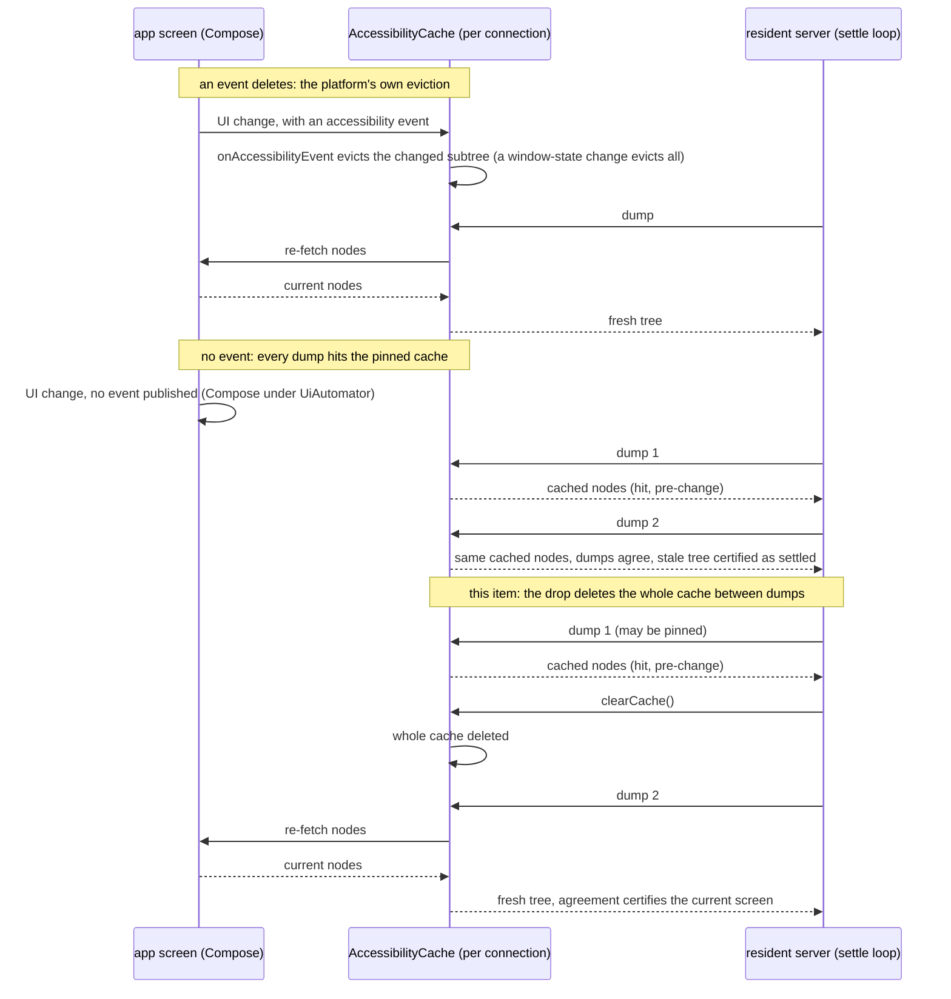

**English** · [日本語](BE-XXXX-adb-accessibility-cache-drop-ja.md)

# BE-XXXX — Drop the platform accessibility cache between the resident server's settle reads

<!-- BE-METADATA -->
| Field | Value |
|---|---|
| Proposal | [BE-XXXX](BE-XXXX-adb-accessibility-cache-drop.md) |
| Author | [@0x0c](https://github.com/0x0c) |
| Status | **Approved** |
| Tracking issue | [Search](https://github.com/bajutsu-e2e/bajutsu/issues?q=is%3Aissue+label%3Aroadmap-tracking+in%3Atitle+"BE-XXXX") |
| Topic | Platform support |
<!-- /BE-METADATA -->

## Introduction

The resident UI Automator server ([BE-0245](../BE-0245-adb-resident-uiautomator-server/BE-0245-adb-resident-uiautomator-server.md))
answers a host read by dumping the window hierarchy until two consecutive dumps agree.
We call that agreement a **settle**, and the host treats a settled tree as the current screen.
The platform cache underneath the dumps weakens that inference.
Android keeps a per-connection cache of accessibility nodes, the **AccessibilityCache**.
An accessibility event is the sole trigger that invalidates entries in the AccessibilityCache.
A change that produces no event therefore leaves the cached nodes untouched.
Two consecutive dumps can then agree because both dumps serialize the same pinned cache.
Agreement proves that the observed tree stopped changing.
Agreement does not prove that the observed tree is the screen.

The codegen target already defends its own reads against the pinned cache.
A generated UI Automator test slices each wait into 500 ms pieces.
The generated test drops the AccessibilityCache between slices, through `UiAutomation.clearCache()`.
That platform call arrived in API 34, so the generated test applies the drop on API 34 and above.
The runtime adb path has no equivalent defense.
Neither the resident server nor the host driver ever drops the AccessibilityCache.

This item brings the codegen defense to the resident server.
The server drops the AccessibilityCache between the reads of its settle loop, on API 34 and above.
A settle then means that two dumps agreed after a cache drop forced the second dump to re-fetch.
API 33 and below stay out of scope, for a reason the Alternatives section records.

## Motivation

The AccessibilityCache invalidates entries in response to accessibility events, and to nothing else.
The platform implementation (`AccessibilityCache.onAccessibilityEvent`) maps each event type to an eviction.
A window-content change clears the changed subtree.
A scroll clears the scrolled subtree.
A window-state change clears the whole cache.
A screen change that arrives without an event triggers none of the three evictions.

A reader might assume that a missing event is a rare accident, such as a dropped IPC message.
Jetpack Compose makes the missing event a normal case.
The Compose accessibility delegate sends events when an accessibility service is active.
The delegate deliberately excludes UI Automator from that check.
The exclusion is the mechanism: the delegate skips semantics-change notifications while UI Automator is the only client.
This repo's own lane has observed a Compose app publish the tapped element's own event ([BE-0332](../BE-0332-read-lag-barrier/BE-0332-read-lag-barrier.md)).
A click event does not evict the node whose text changed, so that observation leaves the gap intact.
What the cache loses is the evicting event for the change itself.
Google's issue tracker records the consequence for event-waiting calls (issue 342316793).
Macrobenchmark's `scrollUntil` received no scroll events from a Compose app and timed out.
The same silence starves the AccessibilityCache of its sole invalidation trigger.

The resident server currently certifies such a screen as settled.
The settle loop in `ResidentServerTest.kt` compares whole dumped XML byte for byte.
A pinned cache yields byte-identical dumps, so the loop returns the pre-change tree as settled.
The host then builds on the settled tree in two places.
The host settle records the tree's key as proven stable ([BE-0351](../BE-0351-adb-settle-proven-key/BE-0351-adb-settle-proven-key.md)).
A pinned tree can therefore earn the fast path that a proven key unlocks.
The `/act` path settles the target's bounds through the same loop before injecting a touch.
A pinned dump can therefore aim a gesture at the position an element has already left.

The cost of the defense is bounded by construction.
A settle performs at most four dumps today (`SETTLE_DUMPS`).
A drop between dumps adds at most three cache drops to one read.
The drop count stays inside the read that already pays for several dumps.
No read gains a new round trip, a new wait, or a longer timeout.

The observable difference this item promises is narrow and checkable.
A screen change that arrives with no accessibility event appears in the next settled read on API 34 and above.
Before this item, the same read could return the pre-change tree until an unrelated event arrived.
A static screen still settles in two dumps, so the defense costs no extra dump on a healthy read.

## Detailed design

The design has five units.
Units 1 and 3 change the resident server, unit 2 fixes the scope, unit 4 proves the change on the emulator lane, and unit 5 documents it.

| Unit | What changes | Where |
|---|---|---|
| 1 | Drop the platform cache between settle dumps | `ResidentServerTest.kt`, the shared `settled()` loop |
| 2 | Nothing: the scope statement that keeps every other path unchanged | — |
| 3 | Record event types beside the read mark: an evicting-event mark and a type log | `ResidentServerTest.kt`, the event listener and `ReadMark` |
| 4 | A fault-injection case that proves freshness, plus a static-screen regression assertion | Android emulator lane ([BE-0208](../BE-0208-android-emulator-e2e-ci/BE-0208-android-emulator-e2e-ci.md)) |
| 5 | Document the drop, the API floor, and the verified event types | `docs/drivers.md`, `docs/ja/drivers.md`, `docs/architecture.md` |

### 1. Drop the cache inside the shared settle loop

In one line: while the settle loop re-dumps, throw the platform cache away before each re-dump, so the next dump must re-fetch the tree from the app.

The resident server gains one helper, mirroring the codegen target's helper in name and in contract:

- The helper calls `uiAutomation.clearCache()` when the device runs API 34 or above.
- The helper returns at once on API 33 and below.
- The helper catches `RuntimeException`, logs a warning, and never throws.
- A failed drop costs the defense for one read, never the read itself.

The helper's sole call site is the shared `settled()` loop in `ResidentServerTest.kt`.
The loop drops the cache after each read that did not close the settle, before the next read.
Both settle consumers inherit the drop from the shared call site.
`settledDump` settles a whole hierarchy dump for `/source`.
`settledActBounds` settles the target bounds for `/act`.
No second call site exists, so the two consumers cannot drift apart.

The drop placement makes the settle budget sufficient, with one dump to spare.
The worst case spends the first dump on a pinned cache.
The first drop then forces a fresh second dump, and the fresh dump differs from the pinned dump.
A third dump, after a second drop, agrees with the second dump and closes the settle.
Four dumps (`SETTLE_DUMPS`) cover that worst case.
A screen that keeps changing still exhausts the budget and returns the last dump, as today.

The budget accounting does not change.
A cache drop is not a dump, so the drop takes no dump lap from `WaitBudget`.
The idle wait still precedes each re-read, and the drop lands between the idle wait and the re-read.
The read therefore re-fetches a tree that the idle wait has already declared quiet.

The diagram shows the three flows: how a dump hits the cache, how an event deletes from the cache, and how the drop deletes the whole cache between settle reads.

### 2. Scope: the resident server only

In one line: only the resident server changes, and every other read path keeps today's behavior.

The item changes the resident server's settle reads and its event record, and no other read path.
The read mark gate ([BE-0332](../BE-0332-read-lag-barrier/BE-0332-read-lag-barrier.md)) still runs before the settle, unchanged.
The mark gate proves order: a read postdates the gesture that prompted the read.
The cache drop strengthens wholeness: the agreeing dumps describe re-fetched nodes.
Neither proof substitutes for the other, so the item keeps the two in their current order.

The host driver does not change.
The host settle's proven key ([BE-0351](../BE-0351-adb-settle-proven-key/BE-0351-adb-settle-proven-key.md)) keeps the meaning BE-0351 gave the key.
The key now rests on dumps that a cache drop preceded, which is the gap this item closes.
The one-shot `uiautomator dump` fallback does not change either.
The fallback starts a fresh connection per invocation, so no cache outlives a single read there.

The item adds no configuration knob and no endpoint.
A config knob would make freshness depend on the app under test, against the app-agnostic directive.
An endpoint would hand the host a timing decision that the settle loop already makes by construction.
The Alternatives section records both rejections in full.

The support floor is API 34, the first level that offers `UiAutomation.clearCache()`.
API 33 and below are out of scope for this item.
A device on those levels runs the settle loop exactly as the loop runs today.
The floor matches the floor the codegen target already ships.

### 3. Extend the resident server's event record

In one line: today the server remembers only when the last event happened; this unit also remembers whether a cache-evicting event happened, and which event types arrived.

The server's event listener feeds one record today: `ReadMark` keeps the newest event's device time and discards the event itself.
That record cannot say which types arrived, and unit 4 needs exactly that distinction.
The listener therefore records two more facts beside the existing mark.
The first is an evicting-event mark: the device time of the newest cache-evicting event.
The platform's mapping evicts on a window-state change, a window-content change, or a scroll.
The second is a bounded log of recent event types, kept for the verification in unit 4.
The record observes the same event stream the platform cache consumes.
The listener sits on the same connection, and the cache's invalidation runs on the events that connection delivers.
The listener records every event it receives, with no filtering by type or package.
Classification happens on the record, never at the listener, so no delivered event passes unrecorded.
The classification is conservative: the evicting mark advances on every event type except the types the platform's mapping positively handles without evicting anything, such as a click.
An unlisted type, a future type, or a type this item misjudges therefore fails toward an invalid fixture, never toward a certified stale read.
The drop in unit 1 never consults this record.
A gap in the record can fail a verification run, but it cannot leave a production read stale, because the drop is unconditional.
If this guarantee cannot be kept, the design may pivot: the Alternatives section licenses dropping the cache on every read instead.
Both facts ride the existing response pattern: the `/source` reply already stamps the read mark as a header, and the evicting mark joins it the same way.
The item adds no endpoint for either fact.
The existing mark does not change: its value, its consumers, and the ordering proof of [BE-0332](../BE-0332-read-lag-barrier/BE-0332-read-lag-barrier.md) stay as they are.
The extension records what the listener already receives and currently throws away.

### 4. Verification on the Android emulator lane

In one line: prove on the emulator lane that a screen change with no event now shows up in the next settled read, and that a quiet screen still costs exactly two dumps.

The Android emulator lane ([BE-0208](../BE-0208-android-emulator-e2e-ci/BE-0208-android-emulator-e2e-ci.md)) gains one fault-injection case.
The case changes the screen while withholding the accessibility event that would invalidate the cache.
The Compose showcase counter is the natural fixture for the case.
A Compose screen under a UI Automator connection publishes no window-content event for a text change.
The case does not take that silence on trust.
The case first asserts its own precondition from the evicting-event mark of unit 3: the mark does not advance while the screen changes.
If an evicting event did arrive, the case fails as an invalid fixture instead of passing.
Only with the precondition established does the case assert the read: the next settled read returns the post-change tree on API 34 and above.
The same run re-verifies the observation the Motivation qualified.
The case logs the event types the fixture publishes during the change, from the type log of unit 3.
The log either confirms the recorded observation (the tapped element's own event arrives, and no window-content event covers the text change) or corrects it.
Unit 5 documents the verified types, so the claim in `docs/drivers.md` rests on a current observation instead of a carried-forward one.
No assertion covers API 33 and below: the lane boots API 34 only, so those levels keep the pre-item behavior unchanged and unverified, as §2 scopes them.
The fault-injection lane ([BE-0305](../BE-0305-driver-resilience-fault-injection/BE-0305-driver-resilience-fault-injection.md)) hosts the case if the lane's harness fits the fixture.

The existing resident-server tests and adb lanes pass unchanged.
A regression assertion pins the healthy path: a static screen settles in exactly two dumps.
The assertion guards the cost claim in the Motivation.
A settle that needed a third dump on a static screen would show up as a failing assertion, not as slower runs.

### 5. Documentation

In one line: write down what changed, from which API level, and which event types the lane actually observed.

The adb section of `docs/drivers.md` gains a short passage, with the Japanese mirror in `docs/ja/drivers.md`.
The passage states three facts a scenario author needs.
A settled read on the resident path drops the platform accessibility cache between dumps.
The drop applies on API 34 and above.
API 33 and below keep the pre-item behavior.
The passage also records which event types the unit 4 run verified for the Compose fixture.
The Implemented section of `docs/architecture.md` records the shipped behavior in the adb group.

### Machine-checkable outcome

The fault-injection case in unit 4 fails against the pre-item server whenever its precondition assertion holds, and passes after unit 1.
The static-screen assertion in unit 4 pins the settle at two dumps before and after the change.
The event types unit 5 documents match the types unit 4's run logged.
The resident-server suite and the adb emulator lanes pass with no scenario edits.
`make check` stays green, and no verdict path changes (prime directive 1).

## Alternatives considered

**Drop the cache before every read, not between settle reads.**
Appium's UiAutomator2 driver clears the AccessibilityCache before each element lookup and each page source read.
That placement pays a full re-fetch on the first read of every query, including reads that never settle.
The resident server exists to remove per-read cost ([BE-0234](../BE-0234-adb-run-performance/BE-0234-adb-run-performance.md)).
The settle loop already re-reads, so a drop between the loop's reads buys the same freshness for less.
We rejected the every-read placement on that cost asymmetry.
The rejection is conditional, and freshness outranks the saving.
If the guarantee in unit 3 cannot be kept (a platform change moves the cache's invalidation onto a stream the listener cannot observe, or the conservative classification becomes unmaintainable), a successor item may adopt this placement and pay the per-read cost.

**Add a cache-drop endpoint and let the host decide when to call the endpoint.**
A `POST /clear-cache` endpoint adds protocol surface to the resident server.
The endpoint also moves a timing decision to the host, which lacks the server's dump-by-dump view.
The settle loop knows the one moment a drop matters: between two dumps whose agreement will certify a screen.
We rejected the endpoint because the loop makes the decision by construction.
A future item can propose the endpoint if a read path outside the settle loop needs a drop.

**Reach the cache on API 33 and below through reflection.**
`UiAutomation.clearCache()` arrived in API 34, and no supported call exists below that level.
androidx.test.uiautomator reaches `AccessibilityInteractionClient.clearCache()` by reflection instead.
The androidx library gives the reflection up on API 33 and above, under hidden-API restrictions.
A reflection path would thus cover API 32 and below while failing on API 33, the level nearest the floor.
We rejected a lever with that coverage shape, and scoped the item to API 34 and above.

**Drop the cache when no accessibility event has arrived since the last read.**
Appium offers the same shape as an opt-in setting that defers a cache reset until an event arrives.
The shape treats a missing event as evidence that the screen did not change.
The Compose case in the Motivation disproves that inference.
A missing event is the normal state of a Compose screen under UI Automator, changed or not.
We rejected the event-gated drop because the gate reintroduces pinning where events are scarcest.

**Refresh each node during the dump instead.**
The server already calls `refresh()` on individual nodes along the actuation and focus-walk paths.
A hierarchy dump is a one-shot serialization, and the dump exposes no per-node refresh hook.
Refreshing nodes one by one would replace the dump with a manual tree walk, at a higher per-read cost.
We rejected the manual walk because the cache drop reaches the same re-fetch through the supported call.

## Progress

> Keep this current as work proceeds. The checklist mirrors the MECE work breakdown in
> *Detailed design* (one box per unit of work); the log records what changed and when
> (oldest first), linking the PRs.

- [ ] Unit 1 — Between settle dumps, drop the platform accessibility cache in the resident server's settle loop, so an agreeing pair of dumps is a re-fetched tree (API 34+, never throws)
- [ ] Unit 2 — Change nothing else: host, fallback, endpoints, and configuration stay as they are; support floor API 34
- [ ] Unit 3 — Remember event types, not just event times: add an evicting-event mark and a bounded event-type log beside the existing read mark; the record takes every delivered event, and the evicting classification defaults to evicting
- [ ] Unit 4 — Prove it on the Android emulator lane: a no-event fault-injection case (precondition asserted from the evicting mark, event types re-verified) and a static-screen assertion that settle still takes two dumps
- [ ] Unit 5 — Document it: the drop, the API floor, and the verified event types in `docs/drivers.md`, `docs/ja/drivers.md`, and `docs/architecture.md`

## References

- `BajutsuAndroidUIAutomatorServer/server/src/androidTest/java/dev/bajutsu/android/server/ResidentServerTest.kt` — the `settled()` loop, `settledDump`, and `settledActBounds`.
- `bajutsu/codegen/uiautomator.py` — the codegen target's `clearAccessibilityCache()` helper and sliced wait, the precedent this item ports.
- [BE-0245](../BE-0245-adb-resident-uiautomator-server/BE-0245-adb-resident-uiautomator-server.md) — the resident UI Automator server whose settle reads this item hardens.
- [BE-0332](../BE-0332-read-lag-barrier/BE-0332-read-lag-barrier.md) — the read mark gate, the order proof that stays ahead of the settle.
- [BE-0351](../BE-0351-adb-settle-proven-key/BE-0351-adb-settle-proven-key.md) — the host settle's proven key, which rests on the resident server's settled trees.
- AOSP `AccessibilityCache.java` — the event-driven invalidation (`onAccessibilityEvent`) that a missing event never triggers.
- Google issue tracker, issue 342316793 — the recorded case of Compose accessibility events not reaching an event-waiting UI Automator call.
- Appium UiAutomator2 driver settings — the `deferAccessibilityCacheReset` setting, the event-gated alternative this item rejects.
